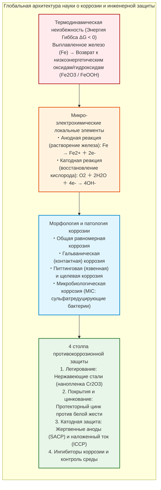
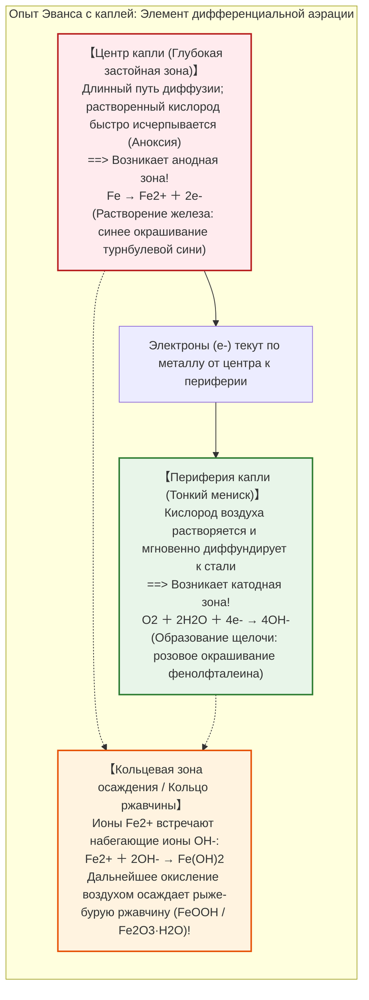
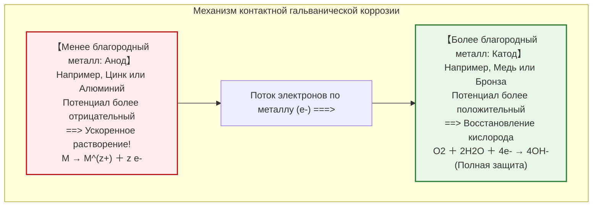
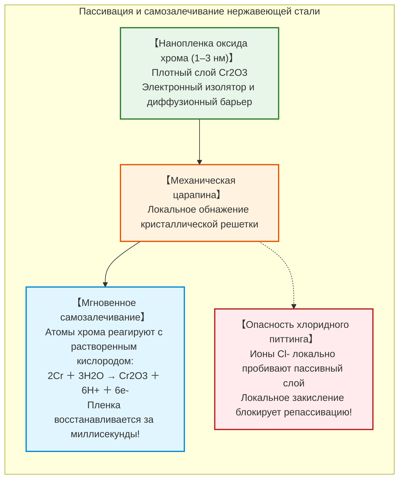

## Введение: Термодинамическая неизбежность возвращения железа в землю

Железо ($\text{Fe}$) — конструкционный остов современной человеческой цивилизации. От каркасов небоскребов и трансконтинентальных рельсовых магистралей до супертанкеров водоизмещением в сотни тысяч тонн, глубоководных нефтепроводов высокого давления и коммунальных водоводов: на железо и сталь приходится **более 95% всего объема металлов, производимых и потребляемых на Земле** (около 1,9 млрд тонн ежегодно).

Однако с первой же миллисекунды металлургического рождения на этом ключевом конструкционном материале лежит неумолимое химическое проклятие: **коррозия, в быту именуемая ржавлением**.

Незащищенная стальная балка под дождем за считанные дни покрывается слоистыми рыжевато-бурыми оксидами. Корпус судна в морской воде изъязвляется язвами питтинга. По данным Ассоциации по защите и характеристикам материалов (AMPP, ранее NACE International), совокупный ежегодный экономический ущерб от коррозии металлов в мире превышает **2,5 триллиона долларов США** — это колоссальные **3,4% мирового валового внутреннего продукта (ВВП)**.

Почему железо ржавеет с таким неотвратимым упорством?

С точки зрения химической термодинамики ответ предельно ясен: **для металлического железа ржавление — это наиболее естественный, энтропийно выгодный и термодинамически устойчивый путь возвращения к равновесию.**

В земной коре железо не существует в виде самородного свободного металла $\text{Fe}^0$. Оно надежно заперто в кислородных рудах (гематит $\text{Fe}_2\text{O}_3$, магнетит $\text{Fe}_3\text{O}_4$), где атомы прочно связаны с кислородом при минимальном запасе энтальпии. Чтобы получить чистое металлическое железо, человечество построило доменные печи, затрачивая колоссальную тепловую энергию ($> 1500^\circ\text{C}$) для насильственного отрыва кислорода.

В результате выплавленное металлическое железо пребывает в **термодинамически нестабильном высокоэнергетическом состоянии**. Подчиняясь Второму закону термодинамики (стремлению к максимальной энтропии и минимуму свободной энергии Гиббса), железо непрерывно стремится сбросить эту энергию. При контакте с водой и кислородом оно самопроизвольно окисляется ($\Delta G < 0$), возвращаясь в устойчивое минеральное состояние. Ржавчина — это естественный процесс возвращения металла в камень.



---

## Глава 1: Электрохимия в капле воды — Локальные микроэлементы

Невооруженному глазу кажется, что сталь под дождем окисляется непосредственно кислородом воздуха. Высокоточные электрохимические исследования доказывают иное:

**Ржавление железа — это короткозамкнутая электрохимическая реакция аккумулятора.** На поверхности металла самопроизвольно зажигаются миллионы микроскопических гальванических пар — **локальных элементов**, обеспечивающих непрерывный перенос электронов и ионов.

### 1.1 Опыт с каплей Эванса и дифференциальная аэрация

В 1920-х годах британский электрохимик Юлик Ричардсон Эванс в Кембриджском университете поставил классический опыт.

Эванс поместил каплю слабого раствора соли ($\text{NaCl}$) на полированную стальную пластину, добавив фенолфталеин (индикатор гидроксид-ионов $\text{OH}^-$) и красную кровяную соль (гексацианоферрат(III) калия, индикатор ионов $\text{Fe}^{2+}$).

Если бы коррозия протекала однородно, окрашивание было бы равномерным. Результат показал обратное:



Этот опыт открыл принцип **дифференциальной аэрации**: растворение железа (анодный процесс) происходит там, где кислорода меньше всего (в глубине капли), а катодный процесс восстановления кислорода локализуется у краев.

### 1.2 Стадии химических реакций

$$\text{Анодное окисление: } \text{Fe} \to \text{Fe}^{2+} + 2e^-$$

$$\text{Катодное восстановление: } \text{O}_2 + 2\text{H}_2\text{O} + 4e^- \to 4\text{OH}^-$$

Образующийся белый гидроксид железа(II) $\text{Fe(OH)}_2$ немедленно окисляется:

$$4\text{Fe(OH)}_2 + \text{O}_2 + 2\text{H}_2\text{O} \to 4\text{Fe(OH)}_3 \downarrow$$

Конечными фазами становятся оксигидроксиды (гетит $\alpha\text{-FeOOH}$, лепидокрокит $\gamma\text{-FeOOH}$) и оксиды (магнетит $\text{Fe}_3\text{O}_4$, гематит $\text{Fe}_2\text{O}_3$).

Из-за **соотношения Пиллинга-Бедворта** удельный объем образующейся ржавчины **в 2–3 раза больше** объема израсходованного металла. Внутренние механические напряжения растрескивают пленку, открывая путь кислороду и воде вглубь металла.

---

## Глава 2: Термодинамика и диаграмма Пурбе

Бельгийский ученый Марсель Пурбе систематизировал электрохимическое поведение железа в **диаграммах потенциал-pH (диаграммах Пурбе)**:
1. **Область иммунитета** ($E < -0{,}6\,\text{В}$): Металлическое железо термодинамически устойчиво; коррозия физически невозможна. Это фундамент **катодной защиты**.
2. **Область коррозии**: Железо активно растворяется в виде гидратированных ионов $\text{Fe}^{2+}$, $\text{Fe}^{3+}$ или $\text{HFeO}_2^-$.
3. **Область пассивности**: Образуются компактные нерастворимые оксидные пленки, резко снижающие скорость коррозии (например, в поровой жидкости бетона при $\text{pH} \approx 13$).

---

## Глава 3: Контактная коррозия и катастрофа соотношения площадей

При электрическом контакте разнородных металлов в проводящем электролите металл с более отрицательным потенциалом становится анодом и подвергается ускоренному разрушению.



### Критическое отношение площадей: $A_\text{Катод} / A_\text{Анод}$

Плотность анодного тока пропорциональна отношению площадей:

$$i_\text{Анод} = i_\text{Катод} \times \left( \frac{A_\text{Катод}}{A_\text{Анод}} \right)$$

Стальные заклепки на обширных медных листах ($A_\text{Катод} \gg A_\text{Анод}$) растворяются и срезаются коррозией в течение считанных недель.

---

## Глава 4: Нержавеющая сталь и нанометровый пассивный слой

Легирование стали хромом в количестве не менее **10,5% ($\text{Cr}$)** приводит к спонтанному образованию плотной самозалечивающейся нанопленки оксида хрома ($\text{Cr}_2\text{O}_3$) толщиной всего 1–3 нанометра.



В морской воде с высокой концентрацией хлорид-ионов ($\text{Cl}^-$) возможен локальный пробой пленки с образованием язв (**питтинг**). Добавление 2–3% молибдена ($\text{Mo}$) кардинально повышает стойкость к питтингу (морская нержавеющая сталь AISI 316).

---

## Глава 5: Оцинковка и катодная защита

### 5.1 Оцинкованная сталь против Белой жести

- **Оцинкованная сталь**: Цинк более электроотрицателен, чем железо ($E^\circ = -0{,}76\,\text{В}$). При царапине цинк становится **жертвенным анодом**, отдавая электроны и защищая обнаженную сталь на расстоянии.
- **Белая жесть (олово)**: Олово благороднее железа ($E^\circ = -0{,}14\,\text{В}$). При повреждении оловянной пленки обнажившееся железо становится крошечным анодом в паре с огромным оловянным катодом, быстро разрушаясь точечной коррозией.

### 5.2 Системы катодной защиты (CP)

```mermaid
flowchart TD
    subgraph CathodicSystems["Системы катодной защиты инфраструктуры"]
        direction TB
        subgraph SACP["1. Протекторная защита жертвенными анодами (SACP)"]
            SACP_Block["Слитки сплавов Цинка или Алюминия, приваренные к корпусу"]
            SACP_Block -->|Самопроизвольный ток электронов| SACP_Hull["Корпус судна поляризован как катод"]
        end
        
        subgraph ICCP["2. Катодная защита наложенным током (ICCP)"]
            ICCP_Gen["Источник постоянного тока (Выпрямитель)"]
            ICCP_Anode["Малоизнашиваемые титановые аноды (MMO), заглубленные в грунт"]
            ICCP_Pipe["Трансконтинентальный трубопровод под защитным потенциалом"]
            ICCP_Gen -->|Плюс (+)| ICCP_Anode
            ICCP_Gen -->|Минус (-)| ICCP_Pipe
        end
    end
    
    style SACP fill:#e1f5fe,stroke:#0288d1,stroke-width:2px
    style ICCP fill:#e8f5e9,stroke:#2e7d32,stroke-width:2px
```

1. **Жертвенные протекторы (SACP)**: Блоки цинка или алюминия на корпусах судов и морских платформах, растворяющиеся для защиты стали.
2. **Защита наложенным током (ICCP)**: Сети выпрямителей и титановых анодов с оксидным покрытием (MMO), защищающие тысячи километров магистральных трубопроводов.

---

## Глава 6: Микробиологическая коррозия и коррозионное растрескивание

- **Сульфатредуцирующие бактерии (СРБ)**: В бескислородных грунтах они окисляют водород с катодных участков и продуцируют сероводород ($\text{H}_2\text{S}$), образуя сульфид железа ($\text{FeS}$), ускоряющий питтинг до нескольких миллиметров в год.
- **Коррозионное растрескивание под напряжением (КРН / SCC)**: Совместное действие растягивающих механических напряжений и специфической коррозионной среды вызывает мгновенное хрупкое разрушение деталей без заметных пластических деформаций.

---

## Заключение: Вечная битва инженерии с энтропией

Железо — базис современной цивилизации. Однако каждая стальная конструкция существует в постоянном термодинамическом напряжении с окружающей средой. Ржавление — это неумолимый закон природы, стремящейся вернуть металл в состояние минерала.

С помощью электрохимии, наноразмерных пассивных пленок и катодной защиты инженерная мысль ежедневно сдерживает энтропию, сохраняя материальный мир человечества.
