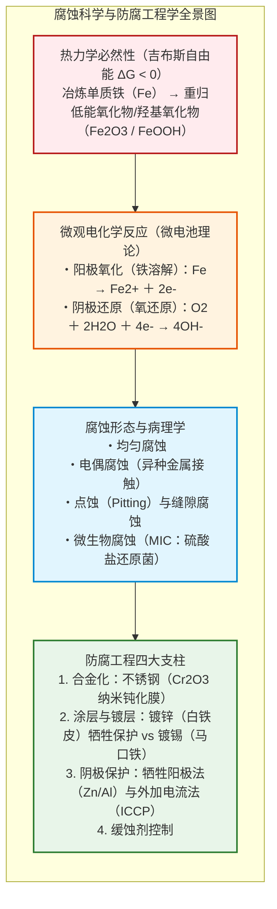
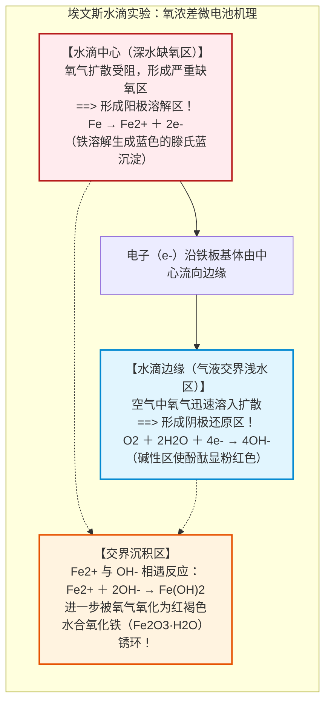
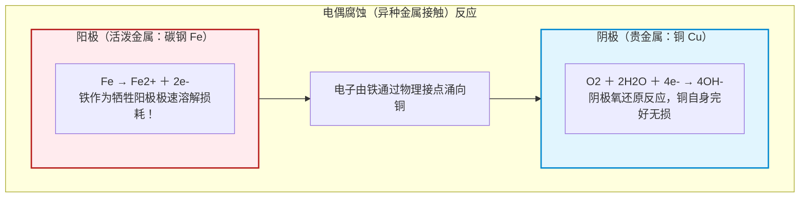
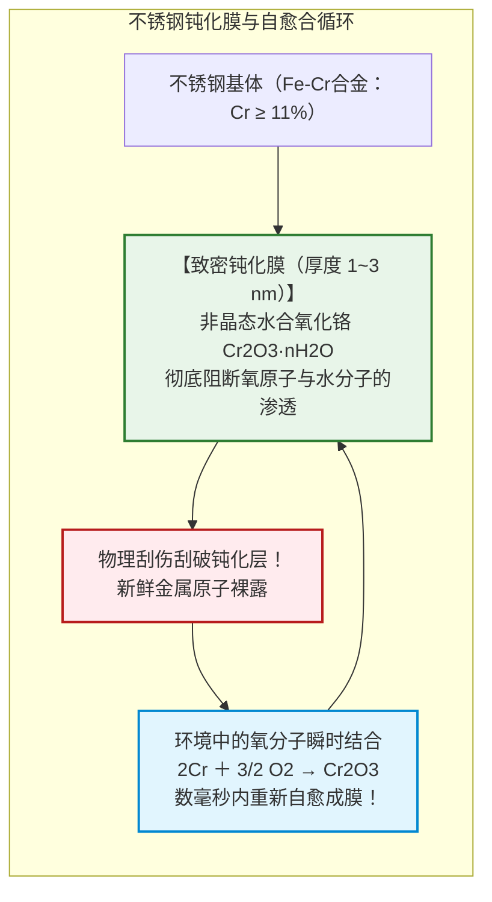
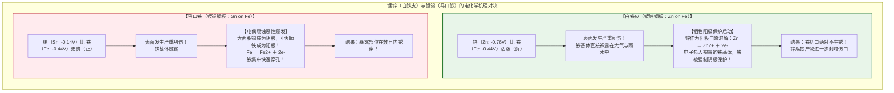
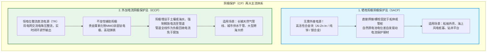

## 引言：铁“重归大地”的热力学宿命

铁（$\text{Fe}$）是人类文明的骨骼。从摩天大楼的钢柱、纵横大陆的铁轨，到数十万吨级的远洋油轮、地下的给排水与天然气管网，钢铁占据了全球金属总产量的**95%以上（每年约19亿吨）**。

然而，自炼成之日起，这种结构材料便背负着无法摆脱的物理诅咒——**腐蚀（Corrosion），即“生锈（Rust）”**。

未经防护的钢梁在雨水中数日即可泛出红褐色锈斑，海风中的船体被蚀孔击穿，埋地水管破损漏水。据国际权威组织统计，全球因金属腐蚀造成的直接与间接经济损失**每年高达2.5万亿美元（约占全球GDP的3.4%）**。

铁为何必然生锈？从热力学角度而言：**对铁来说，“生锈”才是其重回宇宙中最低能量稳定态的最自然归宿。**

自然界的铁均以氧化铁（如赤铁矿 $\text{Fe}_2\text{O}_3$、磁铁矿 $\text{Fe}_3\text{O}_4$）等低能矿石形态存在。人类耗费巨量能量在炼铁高炉中将其强制还原为金属铁（$\text{Fe}^0$）。这使金属铁蓄积了极高的吉布斯自由能，处于亚稳态。在水与氧气存在时，铁自发发生氧化反应（$\Delta G < 0$），释放能量并重归氧化物状态。生锈，是一场金属重归岩土的能量释放回归。

---

## 第一章：水滴里的电化学——微观“局所电池”

铁在潮湿空气中的生锈并非纯粹的气固直接氧化，而是**表面形成了无数个短路的微观化学电池（局所电池：Local Cell）**。

### 1.1 埃文斯水滴实验与氧浓差电池

1920年代，英国剑桥大学的“现代腐蚀科学之父”乌利克·埃文斯（U. R. Evans）进行了一项划时代的实验：在平整的铁板上滴上一滴含有酚酞与铁氰化钾指示剂的食盐水滴。

实验表明，水滴下的铁并没有均匀锈蚀：
- **水滴边缘（气液界面）**：由于液膜极薄，空气中的氧气极易溶入并扩散至钢表面（富氧区），成为**阴极（正极）**，发生氧还原反应：$\text{O}_2 + 2\text{H}_2\text{O} + 4e^- \to 4\text{OH}^-$。液体呈强碱性，使酚酞显粉红色。
- **水滴中心（深处）**：由于水层较厚，氧气难以补充（缺氧区），成为**阳极（负极）**，铁失去电子熔解：$\text{Fe} \to \text{Fe}^{2+} + 2e^-$。铁离子与铁氰化钾反应生成深蓝色滕氏蓝。

电子在铁基体内部从中心流向边缘。中心扩散出的 $\text{Fe}^{2+}$ 与边缘扩散入的 $\text{OH}^-$ 在中途相遇沉淀出水酸化铁，并被氧气进一步氧化成环状红褐色铁锈。这种因氧浓度差异诱发的腐蚀被称为**“氧浓差电池（Differential Aeration Cell）”**。

### 1.2 普尔贝图（Pourbaix Diagram）

比利时化学家普尔贝（Marcel Pourbaix）绘制的电位-pH图标定了铁的三大热力学状态：
1. **腐蚀区（Corrosion）**：中性偏酸性环境下，铁主要以可溶性 $\text{Fe}^{2+}$ 离子形态溶解崩解。
2. **钝化区（Passivity）**：在碱性（$\text{pH} > 9 \sim 13$）适度氧化电位下，生成 $\gamma\text{-Fe}_2\text{O}_3$ 致密保护膜。
3. **免蚀区（Immunity）**：当电位大幅压低至约 $-0.62\ \text{V vs. SHE}$ 以下时，单质铁（$\text{Fe}^0$）为绝对热力学稳定相，**在此区域内铁在物理化学上绝不可能生锈**。

---

## 第二章：致命的接触——电偶腐蚀（Galvanic Corrosion）

当两种不同电位的金属在电解质中接触时，会产生强烈的原电池反应。**较活泼（电位较负）的金属充当阳极剧烈溶解**，较不活泼的金属充当阴极获得免蚀保护。

海水环境中的电位次序（伏特 vs. SCE）：
- 镁合金（$-1.60\text{V}$） > 锌（$-1.00\text{V}$） > 铝合金（$-0.80\text{V}$） > **碳钢（$-0.65\text{V}$）** > 铜（$-0.35\text{V}$） > 钝态不锈钢（$-0.08\text{V}$） > 钛（$+0.00\text{V}$）。

### 2.1 面积效应的灾难：大阴极与小阳极

电偶电流密度公式：

$$i_a = i_c \cdot \left(\frac{A_c}{A_a}\right)$$

如果将广阔的铜板（巨大阴极 $A_c$）用小小的铁铆钉（微小阳极 $A_a$）固定，铁铆钉的腐蚀电流密度将被放大成百上千倍，数周内铆钉头便会被电解折断。

纽约**自由女神像**在1980年代面临坍塌危机，正是由于外层巨大铜板（阴极）与内部锻铁骨架（阳极）之间的绝缘石棉老化失效，潮湿海风导致铁骨架大面积电偶腐蚀削薄过半，后耗巨资全部更换为双相不锈钢与特氟龙绝缘垫。

---

## 第三章：不锈钢的奇迹——数纳米的自愈钝化膜

1913年哈里·布雷尔利（Harry Brearley）发现，当钢中铬（$\text{Cr}$）含量超过**10.5%~12%**时，钢材表面在大气中会自发形成一层厚度仅**$1 \sim 3$ 纳米的无定形水合氧化铬（$\text{Cr}_2\text{O}_3 / \text{CrOOH}$）致密钝化膜**。

这一钝化膜具有**瞬时自愈（Self-Healing）**特性：即便用刀片将其刮伤，暴露的铬原子也会在数毫秒内再度捕获空气中的氧原子重新成膜封闭伤口。

### 3.1 点蚀（Pitting）与敏化

氯离子（$\text{Cl}^-$）会局部穿透钝化膜缺陷诱发极其隐蔽的点蚀。耐点蚀当量：

$$\text{PREN} = \%\text{Cr} + 3.3 \cdot \%\text{Mo} + 16 \cdot \%\text{N}$$

在 $500 \sim 800^\circ\text{C}$ 焊接加热区，碳与铬化合析出晶界碳化铬（$\text{Cr}_{23}\text{C}_6$），造成“贫铬区”，诱发晶间腐蚀（敏化现象）。现代通常采用超低碳钢（304L）避免此问题。

---

## 第四章：白铁皮 vs 马口铁——牺牲阳极与阻隔防腐的抉择

1. **白铁皮（镀锌）**：锌比铁活泼，破损时锌充当阳极牺牲自己（牺牲阳极保护），并且其溶解产物碱式碳酸锌能封闭伤口，使铁在野外数十年不锈。
2. **马口铁（镀锡）**：锡比铁更不活泼。在空气中划伤后，大阴极（锡）对小阳极（铁）引发剧烈电偶腐蚀迅速穿孔。但因锡无毒且在食品罐头内部完全抽真空脱氧环境下发生电位反转（锡变为阳极），故为罐头内壁的理想材质。

---

## 第五章：守护巨型基建——阴极保护技术（CP）

通过外部向被保护钢结构强制输入直流电子，使其极化电位压低至**$-0.85\ \text{V vs. CSE}$ 以下**，强制将其推入普尔贝图的“免蚀区（Immunity）”，从物理上彻底终止腐蚀。

大型油轮船壳附着铝合金阳极块（牺牲阳极法），数年更换一次。跨国长输埋地管道则使用**外加电流法（ICCP）**，由整流器经MMO钛阳极地床源源不断将电流灌入管道，使其长达数千公里永不锈蚀。

---

## 第六章：极端腐蚀——微生物腐蚀与应力腐蚀开裂

厌氧淤泥中的**硫酸盐还原菌（SRB）**能消耗阴极氢膜加速腐蚀，并代谢出有毒 $\text{H}_2\text{S}$ 反应生成导电的硫化铁（$\text{FeS}$）垢。$\text{FeS}$ 与铁构成微电偶，年均穿孔率达数毫米。

在拉应力与腐蚀介质协同作用下发生的**应力腐蚀开裂（SCC）**，能在远低于屈服强度的低载荷下使高压容器毫无预兆地发生脆性瞬断大爆炸。

---

## 结语：对抗熵增的永恒工程

腐蚀，是大自然热力学第二定律对人类人造世界的永恒挑战。人类抗击腐蚀的历程，凝结了微观电子转移的电化学智慧、不锈钢纳米级自愈钝化膜的冶金成果，以及阴极保护的电磁技术。在无声的微观电子博弈中，现代工程学筑起了守护现代物质文明的牢固长城。
