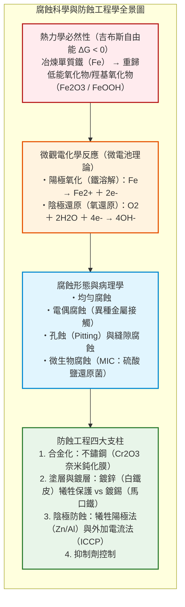
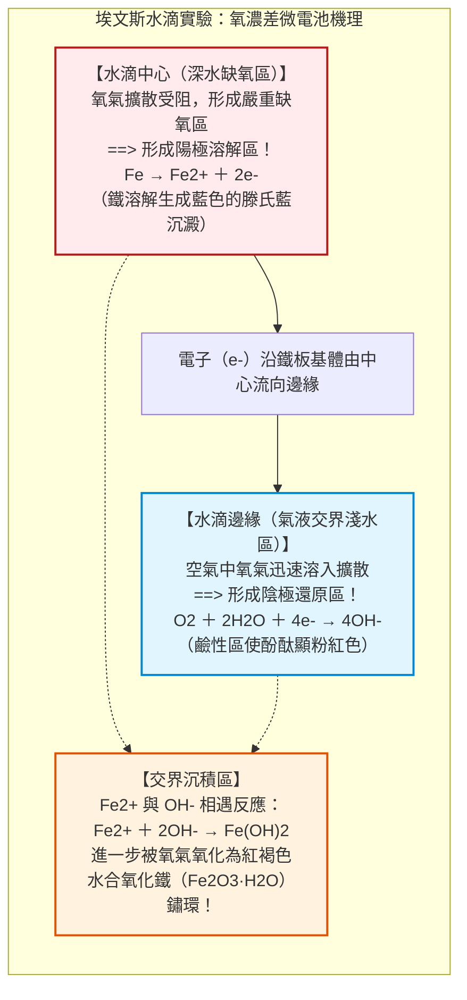
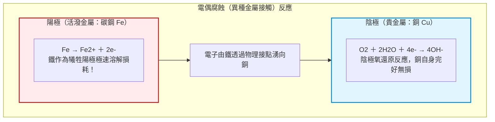
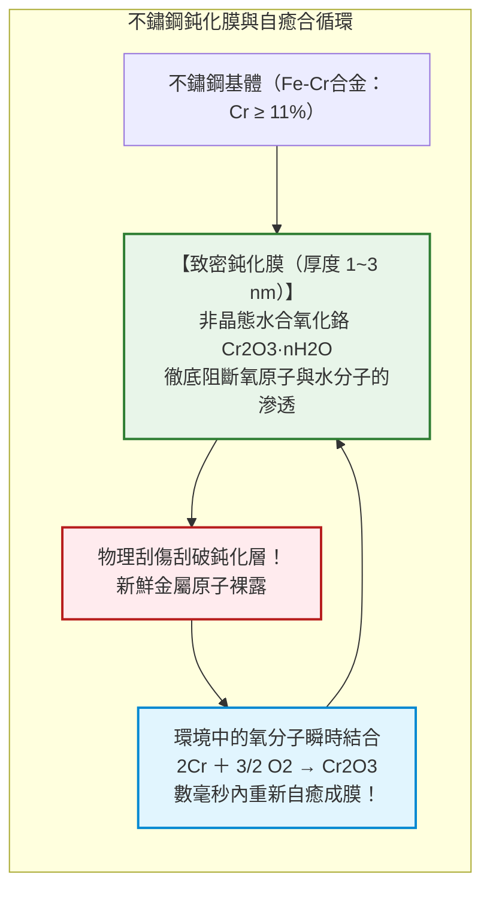
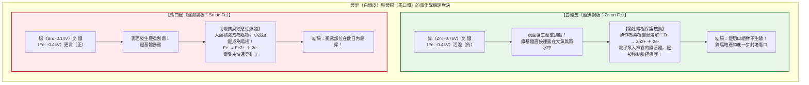
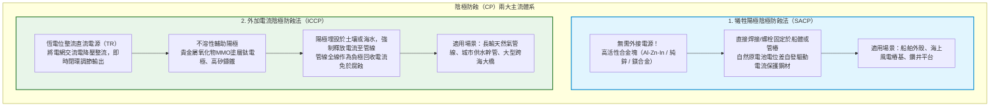

## 引言：鐵「重歸大地」的熱力學宿命

鐵（$\text{Fe}$）是人類文明的骨骼。從摩天大樓的鋼柱、縱橫大陸的鐵軌，到數十萬噸級的遠洋油輪、地下的給排水與天然氣管網，鋼鐵佔據了全球金屬總產量的**95%以上（每年約19億噸）**。

然而，自煉成之日起，這種結構材料便背負著無法擺脫的物理詛咒——**腐蝕（Corrosion），即「生鏽（Rust）」**。

未經防護的鋼樑在雨水中數日即可泛出紅褐色鏽斑，海風中的船體被蝕孔擊穿，埋地水管破損漏水。據國際權威組織統計，全球因金屬腐蝕造成的直接與間接經濟損失**每年高達2.5兆美元（約佔全球GDP的3.4%）**。

鐵為何必然生鏽？從熱力學角度而言：**對鐵來說，「生鏽」才是其重回宇宙中最低能量穩定態的最自然歸宿。**

自然界的鐵均以氧化鐵（如赤鐵礦 $\text{Fe}_2\text{O}_3$、磁鐵礦 $\text{Fe}_3\text{O}_4$）等低能礦石形態存在。人類耗費巨量能量在煉鐵高爐中將其強制還原為金屬鐵（$\text{Fe}^0$）。這使金屬鐵蓄積了極高的吉布斯自由能，處於亞穩態。在水與氧氣存在時，鐵自發發生氧化反應（$\Delta G < 0$），釋放能量並重歸氧化物狀態。生鏽，是一場金屬重歸岩土的能量釋放回歸。

---

## 第一章：水滴裡的電化學——微觀「局所電池」

鐵在潮濕空氣中的生鏽並非純粹的氣固直接氧化，而是**表面形成了無數個短路的微觀化學電池（局所電池：Local Cell）**。

### 1.1 埃文斯水滴實驗與氧濃差電池

1920年代，英國劍橋大學的「現代腐蝕科學之父」烏利克·埃文斯（U. R. Evans）進行了一項劃時代的實驗：在平整的鐵板上滴上一滴含有酚酞與鐵氰化鉀指示劑的食鹽水滴。

實驗表明，水滴下的鐵並沒有均勻鏽蝕：
- **水滴邊緣（氣液界面）**：由於液膜極薄，空氣中的氧氣極易溶入並擴散至鋼表面（富氧區），成為**陰極（正極）**，發生氧還原反應：$\text{O}_2 + 2\text{H}_2\text{O} + 4e^- \to 4\text{OH}^-$。液體呈強鹼性，使酚酞顯粉紅色。
- **水滴中心（深處）**：由於水層較厚，氧氣難以補充（缺氧區），成為**陽極（負極）**，鐵失去電子溶解：$\text{Fe} \to \text{Fe}^{2+} + 2e^-$。鐵離子與鐵氰化鉀反應生成深藍色滕氏藍。

電子在鐵基體內部從中心流向邊緣。中心擴散出的 $\text{Fe}^{2+}$ 與邊緣擴散入的 $\text{OH}^-$ 在中途相遇沉澱出水合氧化鐵，並被氧氣進一步氧化成環狀紅褐色鐵鏽。這種因氧濃度差異誘發的腐蝕被稱為**「氧濃差電池（Differential Aeration Cell）」**。

### 1.2 普爾貝圖（Pourbaix Diagram）

比利時化學家普爾貝（Marcel Pourbaix）繪製的電位-pH圖標定了鐵的三大熱力學狀態：
1. **腐蝕區（Corrosion）**：中性偏酸性環境下，鐵主要以可溶性 $\text{Fe}^{2+}$ 離子形態溶解崩解。
2. **鈍化區（Passivity）**：在鹼性（$\text{pH} > 9 \sim 13$）適度氧化電位下，生成 $\gamma\text{-Fe}_2\text{O}_3$ 致密保護膜。
3. **免蝕區（Immunity）**：當電位大幅壓低至約 $-0.62\ \text{V vs. SHE}$ 以下時，單質鐵（$\text{Fe}^0$）為絕對熱力學穩定相，**在此區域內鐵在物理化學上絕不可能生鏽**。

---

## 第二章：致命的接觸——電偶腐蝕（Galvanic Corrosion）

當兩種不同電位的金屬在電解質中接觸時，會產生強烈的原電池反應。**較活潑（電位較負）的金屬充當陽極劇烈溶解**，較不活潑的金屬充當陰極獲得免蝕保護。

海水環境中的電位次序（伏特 vs. SCE）：
- 鎂合金（$-1.60\text{V}$） > 鋅（$-1.00\text{V}$） > 鋁合金（$-0.80\text{V}$） > **碳鋼（$-0.65\text{V}$）** > 銅（$-0.35\text{V}$） > 鈍態不鏽鋼（$-0.08\text{V}$） > 鈦（$+0.00\text{V}$）。

### 2.1 面積效應的災難：大陰極與小陽極

電偶電流密度公式：

$$i_a = i_c \cdot \left(\frac{A_c}{A_a}\right)$$

如果將廣闊的銅板（巨大陰極 $A_c$）用小小的鐵鉚釘（微小陽極 $A_a$）固定，鐵鉚釘的腐蝕電流密度將被放大成百上千倍，數週內鉚釘頭便會被電解折斷。

紐約**自由女神像**在1980年代面臨坍塌危機，正是由於外層巨大銅板（陰極）與內部鍛鐵骨架（陽極）之間的絕緣石棉老化失效，潮濕海風導致鐵骨架大面積電偶腐蝕削薄過半，後耗巨資全部更換為雙相不鏽鋼與特氟龍絕緣墊。

---

## 第三章：不鏽鋼的奇蹟——數奈米的自癒鈍化膜

1913年哈里·布雷爾利（Harry Brearley）發現，當鋼中鉻（$\text{Cr}$）含量超過**10.5%~12%**時，鋼材表面在大氣中會自發形成一層厚度僅**$1 \sim 3$ 奈米的無定形水合氧化鉻（$\text{Cr}_2\text{O}_3 / \text{CrOOH}$）致密鈍化膜**。

這一鈍化膜具有**瞬時自癒（Self-Healing）**特性：即便用刀片將其刮傷，暴露的鉻原子也會在數毫秒內再度捕獲空氣中的氧原子重新成膜封閉傷口。

### 3.1 孔蝕（Pitting）與敏化

氯離子（$\text{Cl}^-$）會局部穿透鈍化膜缺陷誘發極其隱蔽的孔蝕。耐孔蝕當量：

$$\text{PREN} = \%\text{Cr} + 3.3 \cdot \%\text{Mo} + 16 \cdot \%\text{N}$$

在 $500 \sim 800^\circ\text{C}$ 焊接加熱區，碳與鉻化合析出晶界碳化鉻（$\text{Cr}_{23}\text{C}_6$），造成「貧鉻區」，誘發晶間腐蝕（敏化現象）。現代通常採用超低碳鋼（304L）避免此問題。

---

## 第四章：白鐵皮 vs 馬口鐵——犧牲陽極與阻隔防蝕的抉擇

1. **白鐵皮（鍍鋅）**：鋅比鐵活潑，破損時鋅充當陽極犧牲自己（犧牲陽極保護），並且其溶解產物鹼式碳酸鋅能封閉傷口，使鐵在野外數十年不鏽。
2. **馬口鐵（鍍錫）**：錫比鐵更不活潑。在空氣中劃傷後，大陰極（錫）對小陽極（鐵）引發劇烈電偶腐蝕迅速穿孔。但因錫無毒且在食品罐頭內部完全抽真空脫氧環境下發生電位反轉（錫變為陽極），故為罐頭內壁的理想材質。

---

## 第五章：守護巨型基建——陰極防蝕技術（CP）

透過外部向被保護鋼結構強制輸入直流電子，使其極化電位壓低至**$-0.85\ \text{V vs. CSE}$ 以下**，強制將其推入普爾貝圖的「免蝕區（Immunity）」，從物理上徹底終止腐蝕。

大型油輪船殼附著鋁合金陽極塊（犧牲陽極法），數年更換一次。跨國長輸埋地管線則使用**外加電流法（ICCP）**，由整流器經MMO鈦陽極地床源源不絕將電流灌入管線，使其長達數千公里永不鏽蝕。

---

## 第六章：極端腐蝕——微生物腐蝕與應力腐蝕破裂

厭氧淤泥中的**硫酸鹽還原菌（SRB）**能消耗陰極氫膜加速腐蝕，並代謝出有毒 $\text{H}_2\text{S}$ 反應生成導電的硫化鐵（$\text{FeS}$）垢。$\text{FeS}$ 與鐵構成微電偶，年均穿孔率達數毫米。

在拉應力與腐蝕介質協同作用下發生的**應力腐蝕破裂（SCC）**，能在遠低於降伏強度的低載重下使高壓容器毫無預兆地發生脆性瞬斷大爆炸。

---

## 結語：對抗熵增的永恆工程

腐蝕，是大自然熱力學第二定律對人類人造世界的永恆挑戰。人類抗擊腐蝕的歷程，凝結了微觀電子轉移的電化學智慧、不鏽鋼奈米級自癒鈍化膜的冶金成果，以及陰極防蝕的電磁技術。在無聲的微觀電子博弈中，現代工程學築起了守護現代物質文明的牢固長城。
