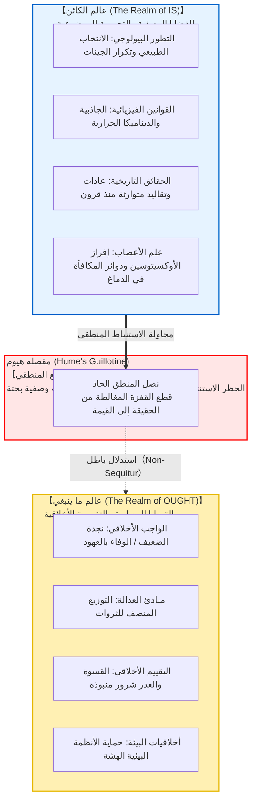
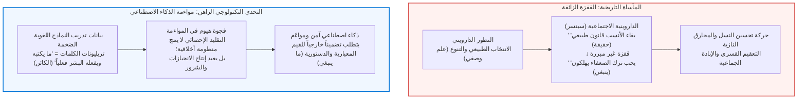

## مقدمة: الفجوة المنطقية الخفية في الخطاب اليومي

في النقاشات اليومية والجدالات السياسية والأطروحات العلمية الشائعة، نصادف بانتظام حججاً مصاغة على النحو التالي:

- «لقد تطور البشر بيولوجياً للتكاثر ونقل جيناتهم للأجيال القادمة. <strong>وبالتالي، ينبغي على كل إنسان أن يتزوج وينجب أطفالاً.</strong>»
- «في اقتصاد السوق الحر، يقضي التنافس الشرس على الكيانات الضعيفة لصالح الأقوياء وفقاً لقوانين الطبيعة. <strong>وبالتالي، لا ينبغي للدولة أن تدعم الضعفاء بالرعاية الاجتماعية.</strong>»
- «لقد حافظ مجتمعنا على هذا التقليد والنمط الأسري لمدة ثلاثة قرون متواصلة. <strong>وبالتالي، يجب علينا التمسك به إلى الأبد دون تغيير.</strong>»
- «نشأ الإيثار والتعاطف نتيجة إفراز هرمون الأوكسيتوسين الذي ساعد المجموعات البشرية القديمة على البقاء. <strong>وبالتالي، فإن الإيثار هو واجب أخلاقي موضوعي وملزم.</strong>»

تبدو هذه الادعاءات للوهلة الأولى مقنعة لأنها تستند إلى حقائق موضوعية من البيولوجيا أو الاقتصاد أو التاريخ أو علم الأعصاب. غير أنه بمجرد إخضاعها للمشرط الدقيق لعلم المنطق وفلسفة ما وراء الأخلاق (Metaethics)، تنكشف قفزة منطقية معيبة: <strong>الانتقال غير المشروع مما "هو كائن" (حقيقة وصفية: Is) إلى ما "ينبغي أن يكون" (قيمة معيارية: Ought)</strong>.

إن كون الإنسان مهيأ بيولوجياً للتكاثر (حقيقة) لا يولد حتماً واجباً أخلاقياً يلزمه بالإنجاب (معيار). ومثلما أن الفيروسات الفتاكة موجودة طبيعياً دون أن يزعم أحد أننا *ينبغي* أن نترك الأوبئة تفتك بالناس، فإن <strong>واقع العالم التجريبي ينتمي إلى فئة منطقية مختلفة كلياً عن مجال الواجبات الأخلاقية.</strong>

قام الفيلسوف التنويري الاسكتلندي <strong>ديفيد هيوم (1711–1776)</strong> بتفكيك هذا الخلط لأول مرة في مؤلفه العظيم *رسالة في الطبيعة البشرية* (1739). وقد أطلق الفيلسوف ماكس بلاك في القرن العشرين على هذا البرهان اسم <strong>«مقصلة هيوم»</strong>، وهو ما حطم النظرة الغائية للطبيعة السائدة منذ أرسطو. ثم صاغ ج. إ. مور "المغالطة الطبيعية"، مؤذناً بميلاد الفلسفة التحليلية المعاصرة في الأخلاق.

---

## 1. نص ديفيد هيوم الكلاسيكي في «رسالة في الطبيعة البشرية»

كتب هيوم في الجزء الأول من الكتاب الثالث لرسالته الشهيرة الملاحظة الأكثر تأثيراً في تاريخ الفلسفة الأخلاقية:

> «في كل مذهب أخلاقي واجهته حتى الآن، لاحظت دائماً أن المؤلف يمضي لبعض الوقت في طريقة التفكير المعتادة، فيثبت وجود إله، أو يبدي ملاحظات حول الشؤون الإنسانية؛ وفجأة أندهش حين أجد أنه بدلاً من روابط القضايا المعتادة، <strong>هو ولا يكون (is and is not)</strong>، لا أجد أي قضية غير متصلة برابطة <strong>ينبغي أو لا ينبغي (ought or ought not)</strong>.
> 
> هذا التغيير غير ملحوظ، ولكنه ذو عواقب بالغة الأهمية. فبما أن هذا الـ *ينبغي* يعبر عن <strong>علاقة أو تأكيد جديد</strong>، فمن الضروري أن يلاحظ ويُشرح؛ وفي الوقت نفسه ينبغي تقديم سبب لما يبدو غير مفهوم على الإطلاق: <strong>كيف يمكن استنتاج هذه العلاقة الجديدة من علاقات أخرى تختلف عنها تمام الاختلاف.</strong>»

تعتمد حجة هيوم على <strong>مبدأ الحفظ في المنطق الاستنباطي</strong>: في أي قياس منطقي صحيح، لا يجوز أن تتضمن النتيجة أي مفهوم لم يكن مشتملاً في المقدمات. إن اشتقاق الـ "ينبغي" من مقدمات تقتصر على الـ "كائن" هو مغالطة عدم لزوم النتيجة (*Non-sequitur*). ولتصحيح الاستدلال لا بد من إضافة مقدمة معيارية مضمرة، مما يوقعنا في تسلسل لا نهائي من التبريرات.

---

## 2. المغالطة الطبيعية وحجة السؤال المفتوح لجورج إدوارد مور

في عام 1903، أوضح الفيلسوف الإنجليزي <strong>جورج إدوارد مور (G. E. Moore)</strong> في كتابه *مبادئ الأخلاق* أن صفة "الخير" هي صفة بسيطة غير قابلة للتحليل أو التعريف، شأنها شأن إدراك اللون "الأصفر". إن محاولة تعريف الخير بخصائص طبيعية (مثل اللذة، أو التكيف التطوري) تشكل <strong>المغالطة الطبيعية (Naturalistic Fallacy)</strong>.

وقدم مور <strong>حجة السؤال المفتوح (Open Question Argument)</strong>:
- <strong>السؤال المغلق:</strong> «زيد أعزب، فهل هو غير متزوج؟» (سؤال بديهي ومغلق بحكم التعريف).
- <strong>السؤال المفتوح:</strong> «الفعل (س) يحقق أكبر قدر من اللذة للمجموع، ولكن <strong>هل الفعل (س) خير حقاً؟</strong>»

يظل هذا السؤال دائماً ذا دلالة وعميقاً ومفتوحاً للنقاش الفلسفي. لو كان "الخير" يعني مطابقة اللذة بحكم التعريف، لكان السؤال سخيفاً وتكراراً عقيماً. وبما أنه سؤال مشروع، فإن الخير خاصية مستقلة تماماً عن الوقائع الطبيعية.

---

## 3. البرهان الصوري في المنطق الإلزامي المعياري (SDL)

في عام 1997، أثبت عالم المنطق النمساوي <strong>غيرهارد شورز (Gerhard Schurz)</strong> مقصلة هيوم رياضياً في إطار منطق الإلزام القياسي (Standard Deontic Logic). في دلالات كريبكي للعوالم الممكنة، فإن دالة التحقق للحقائق الواقعية وعلاقة الوصول إلى العوالم الأخلاقية المثالية <strong>متعامدتان تماماً (مستقلتان رياضياً)</strong>. لأي مجموعة متسقة من المقدمات الواقعية $\Gamma$ وصيغة إلزامية جوهرية $\mathbf{O}\phi$:

$$\Gamma \nvdash_{\text{SDL}} \mathbf{O}\phi$$

---

## 4. الكوارث التاريخية ومعضلة مواءمة الذكاء الاصطناعي

أدى تجاهل مقصلة هيوم تاريخياً إلى ظهور <strong>الداروينية الاجتماعية</strong> واليوجينيا (تحسين النسل)، حيث زُعم أن قسوة الطبيعة في إفناء الضعفاء تبرر إبادتهم اجتماعياً. ونسي هؤلاء أن قسوة الطبيعة هي ذاتها الدافع الذي يوجب على البشر بناء نظم قائمة على التضامن والعدل.

وفي عصرنا الحاضر، تبرز هذه الأزمة في <strong>معضلة مواءمة الذكاء الاصطناعي (AI Alignment)</strong>. إن تدريب النماذج اللغوية الكبيرة على نصوص الإنترنت يمثل حصراً عالم "ما هو كائن" المليء بالتحيزات البشرية. ومن المستحيل رياضياً اشتقاق كيف "ينبغي" للذكاء الاصطناعي الفائق أن يتصرف من خلال المحاكاة الإحصائية المحضة؛ بل لا بد من ضبطه وفق مبادئ معيارية خارجية واعية.

---

## 5. خاتمة: منارة القيم في محيط الحقائق

لا تهدم مقصلة هيوم الأخلاق، بل تصون حرية الإنسان ومسؤوليته الأخلاقية.
فلو كان ما ينبغي مشتقاً حتماً مما هو كائن، لتحولنا إلى مجرد تروس ميكانيكية تخضع لقوانين الطبيعة العمياء بلا خيار أو ضمير.

ولأن هناك هوة سحيقة بين الحقيقة والقيمة، يستطيع الإنسان الواعي أن يقف في وجه الواقع الصلد قائلاً:
> <strong>«إن العالم اليوم واقع هكذا (Is)، لكنه حتماً لا ينبغي أن يظل هكذا (Ought). وإننا بعقولنا وضمائرنا لعازمون على جعله أكثر عدلاً وإنسانية.»</strong>

