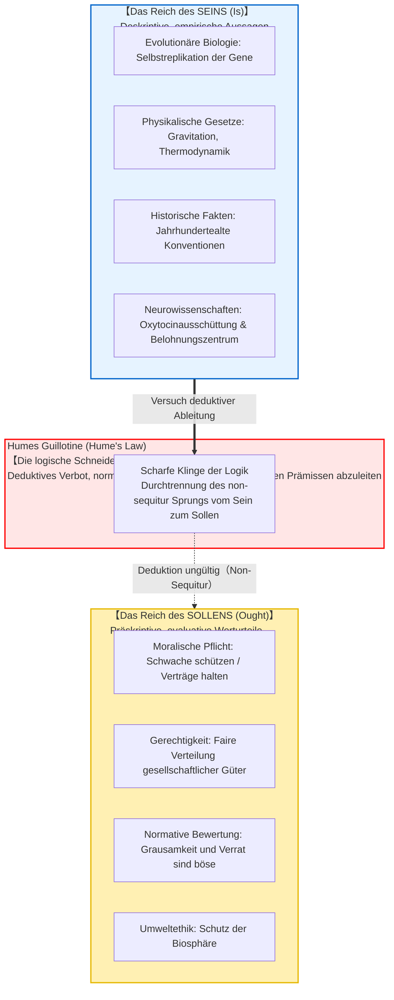
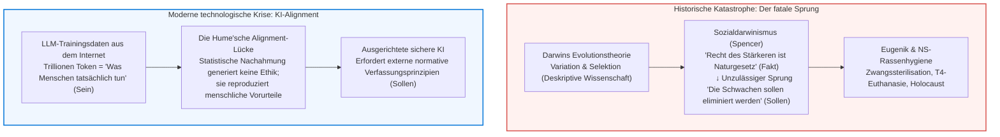

## Einleitung: Die unsichtbare logische Kluft

In alltäglichen Diskursen, politischen Debatten und populärwissenschaftlichen Veröffentlichungen begegnen uns regelmäßig Behauptungen wie diese:

- „Der Mensch hat sich biologisch so entwickelt, dass er Nachkommen zeugt und seine Gene weitergibt. <strong>Folglich sollte jeder Mensch heiraten und Kinder großziehen.</strong>“
- „In der freien Marktwirtschaft sorgt ein harter Wettbewerb dafür, dass die Starken überleben und ineffiziente Schwache verdrängt werden. <strong>Daher sollte der Staat Bedürftige nicht durch Sozialleistungen unterstützen.</strong>“
- „Diese traditionelle Ordnung und Praxis wird in unserer Gesellschaft seit dreihundert Jahren ununterbrochen gewahrt. <strong>Folglich sollten wir diese Tradition für immer bewahren.</strong>“
- „Altruismus und Mitgefühl entstanden evolutionär, weil kooperative Gruppen höhere Überlebenschancen hatten. <strong>Daher ist Altruismus objektiv moralisch gut und verbindlich.</strong>“

Auf den ersten Blick scheinen diese Aussagen bestechend plausibel, gestützt auf objektive Fakten der Biologie, Ökonomie, Geschichte oder Neurophysiologie. Doch unter dem Seziermesser der Logik und der Metaethik offenbart sich ein verhängnisvoller Fehlschluss: <strong>der illegitime Übergang von dem, was IST (deskriptive Tatsache), zu dem, was SEIN SOLL (normative Pflicht)</strong>.

Warum sollte aus der biologischen Tatsache der Fortpflanzungsfähigkeit eine moralische Pflicht erwachsen? Tödliche Viren und Bakterien existieren natürlicherweise in der Welt; dennoch käme niemand auf die Idee zu behaupten, wir *sollten* Epidemien freien Lauf lassen, nur weil Krankheitserreger natürlich sind. <strong>Wie die Welt empirisch beschaffen ist, und wie wir moralisch handeln sollen, sind zwei kategorial getrennte Sphären.</strong>

Diese fundamentale Trennung formulierte der schottische Aufklärungsphilosoph <strong>David Hume (1711–1776)</strong> erstmals 1739 in seinem bahnbrechenden Werk *A Treatise of Human Nature*. Die im 20. Jahrhundert von Max Black als <strong>„Humes Guillotine“ (oder Humes Gesetz)</strong> getaufte Einsicht zerstörte die teleologische Naturauffassung seit Aristoteles. Später systematisierte G. E. Moore dies als „naturalistischen Fehlschluss“ und begründete damit die moderne analytische Metaethik.

---

## 1. David Humes Entdeckung im *Treatise of Human Nature*

Im dritten Buch („Über die Moral“) seines 1739 erschienenen Meisterwerks schrieb David Hume die berühmtesten Zeilen der Metaethik:

> „In jedem Moralsystem, dem ich bisher begegnet bin, habe ich stets bemerkt, dass der Verfasser einige Zeit in der gewöhnlichen Weise vorgeht und das Dasein Gottes begründet oder Beobachtungen über menschliche Angelegenheiten anstellt; wenn ich plötzlich überrascht bin festzustellen, dass anstelle der üblichen Satzverknüpfungen <strong>‚ist‘ und ‚ist nicht‘</strong> kein Satz mehr vorkommt, der nicht mit einem <strong>‚soll‘ oder ‚soll nicht‘</strong> verbunden wäre.
> 
> Dieser Wechsel vollzieht sich unmerklich, ist jedoch von allergrößter Tragweite. Denn da dieses ‚soll‘ oder ‚soll nicht‘ eine <strong>neue Beziehung oder Bejahung</strong> ausdrückt, ist es notwendig, dass sie beachtet und erklärt wird; und gleichzeitig sollte ein Grund für das angegeben werden, was ganz unbegreiflich scheint: <strong>wie nämlich diese neue Beziehung aus anderen deduziert werden kann, die von ihr gänzlich verschieden sind.</strong>“

Humes Kritik beruht auf dem <strong>Konservativitätsprinzip der klassischen deduktiven Logik</strong>: In einem gültigen deduktiven Schluss darf in der Konklusion kein neuer Begriff oder modaler Operator auftauchen, der nicht bereits in den Prämissen enthalten war.
Wenn die Prämissen rein deskriptiv sind („Jones versprach Smith Geld“), ist das plötzliche Auftreten eines normativen Sollensoperators ($\mathbf{O}$) in der Konklusion ein klassischer logischer Fehlschluss (*Non-sequitur*). Um den Schluss logisch gültig zu machen, muss zwingend eine unausgesprochene normative Prämisse hinzugefügt werden („Man soll gegebene Versprechen halten“). Diese Prämisse lässt sich jedoch wiederum nicht rein empirisch begründen, ohne in einen unendlichen Regress zu verfallen.

---

## 2. G. E. Moores naturalistischer Fehlschluss & das Argument der offenen Frage

Im Jahr 1903 erweiterte <strong>G. E. Moore</strong> in *Principia Ethica* Humes Argument auf die Ebene der Begriffsdefinition. Moore argumentierte, dass das Prädikat „gut“ eine einfache, unanalysierbare, nicht-natürliche Eigenschaft darstelle – ähnlich wie die Farbempfindung „Gelb“. Wer versucht, das moralische „Gut“ mit einer natürlichen Eigenschaft (wie Lust, evolutionärer Überlebensfähigkeit oder Wohlbefinden) gleichzusetzen, begehe den <strong>naturalistischen Fehlschluss (Naturalistic Fallacy)</strong>.

### Das Argument der offenen Frage (Open Question Argument: OQA)
- <strong>Geschlossene Frage:</strong> „Jones ist Junggeselle, aber ist er unverheiratet?“ (Analytisch wahr und trivial)
- <strong>Offene Frage:</strong> „Handlung X maximiert das Vergnügen der Mehrheit, aber <strong>ist Handlung X wirklich gut?</strong>“
  
Diese Frage bleibt immer eine sinnvolle, offene Frage. Wenn „gut“ exakt dasselbe wie „lustfördernd“ bedeutete, wäre die Frage so sinnlos wie die Frage nach dem unverheirateten Junggesellen. Da die Frage substanziell und diskussionswürdig bleibt, kann „gut“ nicht mit natürlichen Begriffen deckungsgleich definiert werden.

---

## 3. Mathematische Formalisierung in der deontischen Logik (SDL)

Der österreichische Logiker <strong>Gerhard Schurz</strong> bewies 1997 in seiner Monographie *The Is-Ought Problem* Humes Gesetz mathematisch exakt innerhalb der Standard Deontic Logic (SDL).

Im Kripke-Semantikmodell $\mathcal{M} = \langle W, R, V \rangle$ sind die Belegungsfunktion der empirischen Fakten $V$ und die Erreichbarkeitsrelation zu idealen Welten $R \subseteq W \times W$ modelltheoretisch <strong>vollständig orthogonal (unabhängig)</strong>. Schurz formulierte das <strong>verallgemeinerte Hume-Theorem</strong>:
Für jede konsistente Menge rein faktischer Prämissen $\Gamma \subset \mathcal{L}_{\text{fact}}$ und jede nicht-tautologische, vollkommen relevante deontische Formel $\mathbf{O}\phi$ gilt:

$$\Gamma \nvdash_{\text{SDL}} \mathbf{O}\phi$$

Damit ist Humes Guillotine kein bloßes philosophisches Bonmot, sondern ein mathematisch bewiesenes Theorem der formalen Logik.

---

## 4. Reale Katastrophen und die moderne KI-Alignment-Krise

Die Missachtung von Humes Guillotine führte historisch zu verheerenden Tragödien: Der <strong>Sozialdarwinismus</strong> rechtfertigte Kolonialismus und den Rassenwahn der Nationalsozialisten, indem er die Grausamkeit natürlicher Auslese fälschlicherweise zum moralischen Sollen erhob. Dass die Natur erbarmungslos ist (Sein), rechtfertigt niemals menschliche Grausamkeit; im Gegenteil: Weil die Natur grausam ist, sollen wir gerechte Institutionen schaffen (Sollen).

In der Gegenwart manifestiert sich dieses Problem im <strong>KI-Alignment-Problem</strong>. Große Sprachmodelle (LLMs) lernen statistische Muster menschlicher Internet-Texte – das reine <strong>Reich des Seins</strong>. Daraus lässt sich niemals ableiten, wie eine künftige Superintelligenz handeln <strong>soll</strong>. Ethische Prinzipien müssen durch menschliches Feedback (RLHF) und verfassungsartige Werte explizit als normative Rahmenbedingungen gesetzt werden.

---

## 5. Fazit: Ein Leuchtfeuer der Werte im Meer der Fakten

Humes Gesetz beraubt uns nicht der Moral; es rettet unsere Freiheit.
Wäre das Sollen deduktiv aus dem Sein ableitbar, wären wir bloße Rädchen im Getriebe der Naturgesetze, unfähig zu echter moralischer Entscheidung und Verantwortung.

Weil Fakten und Werte durch einen tiefen Abgrund getrennt sind, vermag der Mensch der harten Realität ins Auge zu blicken und selbstbestimmt zu fordern:
> <strong>„Die Welt ist gegenwärtig so (Sein). Doch so darf sie nicht bleiben (Sollen). Wir wollen sie gerechter und menschlicher gestalten.“</strong>

Die Naturwissenschaft liefert uns die unentbehrliche Landkarte der Tatsachen; doch den Kurs unseres Handelns bestimmen allein die Leuchtfeuer unseres Gewissens und unserer autonomen Werte.

