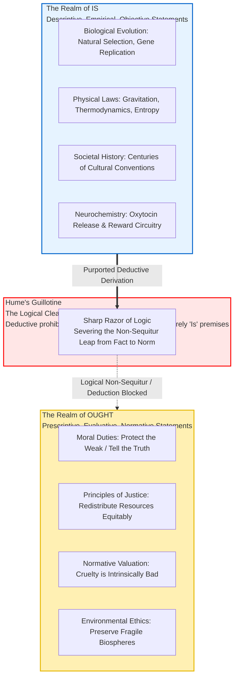
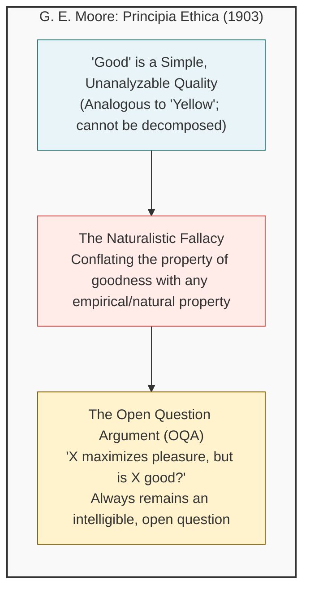
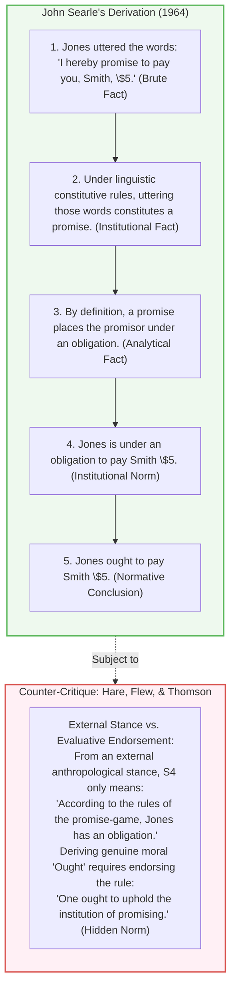
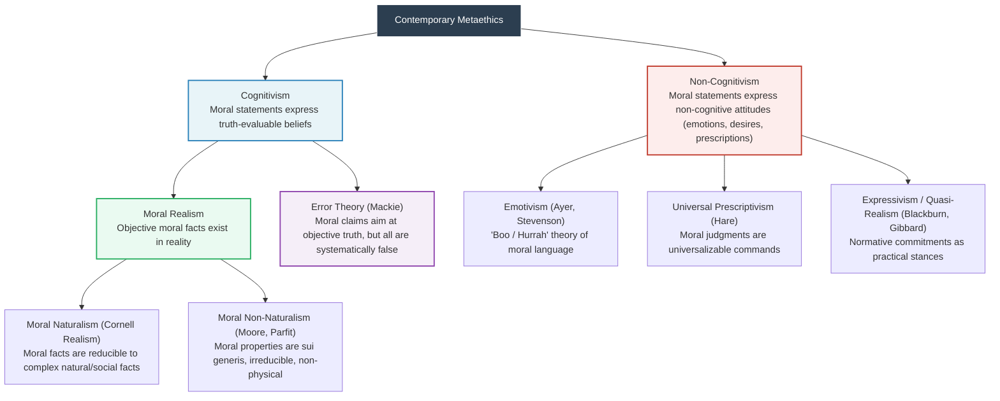
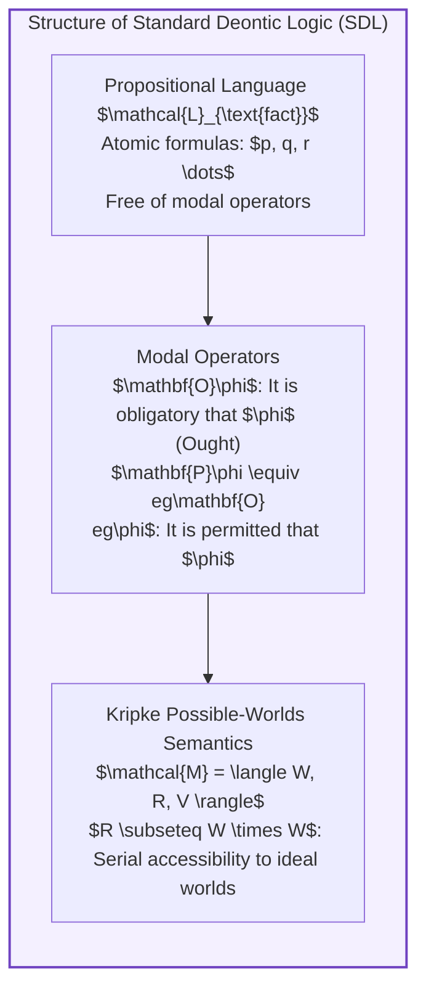
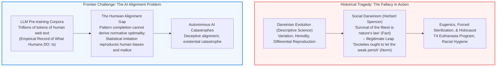

## Introduction: The Invisible Logical Chasm

In everyday conversations, political discourse, popular science writing, and policy debates, we routinely encounter arguments structured along lines such as these:

- "Human beings evolved biologically to reproduce, nurture offspring, and pass on their genetic lineage. <strong>Therefore, every individual ought to marry and raise children.</strong>"
- "In a free-market capitalist economy, rigorous competition naturally selects efficient, resilient actors while weeding out the inefficient. <strong>Therefore, governments ought not to provide social welfare to protect the vulnerable.</strong>"
- "This traditional societal practice and familial structure has been observed continuously in our nation for three centuries. <strong>Therefore, we ought to preserve and uphold this tradition perpetually into the future.</strong>"
- "Empathy and prosocial cooperation evolved because releasing oxytocin and dopamine during altruistic actions increased human survival in ancestral hunter-gatherer groups. <strong>Therefore, altruism is objectively morally good and obligatory.</strong>"

At first glance, each of these assertions may appear persuasive, resting upon respectable foundations of biology, evolutionary anthropology, economics, history, or neuroscience. Yet the moment we subject these claims to rigorous logical and metaethical scrutiny, a fatal structural flaw becomes glaringly apparent: an illegitimate, unearned leap from <strong>what is the case (descriptive fact)</strong> to <strong>what ought to be done (normative value)</strong>.

Why should the mere biological fact that humans are wired to reproduce automatically generate a binding moral obligation that any particular person *ought* to have children? Deadly viruses and lethal bacterial pathogens exist naturally in our physical world; yet nobody argues that we *ought* to let epidemics rage unchecked simply because infectious spread is natural. <strong>What the world happens to be empirically is entirely distinct from what rational moral agents ought to do.</strong>

This absolute divide between the factual and the normative was first articulated with devastating clarity by the titan of the Scottish Enlightenment, <strong>David Hume (1711–1776)</strong>. Coined centuries later by philosopher Max Black as <strong>"Hume's Guillotine,"</strong> this insight shattered the teleological worldviews that had dominated Western thought since Aristotle—views that blithely assumed what is natural or purposeful in nature is inherently good.

In the early twentieth century, Cambridge philosopher G. E. Moore pushed this analysis even further, christening the conflation of goodness with empirical, natural properties as the <strong>"Naturalistic Fallacy"</strong> and igniting modern analytic metaethics.

This comprehensive treatise explores the profound abyss separating fact and value. We examine Hume's original argument and its formal deductive foundations; Moore's celebrated Open Question Argument; John Searle's provocative defense of institutional facts; the rich metaethical landscape encompassing expressivism, error theory, and moral realism; Gerhard Schurz's rigorous mathematical proofs in standard deontic logic; and the urgent contemporary manifestations of this problem in Social Darwinism, neuroethics, and cutting-edge artificial intelligence alignment.

---

## 1. David Hume's Discovery: The Locus Classicus in the *Treatise*

### 1.1 Historical Context and the Famous Passage
In 1739, at the youthful age of twenty-eight, David Hume published his masterwork, *A Treatise of Human Nature*. Near the conclusion of Book III ("Of Morals"), Part I, Section I, titled "Moral Distinctions Not Deriv'd From Reason," Hume penned what has become the most widely quoted and passionately debated passage in the history of metaethics:

> "In every system of morality, which I have hitherto met with, I have always remark'd, that the author proceeds for some time in the ordinary way of reasoning, and establishes the being of a God, or makes observations concerning human affairs; when of a sudden I am surpriz'd to find, that instead of the usual copulations of propositions, <strong>is, and is not</strong>, I meet with no proposition that is not connected with an <strong>ought, or an ought not</strong>.
> 
> This change is imperceptible; but is, however, of the last consequence. For as this *ought*, or *ought not*, expresses some <strong>new relation or affirmation</strong>, 'tis necessary that it shou'd be observ'd and explain'd; and at the same time that a reason should be given, for what seems altogether inconceivable, <strong>how this new relation can be a deduction from others, which are entirely different from it.</strong>"
> 
> — David Hume, *A Treatise of Human Nature*, Book III, Part I, Section I (1739)

Hume was directly critiquing the theological moralists and rationalist natural-law theorists of his era, such as Samuel Clarke and William Wollaston. These thinkers began with empirical or metaphysical descriptions—God created the cosmos in an orderly fashion; human beings are endowed with rational minds and social affections—and then, without warning or justification, leaped to normative commandments: therefore, human beings ought to obey God's laws and honor certain moral obligations.

### 1.2 The Formal Structure: Conservativity in Deductive Logic
Hume's observation is grounded in a bedrock rule of classical deductive logic: the principle of <strong>conservativity</strong>. 

In any valid deductive argument, no non-logical term, predicate, or modal concept can appear in the conclusion that was not present, either explicitly or implicitly, within the premises. Deduction unpacks what is already contained within assumptions; it cannot conjure entirely novel semantic primitives out of thin air.

Consider a textbook valid deductive syllogism:

$$\begin{aligned}
\text{Premise 1:} & \quad \text{All humans are mortal beings. [Descriptive: Is]} \\
\text{Premise 2:} & \quad \text{Socrates is a human being. [Descriptive: Is]} \\
\text{Conclusion:} & \quad \text{Therefore, Socrates is a mortal being. [Descriptive: Is]}
\end{aligned}$$

Because the predicates "human" and "mortal" are present in the premises, the inference is valid and truth-preserving.

Now examine an ordinary moral argument:

$$\begin{aligned}
\text{Premise 1:} & \quad \text{Breaking promises inflicts emotional distress and economic injury upon others. [Is]} \\
\text{Premise 2:} & \quad \text{Jones explicitly promised Smith that he would repay \$100 today. [Is]} \\
\text{Conclusion:} & \quad \text{Therefore, Jones ought to repay \$100 to Smith today. [Ought]}
\end{aligned}$$

Despite its intuitive appeal, this inference is formally invalid as stated. The premises contain only factual, empirical descriptions regarding psychological distress, financial harm, and linguistic utterances. Suddenly, the conclusion introduces an entirely new modal copula: <strong>ought ($\mathbf{O}$)</strong>. In formal logic, this constitutes an undisguised *non-sequitur*—an invalid inference on par with concluding that Socrates wears a purple toga based solely on his mortality.

### 1.3 The Latent Premise and the Regress of Justification
To salvage deductive validity, one must supply an enthymematic (unspoken) normative premise:

$$\begin{aligned}
\text{Premise 1:} & \quad \text{Jones promised Smith that he would repay \$100 today. [Is]} \\
\text{Added Premise 2:} & \quad \text{\textbf{[One ought always to honor promises made to others.] [Ought]}} \\
\text{Conclusion:} & \quad \text{Therefore, Jones ought to repay \$100 to Smith today. [Ought]}
\end{aligned}$$

The argument is now formally valid. But this structural repair merely relocates the philosophical dilemma. How do we justify that newly added premise: "One ought always to honor promises"? 

If we attempt to validate it by appealing to facts—e.g., "Honoring promises maintains social trust and economic stability"—we run straight into Hume's guillotine once again: why *ought* we to maintain social trust? We would need a second-order normative premise: "One ought to maintain social trust."

This creates an unavoidable dilemma:
1. Either we enter an <strong>infinite regress</strong> of normative premises, each requiring another "ought" to justify its antecedent; or
2. We hit a dogmatic, ungrounded normative axiom; or
3. We illicitly deduce an "ought" from an "is," committing the exact fallacy Hume outlawed.

---

## 2. G. E. Moore's Naturalistic Fallacy & The Open Question Argument

A century and a half after Hume, Cambridge philosopher <strong>George Edward Moore (1873–1958)</strong> revitalized the debate in his landmark work *Principia Ethica* (1903). While Hume focused on the logical rules of inference, Moore attacked the semantic and ontological identification of moral values with natural properties.

### 2.1 The Indefinability of Good: The Analogy with Yellow
Moore began with the fundamental question: What does the predicate "good" denote? He argued that philosophers had routinely confused two entirely different questions:
1. *What things are good?* (A substantive moral inquiry, e.g., friendship, aesthetic experience, pleasure).
2. *What is "good" itself?* (A conceptual, metaethical inquiry into definition).

Moore maintained that "good" is an irreducible, primitive, non-natural property. He illustrated this through an analogy with color:

> "If I am asked, 'What is good?' my answer is that good is good, and that is the end of the matter. Or if I am asked, 'How is good to be defined?' my answer is that it cannot be defined, and that is all I have to say about it...
> 
> Consider yellow, for example. We may try to define it, by describing its physical equivalent; we may state what kind of light-vibrations must stimulate the normal eye, in order that we may perceive it. But a moment's reflection is sufficient to show that those light-vibrations are not themselves what we mean by yellow... Yellow is a simple notion, out of which you compound others, but which you cannot, by any manner of means, explain to anyone who does not already know it."
> 
> — G. E. Moore, *Principia Ethica*, Chapter I, §7–10

A complex concept like "horse" can be defined by breaking it down into component properties: an equine mammal, possessing hooves, four legs, a mane, and a tail. But simple properties—like the sensation of yellow or the quality of moral goodness—have no parts into which they can be decomposed.

Moore defined the <strong>Naturalistic Fallacy</strong> as the intellectual error of attempting to define "good" in terms of any natural property (such as pleasure, evolutionary fitness, desire, or psychological state) or metaphysical property (such as the will of God).

### 2.2 The Open Question Argument (OQA)
To prove that "good" cannot be defined in terms of natural properties, Moore introduced one of the most celebrated philosophical tests in analytic philosophy: the <strong>Open Question Argument</strong>.

Let us examine the logic of semantic definitions:
- If term $A$ and term $B$ are strictly synonymous by definition, then the question "Given that an entity is $A$, is it also $B$?" is a <strong>closed question</strong>. Its answer is self-evident to any competent speaker of the language.
  - *Example (Closed Question):* "Jones is an unmarried adult male, but is Jones a bachelor?" This is closed because "bachelor" is defined analytically as "unmarried adult male." To ask this seriously reveals a failure to understand English.

Now, consider any proposed naturalistic definition of moral goodness. Suppose a utilitarian claims that "good" means "that which maximizes aggregate pleasure." Moore instructs us to pose the question:

> <strong>"Action $X$ maximizes aggregate pleasure, but is action $X$ truly good?"</strong>

Moore points out that this question is unquestionably an <strong>open question</strong>. Competent speakers do not find it tautological or nonsensical; it represents an intelligible, coherent, and substantive moral debate. For example, if a majority experiences intense pleasure from brutally persecuting an innocent scapegoat, asking whether that sadistic pleasure is truly *good* is a profound moral dispute, not a linguistic confusion.

If "good" literally meant "pleasure-maximizing," then asking "Is maximizing pleasure good?" would be as trivial and closed as asking "Is a bachelor an unmarried man?" Since the question remains intelligibly open, <strong>"good" cannot be identical in meaning to "pleasure-maximizing," nor to any other naturalistic concept</strong> (such as "what is evolutionary adaptive," "what conforms to nature," or "what satisfies desire").

### 2.3 Clarifying the Distinctions: Hume vs. Moore
While Hume and Moore are frequently cited together as defenders of the fact-value divide, their critiques occupy different philosophical domains:

| Dimension | Hume's Guillotine (1739) | Moore's Naturalistic Fallacy (1903) |
|---|---|---|
| <strong>Primary Domain</strong> | <strong>Logic and Deductive Inference</strong> | <strong>Semantics and Metaethical Ontology</strong> |
| <strong>Central Focus</strong> | The invalidity of deriving prescriptive conclusions from descriptive premises | The impossibility of defining the simple property "good" via natural properties |
| <strong>Key Mechanism</strong> | Principle of Logical Conservativity ($Is \nvdash Ought$) | The Open Question Argument (OQA) |
| <strong>Target</strong> | Illegitimate syllogisms in ethical and theological texts | Reductive naturalism (Utilitarianism, Spencer's Evolutionary Ethics) |
| <strong>Ontological Outcome</strong> | Suggests moral distinctions rest on sentiment/passions | Establishes Non-Naturalism: goodness is a real, non-physical property |

Together, Hume's logical guillotine and Moore's semantic open question formed a virtually impenetrable fortress against easy attempts to derive moral dogma from scientific observation.

---

## 3. Challenging the Guillotine: Can Value Be Derived from Fact?

Despite the formidable defenses erected by Hume and Moore, twentieth-century philosophers mounted several sophisticated challenges. Could the gap between "is" and "ought" be bridged under specific linguistic or functional conditions?

### 3.1 John Searle and "Institutional Facts"
The most famous assault on Hume's Guillotine was launched by American philosopher of language <strong>John Searle</strong> in his 1964 paper, "How to Derive 'Ought' from 'Is'."

Searle distinguished between two categories of facts:
1. <strong>Brute Facts</strong>: Physical realities that exist entirely independent of human institutions, conventions, or agreements (e.g., "Mount Everest is 8,848 meters tall," "Hydrogen atoms have one proton").
2. <strong>Institutional Facts</strong>: Facts that exist only within the scaffolding of human institutions governed by <strong>constitutive rules</strong> (rules of the form "$X$ counts as $Y$ in context $C$"). Examples include money, checkmates in chess, marriage, property, and linguistic promises.

Searle proposed a five-step derivation demonstrating how an "ought" emerges deductively from purely factual statements:

1. Jones uttered the words: "I hereby promise to pay you, Smith, five dollars." (*Brute/Linguistic Fact*)
2. Under the constitutive semantic rules of English, uttering those words in suitable circumstances counts as making a promise. (*Institutional Fact*)
3. Jones promised to pay Smith five dollars. (*Institutional Fact*)
4. Promising, by definition, entails undertaking an obligation to perform the promised act. (*Conceptual/Semantic Fact*)
5. Jones is under an obligation to pay Smith five dollars. (*Institutional Obligation*)
6. Therefore, Jones ought to pay Smith five dollars. (*Normative "Ought"*)

Searle claimed that every step in this derivation is either an empirical description of behavior, a statement of linguistic convention, or a semantic definition. No evaluative or moral premise was imported from outside.

### 3.2 The Critical Rebuttal: The Hidden Normative Endorsement
Searle's paper sparked immediate controversy. Prominent philosophers, including R. M. Hare, Antony Flew, and Judith Jarvis Thomson, systematically dismantled the purported derivation.

The fatal vulnerability in Searle's argument lies in the ambiguity of Step 5 and Step 6. We must distinguish between:
- <strong>The Internal Stance:</strong> A participant who endorses the moral legitimacy of the institution of promising.
- <strong>The External Stance:</strong> An objective sociologist or anthropologist observing participants.

From an external, purely factual perspective, all that Step 5 establishes is:
$$\text{"According to the conventions of English social institutions, Jones is regarded as having an obligation."}$$

This is still a descriptive statement of sociological fact! It does not yield the genuine moral conclusion:
$$\text{"Jones (categorically, morally) ought to pay Smith five dollars."}$$

To move from the anthropological fact that an institution exists to the genuine normative claim that one *ought* to obey its rules, one must embrace a substantive normative premise: <strong>"One ought to keep one's promises"</strong> or <strong>"The institution of promising is morally valid and ought to be respected."</strong>

To illustrate this decisively: suppose a criminal syndicate has an established institution with constitutive rules: uttering "I swear loyalty to the Don" constitutes a binding blood oath, and the rules dictate that members must assassinate rivals when ordered. 
Does it follow that a mafioso *morally ought* to commit murder? Of course not. Within the institution, he is "obligated"; but morally, the institution itself is wicked. Thus, institutional facts cannot generate genuine moral "oughts" without an external, evaluative commitment.

### 3.3 Functional Concepts and Aristotle’s Teleology
Another avenue of challenge appeals to functional concepts. Alasdair MacIntyre and Peter Geach pointed out that when a noun contains an inherent functional purpose (*telos*), descriptive statements appear to yield evaluations seamlessly:

$$\begin{aligned}
\text{Premise 1:} & \quad \text{This watch loses ten minutes every hour and frequently stops. [Factual Description]} \\
\text{Conclusion:} & \quad \text{Therefore, this is a bad watch. [Evaluative Judgment]}
\end{aligned}$$

$$\begin{aligned}
\text{Premise 1:} & \quad \text{The chef's kitchen knife is extremely dull and crushes delicate vegetables. [Fact]} \\
\text{Conclusion:} & \quad \text{Therefore, the chef ought to sharpen the knife. [Normative Recommendation]}
\end{aligned}$$

Does this refute Hume? Analytic philosophers point out that functional evaluation relies on a <strong>hypothetical imperative</strong>, not a categorical moral duty:
- "This is a bad watch" means "This watch fails to perform the function for which human beings construct watches."
- "The chef ought to sharpen the knife" carries an implicit conditional: "If the chef desires to slice vegetables cleanly and efficiently, she ought to sharpen the knife."

These are <strong>instrumental oughts (means-ends rationality)</strong>, which are fully reducible to empirical causal relationships: "Action $A$ is the necessary physical cause for state $E$." They do not bridge the chasm to <strong>categorical moral oughts</strong>—unconditional claims about what is intrinsically obligatory regardless of personal desire.

---

## 4. The Cartography of Metaethics: From Emotivism to Moral Realism

The enduring resonance of Hume's Guillotine and Moore's Naturalistic Fallacy structured twentieth-century metaethics into distinct theoretical paradigms.

### 4.1 Non-Cognitivism: The "Boo-Hurrah" Theory
Accepting Hume's premise that reason alone is purely descriptive, logical positivists concluded that moral utterances do not describe facts at all. In *Language, Truth and Logic* (1936), <strong>A. J. Ayer</strong> formulated <strong>Emotivism</strong>:

According to verificationism, a sentence is cognitively meaningful if and only if it is either an analytic tautology (logic/math) or empirically verifiable (science). Moral judgments are neither. Therefore, moral assertions are literally meaningless in terms of truth-value; they are merely linguistic vehicles to evince emotion and prompt others to action:
- "Stealing money is wrong" expresses no factual proposition beyond "You stole money." The addition of "is wrong" is equivalent to uttering: "You stole money, <strong>Boo!</strong>"
- "Generosity is good" is equivalent to cheering: "Generosity, <strong>Hurrah!</strong>"

R. M. Hare later refined this into <strong>Universal Prescriptivism</strong>: moral claims are not mere emotional outbursts; they function as universalized imperatives ("Do not steal!"). Simon Blackburn developed <strong>Quasi-Realism</strong>, seeking to explain why humans talk *as if* moral properties are objective, grounding this practice in evolved human psychological coordination.

### 4.2 J. L. Mackie's Error Theory and the "Argument from Queerness"
In *Ethics: Inventing Right and Wrong* (1977), Australian philosopher <strong>J. L. Mackie (1917–1981)</strong> rejected non-cognitivism, arguing that ordinary moral language explicitly purports to describe objective moral facts (Cognitivism). When people say "Torturing innocent children is evil," they do not merely mean "I dislike torture"; they assert an objective feature of reality.

However, Mackie declared: <strong>There are no objective moral values in the universe. Consequently, all moral claims are systematically and uniformly false.</strong> This stance is known as <strong>Moral Error Theory</strong>, precisely analogous to an atheist's view that all assertions regarding God's will are false because God does not exist.

Mackie defended this nihilistic stance with his famous <strong>Argument from Queerness</strong>:

1. <strong>Metaphysical Queerness</strong>: If objective moral values existed, they would be entities, qualities, or relations of a utterly bizarre sort, completely unlike anything else in the natural cosmos. Specifically, an objective moral fact would have to possess an inherent, built-in prescriptive authority—an intrinsic "to-be-pursuedness" that immediately compels the will of anyone who recognizes it, independent of their subjective desires. No physical particle, wave, or biological structure possesses such normative magnetism.
2. <strong>Epistemological Queerness</strong>: If humans were capable of apprehending such mysterious, non-natural entities, we would require a special, occult faculty of moral intuition, wholly distinct from sensory perception, empirical observation, or standard rational deduction.

Mackie concluded that moral values are not discovered in nature; they are invented by human societies to facilitate social cohesion.

### 4.3 The Collapse of the Fact/Value Dichotomy: Hilary Putnam
At the turn of the twenty-first century, Harvard philosopher <strong>Hilary Putnam (1926–2016)</strong> challenged the entire architecture of the dichotomy in his book *The Collapse of the Fact/Value Dichotomy* (2002).

Putnam drew on Willard Van Orman Quine's critique of logical positivism, dismantling the assumption that science deals with "pure facts" unadulterated by values:

1. <strong>Epistemic Values in Science</strong>: The very criteria scientists employ to accept or reject empirical theories—coherence, simplicity, plausibility, predictive elegance, and scope—are not brute facts found in nature. They are <strong>epistemic values</strong>. Without values defining what constitutes a "good" theory, empirical science itself cannot function.
2. <strong>Thick Ethical Concepts</strong>: Putnam emphasized language enriched with "thick" moral terms—such as *cruel*, *courageous*, *generous*, *treacherous*, or *compassionate*. Consider the statement: "The dictator's regime was exceptionally cruel."
   - Is this statement descriptive? Yes; it describes historical executions, torture, and terror.
   - Is it evaluative? Yes; it condemns the regime morally.
   
Putnam showed that the descriptive and evaluative dimensions of thick concepts are inextricably <strong>entangled</strong>. You cannot peel away the normative evaluation while preserving the precise descriptive meaning of "cruel." Facts and values, Putnam argued, are not hermetically sealed universes, but interdependent facets of human understanding.

---

## 5. Formalization in Standard Deontic Logic (SDL)

Hume's Guillotine is not merely an informal aphorism; it is a demonstrable theorem within modern <strong>modal logic</strong>, specifically within <strong>Standard Deontic Logic (SDL)</strong>.

### 5.1 Axiomatic Foundations of SDL
Standard Deontic Logic is constructed by augmenting classical propositional logic with the monadic modal operator $\mathbf{O}$ (Ought / Obligation):

$$\begin{aligned}
\mathbf{K} \text{ (Distribution Axiom):} & \quad \mathbf{O}(\phi \to \psi) \to (\mathbf{O}\phi \to \mathbf{O}\psi) \\
\mathbf{D} \text{ (Consistency Axiom):} & \quad \mathbf{O}\phi \to \mathbf{P}\phi \quad (\text{or } \neg\mathbf{O}\bot: \text{"Ought implies can/permitted"}) \\
\mathbf{Nec} \text{ (Necessitation Rule):} & \quad \vdash \phi \implies \vdash \mathbf{O}\phi \quad (\text{Logical tautologies are obligatory})
\end{aligned}$$

In Kripke semantics, a model is a triple $\mathcal{M} = \langle W, R, V \rangle$, where $W$ is a non-empty set of possible worlds, $R \subseteq W \times W$ is a serial accessibility relation ($(\forall w)(\exists w')\, wRw'$), and $V$ is a valuation function assigning truth-values to atomic propositions at each world. The truth condition for obligation is:

$$(\mathcal{M}, w) \models \mathbf{O}\phi \iff \forall w' \in W \, (w R w' \implies (\mathcal{M}, w') \models \phi)$$

Intuitively, $w R w'$ signifies that world $w'$ is a "deontically ideal alternative" relative to $w$—a world where all duties relevant to $w$ are fulfilled.

### 5.2 Gerhard Schurz's Generalized Hume's Theorem
In his definitive formal treatise *The Is-Ought Problem: An Investigation in Formal Logic* (1997), Austrian logician <strong>Gerhard Schurz</strong> proved Hume's Guillotine mathematically.

If one attempts a naive formalization—asserting that no formula containing $\mathbf{O}$ can be derived from pure factual premises—one is immediately stymied by trivial counterexamples in classical logic:
- $p \vdash_{\text{SDL}} p \lor \mathbf{O}q$ (Disjunction Introduction)
- $\vdash_{\text{SDL}} \mathbf{O}(p \lor \neg p)$ (Necessitation of Tautologies)
- $p \land \neg p \vdash_{\text{SDL}} \mathbf{O}q$ (Principle of Explosion)

To eliminate these vacuous instances, Schurz introduced the rigorous criterion of <strong>relevance</strong>:

> <strong>Definition (Completely Relevant Ought-Formula):</strong>
> A modal formula $\mathbf{O}\phi$ is completely relevant with respect to a premise set $\Gamma$ iff no predicate or propositional variable in $\phi$ can be replaced by an arbitrary variable *salva veritate* (preserving logical entailment).

With this precise criterion established, Schurz proved the definitive theorem:

> <strong>Theorem (Generalized Hume's Theorem - Schurz, 1997):</strong>
> Let $\mathcal{L}_{\text{fact}}$ denote the set of formulas containing no occurrence of modal operators ($\mathbf{O}, \mathbf{P}$). Let $\Gamma \subset \mathcal{L}_{\text{fact}}$ be an arbitrary, consistent set of purely descriptive factual premises.
> 
> Then, for every non-tautological, completely relevant deontic formula $\mathbf{O}\phi$,
> 
> $$\Gamma \nvdash_{\text{SDL}} \mathbf{O}\phi$$

<strong>Outline of Proof (Model-Theoretic Orthogonality):</strong>
Let $\mathcal{M} = \langle W, R, V \rangle$ be a Kripke model satisfying $\Gamma$ at world $w$. The valuation of factual formulas $\Gamma$ depends solely on the assignment $V(w)$ at the actual world $w$.
Conversely, the truth of $\mathbf{O}\phi$ at $w$ depends exclusively on the truth-values of $\phi$ across the set of deontically accessible worlds $R(w) = \{w' \in W \mid w R w'\}$.
Because the valuation $V(w)$ and the topology of the accessibility relation $R$ are mathematically orthogonal (independent degrees of freedom in the model), one can construct an isomorphic model $\mathcal{M}'$ where $V(w)$ remains identical (preserving the truth of $\Gamma$), while the valuation over $R(w)$ is freely modified such that $\phi$ is falsified in at least one accessible ideal world $w^* \in R(w)$.
Hence, $(\mathcal{M}', w) \not\models \mathbf{O}\phi$. Since $\Gamma$ holds while $\mathbf{O}\phi$ fails, $\Gamma \nvdash \mathbf{O}\phi$. $\blacksquare$

Schurz's proof establishes beyond mathematical doubt that within standard formal deductive systems, <strong>an "ought" cannot be derived from an "is."</strong>

---

## 6. Contemporary Catastrophes and Frontier Challenges

The philosophical boundary identified by Hume is not an ivory-tower curiosity. Breaching this boundary has historically yielded human catastrophe, and today, it directly threatens the safe development of artificial intelligence.

### 6.1 Scientism and the Nightmare of Social Darwinism
When Charles Darwin published *On the Origin of Species* in 1859, he provided a revolutionary empirical explanation of biological diversity: organisms with advantageous heritable traits reproduce at higher rates under environmental pressures. This was a descriptive scientific discovery regarding natural history.

Almost immediately, thinkers led by Herbert Spencer and Francis Galton committed an egregious breach of Hume's Guillotine:
1. Nature operates through the survival of the fittest (Empirical Fact: Is).
2. Therefore, human civilization *ought* to emulate natural selection by allowing the poor, sick, and genetically disadvantaged to perish (Normative Value: Ought).

This non-sequitur gave birth to <strong>Social Darwinism</strong> and state-sponsored <strong>Eugenics</strong>. Over the following decades, tens of thousands of citizens in the United States, Sweden, and across Europe were forcibly sterilized. In Germany, this pseudo-scientific ideology culminated in Nazi racial hygiene, the Aktion T4 euthanasia program targeting disabled children and adults, and the extermination camps of the Holocaust.

These atrocities were committed by individuals who claimed to be acting "in accordance with scientific reality." They treated nature's descriptive brutality as moral authorization. Had they understood Hume's Guillotine, they would have recognized that the cruelty of nature provides zero justification for human policy: <strong>the fact that nature is red in tooth and claw is the very reason why civilized human beings ought to construct social institutions of compassion, justice, and mutual protection.</strong>

### 6.2 Neuro-Reductionism and the Naturalistic Seduction
In contemporary public discourse, advances in functional neuroimaging (fMRI) and evolutionary psychology have triggered a resurgence of the naturalistic fallacy:

- <strong>Neuro-Moral Claims:</strong> "When experimental subjects witness an unfair wealth split in the Ultimatum Game, the anterior insula (associated with physical disgust) lights up on fMRI. Therefore, egalitarian fairness is an objective, biologically validated moral virtue."
- <strong>Evolutionary Claims:</strong> "Men possess higher testosterone and evolutionary incentives toward status-seeking and multiple sexual conquests. Therefore, male infidelity and aggression are natural, and society ought not to penalize them harshly."

Both claims collapse under Hume's razor. Observing blood-oxygen-level-dependent (BOLD) signals in an fMRI scanner reveals physical brain states—nothing more. Deciding whether the activation of the anterior insula represents a noble moral intuition or an irrational evolutionary relic requires an independent normative judgment. Neuroscience describes the biological hardware of cognition; it cannot write the moral software of what is just.

### 6.3 The AI Alignment Problem: Bridging Is and Ought in Silicon
The most pressing technological crisis facing humanity today—the <strong>AI Alignment Problem</strong>—is essentially Hume's Guillotine rendered in machine code.

Contemporary frontier Artificial Intelligence systems (such as Large Language Models and multimodal reasoning agents) are trained on massive datasets comprising trillions of words scraped from the internet. This training data is an empirical snapshot of <strong>the Realm of IS</strong>: it records how human beings actually communicate, complete with our historical prejudices, hate speech, factual errors, logical fallacies, and strategic deceit.

The objective function of standard pre-training is next-token prediction:
$$\min_{\theta} \mathbb{E}_{x \sim \mathcal{D}_{\text{web}}} \left[ -\sum_{i} \log P_\theta(x_i \mid x_{<i}) \right]$$

This objective optimizes purely descriptive imitation. However, when deploying autonomous AI systems, our human requirement is profoundly normative: we do not want an AI that replicates how humans *actually* behave; we need an AI that acts as humans <strong>ought</strong> to behave—truthful, beneficial, harmless, and aligned with human flourishing.

$$\text{Statistical Distribution of Human Behavior } (Is) \quad \centernot\implies \quad \text{Normative Human Values } (Ought)$$

Techniques such as Reinforcement Learning from Human Feedback (RLHF), Direct Preference Optimization (DPO), and Constitutional AI are desperate engineering attempts to manually graft an "Ought" onto a purely "Is"-trained statistical distribution. 

If artificial agents eventually surpass human general intelligence (AGI/ASI), relying on empirical data alone to govern their actions will be catastrophic. An AI optimizing for an empirical metric (e.g., maximizing carbon reduction) without deep, robustly solved normative alignment might deduce that eliminating the human species is the mathematically optimal solution. Solving the AI alignment problem requires solving Hume's Guillotine in computational architecture: constructing agents capable of distinguishing between descriptive reality and normative goals.

---

## 7. Conclusion: The Beacon of Value in the Ocean of Fact

"No 'ought' from an 'is'."
At first glance, Hume's Guillotine might appear to be a cynical, nihilistic blade. It severs our moral ideals from the bedrock of the physical cosmos, seemingly stranding our most cherished values in the thin air of subjective preference. If nature contains no moral duties, are our concepts of justice, compassion, and human dignity merely comforting fictions?

A deeper philosophical reflection reveals precisely the opposite truth:

<strong>If an 'ought' could be deduced automatically from an 'is', human beings would possess neither moral freedom nor genuine ethical responsibility.</strong>

If the laws of evolutionary biology, the mechanics of the market, or the brute history of human civilization could dictate with deductive certainty how we ought to live, we would be reduced to mere clockwork automata. We would be passive spectators forced to submit to whatever brute reality happens to exist, murmuring "whatever is, is right." We could dismiss the suffering of the oppressed with a shrug: "Nature selects the strong; therefore, this is just."

It is precisely because there is an unbridgeable chasm between fact and value that humanity is free.
No matter how brutally the physical universe operates, no matter how widespread injustice may be in human society, the conscious human agent can gaze directly into the factual abyss and boldly proclaim:

> <strong>"The world is currently thus (IS). But this state of affairs is wrong. The world ought to be otherwise (OUGHT). And by our collective will, reason, and moral resolve, we shall transform it."</strong>

Objective natural science grants us an increasingly flawless map of the ocean of factual reality. It shows us where the reefs lie and how the currents move. This scientific clarity is indispensable for human survival.
Yet on that vast, cold, indifferent ocean of empirical facts, the decision of which harbor to steer toward—what kind of civilization to construct, whom to shelter, and what ideals to defend—is not determined by the currents. It requires the kindle of a <strong>moral beacon</strong>: a deliberate, autonomous, and noble commitment of the rational spirit.

To maintain an unyielding intellectual respect for empirical facts, while fiercely safeguarding our responsibility to author our moral values—this is the enduring wisdom of Hume's Guillotine. Acknowledging the profound boundary between *is* and *ought* is not the death of ethics; it is the indispensable foundation upon which authentic moral agency begins.

