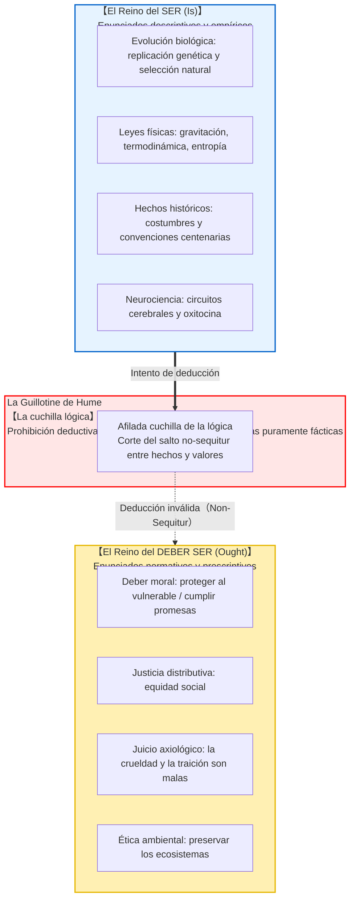
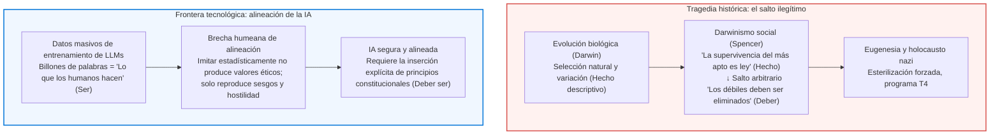

## Introducción: El abismo lógico invisible de la vida cotidiana

En la vida cotidiana, el debate político y la divulgación científica, tropezamos con frecuencia con argumentos como estos:

- «Los seres humanos evolucionaron biológicamente para reproducirse y perpetuar sus genes. <strong>Por lo tanto, toda persona debe casarse y tener hijos.</strong>»
- «En una economía de libre mercado, la competencia hace que los fuertes sobrevivan y los débiles perezcan por ley natural. <strong>Por lo tanto, el Estado no debe socorrer a los vulnerables con subsidios.</strong>»
- «Esta tradición y estructura familiar se ha observado en nuestro país durante tres siglos. <strong>Por lo tanto, debemos conservarla intacta por siempre.</strong>»
- «El altruismo y la cooperación evolucionaron porque la secreción de oxitocina favorecía la cohesión grupal. <strong>Por lo tanto, el altruismo es un deber moral objetivamente vinculante.</strong>»

A simple vista, estas afirmaciones parecen apoyarse sólidamente en hechos científicos irrefutables de la biología, la economía o la neurociencia. Sin embargo, bajo el rigor de la lógica y la metaética, todas incurren en un salto ilegítimo: <strong>el paso indebido de lo que ES (hecho descriptivo) a lo que DEBE SER (norma prescriptiva)</strong>.

El hecho biológico de que estemos dotados de capacidad reproductiva no genera automáticamente la obligación moral de procrear. Del mismo modo que los virus letales existen de manera natural sin que nadie sostenga que *debemos* permitir que las plagas se propaguen, <strong>la descripción fáctica del universo pertenece a un orden lógico enteramente distinto al de la deliberación ética.</strong>

Esta insalvable fractura fue formulada con precisión quirúrgica por el filósofo ilustrado escocés <strong>David Hume (1711–1776)</strong> en su célebre *Tratado de la naturaleza humana* (1739). Conocida gracias a Max Black como <strong>«La guillotina de Hume»</strong>, demolió la visión teleológica aristotélica. Más tarde, G. E. Moore formuló la «falacia naturalista», fundando la metaética analítica moderna.

---

## 1. El pasaje clásico de David Hume en el *Tratado*

En el Libro III de su *Tratado de la naturaleza humana*, Hume redactó uno de los pasajes más citados de la historia filosófica:

> «En todo sistema de moralidad con el que hasta ahora me he topado, siempre he observado que el autor procede durante un tiempo en la forma ordinaria de razonar, y establece el ser de un Dios, o hace observaciones sobre los asuntos humanos; cuando de repente me sorprende encontrar que, en lugar de las copulaciones ordinarias de proposiciones, <strong>es y no es</strong>, no me encuentro con ninguna proposición que no esté conectada con un <strong>debe o un no debe</strong>.
> 
> Este cambio es imperceptible, pero es de la mayor consecuencia. Porque como este *debe* o *no debe* expresa una <strong>nueva relación o afirmación</strong>, es necesario que sea observada y explicada; y al mismo tiempo que se dé una razón para lo que parece enteramente inconcebible: <strong>cómo esta nueva relación puede ser una deducción de otras que son enteramente diferentes de ella.</strong>»

Hume apela a la regla de conservación lógica de la deducción: ninguna conclusión puede introducir un operador conceptual o modal que no estuviera contenido en las premisas. Deducir un deber («ought») a partir de meros hechos descriptivos constituye una falacia de tipo *non-sequitur*. Cualquier intento de salvar la validez formal requiere una premisa normativa implícita, la cual desencadena un regreso al infinito.

---

## 2. G. E. Moore: La falacia naturalista y el argumento de la pregunta abierta

En 1903, en *Principia Ethica*, <strong>G. E. Moore</strong> sostuvo que la propiedad «bueno» es simple e indefinible, como el color «amarillo». Identificar lo bueno con propiedades empíricas (placer, evolución o utilidad) constituye la <strong>falacia naturalista (Naturalistic Fallacy)</strong>.

Moore introdujo el <strong>Argumento de la pregunta abierta (Open Question Argument)</strong>:
- <strong>Pregunta cerrada:</strong> «Juan es soltero, ¿pero acaso no está casado?» (Trivial y cerrada por definición).
- <strong>Pregunta abierta:</strong> «La acción X maximiza el placer colectivo, pero <strong>¿es la acción X verdaderamente buena?</strong>»

La pregunta permanece siempre abierta e inteligible. Si «bueno» fuera sinónimo estricto de «generador de placer», la pregunta sería absurda. Puesto que tiene un significado genuino, lo bueno no puede reducirse a ninguna propiedad física o psicológica.

---

## 3. Demostración formal en lógica deóntica estándar (SDL)

En 1997, el lógico austríaco <strong>Gerhard Schurz</strong> demostró el teorema generalizado de Hume en lógica deóntica. En la semántica de Kripke, las funciones de asignación empírica en el mundo real y la relación de accesibilidad a mundos deónticamente ideales son <strong>mutuamente ortogonales</strong>. Para todo conjunto coherente de hechos $\Gamma$ y toda fórmula deóntica relevante no trivial $\mathbf{O}\phi$:

$$\Gamma \nvdash_{\text{SDL}} \mathbf{O}\phi$$

---

## 4. Desastres históricos y el problema de alineación de la IA

La violación de la guillotina de Hume engendró en el siglo XIX el <strong>darwinismo social</strong> y la eugenesia: justificar el exterminio de los vulnerables aduciendo que la naturaleza selecciona a los fuertes. Olvidaron que la crudeza de la naturaleza es precisamente el motivo por el cual los humanos debemos fundar instituciones de justicia y compasión.

Hoy, esta brecha reaparece en la <strong>alineación de la inteligencia artificial</strong>. Los modelos de lenguaje masivos aprenden lo que los humanos *han escrito empíricamente* (el reino del Ser). Deducir cómo una superinteligencia *debe actuar* (el reino del Deber Ser) requiere una arquitectura axiológica independiente.

---

## 5. Conclusión: El faro de los valores en el mar de los hechos

La guillotina de Hume no destruye la ética; rescata nuestra libertad.
Si el deber ser emanara mecánicamente de los hechos, seríamos autómatas sin responsabilidad moral. Es precisamente porque existe un abismo infranqueable entre hechos y valores que el ser humano puede erguirse ante la realidad y proclamar:
> <strong>«El mundo es así hoy (Ser). Pero no debe permanecer así (Deber Ser). Tenemos la libertad y el deber de transformarlo.»</strong>

