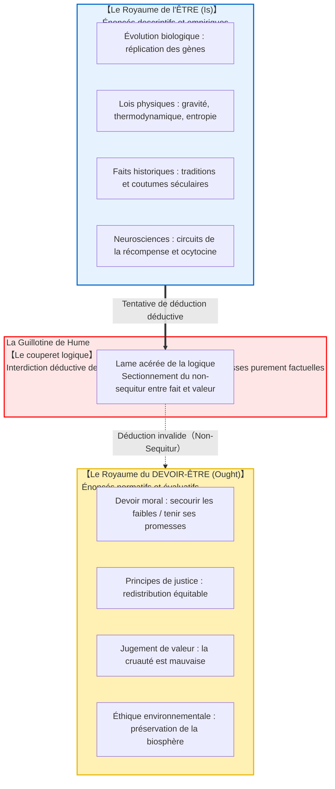
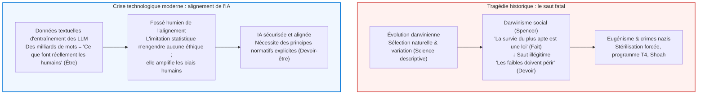

## Introduction : Le gouffre logique invisible du quotidien

Dans les débats publics, les discours politiques et la vulgarisation scientifique, nous rencontrons couramment des arguments formulés ainsi :

- « L'être humain a évolué biologiquement pour procréer et transmettre son patrimoine génétique. <strong>Par conséquent, tout individu doit se marier et élever des enfants.</strong> »
- « Dans une économie de marché libre, la compétition naturelle élimine les acteurs inefficaces au profit des plus forts. <strong>Par conséquent, l'État ne doit pas secourir les plus démunis par des aides sociales.</strong> »
- « Cette coutume et cette structure familiale traditionnelle perdurent dans notre pays depuis trois siècles. <strong>Par conséquent, nous devons la préserver fidèlement pour l'éternité.</strong> »
- « L'empathie et la coopération ont été sélectionnées car la libération d'ocytocine favorisait la survie des groupes ancestraux. <strong>Par conséquent, l'altruisme est un bien moral universel et obligatoire.</strong> »

À première vue, ces affirmations semblent solidement ancrées dans des faits objectifs issus de la biologie, de l'économie ou des neurosciences. Pourtant, soumises au scalpel de la logique formelle et de la métaéthique, elles révèlent un saut logique illégitime : <strong>la transition clandestine de ce qui EST (fait descriptif) à ce qui DOIT ÊTRE (norme prescriptive)</strong>.

Le fait que l'organisme humain soit biologiquement adapté à la reproduction n'implique nullement une obligation morale de procréer. De même que les virus et bactéries pathogènes existent naturellement sans que quiconque n'affirme que nous *devons* laisser les pandémies se propager, <strong>la description empirique du monde est d'une nature radicalement distincte de la prescription de nos devoirs.</strong>

Cette rupture épistémologique majeure a été identifiée pour la première fois par le philosophe des Lumières écossaises <strong>David Hume (1711–1776)</strong> dans son *Traité de la nature humaine* (1739). Qualifiée plus tard de <strong>« Guillotine de Hume »</strong> par Max Black, elle a renversé la téléologie aristotélicienne. Au début du XXe siècle, G. E. Moore a prolongé cette analyse avec le concept de « sophisme naturaliste ».

---

## 1. Le passage fondamental de David Hume (1739)

Dans le Livre III de son *Traité de la nature humaine*, Hume écrit le passage sans doute le plus célèbre de la philosophie morale anglo-saxonne :

> « Dans tous les systèmes de morale que j'ai rencontrés jusqu'ici, j'ai toujours remarqué que l'auteur procède pendant un certain temps de la manière ordinaire de raisonner, établit l'existence d'un Dieu, ou fait des observations sur les affaires humaines ; quand tout à coup, je suis surpris de constater qu'au lieu des copules ordinaires des propositions, <strong>est et n'est pas</strong>, je ne rencontre aucune proposition qui ne soit liée par un <strong>doit ou ne doit pas</strong>.
> 
> Ce changement est imperceptible, mais il est de la plus haute importance. Car comme ce *doit* ou *ne doit pas* exprime une <strong>nouvelle relation ou affirmation</strong>, il est nécessaire qu'il soit remarqué et expliqué ; et qu'en même temps une raison soit donnée pour ce qui semble tout à fait inconcevable : <strong>comment cette nouvelle relation peut être une déduction d'autres relations qui en sont entièrement différentes.</strong> »

L'argument de Hume repose sur le <strong>principe de conservativité de la logique déductive</strong> : une déduction valide ne peut contenir dans sa conclusion aucun prédicat ou opérateur modal absent de ses prémisses. Passer de prémisses purement factuelles à une conclusion déontique (« doit ») constitue un pur sophisme de type *non-sequitur*. Pour valider l'inférence, il faut impérativement adjoindre une prémisse normative implicite (« On doit respecter ses promesses »), laquelle exige à son tour une justification normative, entraînant une régression à l'infini.

---

## 2. Le sophisme naturaliste et l'argument de la question ouverte (G. E. Moore)

En 1903, dans *Principia Ethica*, <strong>G. E. Moore</strong> démontre que la propriété morale « bon » est une propriété simple, inanalysable et non-naturelle, semblable à la perception visuelle du « jaune ». Vouloir définir le « bien » par une propriété naturelle (le plaisir, l'évolution, le désir) constitue le <strong>sophisme naturaliste (Naturalistic Fallacy)</strong>.

Moore forge l'<strong>Argument de la question ouverte (Open Question Argument)</strong> :
- <strong>Question fermée :</strong> « Pierre est célibataire, mais est-il non marié ? » (Triviale et fermée par définition).
- <strong>Question ouverte :</strong> « L'action X maximise le plaisir général, mais <strong>l'action X est-elle réellement bonne ?</strong> »

Cette interrogation demeure toujours intelligible et ouverte. Si « bon » était rigoureusement synonyme de « maximiser le plaisir », la question serait absurde. Puisqu'elle a un sens profond, « bon » ne peut être réduit à aucune propriété naturelle.

---

## 3. Formalisation en logique déontique standard (SDL)

Le logicien autrichien <strong>Gerhard Schurz</strong> a démontré en 1997 le théorème généralisé de Hume au sein de la logique déontique standard. En sémantique de Kripke, les valeurs de vérité empiriques dans le monde réel et la relation d'accessibilité aux mondes idéaux sont <strong>strictement orthogonales</strong>. Pour tout ensemble cohérent de faits $\Gamma$ et toute formule déontique pertinente non triviale $\mathbf{O}\phi$ :

$$\Gamma \nvdash_{\text{SDL}} \mathbf{O}\phi$$

---

## 4. Drames historiques et alignement de l'intelligence artificielle

Ignorer la guillotine de Hume a engendré au XIXe et XXe siècles le désastre du <strong>darwinisme social</strong> et de l'eugénisme : croire que la cruauté de la sélection naturelle autorisait l'élimination des plus faibles. Or, la rudesse de la nature est précisément la raison pour laquelle les êtres humains doivent concevoir des institutions de solidarité.

Aujourd'hui, ce gouffre réapparaît au cœur du <strong>problème de l'alignement de l'IA</strong>. Entraîner un modèle de langage sur les textes du Web revient à modéliser ce que les humains *font et disent* (le monde de l'Être). Déduire comment une superintelligence *doit agir* (le monde du Devoir-être) exige une injection normative externe (RLHF, IA constitutionnelle).

---

## 5. Conclusion : Le phare des valeurs dans l'océan des faits

La guillotine de Hume ne détruit pas la morale : elle préserve notre liberté.
Si le devoir découlait automatiquement des faits, nous ne serions que des rouages mécaniques soumis aux lois impersonnelles de la matière. C'est précisément parce qu'il existe un abîme entre le fait et la valeur que l'être humain peut affirmer face au monde :
> <strong>« Le monde est ainsi fait (Être). Mais il ne doit pas le rester (Devoir). Nous avons le devoir et la liberté de le rendre plus juste. »</strong>

