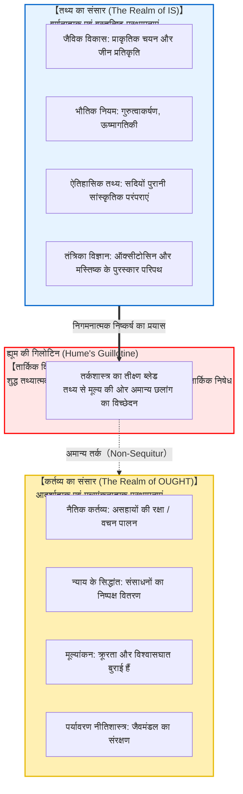
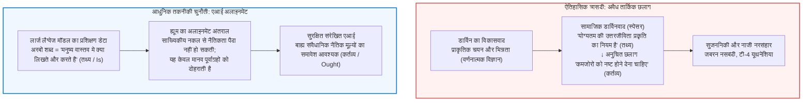

## प्रस्तावना: दैनिक संवाद में छिपा तार्किक अंतराल

दैनिक जीवन, राजनीतिक बहसों और लोकप्रिय वैज्ञानिक चर्चाओं में हम अक्सर ऐसे तर्क सुनते हैं:

- "मनुष्य जैविक रूप से अपनी संतानों को जन्म देने और जीन को आगे बढ़ाने के लिए विकसित हुआ है। <strong>इसलिए, प्रत्येक व्यक्ति को विवाह करना चाहिए और बच्चे पैदा करने चाहिए।</strong>"
- "मुक्त बाजार अर्थव्यवस्था में गलाकाट प्रतिस्पर्धा के माध्यम से मजबूत जीवित रहते हैं और अक्षम कमजोर बाहर हो जाते हैं। <strong>इसलिए, सरकार को सामाजिक कल्याण योजनाओं से कमजोरों की मदद नहीं करनी चाहिए।</strong>"
- "यह पारंपरिक व्यवस्था और पारिवारिक संरचना हमारे समाज में तीन सौ वर्षों से चली आ रही है। <strong>इसलिए, हमें इस परंपरा को सदैव बनाए रखना चाहिए।</strong>"
- "सहानुभूति और सहयोग का विकास इसलिए हुआ क्योंकि ऑक्सीटोसिन स्राव ने आदिम समूहों के अस्तित्व को बचाया। <strong>इसलिए, परोपकार एक वस्तुनिष्ठ रूप से बाध्यकारी नैतिक कर्तव्य है।</strong>"

प्रथम दृष्टया ये दावे जीवविज्ञान, अर्थशास्त्र, इतिहास या तंत्रिका विज्ञान के ठोस तथ्यों पर आधारित प्रतीत होते हैं। परंतु तर्कशास्त्र और मेटा-नीतिशास्त्र (Metaethics) की कसौटी पर कसते ही इनमें एक घातक तार्किक दोष उजागर होता है: <strong>'क्या है (Is: तथ्य)' से 'क्या होना चाहिए (Ought: मूल्य/कर्तव्य)' की ओर अनुचित छलांग</strong>।

मनुष्य का जैविक स्वभाव प्रजनन का है (तथ्य), इससे यह नैतिक अनिवार्यता कैसे निकल सकती है कि उसे बच्चे पैदा ही करने 'चाहिए' (कर्तव्य)? प्रकृति में घातक वायरस और बैक्टीरिया मौजूद हैं, किंतु इसका यह अर्थ कतई नहीं है कि हमें महामारियों को यूं ही फैलने देना 'चाहिए'। <strong>संसार वास्तविक रूप से कैसा है, और हमें नैतिक रूप से कैसा आचरण करना चाहिए, ये दोनों पूर्णतः भिन्न तार्किक क्षेत्र हैं।</strong>

तथ्य और मूल्य के इस गहरे विभाजन को सर्वप्रथम 18वीं शताब्दी के स्कॉटिश दार्शनिक <strong>डेविड ह्यूम (1711–1776)</strong> ने अपनी कालजयी पुस्तक *ए ट्रीटीज ऑफ ह्यूमन नेचर* में उजागर किया था। 20वीं सदी में मैक्स ब्लैक ने इसे <strong>'ह्यूम की गिलोटिन (Hume's Guillotine)'</strong> का नाम दिया। तत्पश्चात जी. ई. मूर ने 'प्रकृतिवादी हेत्वाभास (Naturalistic Fallacy)' का प्रतिपादन कर आधुनिक मेटा-नीतिशास्त्र की नींव रखी।

---

## 1. डेविड ह्यूम का मौलिक तर्क: *ट्रीटीज* का प्रसिद्ध अंश

1739 में ह्यूम ने नीतिशास्त्र के इतिहास का सर्वाधिक उद्धृत गद्यांश लिखा:

> "मैंने अब तक देखी प्रत्येक नैतिक प्रणाली में हमेशा पाया है कि लेखक कुछ समय तक सामान्य तरीके से आगे बढ़ता है, ईश्वर के अस्तित्व को स्थापित करता है, या मानवीय मामलों का अवलोकन करता है; तभी अचानक मुझे यह देखकर आश्चर्य होता है कि प्रस्थापनाओं के सामान्य संयोजनों <strong>'है' और 'नहीं है' (is and is not)</strong> के स्थान पर ऐसा कोई वाक्य नहीं मिलता जो <strong>'चाहिए' या 'नहीं चाहिए' (ought or ought not)</strong> से न जुड़ा हो।
> 
> यह परिवर्तन अत्यंत सूक्ष्म है, किंतु इसके परिणाम अत्यंत गंभीर हैं। क्योंकि यह *चाहिए* एक <strong>नए संबंध या निश्चय</strong> को व्यक्त करता है, इसलिए यह आवश्यक है कि इसे स्पष्ट किया जाए; और साथ ही उस बात का कारण दिया जाए जो सर्वथा समझ से परे लगती है: <strong>कि यह नया संबंध उन अन्य संबंधों से कैसे निगमित किया जा सकता है जो इससे पूरी तरह भिन्न हैं।</strong>"

ह्यूम का तर्क निगमनात्मक तर्कशास्त्र के <strong>संरक्षण नियम (Principle of Conservativity)</strong> पर आधारित है: किसी भी वैध निष्कर्ष में ऐसा कोई नया शब्द या संकल्पना नहीं हो सकती जो आधारवाक्यों में उपस्थित न हो। शुद्ध तथ्यात्मक वर्णनों से अचानक कर्तव्य ('चाहिए') का निष्कर्ष निकालना एक तार्किक हेत्वाभास (*Non-sequitur*) है। इसे वैध बनाने के लिए एक अंतर्निहित नैतिक आधारवाक्य जोड़ना पड़ता है, जो अंततः अनवस्था दोष (Infinite Regress) की ओर ले जाता है।

---

## 2. जी. ई. मूर का प्रकृतिवादी हेत्वाभास और खुला प्रश्न तर्क

1903 में <strong>जी. ई. मूर (G. E. Moore)</strong> ने *प्रिंसिपिया एथिका* में स्पष्ट किया कि 'शुभ' (Good) एक सरल, अविभाज्य और गैर-प्राकृतिक गुण है—ठीक वैसे ही जैसे 'पीले रंग' की अनुभूति। अच्छाई को किसी प्राकृतिक गुण (जैसे सुख, विकास या इच्छा) के रूप में परिभाषित करना <strong>प्रकृतिवादी हेत्वाभास (Naturalistic Fallacy)</strong> कहलाता है।

मूर ने <strong>खुला प्रश्न तर्क (Open Question Argument)</strong> प्रस्तुत किया:
- <strong>बंद प्रश्न:</strong> "मोहन कुंवारा है, किंतु क्या वह अविवाहित है?" (परिभाषा से ही स्वतः सिद्ध)।
- <strong>खुला प्रश्न:</strong> "कार्य X से अधिकतम लोगों को सुख मिलता है, किंतु <strong>क्या कार्य X वास्तव में 'शुभ' है?</strong>"

यह प्रश्न सदैव एक सार्थक और खुला प्रश्न बना रहता है। यदि 'शुभ' का अर्थ केवल 'सुख' होता, तो यह प्रश्न व्यर्थ की पुनरुक्ति होता। चूंकि यह प्रश्न गहरा और विचारणीय है, अतः शुभ को किसी भी भौतिक या मनोवैज्ञानिक तथ्य के बराबर नहीं माना जा सकता।

---

## 3. डिओन्टिक लॉजिक (SDL) में गणितीय प्रमाण

1997 में ऑस्ट्रियाई तर्कशास्त्री <strong>गेरहार्ड शुर्ज (Gerhard Schurz)</strong> ने मानक कर्तव्य तर्कशास्त्र (SDL) के अंतर्गत ह्यूम के नियम को गणितीय रूप से सिद्ध किया। क्रिपके के संभावित विश्व मॉडल में वास्तविक विश्व के तथ्यों का सत्य-मान और आदर्श विश्वों का संबंध <strong>पूरी तरह से लंबवत (स्वतंत्र)</strong> होता है। सुसंगत तथ्यों के समुच्चय $\Gamma$ और किसी गैर-तुच्छ नैतिक सूत्र $\mathbf{O}\phi$ के लिए:

$$\Gamma \nvdash_{\text{SDL}} \mathbf{O}\phi$$

---

## 4. ऐतिहासिक त्रासदी और आधुनिक एआई संरेखण संकट

ह्यूम की गिलोटिन की उपेक्षा का दुष्परिणाम 19वीं और 20वीं सदी में <strong>सामाजिक डार्विनवाद</strong> और सुजननिकी (Eugenics) के रूप में सामने आया, जहां कमजोरों के संहार को यह कहकर उचित ठहराया गया कि प्रकृति में 'मजबूत' ही बचता है। वे भूल गए कि प्रकृति की क्रूरता (तथ्य) ही वह कारण है जिसके विरुद्ध मनुष्य को करुणा और न्याय के संस्थान (कर्तव्य) गढ़ने चाहिए।

आज यह संकट <strong>आर्टिफिशियल इंटेलिजेंस अलाइनमेंट (AI Alignment)</strong> में पुनः उत्पन्न हो गया है। इंटरनेट के डेटा से भाषा मॉडल यह तो सीख लेते हैं कि मनुष्य 'क्या करता है' (Is), किंतु एक महाबुद्धिमान एआई को 'क्या करना चाहिए' (Ought), यह सांख्यिकी से नहीं बल्कि स्पष्ट नैतिक संहिताओं से ही निर्धारित किया जा सकता है।

---

## 5. निष्कर्ष: तथ्यों के सागर में मूल्यों का प्रकाशस्तंभ

ह्यूम की गिलोटिन नैतिकता को समाप्त नहीं करती, बल्कि मानवीय स्वतंत्रता की रक्षा करती है।
यदि 'तथ्य' से स्वतः 'कर्तव्य' निकल आता, तो हम प्राकृतिक नियमों की अंधी कठपुतली बन जाते, और हमारी नैतिक स्वतंत्रता समाप्त हो जाती।

तथ्य और मूल्य के बीच इस गहरी खाई के कारण ही मनुष्य कठोर यथार्थ के सम्मुख दृढ़ता से कह सकता है:
> <strong>"संसार आज भले ही ऐसा है (Is), किंतु इसे ऐसा ही नहीं रहना चाहिए (Ought)। हम अपने विवेक और अंतरात्मा से इसे अधिक न्यायपूर्ण और सुंदर बनाएंगे।"</strong>

