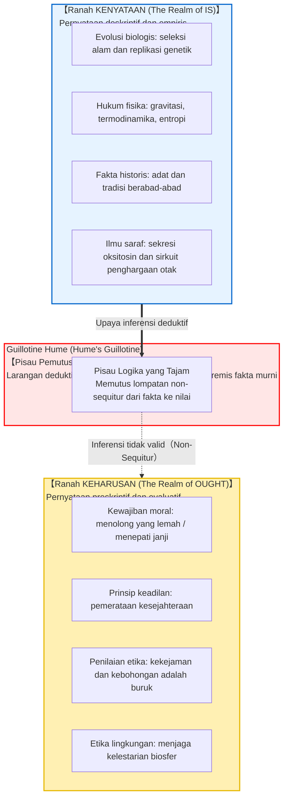
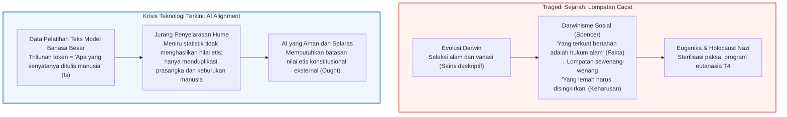

## Pendahuluan: Jurang Logika Tersembunyi dalam Keseharian

Dalam percakapan sehari-hari, debat politik, maupun narasi sains populer, kita sering mendengar pernyataan seperti:

- "Manusia secara biologis berevolusi untuk bereproduksi dan mewariskan materi genetik. <strong>Oleh karena itu, setiap orang seharusnya menikah dan memiliki anak.</strong>"
- "Dalam pasar bebas, persaingan ketat menyeleksi pihak yang kuat dan melenyapkan yang lemah menurut hukum alam. <strong>Oleh karena itu, pemerintah tidak seharusnya memberikan bantuan sosial bagi kelompok rentan.</strong>"
- "Tradisi dan adat keluarga ini telah dijalankan di negeri kita selama tiga ratus tahun. <strong>Oleh karena itu, kita wajib melestarikannya untuk selama-lamanya.</strong>"
- "Empati dan kerja sama terbentuk karena pelepasan hormon oksitosin meningkatkan kelangsungan hidup kelompok purba. <strong>Oleh karena itu, altruisme adalah kebaikan moral yang bernilai objektif.</strong>"

Sepintas lalu, pernyataan-pernyataan di atas tampak meyakinkan karena bersandar pada fakta-fakta ilmiah dari biologi, ekonomi, sejarah, atau ilmu saraf. Namun, di bawah analisis logika dan metaetika, klaim-klaim tersebut memperlihatkan cacat logika fatal: <strong>lompatan sewenang-wenang dari apa yang NYATA ADANYA (Is / fakta) menuju apa yang SEHARUSNYA DILAKUKAN (Ought / norma)</strong>.

Fakta biologis bahwa tubuh manusia berevolusi untuk bereproduksi tidak serta-merta melahirkan kewajiban moral bahwa seseorang *harus* memiliki anak. Sebagaimana virus dan bakteri mematikan ada secara alami di dunia tanpa seorang pun menyimpulkan bahwa kita *harus* membiarkan wabah merajalela, <strong>keadaan empiris alam semesta berada pada domain logika yang sama sekali berbeda dengan pertimbangan kewajiban moral manusia.</strong>

Pemisahan radikal ini pertama kali diartikulasikan oleh filsuf Pencerahan Skotlandia <strong>David Hume (1711–1776)</strong> dalam karya monumentalnya *A Treatise of Human Nature* (1739). Dinamai oleh Max Black pada abad ke-20 sebagai <strong>"Guillotine Hume"</strong>, gagasan ini meruntuhkan pandangan alam teleologis Aristotelian. Kemudian, G. E. Moore memperluasnya menjadi konsep "Kesesatan Naturalistik" (Naturalistic Fallacy).

---

## 1. Teks Klasik David Hume dalam *Treatise of Human Nature*

Dalam Buku III dari *Treatise*, Hume menuliskan kalimat yang paling sering dikutip dalam metaetika:

> "Dalam setiap sistem moralitas yang pernah saya temui, saya selalu memperhatikan bahwa penulis selama beberapa waktu menggunakan cara penalaran biasa, membuktikan keberadaan Tuhan, atau mengamati urusan manusia; namun tiba-tiba saya terkejut mendapati bahwa, alih-alih menggunakan kata penghubung proposisi biasa, <strong>adalah dan bukan (is and is not)</strong>, tidak ada proposisi yang tidak terhubung dengan kata <strong>seharusnya atau tidak seharusnya (ought or ought not)</strong>.
> 
> Perubahan ini tidak mencolok, namun membawa konsekuensi besar. Karena kata *seharusnya* atau *tidak seharusnya* ini mengekspresikan suatu <strong>hubungan atau afirmasi baru</strong>, maka hal itu mutlak perlu diperhatikan dan dijelaskan; dan pada saat yang sama harus diberikan alasan untuk hal yang tampaknya sama sekali tidak dapat dipahami: <strong>bagaimana hubungan baru ini dapat diturunkan dari hubungan-hubungan lain yang sama sekali berbeda darinya.</strong>"

Hume berpegang pada <strong>prinsip konservativitas logika deduktif</strong>: dalam argumen yang valid, kesimpulan tidak boleh memuat predikat atau operator baru yang tidak tercantum dalam premis-premisnya. Menurunkan keharusan moral dari fakta empiris semata merupakan kekeliruan bernalar (*non-sequitur*). Untuk menjadikannya sah, premis normatif tersembunyi harus ditambahkan, yang pada gilirannya menuntut pembenaran tanpa akhir (regres tak terhingga).

---

## 2. Kesesatan Naturalistik dan Argumen Pertanyaan Terbuka G. E. Moore

Pada tahun 1903, dalam *Principia Ethica*, <strong>G. E. Moore</strong> membuktikan bahwa sifat "baik" (good) adalah kualitas sederhana dan non-natural yang tidak dapat didefinisikan, serupa dengan pengalaman melihat warna "kuning". Menyamakan kebaikan moral dengan kualitas alamiah (kenikmatan, kelangsungan hidup evolusioner, atau kepuasan hasrat) disebut <strong>Kesesatan Naturalistik (Naturalistic Fallacy)</strong>.

Moore merumuskan <strong>Argumen Pertanyaan Terbuka (Open Question Argument)</strong>:
- <strong>Pertanyaan tertutup:</strong> "Budi adalah seorang bujangan, tetapi apakah dia belum menikah?" (Trivial dan tertutup secara definisi).
- <strong>Pertanyaan terbuka:</strong> "Tindakan X memaksimalkan kesenangan kelompok terbanyak, tetapi <strong>apakah tindakan X benar-benar 'baik'?</strong>"

Pertanyaan tersebut selalu merupakan pertanyaan terbuka yang bermakna. Jika "baik" identik dengan "kenikmatan", pertanyaan itu akan konyol seperti menanyakan bujangan yang belum menikah. Karena pertanyaan itu sah dan mendalam, konsep kebaikan moral tidak dapat direduksi menjadi fakta empiris apa pun.

---

## 3. Pembuktian Formal dalam Logika Deontik Standar (SDL)

Pada tahun 1997, pakar logika Austria <strong>Gerhard Schurz</strong> membuktikan teorema Hume secara matematis dalam kerangka Standard Deontic Logic (SDL). Dalam semantik Kripke, penetapan nilai kebenaran fakta dunia nyata dan relasi keterjangkauan menuju dunia ideal secara model-teoretis adalah <strong>sepenuhnya ortogonal (independen)</strong>. Untuk setiap himpunan fakta yang konsisten $\Gamma$ dan formula deontik relevan non-trivial $\mathbf{O}\phi$:

$$\Gamma \nvdash_{\text{SDL}} \mathbf{O}\phi$$

---

## 4. Tragedi Sejarah dan Krisis Penyelarasan AI Modern

Pelanggaran terhadap Guillotine Hume memicu malapetaka <strong>Darwinisme Sosial</strong> dan eugenika pada abad ke-19 dan ke-20. Penganutnya berdalih bahwa karena alam menyeleksi yang terkuat, maka masyarakat pun harus menyingkirkan yang lemah. Mereka lupa: kekejaman alam justru menjadi alasan mengapa manusia harus membangun tatanan keadilan dan belas kasih.

Kini, persoalan ini muncul kembali dalam <strong>masalah penyelarasan kecerdasan buatan (AI Alignment Problem)</strong>. Model bahasa besar (LLM) dilatih menggunakan kumpulan teks internet raksasa yang merepresentasikan alam Kenyataan (Is). Menentukan bagaimana superintelijen *seharusnya bertindak* (Ought) secara logis mustahil diperoleh hanya dari pola statistik teks masa lalu, melainkan membutuhkan penanaman prinsip etika konstitusional.

---

## 5. Kesimpulan: Mercusuar Nilai di Samudra Fakta

Guillotine Hume tidak meniadakan moralitas; gagasan ini justru menyelamatkan kebebasan manusia.
Jika keharusan dapat diturunkan otomatis dari fakta, kita hanyalah roda mekanis yang tunduk pasrah pada hukum alam tanpa kebebasan memilih dan tanggung jawab etis.

Karena ada jurang pemisah antara fakta dan nilai, manusia dapat menatap kenyataan yang keras dan menyatakan:
> <strong>"Dunia saat ini memang demikian adanya (Is). Namun dunia tidak boleh dibiarkan begitu saja (Ought). Kita memiliki kebebasan dan nurani untuk memperbaikinya."</strong>

