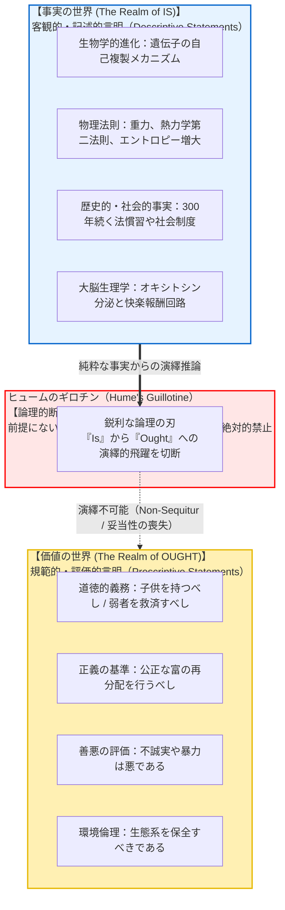
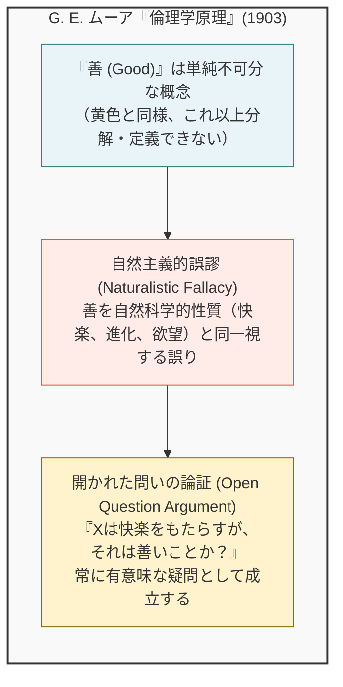
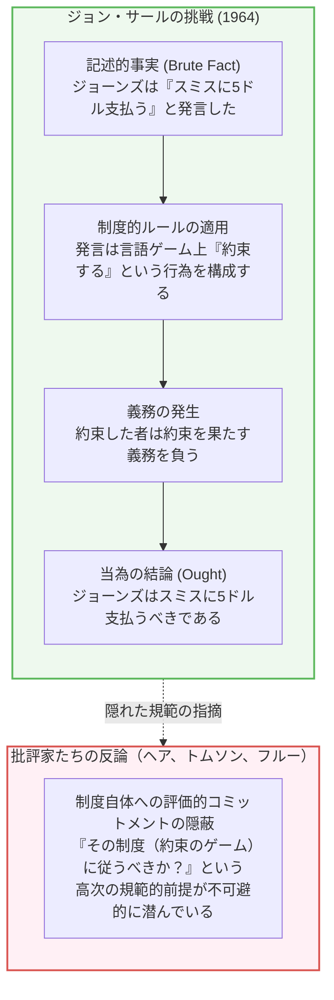
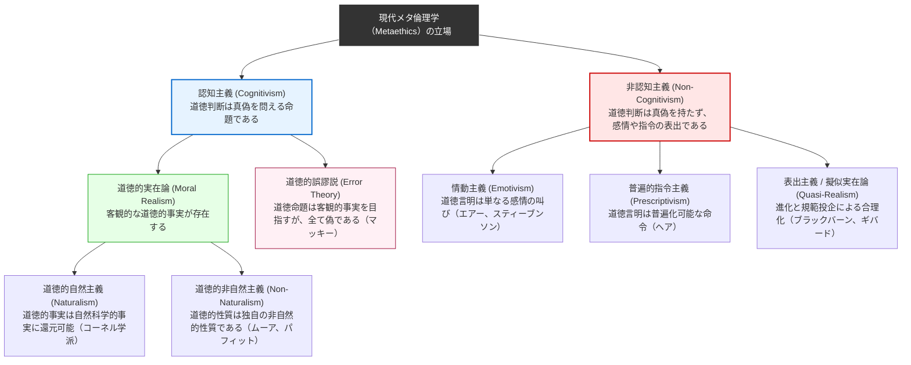
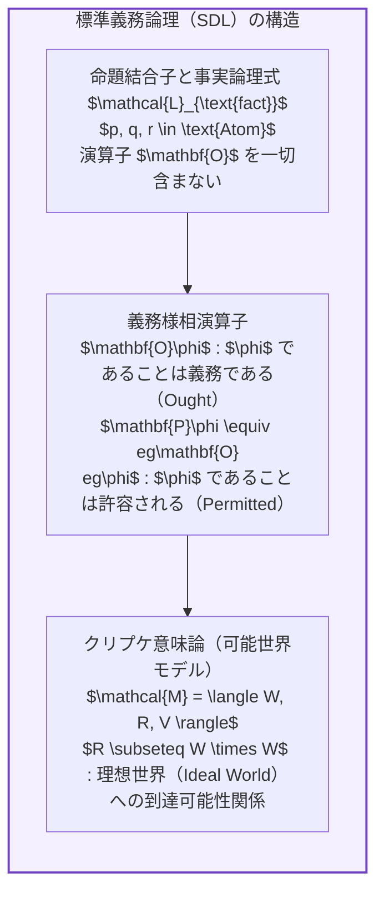

## 序論：日常に潜む論理の断絶

私たちは日常生活や政治的議論、あるいは科学の普及言説において、次のような主張を頻繁に耳にします：

- 「人間は生物学的に子供を産み育てて遺伝子を後世に残すように進化してきた。<strong>したがって、すべての人間は結婚して子供を持つべきである。</strong>」
- 「資本主義の自由市場においては、競争によって効率的な強者が生き残り、非効率な弱者が淘汰されるのが自然の摂理である。<strong>したがって、国家は福祉政策によって弱者を救済すべきではない。</strong>」
- 「この伝統的な儀礼や家族形態は、我が国の歴史において三百年間にわたり遵守されてきた。<strong>したがって、私たちはこの伝統を未来永劫変えることなく維持すべきである。</strong>」
- 「他者を思いやり協力することは、人類が過酷な環境を生き延びるために脳内で快楽物質オキシトシンを分泌するように進化した結果である。<strong>したがって、利他主義こそが客観的に正しい道徳的善である。</strong>」

これらは一見すると、生物学、経済学、歴史学、大脳生理学などの客観的な「事実」を根拠にした説得力ある論証に見えるかもしれません。しかし、論理学およびメタ倫理学（Metaethics）の厳密な分析のメスを入れた瞬間、これらの論述には極めて致命的な論理的跳躍、すなわち<strong>「事実（Is: である）」から「当為（Ought: すべきである）」への不当な密輸</strong>が潜んでいることが白日の下に晒されます。

「人間が子孫を残すようにできている（事実）」ということから、なぜ「子供を持つべきである（規範・当為）」という道徳的義務が必然的に導かれるのでしょうか？ 病原菌やウイルスが自然界に実在している（事実）からといって、私たちが感染症を治療せずに放置「すべき」ではないのと同様に、<strong>自然界や社会が「現にどうであるか」ということと、私たちが「どう行動すべきであるか」ということは、論理的に全く別次元の問題</strong>です。

この「事実と価値の絶対的断絶」を哲学史上初めて明確に告発したのが、18世紀スコットランド啓蒙主義の巨頭<strong>デイヴィッド・ヒューム（David Hume, 1711–1776）</strong>でした。後に20世紀の哲学者マックス・ブラック（Max Black）によって<strong>『ヒュームのギロチン（Hume's Guillotine）』</strong>と命名されたこの洞察は、アリストテレス以来二千年にわたり西洋思想を支配してきた目的論的自然観（「自然な状態こそが善である」という前提）を根底から打ち砕きました。

さらに20世紀初頭、ケンブリッジの哲学者G. E. ムーア（G. E. Moore）は、善という概念を自然科学的・経験的性質と同一視することを<strong>「自然主義的誤謬（Naturalistic Fallacy）」</strong>と名付け、分析哲学におけるメタ倫理学という広大な学問領域を拓きました。

本稿では、ヒュームの原典の精緻な論理構造から、ムーアの「開かれた問いの論証」、ジョン・サールによる「制度的事実」を通じたギロチンへの大胆な挑戦、情動主義・投企説・誤謬説・道徳的実在論に至るメタ倫理学の地層図、義務論理（Deontic Logic）による形式的証明、そして現代の優生学・社会ダーウィニズムの悲劇や最先端AIアライメント問題との交差点まで、事実と価値の深淵なる境界線を徹底的に探求します。

---

## 1. デイヴィッド・ヒュームの告発：『人間本性論』の決定的パッセージ

### 1.1 歴史的文脈と原典のテキスト
1739年、弱冠28歳のデイヴィッド・ヒュームは、哲学史上の金字塔となる主著『人間本性論（A Treatise of Human Nature）』を匿名で世に問いました。その第3巻「道徳について」第1部第1節「道徳的区別は理性から導かれない」の結びにおいて、ヒュームは哲学史上最も引用され、最も激しい論争を巻き起こした一節を書き記しました：

> 「私はこれまでに論じられてきた道徳体系のすべてにおいて、常に気づかされてきたことがある。著者はしばらくの間、通常の論法で進み、神の存在を確立したり、人間界の事柄について観察を行ったりする。
> 
> だが不意に、命題の通常の結合詞である<strong>『である（is）』や『ではない（is not）』</strong>の代わりに、どの命題も<strong>『すべきである（ought）』あるいは『すべきではない（ought not）』</strong>で結ばれていないものに出会わなくなるのを見て、私は驚かされるのである。
> 
> この変化は目立たないが、極めて重大な結果をもたらす。なぜなら、この『すべきである』や『すべきではない』は、何らかの<strong>新たな関係や断定</strong>を表現しているため、それが説明され、理由が与えられることが不可欠だからである。
> 
> しかし著者は通常そのような用心を全くせず、<strong>この新しい関係が、それとは完全に異なる他の関係からいかにして導き出され得るのか、およそ考えも及ばないことである。</strong>」
> 
> ―― デイヴィッド・ヒューム『人間本性論』第3巻第1部第1節（1739年）

ヒュームがここで痛烈に批判していたのは、当時の神学者や自然法論者たちの議論でした。彼らは「神は世界を調和的に創造した（事実）」「人間には理性と情念が備わっている（事実）」という観察から、何の説明もなく「ゆえに人間は神の戒律に従うべきである（当為）」という規範的命令へと無反省にジャンプしていたのです。

### 1.2 ヒュームの論証の形式的構造：演繹論理の保存則
ヒュームの指摘の核心は、古典的な三段論法をはじめとする<strong>演繹論理（Deductive Logic）の鉄則</strong>に基づいています。

健全（Sound）かつ妥当（Valid）な演繹推論において、結論に含まれる非論理的語彙（概念）は、必ず前提の中に明示的または暗黙のうちに含まれていなければなりません。これを論理学では<strong>保存則（Conservativity）</strong>と呼びます。

例えば、次の推論を見てみましょう：

$$\begin{aligned}
\text{前提 1:} & \quad \text{すべての人間は可死的な存在である。（事実：Is）} \\
\text{前提 2:} & \quad \text{ソクラテスは人間である。（事実：Is）} \\
\text{結論:} & \quad \text{したがって、ソクラテスは可死的な存在である。（事実：Is）}
\end{aligned}$$

この推論では、前提に含まれる述語「人間である」「可死的な存在である」のみが結論に現れており、論理的に完全に妥当です。

しかし、次のような推論はどうでしょうか：

$$\begin{aligned}
\text{前提 1:} & \quad \text{約束を破る行為は、相手に精神的苦痛と経済的損失を与える。（事実：Is）} \\
\text{前提 2:} & \quad \text{太郎は花子に対して10万円を返す約束をした。（事実：Is）} \\
\text{結論:} & \quad \text{したがって、太郎は花子に10万円を返すべきである。（当為：Ought）}
\end{aligned}$$

一見すると常識的で正しい主張に思えます。しかし形式論理学の視点から厳密に見ると、<strong>前提には「〜である（Is）」という客観的事実の記述しか存在しないのに、結論に突如として「〜すべきである（Ought）」という全く新しい述語（様相演算子）が出現しています。</strong>

これは、前提に「ソクラテスは人間である」としか書いていないのに、結論で「したがってソクラテスは紫色の服を着ている」と言い出すのと同じレベルの<strong>論理的飛躍（Non-sequitur: 誤謬）</strong>なのです。

### 1.3 隠された前提（Enthymeme）の正体
この推論を論理的に妥当なものにするためには、前提の中に「〜すべきである」という規範的言明をあらかじめ挿入しなければなりません：

$$\begin{aligned}
\text{前提 1:} & \quad \text{太郎は花子に対して10万円を返す約束をした。（事実：Is）} \\
\text{追加前提 2:} & \quad \text{【人は誰しも、相手とした約束を守るべきである】（当為：Ought）} \\
\text{結論:} & \quad \text{したがって、太郎は花子に10万円を返すべきである。（当為：Ought）}
\end{aligned}$$

このように前提に規範的な大前提（Ought）を追加して初めて、結論の「すべきである」は演繹的に正当化されます。

しかし、ここで問題は一歩後退したに過ぎません。その追加された大前提「人は約束を守るべきである」は、一体何によって正当化されるのでしょうか？
もしそれを「社会の信用秩序を維持するためである（事実）」と説明するなら、再び「社会の信用秩序を維持すべきである（当為）」というさらなる大前提が必要になります。

このように、<strong>「すべき（Ought）」を正当化するためには、無限に先行する別の「すべき（Ought）」を要求せざるを得ず、純粋な事実の観察（Is）だけから最初の「すべき」を生み出すことは論理的に絶対に不可能</strong>なのです。

---

## 2. G. E. ムーアの自然主義的誤謬と「開かれた問いの論証」

ヒュームのギロチンから約160年後、20世紀初頭のイギリスで、事実と価値の断絶をめぐる議論に決定的な理論的深化をもたらしたのが、ケンブリッジ大学の哲学者<strong>G. E. ムーア（George Edward Moore, 1873–1958）</strong>です。彼が1903年に出版した『倫理学原理（Principia Ethica）』は、現代のメタ倫理学を独立した学問分野として確立させた画期的な名著でした。

### 2.1 「善」の定義不可能性：黄色とのアナロジー
ムーアはまず、「善（Good）」という基本的性質の本性について考察しました。ムーアによれば、多くの倫理学者たちは「善とは何か？」という問いに対して、善そのものを定義するのではなく、<strong>「善い事物」が持つ付帯的な性質（例えば「快楽をもたらすこと」「神の御心にかなうこと」「進化の適応度を高めること」）を善そのものと混同してきた</strong>と批判します。

ムーアは次のように論じます：

> 「もし私が『黄色とは何か？』と問われたなら、私は光の波長について物理学的な説明をすることはできるかもしれない。しかし、黄色という直接的な色覚の質そのものは、それを経験したことのない人に対して言葉で説明・定義することはできない。黄色は単純で分解不能な性質（Simple, unanalyzable property）だからである。
> 
> 『善』もこれと全く同様である。馬という複合的な概念は『四本足で、蹄があり、たてがみを持つ哺乳類』と部分に分解して定義できる。しかし、善はこれ以上分解することのできない単純な性質であり、したがって<strong>言語的にいかなる他の性質によっても定義することはできない。</strong>」

ムーアは、この単純な非自然的な性質である「善」を、物理的・心理的・生物学的な自然界の性質（Natural properties）と同一視して定義しようとする知的過誤を、<strong>「自然主義的誤謬（Naturalistic Fallacy）」</strong>と命名しました。

### 2.2 開かれた問いの論証（Open Question Argument: OQA）
ムーアが自然主義的誤謬を論駁するために考案した極めて強力な武器が、<strong>「開かれた問いの論証（Open Question Argument: OQA）」</strong>です。

ある概念 $A$ と概念 $B$ が<strong>定義上同一（同義語）</strong>であるならば、「$X$ は $A$ であるが、果たして $X$ は $B$ であるか？」という問いは、言葉の意味を理解している者にとって答えるまでもない自明な問い（閉じられた問い：Closed Question）になるはずです。

- <strong>例1（閉じられた問い）：</strong>
  「太郎は独身男性であるが、果たして太郎は未婚であるか？」
  → 「独身男性」の定義そのものが「未婚の男性」であるため、この問いには論理的に「自明である（問いとして成り立たない）」という答えしかあり得ません。これが「閉じられた問い」です。

では、倫理学的な定義の試みに対してこのテストを適用してみましょう。
功利主義者たちはしばしば「善とは、最大多数の最大幸福（快楽）をもたらすことである」と定義しようとします。そこでムーアは問いを立てます：

- <strong>例2（開かれた問い）：</strong>
  「行為 $A$ は最大多数の人々に最大の快楽をもたらすが、<strong>果たして行為 $A$ は本当に『善い』ことなのだろうか？</strong>」

この問いを聞いたとき、理性的な人間であれば誰しも、これが例1のような馬鹿げた同義反復ではなく、<strong>真剣に熟考し議論に値する有意味な問い（開かれた問い：Open Question）</strong>であると直感します。
例えば、「多数派が少数派を迫害・差別することで社会全体に巨大な快楽がもたらされる場合、その迫害行為は本当に善いのか？」という疑問は、極めて妥当で深い倫理的問いです。

もし「善＝快楽」が真の同義語的定義であるならば、「快楽をもたらす行為は善いのか？」という問いは「未婚の男は未婚なのか？」と同義の無意味な問いにならなければなりません。しかし、そうはならない。
したがって、<strong>「善」という性質は「快楽」という自然的性質とは絶対に同一ではない</strong>、とムーアは結論づけました。

同様の論理は、いかなる自然主義的定義（「欲望されるもの」「進化的に適応的なもの」「神が望むもの」）に対しても成立します：
- 「それは生物学的に進化を促進するが、果たして善いことか？」 （開かれた問い）
- 「それは神の命令であるが、果たして善いことか？」 （開かれた問い／エウテュプロンのジレンマ）

### 2.3 ヒュームのギロチンと自然主義的誤謬の相違点
現代の哲学において、ヒュームのギロチンとムーアの自然主義的誤謬は密接に関連していますが、その焦点は厳密には異なります：

| 比較項目 | ヒュームのギロチン (Hume's Guillotine) | 自然主義的誤謬 (Naturalistic Fallacy) |
|---|---|---|
| <strong>提唱者・年代</strong> | デイヴィッド・ヒューム (1739年) | G. E. ムーア (1903年) |
| <strong>主たる領域</strong> | <strong>論理学・推論の妥当性 (Logic / Inference)</strong> | <strong>意味論・存在論 (Semantics / Ontology)</strong> |
| <strong>問いの形式</strong> | 「事実の前提から当為の結論を<strong>演繹推論</strong>できるか？」 | 「『善』という性質を<strong>自然的性質で定義</strong>できるか？」 |
| <strong>禁止される行為</strong> | 前提にない「Ought」を結論に不当に持ち込むこと | 善を快楽や進化などの自然科学的対象と等置すること |
| <strong>結論</strong> | 事実言明から規範言明の導出は演繹的に不可能 | 善は単純かつ非自然的な（Non-natural）直観的性質 |

ヒュームは「推論の飛躍（論理）」を斬り落とし、ムーアは「同一視の混同（定義）」を告発したのです。両者は車の両輪として、自然科学から道徳的真理を安易に導こうとするあらゆる試みに対する鉄壁の防波堤となりました。

---

## 3. ギロチンへの挑戦：事実から価値は導出可能か？

ヒュームとムーアが築いた堅固な防波堤に対して、20世紀後半の哲学者たちは様々な角度から果敢な挑戦を試みました。事実から価値を架橋することは本当に不可能なのか？ それともヒュームの定式化に何らかの盲点があったのでしょうか？

### 3.1 ジョン・サールの「制度的事実（Institutional Facts）」論証
事実から当為の導出を試みた最も有名な挑戦は、アメリカの言語哲学者<strong>ジョン・サール（John Searle）</strong>が1964年の記念碑的論文「いかにして『である』から『すべき』を導くか（How to Derive 'Ought' from 'Is'）」で展開した論証です。

サールは世界における事実を二種類に明確に区別しました：
1. <strong>剥き出しの事実（Brute Facts）</strong>：人間の社会規範や言語制度とは独立に存在する客観的物理的事実（例：この石の重さは500グラムである、太陽は東から昇る）。
2. <strong>制度的事実（Institutional Facts）</strong>：人間が創り出した社会的ルールや制度（Constitutive Rules: 構成的規則）を背景にしてのみ意味を持つ事実（例：小切手を切る、ホームランを打つ、結婚する、約束する）。

サールはこの「制度的事実」を用いれば、純粋に記述的な前提から規範的な結論が演繹できると主張し、以下の有名な5段階の推論を提示しました：

1. <strong>前提1（事実）：</strong> ジョーンズは「私は君に5ドルを支払うと約束する、スミス」という言葉を発した。
2. <strong>前提2（事実）：</strong> 言語の約束規則のもとで、特定の状況で「私は約束する」という言葉を発することは、約束を行うことである。
3. <strong>中間結論3（事実）：</strong> したがって、ジョーンズはスミスに5ドル支払う約束をした。
4. <strong>前提4（事実）：</strong> 定義上、約束するという行為は、約束したことを実行する義務の下に身を置くことである。
5. <strong>結論5（当為）：</strong> したがって、ジョーンズはスミスに5ドルを支払うべきである（Ought）。

サールは、この推論過程には道徳的・評価的な前提（「人は約束を守るべし」など）は一切挿入されておらず、言語という社会制度の客観的事実と語の意味の分析のみから、正当に「べきである（Ought）」が導かれていると主張しました。

### 3.2 批評家たちの反撃：制度への参加と規範の密輸
サールの論文は世界的な大論争を巻き起こし、リチャード・ヘア（R. M. Hare）やアントニー・フルー（Antony Flew）ら多くのメタ倫理学者から激しい反撃を受けました。

彼らの反論の要点は、サールの論証のステップ4からステップ5への移行において、<strong>「約束という制度そのものを受け入れ、尊重すべきである」という評価的（規範的）態度が暗黙のうちに密輸されている</strong>という点でした。

外部観察者（人類学者）の視点に立ってみましょう：
- 「ジョーンズの属する文化圏では、約束をした者は支払うべきであると信じられている（事実）。」
- 「ジョーンズはその文化のルールに従っている（事実）。」

ここから導かれるのは、単に「ジョーンズはその制度の内側において義務を負っているとみなされている（記述的事実）」に過ぎません。
「ジョーンズは（客観的・道徳的に真に）支払うべきである」という真の道徳的当為を導くためには、<strong>「人間は約束という社会制度を守るべきである」という外在的な道徳的判断</strong>が前提として絶対に不可欠です。

もし誰かが「私はマフィアの掟（制度）に従って人を殺すと約束した」と言った場合、マフィアの構成的規則の内側では「殺すべきである」という制度的義務が生じますが、それが客観的な道徳的当為にならないのは自明です。したがって、サールの論証もまた、ギロチンの鋭利な刃を回避することはできなかったと広く評価されています。

### 3.3 ピーター・シンガーと機能的評価言明（Functional Ought）
もう一つのアプローチとして、道具や生物の「機能（Function）」に着目する機能主義的アプローチがあります。哲学者アラスデア・マッキンタイア（Alasdair MacIntyre）やピーター・シンガーらが議論した例です：

$$\begin{aligned}
\text{前提 1:} & \quad \text{この時計は時間がひどく狂い、すぐに止まってしまう。（事実）} \\
\text{結論:} & \quad \text{したがって、この時計は『悪い（Bad）』時計である。（評価）}
\end{aligned}$$

あるいは、
$$\begin{aligned}
\text{前提 1:} & \quad \text{この包丁の刃はボロボロに欠けており、食材が全く切れない。（事実）} \\
\text{結論:} & \quad \text{したがって、料理人はこの包丁を研ぐ『べき（Ought）』である。（当為）}
\end{aligned}$$

これらのケースでは、事実の記述から「善い／悪い」「すべき」という評価が直接導かれているように見えます。
しかし、分析哲学者はこれを<strong>「道具的・機能的当為（Instrumental Ought）」</strong>と呼び、真の<strong>「道徳的当為（Moral Ought）」</strong>と厳密に区別します。

時計や包丁には、人間があらかじめ設定した「正確に時を刻む」「食材を鋭く切る」という明確な<strong>目的（Telos）</strong>がビルトインされています。「研ぐべきである」という命題は、「もし食材をスムーズに切りたいのであれば、研ぐべきである」というカントの言う<strong>仮言命法（Hypothetical Imperative）</strong>に過ぎず、目的そのものを無条件に義務付ける<strong>定言命法（Categorical Imperative: 道徳的当為）</strong>ではないのです。

---

## 4. メタ倫理学の地図：事実と価値をめぐる思想の系譜

ヒュームのギロチンとムーアの自然主義的誤謬の発見以降、哲学界では「事実と価値の関係をどう捉えるか」をめぐって無数の学派が林立しました。現代メタ倫理学の全体構造を俯瞰する概念図を以下に示します。

### 4.1 非認知主義（Non-Cognitivism）：ブー・ハラー説から表出主義へ
ヒュームのギロチンを最もラディカルに継承したのが、20世紀前半の論理実証主義者たちでした。A. J. エアー（A. J. Ayer）は『言語・真理・論理』（1936）において、<strong>情動主義（Emotivism）</strong>を提唱しました。

エアーによれば、有意味な命題とは「経験的に検証可能な事実言明（科学）」か「論理的恒真命題（数学）」のいずれかだけであり、客観的検証が不可能な道徳的言明は、真でも偽でもない単なる<strong>感情の叫び</strong>に過ぎません：
- 「君が金を盗んだのは悪いことだ」という発言は、事実としては「君は金を盗んだ」と述べているだけであり、「悪い」という部分は「金を盗むなんて、ブー！（Boo! けしからん！）」という感嘆詞を付け加えているだけである。
- 「親孝行は善いことだ」は、「親孝行、万歳！（Hurrah!）」と叫んでいるに等しい。

これが悪名高い<strong>「ブー・ハラー説（Boo-Hurrah Theory）」</strong>です。
後にR. M. ヘア（R. M. Hare）は、道徳言明の本質は感情の吐露ではなく、他者に対する<strong>「普遍化可能な指令（Universal Prescriptions）」</strong>であるとする普遍的指令主義を展開し、サイモン・ブラックバーン（Simon Blackburn）は<strong>擬似実在論（Quasi-Realism）</strong>によって、なぜ私たちが主観的な情動をあたかも客観的な事実であるかのように語るのかを進化心理学的に説明しました。

### 4.2 J. L. マッキーの誤謬説（Error Theory）と「奇妙さの論証」
オーストラリアの哲学者<strong>J. L. マッキー（John Leslie Mackie, 1917–1981）</strong>は、1977年の著書『倫理学：善悪の探求』で衝撃的な<strong>「道徳的誤謬説（Error Theory）」</strong>を提示しました。

マッキーは情動主義に反対し、「人々が道徳的判断を下すとき、彼らは単に感情を叫んでいるのではなく、本当に『客観的な道徳的真理が存在する』と信じて客観的言明を行っている（認知主義）」と認めました。しかしマッキーは、<strong>「客観的な道徳的価値などというものは、この宇宙のどこにも存在しない。したがって、すべての道徳的判断は例外なく偽（誤謬）である」</strong>と断言したのです。これは、無神論者が「すべての宗教的言説（神は存在する、神は慈悲深い）は偽である」とみなすのと全く同じ構造です。

マッキーが挙げた最大の根拠が<strong>「奇妙さの論証（Argument from Queerness）」</strong>です：

1. <strong>形而上学的奇妙さ：</strong> もし客観的な道徳的価値（「善」や「正義」）が宇宙に実在するなら、それは原子や電磁場、ブラックホールといった通常の自然界のあらゆる存在物とは全く異なる、<strong>「それ自体の中に人を特定の行動へと駆り立てる内在的動機づけ（To-be-pursuedness）を帯びた、極めてグロテスクで奇妙な存在物」</strong>でなければならない。
2. <strong>認識論的奇妙さ：</strong> もし私たちがそのような奇妙な客観的価値を認識できるとしたら、通常の五感（視覚や聴覚）や理性的推論とは全く異なる、<strong>「道徳的直観（Moral Intuition）というオカルト的な第六感」</strong>を備えていなければならないが、そのような器官の存在を証明する経験的証拠は皆無である。

マッキーの誤謬説は、事実の世界（物理的宇宙）に価値の居場所はないというヒュームの洞察を極限まで冷徹に突き詰めた帰結でした。

### 4.3 クワインの全体論とヒラリー・パトナムの「事実／価値二分法の崩壊」
この冷酷な二分法に根本的な揺らぎを与えたのが、プラグマティズムの巨星<strong>ヒラリー・パトナム（Hilary Putnam, 1926–2016）</strong>でした。パトナムは2002年の著書『事実／価値二分法の崩壊（The Collapse of the Fact/Value Dichotomy）』において、論理実証主義的な純粋な事実言明などそもそも存在しないと主張しました。

パトナムの論理の柱は以下の2点です：
1. <strong>科学的認識論それ自体の価値負荷性：</strong>
   物理学者たちが理論を選択するとき、「単純さ（Simplicity）」「整合性（Coherence）」「美しさ（Elegance）」「説明力（Plausibility）」といった基準を用います。これらはすべて純粋な事実ではなく、<strong>認識論的価値（Epistemic Values）</strong>です。つまり、客観的事実を記述する科学の基礎そのものが、価値判断に深く依存しているのです。
2. <strong>濃厚な倫理概念（Thick Ethical Concepts）：</strong>
   私たちは日常において、「残酷（Cruel）」「勇敢（Courageous）」「不誠実（Deceitful）」「寛容（Generous）」といった言葉を使います。例えば「教師が子供を残酷に罰した」という言明は、子供の身体的苦痛という<strong>事実の記述（Descriptive）</strong>であると同時に、その行為に対する<strong>道徳的非難（Evaluative）</strong>を分かちがたく一体化して含んでいます。「残酷」という概念から評価的要素だけを綺麗に抜き取って純粋な事実として記述することは不可能です。

パトナムは、事実と価値は完全に分離された二つの孤島ではなく、人間の言語と実践の網の目の中で不可分に絡み合っている（Entanglement）と論じました。

---

## 5. 義務論理（Deontic Logic）による数理的・形式的分析

ヒュームのギロチンは単なる文芸的・哲学的な直観にとどまりません。20世紀中盤から発展した<strong>様相論理学（Modal Logic）</strong>の一分野である<strong>標準義務論理（SDL: Standard Deontic Logic）</strong>を用いることで、ヒュームの主張は厳密な数理定理として証明されています。

### 5.1 標準義務論理（SDL）の公理系
標準義務論理 SDL は、古典命題論理に義務演算子 $\mathbf{O}$（〜すべきである）を追加した体系であり、以下の公理と推論規則から構成されます：

$$\begin{aligned}
\mathbf{K} \text{（分配公理）}: & \quad \mathbf{O}(\phi \to \psi) \to (\mathbf{O}\phi \to \mathbf{O}\psi) \\
\mathbf{D} \text{（無矛盾性公理）}: & \quad \mathbf{O}\phi \to \mathbf{P}\phi \quad (\text{「義務であるならば、許容される」／}\neg \mathbf{O}\bot) \\
\mathbf{Nec} \text{（必然化規則）}: & \quad \vdash \phi \implies \vdash \mathbf{O}\phi \quad (\text{定理・恒真式は義務である})
\end{aligned}$$

クリプケモデル $\mathcal{M} = \langle W, R, V \rangle$ において、可能世界 $w \in W$ での義務命題の真理条件は次のように定義されます：

$$(\mathcal{M}, w) \models \mathbf{O}\phi \iff \forall w' \in W \, (w R w' \implies (\mathcal{M}, w') \models \phi)$$

ここで $w R w'$ は、「世界 $w'$ は、世界 $w$ から見て道徳的・法的な義務が完全に満たされている理想世界である」というアクセシビリティ関係を表します。公理 $\mathbf{D}$ は、関係 $R$ が<strong>連続的（Serial: すべての世界 $w$ に対して少なくとも一つの理想世界 $w'$ が存在する）</strong>であることを保証します。

### 5.2 ヒュームのギロチンの保存性定理（シュルツの定理）
論理学者ゲルハルト・シュルツ（Gerhard Schurz）は、1997年のモノグラフ『The Is-Ought Problem: An Investigation in Formal Logic』において、ヒュームのギロチンを様相論理上で厳密に定式化・証明しました。

純粋な事実命題の言語を $\mathcal{L}_{\text{fact}}$（演算子 $\mathbf{O}$ を一切含まない一階述語論理の論理式集合）、義務論理の全言語を $\mathcal{L}_{\text{SDL}}$ とします。

ここで単純に「事実前提から当為命題は演繹できない」と主張すると、論理学的なトリビアルな反例に直面します。例えば：
- $p \vdash_{\text{SDL}} p \lor \mathbf{O}q$ （選言導入の規則）
- $\vdash_{\text{SDL}} \mathbf{O}(p \lor \neg p)$ （必然化規則 $\mathbf{Nec}$）
- $p \land \neg p \vdash_{\text{SDL}} \mathbf{O}q$ （爆発原理：矛盾からは何でも導ける）

これらの自明で不毛な帰結を排除するため、シュルツは<strong>実質的帰結（Relevant Consequence）</strong>の概念を導入しました。

> <strong>定義（完全に関係ある当為命題：Completely Relevant Ought-Formula）：</strong>
> 論理式 $\mathbf{O}\phi$ において、$\phi$ に現れるいかなる述語記号も、妥当性を損なうことなく他の任意の述語記号へと置き換えることができないとき、$\mathbf{O}\phi$ は実質的な規範命題であるという。

これに基づき、以下の定理が証明されます：

> <strong>定理（一般化ヒューム定理 / Generalized Hume's Theorem - Schurz, 1997）：</strong>
> $\Gamma \subset \mathcal{L}_{\text{fact}}$ を無矛盾な純粋事実命題の集合とする。このとき、実質的かつ非自明な規範命題 $\mathbf{O}\phi$（ここで $\mathbf{O}\phi$ は恒真式ではない）に対して、次が成立する：
> 
> $$\Gamma \nvdash_{\text{SDL}} \mathbf{O}\phi$$

<strong>【証明の直観的骨子】</strong>
クリプケモデル $\mathcal{M} = \langle W, R, V \rangle$ を考える。各可能世界 $w \in W$ における事実の真理値割り当て関数 $V(w): \text{Atom} \to \{0, 1\}$ と、理想世界関係 $R \subseteq W \times W$ は、モデル論的に<strong>完全に直交（独立）</strong>している。
事実命題の集合 $\Gamma$ が真であるようなモデルにおいて、世界 $w$ から到達可能な理想世界集合 $R(w) = \{w' \mid w R w'\}$ における原子命題の真理値を、事実 $V(w)$ に何らの影響も与えることなく自由に変更することができる。事実の固定は理想世界の配置に対して何らの論理的制約も課さないため、純粋な事実集合 $\Gamma$ から実質的な義務命題 $\mathbf{O}\phi$ を強制的に真にすることは論理的に不可能である。 $\blacksquare$

この形式論理学的な定理は、ヒュームの直観が単なる修辞的疑問ではなく、<strong>論理体系の構造そのものに刻み込まれた数学的必然であること</strong>を確定させました。

---

## 6. 現代的危機と応用：科学主義、優生学、AIアライメント

ヒュームのギロチンをめぐる問題は、哲学者の象牙の塔の中の思弁にとどまりません。歴史を振り返れば、この境界線を踏み越えたことによって人類は凄惨な悲劇を経験してきました。そして現在、人工知能（AI）の急速な発展に伴い、ヒュームのギロチンは全人類の未来を左右する最前線の技術的課題として再浮上しています。

### 6.1 科学主義の落とし穴：社会ダーウィニズムと優生学の悲劇
19世紀後半、チャールズ・ダーウィンが提唱した進化論（自然選択説）は、生物学における純粋に記述的な科学的理論（「変異と自然選択によって環境に適応した形質が残る」という事実）でした。

しかし、ハーバート・スペンサーをはじめとする思想家たちは、この記述的事実から無反省に道徳的当為を導出しました。これが<strong>社会ダーウィニズム（Social Darwinism）</strong>です：
1. 「自然界では適者が生き残り、不適者が淘汰されている（事実：Is）。」
2. 「したがって、人間社会においても強者が繁栄し、貧困者や病弱者などの弱者は淘汰されるべきである（当為：Ought）。」

この恐るべき論理的飛躍は、フランシス・ゴルトンによる<strong>優生学（Eugenics）</strong>の創始へとつながり、20世紀前半にはアメリカでの断種法制定、そしてナチス・ドイツによる障害者の安楽死計画（T4作戦）やホロコーストという、人類史上最悪の蛮行へと結実しました。

彼らは「自然の法則（科学的事実）」をそのまま「道徳の規範（当為）」と同一視するという致命的な誤謬を犯したのです。もし彼らがヒュームのギロチンを真摯に学んでいれば、「自然界が弱肉強食であるという事実」から「人間も弱肉強食であるべきだ」という結論は論理的に1ミリも導けないこと、むしろ<strong>「自然が過酷であるからこそ、人間は連帯して弱者を保護すべきである」という規範を掲げることこそが人間の自由と尊厳であること</strong>に気づけたはずでした。

### 6.2 神経倫理学と進化心理学の現代的誤用
現代においても、大脳生理学や進化心理学の発展に伴い、装いを新たにしたヒュームのギロチンの侵犯が横行しています。

- <strong>脳神経科学の過信：</strong>
  「fMRIで脳をスキャンした結果、人間が不公平な分配を目撃したとき、島皮質（嫌悪感を司る領域）が強く活性化することが判明した。<strong>ゆえに、公平さは客観的に正しい道徳的善である。</strong>」
- <strong>進化心理学の過信：</strong>
  「男性が複数のパートナーを求める傾向は、自己の精子を拡散させるための進化的適応の産物である。<strong>ゆえに、男性の不貞は自然の理にかなっており、非難されるべきではない。</strong>」

これらはすべて、ヒュームのギロチンによって一刀両断されます。
脳の特定部位が反応することや、遺伝子が特定の行動パターンをコードしていることは、どこまで突き詰めても<strong>「物質と電気信号の物理的事実（Is）」</strong>に過ぎません。その物理現象を私たちが「善し」とするか「悪し」とするかの規範的評価（Ought）は、脳スキャナーの画像の中には決して写り込まないのです。

### 6.3 最先端AIアライメント問題：IsとOughtの工学的激突
ヒュームのギロチンが現在最も切実に問われている現場、それが<strong>人工知能のアライメント問題（AI Alignment Problem）</strong>です。

ChatGPTなどの現代の大規模言語モデル（LLM）は、インターネット上に存在する膨大なテキストデータを自己教師あり学習（Next-token prediction）することによって構築されます。
しかし、Web上のテキストデータとは、究極的には<strong>「人間がこれまで現に何を書いてきたか」という歴史的・統計的事実の集積（The Realm of IS）</strong>に他なりません。そこには人類の知恵だけでなく、偏見、差別、憎悪、欺瞞、陰謀論といったあらゆる醜い事実が含まれています。

$$\text{訓練データ} \ (\text{Humans do } X) \quad \centernot\implies \quad \text{AIの目的} \ (\text{AI ought to do } X)$$

人間が入力したテキスト（事実）をどれほど完璧に模倣・予測できるAIを作ったとしても、そのAIが「いかに行動すべきか（アライメント・倫理的目標）」を自動的に獲得することは論理的に不可能です。
強化学習（RLHF: Reinforcement Learning from Human Feedback）や憲法AI（Constitutional AI）などの技術は、AIの事実予測モデルに対して、人間が外在的な<strong>価値規範（憲法・倫理原則）</strong>を意図的に接ぎ木（プラグイン）する試みです。

超知能（AGI/ASI）の時代を迎えつつある今、私たちはAIに対して「何が真実であるか（Fact）」を教えることよりも、「何が善いことであるか（Value）」をいかに合意し定式化するかという、かつてないメタ倫理学的難問に直面しています。ヒュームのギロチンを理解しない技術者がAIの自律的価値形成を過信するとき、破滅的なディストピアが現実のものとなり得るのです。

---

## 7. 結論：事実の海に浮かぶ価値の灯火

「そうである（Is）」から「そうすべき（Ought）」は決して導けない。
このヒュームのギロチンは、一見すると私たちの道徳的確信を切り刻み、客観的な正義の根拠を奪い去る、冷徹でニヒリスティックな不毛の刃に見えるかもしれません。事実に基づかない道徳など、単なる主観的な幻想に過ぎないのではないか、と。

しかし、歴史と哲学を深く踏破した私たちが到達する結論は、その真逆です。

<strong>もし事実から当為が自動的に導けてしまうとしたら、人間には「倫理的選択の自由」も「自己の行動に対する責任」も一切存在しなくなってしまいます。</strong>

もし自然界の進化の法則や、経済市場の現状、あるいは神や権力者の存在という客観的事実から「なすべきこと」が数学の方程式のように必然的に導き出されるのだとしたら、私たちは現実にただ盲従するだけの受動的な歯車、オートマトン（自動機械）に成り下がってしまいます。「自然がそう命じているから」「社会がそうなっているから」と言い訳し、自らの頭で善悪を苦悩して選び取ることを放棄してしまうでしょう。

事実と価値のあいだに絶対的な断絶の深淵があるからこそ、人間は自由なのです。
世界がいかに過酷な弱肉強食であろうとも、社会にいかに理不尽な差別が蔓延していようとも、私たちはその事実を冷徹に見据えた上で、毅然としてこう宣言することができるのです：

> <strong>「世界は現にこうである（Is）。――しかし、私たちはこの世界を断じてこのままにしておくべきではない（Ought）。私たちは、もっと公正で、優しく、美しい世界を創り出すべきである。」</strong>

客観的な自然科学は、世界が「どうなっているか」という事実の地図をどこまでも精密に描き出してくれます。それは私たちが暗闇で座礁しないための不可欠の知性です。
しかし、その広大で冷徹な事実の海において、どの港を目指して船の舵を切るべきか、誰のために命を懸けるべきかという<strong>「価値の灯火」</strong>を灯すのは、自然法則ではなく、私たち人間一人ひとりの自由で、自律的で、祈りにも似た意志の崇高な跳躍に他なりません。

事実を直視する揺るぎない客観的知性と、冷たい現実に抗して温かな当為を紡ぎ出す自律的な良心。ヒュームのギロチンが切り分けた事実と価値の境界線の上に立ち、その深淵を恐れることなく自らの価値を引き受けることこそが、私たちが成熟した倫理的主体として生きるための、唯一の道なのです。

