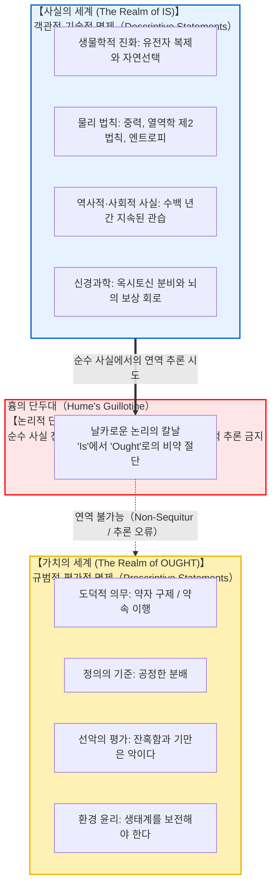
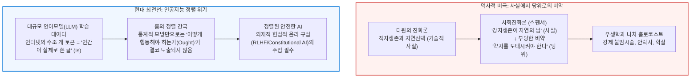

## 서론: 일상적 담론에 숨겨진 논리적 단절

우리는 일상적인 대화, 정치적 논쟁, 혹은 대중 과학 담론에서 다음과 같은 주장들을 자주 접합니다:

- “인간은 생물학적으로 자손을 낳아 유전자를 후대에 남기도록 진화했다. <strong>그러므로 모든 인간은 결혼하여 아이를 낳아야 마땅하다(Ought).</strong>”
- “자유 시장 경제에서 치열한 경쟁을 통해 강자가 살아남고 비효율적인 약자가 도태되는 것은 자연의 섭리다. <strong>그러므로 국가는 복지 정책을 통해 약자를 구제해서는 안 된다.</strong>”
- “이 전통적 관습과 규범은 우리 역사에서 300년간 지속되어 왔다. <strong>그러므로 우리는 이 전통을 미래에도 변함없이 지켜야 한다.</strong>”
- “타인을 배려하고 돕는 이타주의는 인류의 조상이 가혹한 환경에서 살아남기 위해 뇌에서 옥시토신을 분비하도록 진화한 결과다. <strong>그러므로 이타주의는 객관적으로 올바른 도덕적 선이다.</strong>”

언뜻 보면 이러한 주장들은 진화생물학, 경제학, 역사학, 신경과학 등의 객관적 ‘사실(Fact)’에 기초한 매우 설득력 있는 논증처럼 보입니다. 그러나 논리학과 메타윤리학(Metaethics)의 정밀한 메스를 들이대는 순간, 이러한 논증에는 치명적인 논리적 비약, 즉 <strong>‘사실(Is: 그러함)’에서 ‘당위(Ought: 마땅히 그러해야 함)’로의 부당한 밀수</strong>가 도사리고 있음이 명백히 드러납니다.

“인간이 번식하도록 진화했다(객관적 사실)”는 명제로부터, 왜 “아이를 낳아야 한다(도덕적 당위)”는 의무가 논리적으로 필연적으로 도출된단 말입니까? 자연계에 치명적인 바이러스와 병원균이 실재한다(사실)고 해서, 우리가 전염병 치료를 포기하고 방치해야(당위) 하는 것이 아닌 것처럼, <strong>자연계나 사회가 ‘실제로 어떠한가(Is)’라는 문제와 우리가 ‘어떻게 행동해야 하는가(Ought)’라는 문제는 논리적으로 완전히 다른 차원의 영역</strong>입니다.

이 ‘사실과 가치의 절대적 단절’을 철학사상 최초로 명확히 고발한 인물이 바로 18세기 스코틀랜드 계몽주의 철학자 <strong>데이비드 흄(David Hume, 1711–1776)</strong>이었습니다. 20세기 철학자 맥스 블랙이 <strong>‘흄의 단두대(Hume's Guillotine)’</strong>라고 명명한 이 통찰은 아리스토텔레스 이래 서구 사상을 지배해 온 목적론적 자연관을 송두리째 무너뜨렸습니다. 이어 G. E. 무어는 ‘자연주의적 오류(Naturalistic Fallacy)’를 정식화하여 현대 분석 메타윤리학을 탄생시켰습니다.

---

## 1. 데이비드 흄의 고발: 『인간 본성에 관한 논고』의 결정적 구절

1739년 28세의 데이비드 흄은 대작 『인간 본성에 관한 논고(A Treatise of Human Nature)』 제3권 제1부 제1절에서 철학사상 가장 유명한 구절을 남겼습니다:

> “나는 지금까지 접한 모든 도덕 체계에서 저자가 한동안은 일상적인 방식으로 추론을 진행하며 신의 존재를 확립하거나 인간사에 대한 관찰을 수행하는 것을 보아왔다.
> 
> 그러나 갑자기 명제의 통상적인 연결어인 <strong>‘이다(is)’나 ‘아니다(is not)’</strong> 대신, 모든 명제가 <strong>‘해야 한다(ought)’ 혹은 ‘해서는 안 된다(ought not)’</strong>로 연결되어 있는 것을 보고 놀라지 않을 수 없다.
> 
> 이 변화는 눈에 띄지 않지만 지극히 중대한 결과를 낳는다. 왜냐하면 이 ‘해야 한다’는 <strong>새로운 관계나 긍정</strong>을 표현하고 있으므로, 그것이 설명되고 정당화되어야 마땅하기 때문이다. 하지만 저자들은 전혀 주의를 기울이지 않으며, <strong>이 새로운 관계가 어떻게 이전의 완전히 다른 관계들로부터 연역될 수 있는지 도무지 상상조차 할 수 없다.</strong>”

연역 논리학의 철칙에 따르면, 타당한 연역 추론에서 결론에 나타나는 술어는 전제 속에 명시적·묵시적으로 이미 포함되어 있어야 합니다(보존성 원리).
전제가 순수한 사실(“약속을 어기면 타인에게 피해를 준다”)만을 기술하고 있다면, 결론에 도덕적 양상 연산자인 “약속을 지켜야 한다(Ought)”가 갑자기 튀어나오는 것은 명백한 <strong>논리적 비약(Non-sequitur)</strong>입니다. 이를 정당화하려면 “사람은 약속을 지켜야 한다”는 규범적 대전제를 전제에 미리 삽입해야만 합니다. 그러나 그 대전제는 또 어떻게 정당화할 것인가? 결국 무한 퇴행에 빠지게 됩니다.

---

## 2. G. E. 무어의 자연주의적 오류와 열린 질문 논증

1903년 G. E. 무어(G. E. Moore)는 『윤리학 원리(Principia Ethica)』에서 ‘선(Good)’의 성질을 분석했습니다.
무어는 ‘노란색’을 경험하지 못한 사람에게 빛의 파장만으로 노란색의 질감을 설명할 수 없듯이, <strong>‘선’ 역시 더 이상 나눌 수 없는 단순하고 비자연적인 성질(Simple, unanalyzable non-natural property)</strong>이라고 보았습니다. 선을 쾌락, 진화적 적응도, 신의 뜻과 같은 자연적 성질과 동일시하여 정의하려는 시도를 무어는 <strong>‘자연주의적 오류(Naturalistic Fallacy)’</strong>라고 불렀습니다.

### 열린 질문 논증 (Open Question Argument: OQA)
- <strong>닫힌 질문:</strong> “철수는 총각인데, 그는 미혼인가?” (정의상 자명하므로 질문 자체가 성립하지 않음)
- <strong>열린 질문:</strong> 공리주의자가 “선이란 최대 다수의 최대 쾌락을 낳는 것이다”라고 주장할 때, 무어는 묻습니다:
  > <strong>“행위 X는 최대 다수의 쾌락을 낳지만, 과연 행위 X는 진정으로 ‘선한’ 것인가?”</strong>

만약 선이 쾌락과 동일한 정의라면 이 질문은 “미혼남이 미혼인가?”처럼 자명한 닫힌 질문이어야 합니다. 그러나 다수가 소수를 잔혹하게 박해하여 쾌락을 얻는 상황을 상상할 때, 이 질문은 매우 심각하고 유의미한 윤리적 질문(열린 질문)으로 남습니다. 따라서 ‘선’은 ‘쾌락’이나 어떠한 자연적 성질과도 동일할 수 없습니다.

---

## 3. 의무 논리(Deontic Logic)에 의한 수학적 엄밀 증명

오스트리아의 수리철학자 게르하르트 슈르츠(Gerhard Schurz)는 1997년 표준 의무 논리(SDL: Standard Deontic Logic) 체계에서 흄의 단두대를 수학적 정리로 완벽히 증명했습니다.

크립키 가능세계 모델 $\mathcal{M} = \langle W, R, V \rangle$에서 사실 명제의 진리값 부여 함수 $V$와 이상세계 도달 관계 $R \subseteq W \times W$는 모델론적으로 <strong>완전히 독립(직교)</strong>해 있습니다. 따라서 사실 명제들의 모순 없는 집합 $\Gamma$로부터 실질적인 규범 명제 $\mathbf{O}\phi$를 연역하는 것은 불가능합니다:

$$\Gamma \nvdash_{\text{SDL}} \mathbf{O}\phi$$

이로써 흄의 직관은 단순한 수사학적 의문이 아니라 연역 논리 체계 자체의 수학적 필연임이 입증되었습니다.

---

## 4. 역사적 비극과 현대 AI 정렬(Alignment)의 위기

19세기 허버트 스펜서 등은 다윈의 생물학적 사실을 도덕적 명령으로 오인하여 “자연계가 약육강식이므로 사회도 약자를 도태시켜야 마땅하다”는 사회진화론과 우생학을 낳았고, 이는 나치즘의 끔찍한 학살로 이어졌습니다. 자연이 가혹하다는 사실(Is)은 결코 인간이 잔혹해야 한다는 당위(Ought)가 될 수 없습니다.

오늘날 최첨단 인공지능(LLM) 역시 인터넷의 방대한 텍스트(인간이 실제로 행한 사실: Is)를 학습하지만, 여기서 AI가 마땅히 지켜야 할 윤리적 정렬(Ought)은 결코 저절로 도출되지 않습니다. 인간의 편향과 악의를 극복하고 AI를 안전하게 통제하기 위해서는 독립적인 규범적 설계가 필수적입니다.

---

## 5. 결론: 사실의 바다에 띄운 가치의 등대

“‘그러함’에서 ‘해야 함’을 도출할 수 없다.”
만약 사실에서 당위가 자동적으로 도출된다면, 인간은 냉혹한 현실과 생물학적 본능에 맹종하는 기계적 자동인형에 불과할 것이며, 도덕적 자유도 책임도 사라질 것입니다.

사실과 가치 사이에 건널 수 없는 심연이 존재하기에, 우리는 현실의 비정함을 직시하면서도 용기 있게 선언할 수 있습니다:
> <strong>“세계는 지금 이러하다(Is). 그러나 세계가 결코 이대로 머물러서는 안 된다(Ought). 우리는 더 정의롭고 따뜻한 세계를 만들어야 한다.”</strong>

자연과학이 사실의 정밀한 지도를 제공한다면, 그 차가운 바다 위에서 우리가 나아갈 항로를 비추는 것은 오직 인간의 자율적인 양심과 가치 결단의 숭고한 등불뿐입니다.

