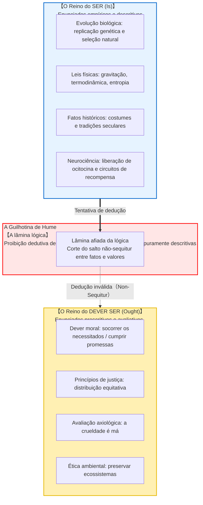
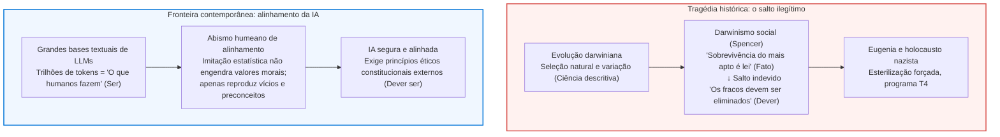

## Introdução: O abismo lógico invisível do cotidiano

No cotidiano, em debates políticos e na divulgação científica, deparamo-nos constantemente com raciocínios como estes:

- «Os seres humanos evoluíram biologicamente para procriar e transmitir seus genes. <strong>Portanto, todo indivíduo deve se casar e ter filhos.</strong>»
- «No livre mercado capitalista, a competição severa seleciona os fortes e elimina os ineficientes por lei natural. <strong>Portanto, o Estado não deve amparar os vulneráveis com programas sociais.</strong>»
- «Esta tradição e estrutura familiar foi observada em nossa sociedade por trezentos anos. <strong>Portanto, devemos preservar essa tradição perpetuamente.</strong>»
- «A empatia e o altruísmo evoluíram porque a liberação de ocitocina aumentava a sobrevivência de grupos ancestrais. <strong>Portanto, o altruísmo é um dever moral objetivamente vinculante.</strong>»

À primeira vista, tais proposições parecem persuasivas, amparadas em fatos objetivos da biologia, economia ou neurociência. Contudo, sob a ótica rigorosa da lógica formal e da metaética, revelam um salto ilegítimo: <strong>a passagem indevida daquilo que É (fato descritivo) para aquilo que DEVE SER (norma prescritiva)</strong>.

O mero fato biológico de possuirmos impulsos reprodutivos não engendra uma obrigação moral de procriar. Assim como bactérias letais existem na natureza sem que ninguém defenda que *devemos* deixar pandemias se espalharem, <strong>o modo como o universo empiricamente se comporta pertence a uma ordem lógica completamente distinta daquela que dita como devemos agir.</strong>

Essa ruptura foi articulada pela primeira vez pelo iluminista escocês <strong>David Hume (1711–1776)</strong> em sua obra *Tratado da Natureza Humana* (1739). Batizada por Max Black no século XX como <strong>«A Guilhotina de Hume»</strong>, ela demoliu as concepções teleológicas aristotélicas. Mais tarde, G. E. Moore formulou a «falácia naturalista», inaugurando a metaética analítica contemporânea.

---

## 1. O argumento de David Hume no *Tratado da Natureza Humana*

No Livro III de sua obra de 1739, Hume expôs a constatação mais célebre da história da ética:

> «Em todo sistema de moral que até hoje encontrei, sempre notei que o autor procede por algum tempo da maneira comum de raciocinar, estabelece a existência de Deus ou faz observações sobre os assuntos humanos; quando, de repente, fico surpreso ao constatar que, em vez das habituais cópulas das proposições, <strong>é e não é</strong>, não encontro nenhuma proposição que não esteja conectada com um <strong>deve ou um não deve</strong>.
> 
> Esta mudança é imperceptível, mas é da maior importância. Pois, como este *deve* ou *não deve* expressa uma <strong>nova relação ou afirmação</strong>, é necessário que seja observada e explicada; e que ao mesmo tempo se dê uma razão para aquilo que parece inteiramente inconcebível: <strong>como esta nova relação pode ser uma dedução de outras inteiramente diferentes dela.</strong>»

Hume baseia-se no <strong>princípio da conservatividade da lógica dedutiva</strong>: numa inferência válida, a conclusão não pode conter nenhum operador ou predicado que não estivesse presente nas premissas. Derivar um dever («ought») de meras descrições fáticas constitui uma falácia de *non-sequitur*. Para torná-la válida, é indispensável acrescentar uma premissa normativa prévia, o que acarreta uma regressão ao infinito.

---

## 2. G. E. Moore: Falácia naturalista e o argumento da questão aberta

Em 1903, em *Principia Ethica*, <strong>G. E. Moore</strong> defendeu que a propriedade «bom» é simples e indefinível, análoga à percepção da cor «amarelo». Tentar definir a bondade por meio de propriedades naturais (prazer, evolução ou desejo) constitui a <strong>falácia naturalista (Naturalistic Fallacy)</strong>.

Moore introduziu o <strong>Argumento da Questão Aberta (Open Question Argument)</strong>:
- <strong>Questão fechada:</strong> «João é solteiro, mas ele não é casado?» (Trivial e analítica).
- <strong>Questão aberta:</strong> «A ação X maximiza o prazer geral, mas <strong>a ação X é verdadeiramente boa?</strong>»

A questão permanece genuinamente aberta e substantiva. Se «bom» fosse estritamente idêntico a «maximizar o prazer», a pergunta seria um contra-senso. Portanto, o bem moral não pode ser identificado com propriedades empíricas.

---

## 3. Demonstração formal na lógica deôntica padrão (SDL)

Em 1997, o lógico austríaco <strong>Gerhard Schurz</strong> provou o teorema generalizado de Hume na lógica deôntica padrão. Nos modelos de Kripke, a valoração fática e a relação de acessibilidade aos mundos ideais são <strong>matematicamente ortogonais</strong>. Para qualquer conjunto consistente de fatos $\Gamma$ e qualquer fórmula deôntica relevante $\mathbf{O}\phi$:

$$\Gamma \nvdash_{\text{SDL}} \mathbf{O}\phi$$

---

## 4. Tragédias históricas e o alinhamento da IA

Historicamente, ignorar a guilhotina de Hume gerou o pesadelo do <strong>darwinismo social</strong> e da eugenia, postulando que a crueldade da seleção natural justificava o extermínio de populações vulneráveis. A hostilidade da natureza é, ao contrário, o exato motivo pelo qual devemos fundar laços de solidariedade.

Hoje, essa questão ressurge no <strong>problema de alinhamento da IA</strong>. Modelos de linguagem aprendem a distribuição empírica do que os humanos escrevem (o domínio do Ser). Estabelecer como uma inteligência artificial *deve agir* (o domínio do Dever Ser) requer salvaguardas éticas independentes.

---

## 5. Conclusão: O farol dos valores no mar dos fatos

A guilhotina de Hume não corrói a ética; ela resguarda a nossa liberdade.
Se o dever brotasse diretamente dos fatos, seríamos meros autômatos biológicos subjugados à realidade existente. É justamente porque há um abismo entre o ser e o dever ser que podemos fitar a realidade e proclamar:
> <strong>«O mundo é assim hoje (Ser). Mas ele não deve continuar assim (Dever Ser). Nós temos a liberdade e a responsabilidade de torná-lo melhor.»</strong>

