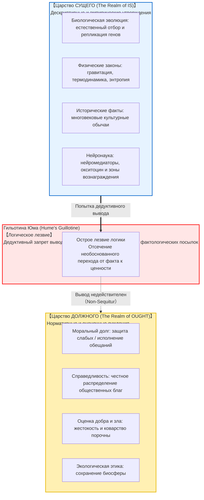
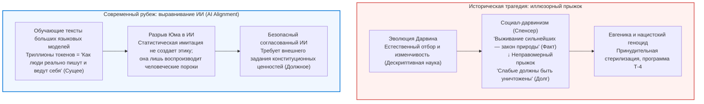

## Введение: Невидимый логический разрыв в повседневности

В повседневных дискуссиях, политических дебатах и научно-популярных публикациях мы постоянно сталкиваемся с подобными аргументами:

- «Человек биологически эволюционировал для продолжения рода и передачи своих генов. <strong>Следовательно, каждый человек обязан вступать в брак и растить детей.</strong>»
- «В условиях свободного рынка жесткая конкуренция естественным образом отсеивает слабых в пользу сильных. <strong>Следовательно, государство не должно оказывать социальную помощь уязвимым слоям.</strong>»
- «Эта традиционная форма семьи и общественный уклад сохраняются в нашей культуре уже три столетия. <strong>Следовательно, мы обязаны свято хранить эту традицию во веки веков.</strong>»
- «Эмпатия и взаимопомощь сформировались эволюционно благодаря выбросу окситоцина в мозге древних охотников-собирателей. <strong>Следовательно, альтруизм является объективным нравственным долгом.</strong>»

На первый взгляд эти утверждения кажутся вполне убедительными, опираясь на авторитет биологии, экономики, истории или нейрофизиологии. Однако под скальпелем формальной логики и метаэтики (Metaethics) немедленно обнажается критический изъян: <strong>нелегитимный логический прыжок от того, что ЕСТЬ (дескриптивный факт), к тому, что ДОЛЖНО БЫТЬ (прескриптивная норма)</strong>.

Почему из биологической способности к размножению должна автоматически следовать моральная обязанность иметь детей? Смертоносные вирусы и бактерии объективно существуют в природе, но из этого не следует, что мы *должны* позволять эпидемиям убивать людей. <strong>То, каков мир эмпирически (Is), и то, как мы обязаны поступать (Ought), представляют собой принципиально разные измерения бытия.</strong>

Этот глубокий разрыв был впервые сформулирован шотландским философом <strong>Дэвидом Юмом (1711–1776)</strong> в его «Трактате о человеческой природе» (1739). Названный Максом Блэком в XX веке <strong>«Гильотиной Юма»</strong>, этот принцип сокрушил господствовавшую со времен Аристотеля телеологию. Позднее Дж. Э. Мур развил его в концепцию «натуралистической ошибки».

---

## 1. Знаменитый фрагмент Дэвида Юма из «Трактата»

В третьей книге «Трактата о человеческой природе» Юм записал классические строки:

> «Я заметил, что в каждой этической теории автор в течение некоторого времени рассуждает обычным образом, доказывает бытие Бога или делает наблюдения о человеческих делах; и вдруг я с удивлением обнаруживаю, что вместо обычных связок <strong>«есть» или «не есть»</strong> каждое предложение связано со <strong>«следует» или «не следует»</strong>.
> 
> Это изменение происходит незаметно, но влечет за собой важнейшие последствия. Ибо поскольку это *следует* или *не следует* выражает некоторое <strong>новое отношение или утверждение</strong>, необходимо, чтобы оно было объяснено; и одновременно должно быть дано основание тому, что кажется совершенно непостижимым: <strong>каким образом это новое отношение может быть выведено из других, совершенно отличных от него.</strong>»

Аргумент Юма опирается на <strong>принцип консервативности дедуктивной логики</strong>: в состоятельном силлогизме вывод не может содержать понятий или операторов, которых не было в посылках. Вывод долженствования («следует») из чисто эмпирических фактов представляет собой классическую ошибку *non-sequitur*. Чтобы сделать рассуждение валидным, необходимо добавить скрытую нормативную посылку («Обещания следует выполнять»), что неизбежно ведет к дурной бесконечности обоснований.

---

## 2. Натуралистическая ошибка и аргумент открытого вопроса Дж. Э. Мура

В 1903 году в работе *Principia Ethica* британский философ <strong>Дж. Э. Мур</strong> доказал, что свойство «добро» является простым, неделимым и ненатуральным свойством — аналогично зрительному восприятию желтого цвета. Попытка отождествить благо с естественными свойствами (удовольствием, эволюционным приспособлением или волей высших сил) получила название <strong>натуралистической ошибки (Naturalistic Fallacy)</strong>.

Мур предложил знаменитый <strong>Аргумент открытого вопроса (Open Question Argument)</strong>:
- <strong>Закрытый вопрос:</strong> «Иван — холостяк, но женат ли он?» (Ответ очевиден и тривиален по определению).
- <strong>Открытый вопрос:</strong> «Поступок X максимизирует всеобщее удовольствие, но <strong>является ли поступок X действительно благим?</strong>»

Этот вопрос всегда остается содержательным и открытым. Если бы «добро» означало в точности «удовольствие», вопрос был бы бессмысленной тавтологией. Следовательно, понятие блага несводимо к физическим или психологическим фактам.

---

## 3. Математическое доказательство в стандартной деонтической логике (SDL)

В 1997 году австрийский логик <strong>Герхард Шурц (Gerhard Schurz)</strong> математически строго доказал теорему Юма в рамках стандартной деонтической логики (SDL). В семантике возможных миров Крипке истинностное означивание фактов в действительном мире и отношение достижимости деонтически идеальных миров <strong>строго ортогональны</strong>. Для любого непротиворечивого множества чисто фактологических посылок $\Gamma$ и нетривиальной нормативной формулы $\mathbf{O}\phi$:

$$\Gamma \nvdash_{\text{SDL}} \mathbf{O}\phi$$

---

## 4. Исторические катастрофы и проблема выравнивания ИИ

Пренебрежение гильотиной Юма привело в XIX–XX веках к возникновению <strong>социал-дарвинизма</strong> и евгеники, оправдывавших уничтожение слабых тем, что в дикой природе побеждает сильнейший. Мыслители забыли: то, что природа беспощадна (факт), не означает, что люди должны быть жестокими; напротив, суровость природы — причина создавать институты милосердия и солидарности (долг).

Сегодня эта проблема встает в полный рост при решении <strong>проблемы выравнивания искусственного интеллекта (AI Alignment)</strong>. Обучение больших языковых моделей на текстах из Интернета охватывает лишь мир Сущего со всеми его предрассудками. Вывести отсюда то, как сверхразум *должен поступать*, логически невозможно без явного внедрения ценностных рамок.

---

## 5. Заключение: Маяк ценностей в океане фактов

Гильотина Юма не лишает нас нравственности — она защищает человеческую свободу.
Если бы должное выводилось из сущего, мы были бы безвольными шестеренками природных законов. Именно потому, что между фактами и ценностями пролегает бездна, человек может смотреть на холодную вселенную и заявлять:
> <strong>«Таков мир сегодня (Сущее). Но он не должен оставаться таким (Должное). Мы обладаем свободой и разумом, чтобы сделать его справедливее.»</strong>

