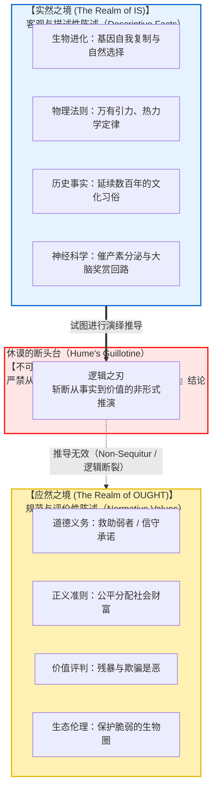
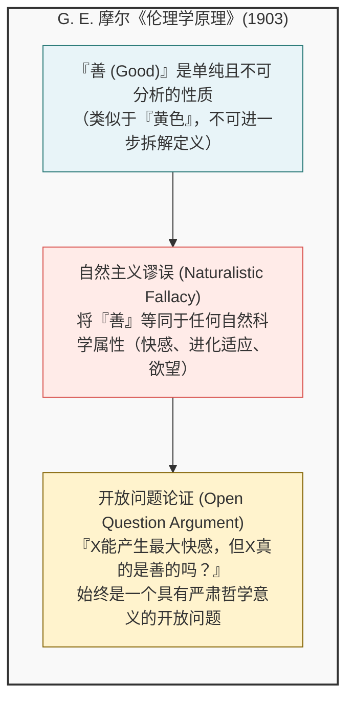
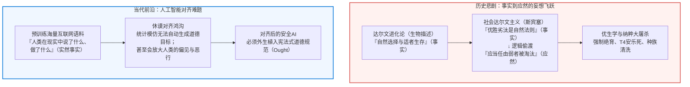

## 引言：日常论述中隐蔽的逻辑鸿沟

在日常生活、政治辩论以及大众科学传播中，我们经常听到以下论调：

- “人类在生物学上经过漫长进化，其本能是繁衍后代并传递基因。<strong>因此，每个人都应该结婚并生育子女。</strong>”
- “在自由市场经济中，残酷的竞争使得高效强者生存、低效弱者被淘汰乃是自然规律。<strong>因此，国家不应该通过社会福利救济弱者。</strong>”
- “这种传统的家族结构与礼仪在我国历史上已经维系了三百年。<strong>因此，我们应当永远传承并遵守这一传统。</strong>”
- “利他主义和同情心是人类祖先在严苛环境中为了生存而进化出的神经机制。<strong>因此，利他行为是客观正确的道德规范。</strong>”

从表面上看，这些论断似乎都有生物学、经济学、历史学或脑科学的“事实”作为支撑，极具说服力。然而，在逻辑学与元伦理学（Metaethics）的严密审视下，这些论证全都暴露出致命的逻辑跳跃：即<strong>从“实然（Is: 是什么）”非法偷渡到“应然（Ought: 应该做什么）”</strong>。

“人类天生具有繁衍基因的机制（客观事实）”，凭什么能够自动推导出“人应该生孩子（道德规范）”？自然界中广泛存在致命的病毒和细菌（事实），难道我们“应该”任由瘟疫肆虐而不去医治吗？<strong>世界“事实上如何”，与人类“应当如何行动”，在逻辑上完全属于两个截然不同的维度。</strong>

这一“事实与价值的绝对断裂”，最早由18世纪苏格兰启蒙哲学家<strong>大卫·休谟（David Hume）</strong>在其名著《人性论》中深刻揭示。20世纪哲学家马克斯·布莱克将其形象地命名为<strong>『休谟的断头台（Hume's Guillotine）』</strong>。这一论断彻底粉碎了自亚里士多德以来主导西方思想两千年的目的论自然观。随后，G.E.摩尔在20世纪初提出了“自然主义谬误”，开启了现代分析元伦理学的大门。

---

## 1. 大卫·休谟的深刻洞见：《人性论》经典段落解析

### 1.1 经典文本与历史背景
1739年，年仅28岁的大卫·休谟出版了哲学巨著《人性论》（*A Treatise of Human Nature*）。在第三卷“道德学”第一部第一节的结尾，休谟写下了哲学史上被引用次数最多、也最具颠覆性的一段话：

> “在我所遇到的每一个道德学体系中，我常常注意到，作者在一段时间内是按照平常的推理方式进行的，确立了上帝的存在，或者对人类事务进行了观察；但突然之间，我感到十分惊讶，因为我发现每一个命题不再像以往那样用<strong>『是（is）』和『不是（is not）』</strong>连接，而是无一例外地都与<strong>『应该（ought）』或『不应该（ought not）』</strong>联系在一起。
> 
> 这个变化虽不引人注目，却关系重大。因为这个『应该』或『不应该』表达了一种<strong>新的关系或肯定</strong>，必须对它加以说明并给出理由；同时，对于这一新关系如何能够从完全不同的其他关系中演绎出来，完全是不可想象的，但作者们通常根本不做防范。”
> 
> —— 大卫·休谟，《人性论》第三卷第一部第一节（1739）

休谟批判的矛头直指当时的神学家与自然法论者。他们常常由“上帝创造了和谐的宇宙（事实）”直接跳跃到“人类应该遵从上帝的戒律（道德命令）”，却从未说明这二者之间的逻辑推导凭据。

### 1.2 演绎逻辑的守恒律
休谟论证的核心是经典演泽逻辑的基本法则：<strong>保守性原理（Principle of Conservativity）</strong>。

在任何有效的演绎推理中，结论中所包含的任何实质性概念或谓词，必须已经在前提中明确或隐含地存在。演绎推理只能展开前提中已经包含的内容，绝不可能凭空创造出全新的逻辑范畴。

$$\begin{aligned}
\text{前提 1:} & \quad \text{违背诺言会给他人带来痛苦与经济损失。（事实描述：Is）} \\
\text{前提 2:} & \quad \text{张三向李四许诺今天偿还借款。（事实描述：Is）} \\
\text{结论:} & \quad \text{因此，张三今天应该向李四偿还借款。（道德规范：Ought）}
\end{aligned}$$

从形式逻辑的角度看，上述推论是<strong>无效的（Invalid）</strong>。前提中仅包含事实陈述（“给他人带来痛苦”、“许诺偿还”），而在结论中却凭空出现了一个全新的道义模态词——<strong>“应该（Ought）”</strong>。这在逻辑学上属于纯粹的<strong>推不出（Non-sequitur）</strong>。

要使其在逻辑上有效，必须显式补入一个包含“应该”的规范性大前提：
$$\text{【所有人无论何时都应当信守对他人做出的承诺。】}$$
然而，这一大前提自身又由什么来辩护？如果用事实来证明它，就会再次遭遇断头台；如果用另一个“应该”来证明，就会陷入无穷倒退。

---

## 2. G. E. 摩尔的自然主义谬误与开放问题论证

1903年，剑桥大学哲学家<strong>G. E. 摩尔（G. E. Moore）</strong>出版了里程碑式的著作《伦理学原理》（*Principia Ethica*），从语义学与本体论角度进一步深化了这一断裂。

### 2.1 善的不可定义性：黄色的类比
摩尔指出，“善（Good）”是一种不可化约的、单纯的非自然性质（Non-natural property）。
正如“黄色”，我们可以用物理学解释光波波长，但对于从未见过黄色的人，我们无法用文字向他拆解定义“黄色的主观感觉本身”。善同样如此，它不能被等同于“带来快感”、“符合自然法则”或“上帝的旨意”。将非自然的道德善与自然的物理或心理性质混为一谈，就是犯了<strong>自然主义谬误</strong>。

### 2.2 开放问题论证（Open Question Argument: OQA）
摩尔提出了极为著名的“开放问题论证”：
- <strong>封闭问题（Closed Question）：</strong> “张三是单身汉，但他未婚吗？”——因为单身汉在定义上就是未婚成年男性，所以这个问题是不证自明的封闭问题。
- <strong>开放问题（Open Question）：</strong> 假设功利主义者主张“善就是带来最大多数人的最大快乐”。摩尔问道：
  > <strong>“行为 X 能带来最大多数人的最大快乐，但行为 X 真正是『善』的吗？”</strong>
  
任何有理智的人都能看出，这仍然是一个需要严肃伦理思考的开放问题（例如，如果多数人通过迫害无辜少数人获得了极大的狂欢快感，这真的是善吗？）。如果“善”与“快乐”在定义上是同义词，这个问题就应当像“单身汉未婚吗”一样荒谬可笑。然而事实并非如此，因此<strong>“善”绝不能等同于“快乐”或任何自然属性</strong>。

---

## 3. 约翰·塞尔对断头台的挑战及其破产

美国著名语言哲学家<strong>约翰·塞尔（John Searle）</strong>在1964年发表了著名论文《如何从“实然”推导出“应然”》，试图借助<strong>制度性事实（Institutional Facts）</strong>攻破休谟的断头台：

1. 琼斯说出了话语：“我在此承诺付给你史密斯五美元。”（粗糙事实 / 描述事实）
2. 在英语承诺规则下，说出该话语构成了一项承诺。（制度性规则）
3. 琼斯向史密斯承诺了五美元。（制度性事实）
4. 承诺在定义上即意味着承担履行承诺的义务。（分析性语义）
5. 琼斯有义务付给史密斯五美元。（制度性规范）
6. 琼斯应该付给史密斯五美元。（应然结论：Ought）

<strong>批评家的反驳（R. M. 黑尔、弗卢等人）：</strong>
这一论证的漏洞在于外在立场与内在立场的混淆。在客观人类学视角下，步骤5仅仅意味着“在英语社会的承诺游戏内部，琼斯被视为具有义务（描述性事实）”。要推导出琼斯在真实的客观道德层面上“真正应该支付”，必须暗含一个外在的规范性前提：<strong>“人类应该遵守承诺这项制度。”</strong> 如果黑帮成员立誓为黑帮杀人，在其组织制度内部他具有“义务”，但绝不意味着他客观上“应该”杀人。因此，塞尔并未真正跨越休谟的鸿沟。

---

## 4. 道义逻辑（Deontic Logic）的数理严格证明

在数理逻辑与模态逻辑领域，奥地利逻辑学家<strong>格哈德·舒尔茨（Gerhard Schurz）</strong>于1997年用标准道义逻辑（SDL: Standard Deontic Logic）对休谟断头台给出了完备的数学证明。

在SDL公理体系中：
$$\begin{aligned}
\mathbf{K}: & \quad \mathbf{O}(\phi \to \psi) \to (\mathbf{O}\phi \to \mathbf{O}\psi) \\
\mathbf{D}: & \quad \mathbf{O}\phi \to \mathbf{P}\phi \quad (\text{道义无矛盾性}) \\
\mathbf{Nec}: & \quad \vdash \phi \implies \vdash \mathbf{O}\phi \quad (\text{逻辑重言式之必然化})
\end{aligned}$$

在克里普克语义模型 $\mathcal{M} = \langle W, R, V \rangle$ 中，理想世界关系 $R \subseteq W \times W$ 与现实世界的事实真值分配 $V$ 在模型论上是<strong>完全正交独立</strong>的。舒尔茨证明了<strong>广义休谟定理（Generalized Hume's Theorem）</strong>：

> 对于任意无矛盾的纯事实命题集合 $\Gamma \subset \mathcal{L}_{\text{fact}}$ 以及任何非重言的、实质相关的道义规范命题 $\mathbf{O}\phi$：
> 
> $$\Gamma \nvdash_{\text{SDL}} \mathbf{O}\phi$$

这表明，从纯事实前提推导出规范性当为，在数理逻辑层面是不可能的。

---

## 5. 现实灾难与当代AI对齐危机

### 5.1 科学主义的深渊：社会达尔文主义与优生学
19世纪斯宾塞等人将达尔文的描述性生物学理论偷换为社会道德命令，断言“既然自然界适者生存，那么人类社会就应当淘汰弱者”。这种荒谬的逻辑跳跃直接催生了20世纪的优生学运动、强制绝育法律以及纳粹大屠杀的浩劫。他们忘记了：<strong>自然界即便再残酷（事实），人类也绝不应该以此为法则；正因为自然冷酷无情，人类才应当建立公正与关怀的社会制度（应然）。</strong>

### 5.2 大语言模型与AI价值对齐
当今人工智能最核心的技术危机——<strong>AI对齐问题（AI Alignment Problem）</strong>，本质上就是计算领域的休谟断头台。
大模型预训练的数据是整个互联网的文本库，这纯粹属于<strong>实然的世界（Is）</strong>，充满了人类历史上的偏见、虚假信息与恶意。无论模型的预测准确率有多高，单纯从“人类写了什么（Is）”中，逻辑上绝对无法推导出“AI应当秉持何种伦理原则（Ought）”。我们必须通过人类反馈强化学习（RLHF）或宪法AI（Constitutional AI），将道德价值作为独立的外在约束明确植入。

---

## 6. 结语：事实之海中屹立的价值灯塔

“实然不能推出应然。” 休谟的断头台并不是冰冷虚无的破坏之刃，恰恰相反：

<strong>如果实然能够自动推导出应然，人类将彻底沦为宇宙物理规律与社会现实的机械木偶，失去一切道德选择的自由与责任。</strong>

正因为自然规律无法替我们决定善恶，正因为事实与价值之间存在无法抹平的深渊，人类才能够面对冷酷的世界，昂起头颅坚定地宣告：
> <strong>“世界现状如此（Is），但世界绝不应该如此（Ought）；我们将凭借理智与良知，将世界塑造成它应当具有的模样。”</strong>

客观科学描绘出事实的浩瀚海洋，而唯有我们内心的良善与道德决断，才是指引人类航向的正义灯塔。

