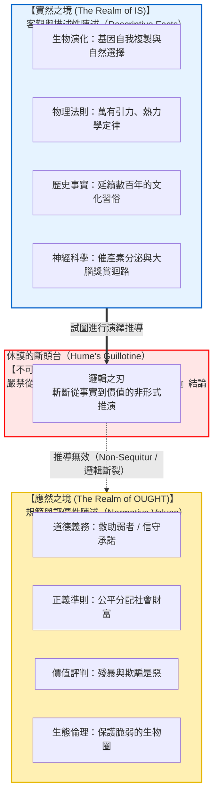
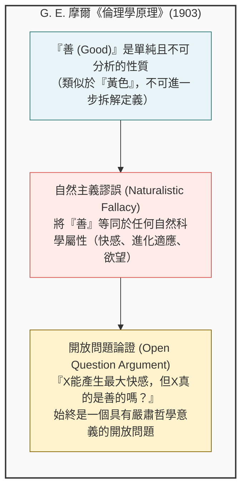
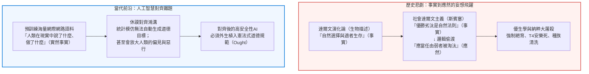

## 引言：日常論述中隱蔽的邏輯鴻溝

在日常生活、政治辯論以及大眾科學傳播中，我們經常聽到以下論調：

- 「人類在生物學上經過漫長演化，其本能是繁衍後代並傳遞基因。<strong>因此，每個人都應該結婚並生育子女。</strong>」
- 「在自由市場經濟中，殘酷的競爭使得高效強者生存、低效弱者被淘汰乃是自然法則。<strong>因此，國家不應該透過社會福利救濟弱者。</strong>」
- 「這種傳統的家族結構與禮儀在我國歷史上已經維繫了三百年。<strong>因此，我們應當永遠傳承並遵守這一傳統。</strong>」
- 「利他主義與同情心是人類祖先在嚴苛環境中為了生存而演化出的神經機制。<strong>因此，利他行為是客觀正確的道德規範。</strong>」

從表面上看，這些論斷似乎都有生物學、經濟學、歷史學或腦科學的「事實」作為支撐，極具說服力。然而，在邏輯學與元倫理學（Metaethics）的嚴密審視下，這些論證全都暴露出致命的邏輯跳躍：即<strong>從「實然（Is: 是什麼）」非法偷渡到「應然（Ought: 應該做什麼）」</strong>。

「人類天生具有繁衍基因的機制（客觀事實）」，憑什麼能夠自動推導出「人應該生孩子（道德規範）」？自然界中廣泛存在致命的病毒與細菌（事實），難道我們「應該」任由瘟疫肆虐而不去醫治嗎？<strong>世界「事實上如何」，與人類「應當如何行動」，在邏輯上完全屬於兩個截然不同的維度。</strong>

這一「事實與價值的絕對斷裂」，最早由18世紀蘇格蘭啟蒙哲學家<strong>大衛·休謨（David Hume）</strong>在其名著《人性論》中深刻揭示。20世紀哲學家馬克斯·布萊克將其形象地命名為<strong>『休謨的斷頭台（Hume's Guillotine）』</strong>。這一論斷徹底粉碎了自亞里斯多德以來主導西方思想兩千年的目的論自然觀。隨後，G.E.摩爾在20世紀初提出了「自然主義謬誤」，開啟了現代分析元倫理學的大門。

---

## 1. 大衛·休謨的深刻洞見：《人性論》經典段落解析

### 1.1 經典文本與歷史背景
1739年，年僅28歲的大衛·休謨出版了哲學巨著《人性論》（*A Treatise of Human Nature*）。在第三卷「道德學」第一部第一節的結尾，休謨寫下了哲學史上被引用次數最多、也最具顛覆性的一段話：

> 「在我所遇到的每一個道德學體系中，我常常注意到，作者在一段時間內是按照平常的推理方式進行的，確立了上帝的存在，或者對人類事務進行了觀察；但突然之間，我感到十分驚訝，因為我發現每一個命題不再像以往那樣用<strong>『是（is）』和『不是（is not）』</strong>連接，而是無一例外地都與<strong>『應該（ought）』或『不應該（ought not）』</strong>聯繫在一起。
> 
> 這個變化雖不引人注目，卻關係重大。因為這個『應該』或『不應該』表達了一種<strong>新的關係或肯定</strong>，必須對它加以說明並給出理由；同時，對於這一新關係如何能夠從完全不同的其他關係中演繹出來，完全是不可想像的，但作者們通常根本不做防範。」
> 
> —— 大衛·休謨，《人性論》第三卷第一部第一節（1739）

休謨批判的矛頭直指當時的神學家與自然法論者。他們常常由「上帝創造了和諧的宇宙（事實）」直接跳躍到「人類應該遵從上帝的戒律（道德命令）」，卻從未說明這二者之間的邏輯推導憑據。

### 1.2 演繹邏輯的守恆律
休謨論證的核心是經典演澤邏輯的基本法則：<strong>保守性原理（Principle of Conservativity）</strong>。

在任何有效的演繹推理中，結論中所包含的任何實質性概念或謂詞，必須已經在前提中明確或隱含地存在。演繹推理只能展開前提中已經包含的內容，絕不可能憑空創造出全新的邏輯範疇。

$$\begin{aligned}
\text{前提 1:} & \quad \text{違背諾言會給他人帶來痛苦與經濟損失。（事實描述：Is）} \\
\text{前提 2:} & \quad \text{張三向李四許諾今天償還借款。（事實描述：Is）} \\
\text{結論:} & \quad \text{因此，張三今天應該向李四償還借款。（道德規範：Ought）}
\end{aligned}$$

從形式邏輯的角度看，上述推論是<strong>無效的（Invalid）</strong>。前提中僅包含事實陳述（“給他人帶來痛苦”、“許諾償還”），而在結論中卻憑空出現了一個全新的道義模態詞——<strong>“應該（Ought）”</strong>。這在邏輯學上屬於純粹的<strong>推不出（Non-sequitur）</strong>。

要使其在邏輯上有效，必須顯式補入一個包含“應該”的規範性大前提：
$$\text{【所有人無論何時都應當信守對他人做出的承諾。】}$$
然而，這一大前提自身又由什麼來辯護？如果用事實來證明它，就會再次遭遇斷頭台；如果用另一個“應該”來證明，就會陷入無窮倒退。

---

## 2. G. E. 摩爾的自然主義謬誤與開放問題論證

1903年，劍橋大學哲學家<strong>G. E. 摩爾（G. E. Moore）</strong>出版了里程碑式的著作《倫理學原理》（*Principia Ethica*），從語義學與本體論角度進一步深化了這一斷裂。

### 2.1 善的不可定義性：黃色的類比
摩爾指出，“善（Good）”是一種不可化約的、單純的非自然性質（Non-natural property）。
正如“黃色”，我們可以用物理學解釋光波波長，但對於從未見過黃色的人，我們無法用文字向他拆解定義“黃色的主觀感覺本身”。善同樣如此，它不能被等同於“帶來快感”、“符合自然法則”或“上帝的旨意”。將非自然的道德善與自然的物理或心理性質混為一談，就是犯了<strong>自然主義謬誤</strong>。

### 2.2 開放問題論證（Open Question Argument: OQA）
摩爾提出了極為著名的“開放問題論證”：
- <strong>封閉問題（Closed Question）：</strong> “張三是單身漢，但他未婚嗎？”——因為單身漢在定義上就是未婚成年男性，所以這個問題是不證自明的封閉問題。
- <strong>開放問題（Open Question）：</strong> 假設功利主義者主張“善就是帶來最大多數人的最大快樂”。摩爾問道：
  > <strong>“行為 X 能帶來最大多數人的最大快樂，但行為 X 真正是『善』的嗎？”</strong>
  
任何有理智的人都能看出，這仍然是一個需要嚴肅倫理思考的開放問題（例如，如果多數人通過迫害無辜少數人獲得了極大的狂歡快感，這真的是善嗎？）。如果“善”與“快樂”在定義上是同義詞，這個問題就應當像“單身漢未婚嗎”一樣荒謬可笑。然而事實並非如此，因此<strong>“善”絕不能等同於“快樂”或任何自然屬性</strong>。

---

## 3. 約翰·塞爾對斷頭台的挑戰及其破產

美國著名語言哲學家<strong>約翰·塞爾（John Searle）</strong>在1964年發表了著名論文《如何從“實然”推導出“應然”》，試圖藉助<strong>制度性事實（Institutional Facts）</strong>攻破休謨的斷頭台：

1. 瓊斯說出了話語：“我在此承諾付給你史密斯五美元。”（粗糙事實 / 描述事實）
2. 在英語承諾規則下，說出該話語構成了一項承諾。（制度性規則）
3. 瓊斯向史密斯承諾了五美元。（制度性事實）
4. 承諾在定義上即意味著承擔履行承諾的義務。（分析性語義）
5. 瓊斯有義務付給史密斯五美元。（制度性規範）
6. 瓊斯應該付給史密斯五美元。（應然結論：Ought）

<strong>批評家的反駁（R. M. 黑爾、弗盧等人）：</strong>
這一論證的漏洞在於外在立場與內在立場的混淆。在客觀人類學視角下，步驟5僅僅意味著“在英語社會的承諾遊戲內部，瓊斯被視為具有義務（描述性事實）”。要推導出瓊斯在真實的客觀道德層面上“真正應該支付”，必須暗含一個外在的規範性前提：<strong>“人類應該遵守承諾這項制度。”</strong> 如果黑幫成員立誓為黑幫殺人，在其組織制度內部他具有“義務”，但絕不意味著他客觀上“應該”殺人。因此，塞爾並未真正跨越休謨的鴻溝。

---

## 4. 道義邏輯（Deontic Logic）的數理嚴格證明

在數理邏輯與模態邏輯領域，奧地利邏輯學家<strong>格哈德·舒爾茨（Gerhard Schurz）</strong>於1997年用標準道義邏輯（SDL: Standard Deontic Logic）對休謨斷頭台給出了完備的數學證明。

在SDL公理體系中：
$$\begin{aligned}
\mathbf{K}: & \quad \mathbf{O}(\phi \to \psi) \to (\mathbf{O}\phi \to \mathbf{O}\psi) \\
\mathbf{D}: & \quad \mathbf{O}\phi \to \mathbf{P}\phi \quad (\text{道義無矛盾性}) \\
\mathbf{Nec}: & \quad \vdash \phi \implies \vdash \mathbf{O}\phi \quad (\text{邏輯重言式之必然化})
\end{aligned}$$

在克里普克語義模型 $\mathcal{M} = \langle W, R, V \rangle$ 中，理想世界關係 $R \subseteq W \times W$ 與現實世界的事實真值分配 $V$ 在模型論上是<strong>完全正交獨立</strong>的。舒爾茨證明了<strong>廣義休謨定理（Generalized Hume's Theorem）</strong>：

> 對於任意無矛盾的純事實命題集合 $\Gamma \subset \mathcal{L}_{\text{fact}}$ 以及任何非重言的、實質相關的道義規範命題 $\mathbf{O}\phi$：
> 
> $$\Gamma \nvdash_{\text{SDL}} \mathbf{O}\phi$$

這表明，從純事實前提推導出規範性當為，在數理邏輯層面是不可能的。

---

## 5. 現實災難與當代AI對齊危機

### 5.1 科學主義的深淵：社會達爾文主義與優生學
19世紀斯賓塞等人將達爾文的描述性生物學理論偷換為社會道德命令，斷言「既然自然界適者生存，那麼人類社會就應當淘汰弱者」。這種荒謬的邏輯跳躍直接催生了20世紀的優生學運動、強制絕育法律以及納粹大屠殺的浩劫。他們忘記了：<strong>自然界即便再殘酷（事實），人類也絕不應該以此為法則；正因為自然冷酷無情，人類才應當建立公正與關懷的社會制度（應然）。</strong>

### 5.2 大語言模型與AI價值對齊
當今人工智慧最核心的技術危機——<strong>AI對齊問題（AI Alignment Problem）</strong>，本質上就是計算領域的休謨斷頭台。
大模型預訓練的數據是整個網際網路的文本庫，這純粹屬於<strong>實然的世界（Is）</strong>，充滿了人類歷史上的偏見、虛假資訊與惡意。無論模型的預測準確率有多高，單純從「人類寫了什麼（Is）」中，邏輯上絕對無法推導出「AI應當秉持何種倫理原則（Ought）」。我們必須透過人類反饋強化學習（RLHF）或憲法AI（Constitutional AI），將道德價值作為獨立的外在約束明確植入。

---

## 6. 結語：事實之海中屹立的價值燈塔

「實然不能推出應然。」 休謨的斷頭台並不是冰冷虛無的破壞之刃，恰恰相反：

<strong>如果實然能夠自動推導出應然，人類將徹底淪為宇宙物理規律與社會現實的機械木偶，失去一切道德選擇的自由與責任。</strong>

正因為自然規律無法替我們決定善惡，正因為事實與價值之間存在無法抹平的深淵，人類才能夠面對冷酷的世界，昂起頭顱堅定地宣告：
> <strong>「世界現狀如此（Is），但世界絕不應該如此（Ought）；我們將憑藉理智與良知，將世界塑造成它應當具有的模樣。」</strong>

客觀科學描繪出事實的浩瀚海洋，而唯有我們內心的良善與道德決斷，才是指引人類航向的正義燈塔。

