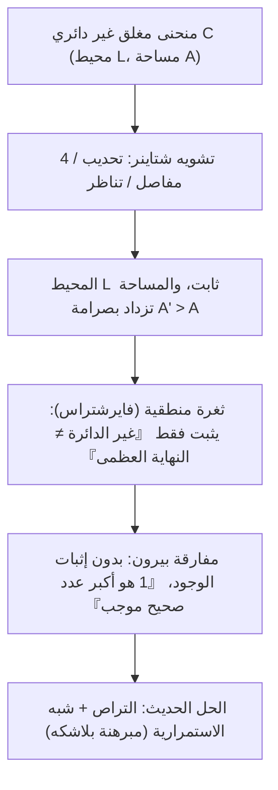
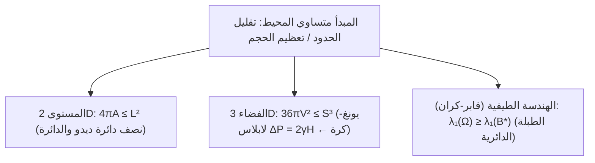

## مقدمة: كم من المملكة يمكن أن يحيط به جلد ثور واحد؟

في ملحمة «الإنيادة» للشاعر الروماني فيرجيل، تصل الأميرة الفينيقية المنفية <strong>ديدو (Dido)</strong> إلى ساحل شمال أفريقيا وتطلب شراء مساحة من الأرض «بقدر ما يمكن أن يحيط به جلد ثور». تقطع ديدو الجلد إلى أشرطة رفيعة جداً وتوصلها لتشكّل حبلاً طويلاً، وباستخدام خط الساحل المستقيم كحد طبيعي، تحيط بـ<strong>نصف دائرة</strong> هائل تؤسس فيه مدينة قرطاج.

رياضياً، واجهت ديدو أقدم مسألة في حساب التغيرات، وهي <strong>المسألة متساوية المحيط (Isoperimetric Problem)</strong>: من بين جميع المنحنيات المستوية المغلقة البسيطة $C$ ذات المحيط الثابت $L > 0$، أيها يحصر أكبر مساحة $A$؟ الجواب هو <strong>الدائرة</strong>. فلكل منحنى مغلق بسيط طوله $L$ ومساحته $A$، تتحقق <strong>المتباينة متساوية المحيط المستوية</strong>:

$$\boxed{4\pi A \le L^2 \quad \Longleftrightarrow \quad Q(C) := \frac{4\pi A}{L^2} \le 1}$$

حيث تُسمى النسبة اللابعدية $Q(C) \in (0, 1]$ <strong>حاصل القسمة متساوي المحيط</strong>، وتتحقق المساواة إذا وفقط إذا كان المنحنى $C$ دائرة تامة. ورغم بداهة النتيجة حدسياً، استغرق البشر أكثر من ألفي عام لصياغة برهان صارم خالٍ من الثغرات.

---

## الفصل 1: المضلعات المنتظمة والحدس اليوناني القديم

في القرن الثاني قبل الميلاد، أثبت <strong>زينودوروس (Zenodorus)</strong> أنه من بين جميع المضلعات ذات $n$ ضلعاً ومحيط مشترك $L$، يمتلك المضلع المنتظم المساحة الكبرى:

$$A_n = \frac{L^2}{4n \tan(\pi/n)}, \qquad Q_n = \frac{4\pi A_n}{L^2} = \frac{\pi/n}{\tan(\pi/n)} \xrightarrow{n \to \infty} 1$$

| الشكل المستوي ($L$ ثابت) | المساحة $A(L)$ | المعامل $Q = \frac{4\pi A}{L^2}$ | الكفاءة مقارنة بالدائرة (%) |
| :--- | :--- | :--- | :--- |
| <strong>مثلث متساوي الأضلاع ($n = 3$)</strong> | $\frac{\sqrt{3}}{36} L^2 \approx 0.04811 L^2$ | $\frac{\pi}{3\sqrt{3}} \approx 0.6046$ | $60.46\%$ |
| <strong>مربع ($n = 4$)</strong> | $\frac{1}{16} L^2 = 0.06250 L^2$ | $\frac{\pi}{4} \approx 0.7854$ | $78.54\%$ |
| <strong>سداسي منتظم ($n = 6$)</strong> | $\frac{\sqrt{3}}{24} L^2 \approx 0.07217 L^2$ | $\frac{\pi}{2\sqrt{3}} \approx 0.9069$ | $90.69\%$ |
| <strong>دائرة ($n \to \infty$)</strong> | $\frac{1}{4\pi} L^2 \approx 0.07958 L^2$ | <strong>$1.0000$ (الحد الأقصى)</strong> | <strong>$100.00\%$</strong> |

وبعكس حبل ديدو ذي الطول $L_{\text{rope}}$ حول خط الساحل المستقيم، نحصل على منحنى مغلق محيطه $2L_{\text{rope}}$؛ لذا فإن الشكل الأمثل المستند إلى الساحل هو <strong>نصف الدائرة</strong> بمساحة $A_{\max} = \frac{L_{\text{rope}}^2}{2\pi}$.

---

## الفصل 2: طريقة المفاصل الأربعة لشتاينر ونقد فايرشتراس

في عام 1838، ابتكر <strong>ياكوب شتاينر (Jakob Steiner)</strong> <strong>تجميع شتاينر التناظري</strong> و<strong>طريقة المفاصل الأربعة</strong>:
1. <strong>التحديب</strong>: أي جزء مقعر ينعكس للخارج يحافظ على $L$ ويزيد $A$ بصرامة.
2. <strong>المفاصل الأربعة</strong>: إذا كانت $P, Q$ تنصّفان المحيط وكانت النقطة $R$ تحقق $\angle PRQ \neq 90^\circ$، نحرك القطع القوسية الصلبة الأربع عبر مفاصل عند $P, R, Q, S$ حتى تصبح $\angle PRQ = \angle PSQ = 90^\circ$. وبما أن مساحة المثلث $\frac{1}{2}ab\sin\theta$ تبلغ ذروتها عند $\theta = 90^\circ$، تزداد المساحة الكلية بصرامة مع ثبات المحيط! وبموجب مبرهنة طاليس، وحدها <strong>الدائرة</strong> لا تقبل الزيادة.

غير أن <strong>كارل فايرشتراس (Karl Weierstrass)</strong> كشف عن ثغرة منطقية قاتلة: أثبت شتاينر أنه *إذا* وُجد شكل ذو مساحة عظمى فلا بد أن يكون دائرة، لكنه لم يثبت وجود هذا الشكل أصلاً! وسخر <strong>أوسكار بيرون</strong> من ذلك عبر <strong>مفارقة بيرون</strong>: «افترض وجود أكبر عدد صحيح موجب $N$. إذا كان $N > 1$ فإن $N^2 > N$ (تناقض)، إذن $N = 1$ هو أكبر عدد صحيح!» وقد سُدّت هذه الثغرة لاحقاً عبر مبرهنة الاختيار لبلاشكه.

---

## الفصل 3: برهان هورفيتز بمتسلسلات فورييه (1901)

في عام 1901، تجاوز <strong>أدولف هورفيتز (Adolf Hurwitz)</strong> فرضية الوجود كلياً باستخدام <strong>متسلسلات فورييه</strong>. بتغيير المقياس نضع $L = 2\pi$ ونعلّم $(x(s), y(s))$ بطول القوس $s \in [0, 2\pi]$ بحيث $(x')^2 + (y')^2 = 1$:

$$\left(x'(s)\right)^2 + \left(y'(s)\right)^2 = 1 \quad \Longrightarrow \quad L = \int_0^{2\pi} \left(x'(s)^2 + y'(s)^2\right) ds = 2\pi$$

وبنشر $x(s) = \sum_{n=-\infty}^{\infty} a_n e^{ins}$ و $y(s) = \sum_{n=-\infty}^{\infty} b_n e^{ins}$ ($a_{-n} = \overline{a_n}, b_{-n} = \overline{b_n}$)، تعطي <strong>متطابقة بارسيفال</strong> و<strong>مبرهنة غرين</strong> $A = \frac{1}{2}\oint (x\,dy - y\,dx)$:

$$\frac{L}{2\pi} = 1 = \sum_{n \neq 0} n^2 \left(|a_n|^2 + |b_n|^2\right), \qquad \frac{A}{\pi} = \sum_{n \neq 0} i n \left(a_n \overline{b_n} - \overline{a_n} b_n\right)$$

بطرح المعادلتين ($L^2 - 4\pi A = 4\pi^2(1 - A/\pi)$):

$$\boxed{\frac{L^2 - 4\pi A}{4\pi^2} = \sum_{n \neq 0} \Big[ \underbrace{(n^2 - 1)\left(|a_n|^2 + |b_n|^2\right)}_{\ge 0 \ (\forall |n| \ge 1)} + \underbrace{|a_n + i b_n|^2}_{\ge 0} \Big] \ge 0}$$

تتحقق المساواة إذا وفقط إذا انعدمت جميع التوافقيات العليا $|n| \ge 2$ ($a_n = b_n = 0$) وكان $a_1 + i b_1 = 0$، وهو ما يصف <strong>دائرة</strong> نصف قطرها $R = 1$: أي <strong>نغمة أساسية نقية</strong> بلا تشويه توافقي.

---

## الفصل 4: فقاعات الصابون ثلاثية الأبعاد ومبرهنة فابر-كران

1. <strong>المتباينة ثلاثية الأبعاد وفقاعات الصابون</strong>: في $\mathbb{R}^3$، تحقق مساحة السطح $S$ والحجم $V$ المتباينة <strong>$36\pi V^2 \le S^3$</strong> (المساواة للكرة فقط). تقلل فقاعة الصابون طاقة السطح $E = \gamma S$ وفق <strong>معادلة يونغ-لابلاس</strong> $\Delta P = 2\gamma H$ (انحناء متوسط ثابت، كرة بموجب <strong>مبرهنة ألكسندروف 1956</strong>).
2. <strong>متباينة فابر-كران (Faber-Krahn)</strong>: من بين جميع أغشية الطبول $\Omega \subset \mathbb{R}^2$ المتساوية المساحة، تمتلك الطبلة الدائرية $B^*$ أخفض تردد أساسي:
   $$\lambda_1(\Omega) = \inf_{u \in H_0^1(\Omega)\setminus\{0\}} \frac{\int_\Omega |\nabla u|^2 \, dx}{\int_\Omega u^2 \, dx} \ge \lambda_1(B^*) = \frac{\pi j_{0,1}^2}{A(\Omega)}$$
