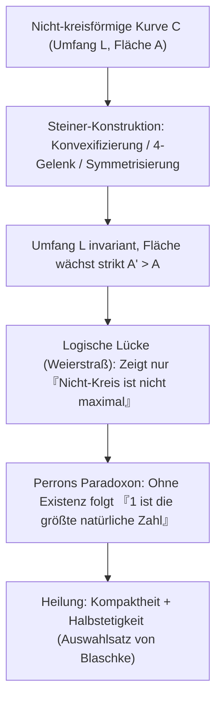
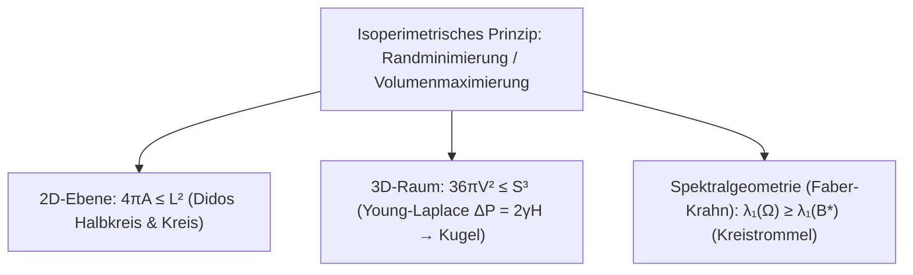

## Einleitung: Wie viel Königreich passt in eine Rinderhaut?

In Vergils Epos *Aeneis* bittet die phönizische Prinzessin <strong>Dido</strong> an der nordafrikanischen Küste um so viel Land, „wie eine Rinderhaut umschließen kann“. Sie schneidet die Haut in hauchdünne Streifen, knüpft daraus ein langes Seil und spannt es mit der geraden Meeresküste als natürlicher Grenze zu einem gewaltigen <strong>Halbkreis</strong> auf — die Gründung Karthagos.

Mathematisch stand Dido vor dem ältesten Variationsproblem der Geschichte, dem <strong>isoperimetrischen Problem</strong>: Welche geschlossene ebene Kurve $C$ fester Länge $L > 0$ umschließt den größten Flächeninhalt $A$? Die Antwort ist der <strong>Kreis</strong>. Für jede einfach geschlossene Kurve der Länge $L$ und Fläche $A$ gilt die <strong>ebene isoperimetrische Ungleichung</strong>:

$$\boxed{4\pi A \le L^2 \quad \Longleftrightarrow \quad Q(C) := \frac{4\pi A}{L^2} \le 1}$$

Der dimensionslose <strong>isoperimetrische Quotient</strong> $Q(C) \in (0, 1]$ nimmt genau dann den Wert $1$ an, wenn $C$ ein Kreis ist. Obwohl das Ergebnis anschaulich sofort einleuchtet, dauerte es über 2000 Jahre, bis ein lückenloser Beweis gelang.

---

## Kapitel 1: Reguläre Polygone und griechische Intuition

Schon im 2. Jahrhundert v. Chr. bewies <strong>Zenodoros</strong>, dass unter allen $n$-Ecken gleichen Umfangs $L$ das reguläre $n$-Eck die größte Fläche besitzt:

$$A_n = \frac{L^2}{4n \tan(\pi/n)}, \qquad Q_n = \frac{4\pi A_n}{L^2} = \frac{\pi/n}{\tan(\pi/n)} \xrightarrow{n \to \infty} 1$$

| Ebene Figur ($L$ fest) | Fläche $A(L)$ | Quotient $Q = \frac{4\pi A}{L^2}$ | Effizienz vs. Kreis (%) |
| :--- | :--- | :--- | :--- |
| <strong>Gleichseitiges Dreieck ($n = 3$)</strong> | $\frac{\sqrt{3}}{36} L^2 \approx 0.04811 L^2$ | $\frac{\pi}{3\sqrt{3}} \approx 0.6046$ | $60.46\%$ |
| <strong>Quadrat ($n = 4$)</strong> | $\frac{1}{16} L^2 = 0.06250 L^2$ | $\frac{\pi}{4} \approx 0.7854$ | $78.54\%$ |
| <strong>Reguläres Sechseck ($n = 6$)</strong> | $\frac{\sqrt{3}}{24} L^2 \approx 0.07217 L^2$ | $\frac{\pi}{2\sqrt{3}} \approx 0.9069$ | $90.69\%$ |
| <strong>Kreis ($n \to \infty$)</strong> | $\frac{1}{4\pi} L^2 \approx 0.07958 L^2$ | <strong>$1.0000$ (Maximum)</strong> | <strong>$100.00\%$</strong> |

Durch Spiegelung an der geraden Küstenlinie entsteht aus Didos Seil der Länge $L_{\text{rope}}$ eine geschlossene Kurve des Umfangs $2L_{\text{rope}}$; die optimale Form an der Küste ist daher der <strong>Halbkreis</strong> mit $A_{\max} = \frac{L_{\text{rope}}^2}{2\pi}$.

---

## Kapitel 2: Steiners Vier-Gelenk-Methode und Weierstraß' Kritik

1838 stellte <strong>Jakob Steiner</strong> seine berühmte <strong>Steiner-Symmetrisierung</strong> und die <strong>Vier-Gelenk-Methode</strong> vor:
1. <strong>Konvexifizierung</strong>: Jede Einbuchtung wird an einer Stützgeraden nach außen gespiegelt ($L$ bleibt gleich, $A$ wächst strikt).
2. <strong>Vier-Gelenk-Deformation</strong>: Teilen $P, Q$ den Umfang halbierend und gilt für einen Randpunkt $R$, dass $\angle PRQ \neq 90^\circ$, bewegt man die vier starren Bogensegmente über Gelenke in $P, R, Q, S$ so, dass $\angle PRQ = \angle PSQ = 90^\circ$ wird. Da die Dreiecksfläche $\frac{1}{2}ab\sin\theta$ bei $\theta = 90^\circ$ maximal ist, wächst die Gesamtfläche strikt bei gleichem Umfang! Nach dem Satz des Thales bleibt nur der <strong>Kreis</strong> unveränderbar.

<strong>Karl Weierstraß</strong> deckte jedoch eine fundamentale Lücke auf: Steiner hatte nur bewiesen, dass *falls* eine optimale Kurve existiert, sie ein Kreis sein muss — nicht aber, dass ein Maximum überhaupt existiert! <strong>Oskar Perron</strong> illustrierte dies mit <strong>Perrons Paradoxon</strong>: Angenommen, es gibt eine größte natürliche Zahl $N$. Wäre $N > 1$, so wäre $N^2 > N$ (Widerspruch), also ist $N = 1$ die größte natürliche Zahl! Erst der Auswahlsatz von Blaschke schloss diese Existenzlücke.

---

## Kapitel 3: Hurwitz' Fourier-Beweis (1901) — Der Kreis als reiner Grundton

1901 bewies <strong>Adolf Hurwitz</strong> die Ungleichung rein analytisch mit <strong>Fourier-Reihen</strong>, ganz ohne Existenzannahme. Durch Skalierung sei $L = 2\pi$ und $(x(s), y(s))$ nach der Bogenlänge $s \in [0, 2\pi]$ parametrisiert, sodass $(x')^2 + (y')^2 = 1$ gilt:

$$\left(x'(s)\right)^2 + \left(y'(s)\right)^2 = 1 \quad \Longrightarrow \quad L = \int_0^{2\pi} \left(x'(s)^2 + y'(s)^2\right) ds = 2\pi$$

Mit den Fourier-Reihen $x(s) = \sum_{n=-\infty}^{\infty} a_n e^{ins}$ und $y(s) = \sum_{n=-\infty}^{\infty} b_n e^{ins}$ ($a_{-n} = \overline{a_n}, b_{-n} = \overline{b_n}$) liefern die <strong>Parsevalsche Gleichung</strong> und der <strong>Satz von Green</strong> $A = \frac{1}{2}\oint (x\,dy - y\,dx)$:

$$\frac{L}{2\pi} = 1 = \sum_{n \neq 0} n^2 \left(|a_n|^2 + |b_n|^2\right), \qquad \frac{A}{\pi} = \sum_{n \neq 0} i n \left(a_n \overline{b_n} - \overline{a_n} b_n\right)$$

Subtraktion und quadratische Ergänzung ergeben sofort ($L^2 - 4\pi A = 4\pi^2(1 - A/\pi)$):

$$\boxed{\frac{L^2 - 4\pi A}{4\pi^2} = \sum_{n \neq 0} \Big[ \underbrace{(n^2 - 1)\left(|a_n|^2 + |b_n|^2\right)}_{\ge 0 \ (\forall |n| \ge 1)} + \underbrace{|a_n + i b_n|^2}_{\ge 0} \Big] \ge 0}$$

Gleichheit gilt genau dann, wenn alle Oberschwingungen $|n| \ge 2$ verschwinden ($a_n = b_n = 0$) und $a_1 + i b_1 = 0$ gilt — also genau für den <strong>Kreis</strong> vom Radius $R = 1$! Der Kreis ist somit der <strong>reine Grundton erster Ordnung</strong> ohne hochfrequente Verzerrungen.

---

## Kapitel 4: 3D-Seifenblasen und die Faber-Krahn-Ungleichung

1. <strong>3D-Ungleichung & Seifenblasen</strong>: Im $\mathbb{R}^3$ gilt zwischen Oberfläche $S$ und Volumen $V$ die Ungleichung <strong>$36\pi V^2 \le S^3$</strong> (Gleichheit nur für die Kugel). Seifenblasen minimieren die Oberflächenenergie $E = \gamma S$ gemäß der <strong>Young-Laplace-Gleichung</strong> $\Delta P = 2\gamma H$ zu Flächen konstanter mittlerer Krummung (CMC), die nach dem <strong>Satz von Alexandrow (1956)</strong> Kugeln sein müssen.
2. <strong>Satz von Faber-Krahn</strong>: Unter allen Trommelmembranen $\Omega \subset \mathbb{R}^2$ gleicher Fläche besitzt die kreisförmige Trommel $B^*$ den kleinsten ersten Dirichlet-Eigenwert (tiefsten Grundton):
   $$\lambda_1(\Omega) = \inf_{u \in H_0^1(\Omega)\setminus\{0\}} \frac{\int_\Omega |\nabla u|^2 \, dx}{\int_\Omega u^2 \, dx} \ge \lambda_1(B^*) = \frac{\pi j_{0,1}^2}{A(\Omega)}$$
