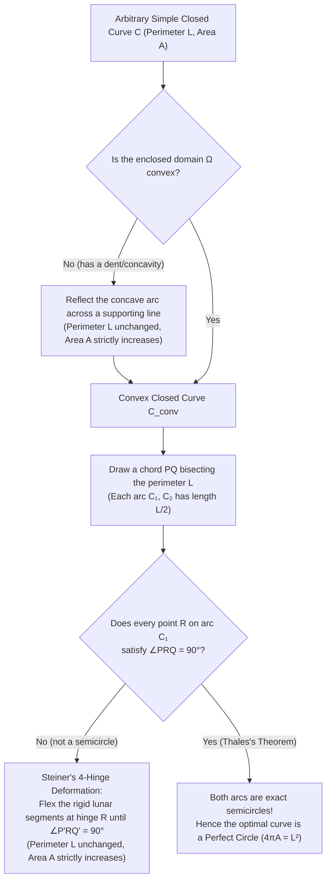
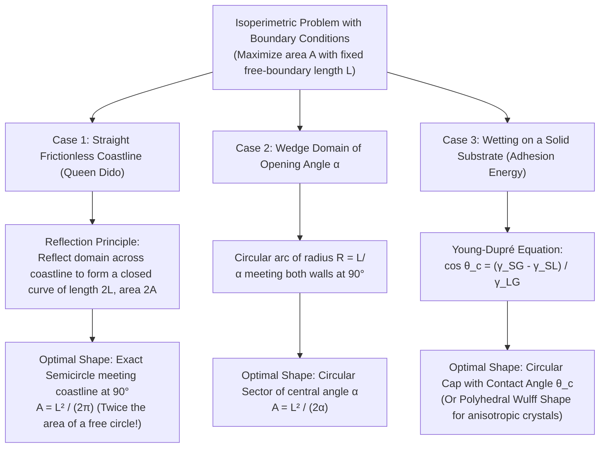

## 1. Queen Dido of Carthage and the Oldest Variational Problem in History

"Given a closed loop of string of fixed length $L$, what planar shape should we form so that the enclosed area $A$ is as large as possible?"

At first glance, the answer seems almost self-evident: <strong>a perfect circle</strong>. Even a child blowing soap bubbles or an ancient surveyor laying out a camp knows intuitively that round shapes pack the most interior space inside a given boundary. Yet the moment we ask *why* the circle is optimal—and demand a watertight mathematical proof that no conceivable irregular, wiggly, or non-convex closed curve could ever match or surpass the circle's area—we step into a two-thousand-year mathematical odyssey. Known as the <strong>Isoperimetric Problem</strong> (from the Greek *isos* "equal" and *perimetros* "measure around"), this deceptively simple question catalyzed the birth of the calculus of variations, exposed deep logical fissures in nineteenth-century analysis regarding the existence of extrema, inspired dazzling applications of harmonic analysis, and laid the foundations of modern geometric measure theory and partial differential equations.

### 1.1 Virgil's *Aeneid* and the Oxhide of Byrsa

The mythic origin of the isoperimetric problem dates back to the ninth century BCE and the Phoenician princess <strong>Dido (also known as Elissa)</strong> of Tyre. According to Book I of the Roman poet Virgil's epic *Aeneid*, after Dido's tyrannical brother King Pygmalion murdered her husband Acerbas for his hidden wealth, Dido fled across the Mediterranean Sea with a band of loyal followers.

Landing on the coast of North Africa (modern-day Tunisia), Dido sought to purchase land from the local Berber chieftain, King Iarbas. Reluctant to cede valuable territory to foreign refugees, Iarbas mockingly agreed to sell her only <strong>"as much land as could be encompassed by the hide of a single ox"</strong> (*taurino quantum possent circumdare tergo*).

Rather than accepting defeat, Dido turned the king's riddle into the earliest recorded triumph of geometric optimization:
1. She ordered her artisans to lay the oxhide flat and slice it in a continuous spiral into a single, razor-thin leather thong stretching several kilometers in length.
2. Recognizing that the straight Mediterranean shoreline could serve as a natural, cost-free boundary, she did not waste her leather thong enclosing the seaside edge. Instead, she anchored the two ends of the cord along the beach and bowed the thong outward into a vast <strong>semicircle</strong>.

The citadel she founded within that semicircular enclosure was named *Byrsa* (from the Greek $\beta\upsilon\rho\sigma\alpha$, meaning "oxhide"), which grew into the maritime empire of <strong>Carthage</strong>. To this day, variational problems that seek to maximize area subject to perimeter constraints and fixed boundary walls are universally referred to by mathematicians as <strong>Dido's Problem</strong>.

### 1.2 Zenodorus's *On Isometric Figures* (~200 BCE)

While Dido solved the problem through mythic ingenuity, the first mathematician to subject the isoperimetric property to rigorous deductive proof was <strong>Zenodorus</strong> (c. 200–140 BCE), an ancient Greek geometer living shortly after Archimedes. Although Zenodorus's original treatise *On Isometric Figures* ($\Pi\epsilon\rho\grave{\iota}\ \ἰ\sigma\omicron\mu\epsilon\tau\rho\omega\nu\ \sigma\chi\eta\mu\alpha\tau\omega\nu$) was lost in antiquity, its core theorems and proofs were preserved nearly intact in the fourth-century CE commentaries of <strong>Pappus of Alexandria</strong> and <strong>Theon of Alexandria</strong>.

Operating entirely within the framework of Euclidean synthetic geometry, Zenodorus established a remarkable hierarchy of polygonal optimization theorems:
1. <strong>The Isosceles Principle</strong>: Among all triangles sharing a fixed base $b$ and having the same sum of the remaining two sides $s_1 + s_2 = c$, the enclosed area is strictly maximized when the triangle is <strong>isosceles</strong> ($s_1 = s_2 = c/2$).
2. <strong>Optimality of Regular Polygons</strong>: Among all $n$-gons (polygons with $n$ sides) having a fixed perimeter $L$, the one with the largest area is necessarily equilateral and equiangular—that is, the <strong>regular $n$-gon</strong>.
3. <strong>Monotonicity in the Number of Sides</strong>: Given two regular polygons with the exact same perimeter $L$, if one has $m$ sides and the other has $n$ sides with $m > n$, then the regular $m$-gon encloses a strictly larger area than the regular $n$-gon ($A_m > A_n$).
4. <strong>Superiority of the Circle over All Polygons</strong>: A circle of perimeter $L$ encloses a strictly greater area than any regular polygon of the same perimeter $L$.

We can easily verify Zenodorus's third and fourth theorems using modern trigonometry. Consider a regular $n$-gon of perimeter $L$. Each of its $n$ sides has length $a = L/n$, and the central angle subtended by each side is $2\pi/n$. The apothem $r_n$ (the radius of the inscribed circle, which acts as the altitude of each of the $n$ congruent isosceles triangles forming the polygon) satisfies $\tan(\pi/n) = \frac{a/2}{r_n} = \frac{L}{2n r_n}$, giving $r_n = \frac{L}{2n\tan(\pi/n)}$. Thus, the total area $A_n$ of the regular $n$-gon is:

$$A_n = n \left(\frac{1}{2} a r_n\right) = \frac{1}{2} L r_n = \frac{L^2}{4n \tan(\pi/n)} = \frac{L^2}{4\pi} \left( \frac{\pi/n}{\tan(\pi/n)} \right)$$

Let $x = \pi/n \in (0, \pi/3]$. Since the derivative of $g(x) = \frac{x}{\tan x}$ on $(0, \pi/2)$ is $g'(x) = \frac{\sin x \cos x - x}{\sin^2 x} = \frac{\sin(2x) - 2x}{2\sin^2 x} < 0$, the function $g(x)$ is strictly decreasing with $x$. As the number of sides $n$ increases ($n = 3, 4, 5, 6, \dots \to \infty$), $x = \pi/n$ decreases toward $0^+$, so $g(\pi/n)$ strictly increases toward $\lim_{x \to 0^+} \frac{x}{\tan x} = 1$. Consequently:

$$A_3 < A_4 < A_5 < A_6 < \cdots < \lim_{n \to \infty} A_n = \frac{L^2}{4\pi} = A_{\text{circle}}$$

Zenodorus proved everything he could with Euclidean tools, yet a profound gap remained: comparing the circle to *polygons* does not automatically rule out the possibility of some exotic curvilinear shape—neither polygonal nor circular—that might beat the circle. Closing that gap required more than two millennia of new mathematics.

---

## 2. The Classical Planar Isoperimetric Inequality and the Isoperimetric Quotient

### 2.1 Rigorous Formulation and Scale Invariance

Let $C \subset \mathbb{R}^2$ be any simple, closed, rectifiable curve of arc length (perimeter) $L$, and let $\Omega \subset \mathbb{R}^2$ be the bounded interior domain enclosed by $C$ (guaranteed to exist by the Jordan Curve Theorem) with two-dimensional Lebesgue measure (area) $A$. The <strong>Classical Planar Isoperimetric Inequality</strong> states that:

$$4\pi A \le L^2$$

Furthermore, <strong>equality $4\pi A = L^2$ holds if and only if $C$ is a circle</strong>.

Equivalently, we can rearrange the inequality into a dimensionless ratio known as the <strong>Isoperimetric Quotient</strong> (or <strong>Circularity</strong>) $Q(C)$:

$$Q(C) = \frac{4\pi A}{L^2} \le 1$$

Why is the combination $4\pi A / L^2$ so fundamental? Suppose we subject our domain $\Omega$ to a uniform homothety (scaling transformation) $\Omega \mapsto \lambda \Omega$ by a linear scale factor $\lambda > 0$. Under this scaling, the one-dimensional perimeter scales linearly as $L(\lambda \Omega) = \lambda L(\Omega)$, whereas the two-dimensional area scales quadratically as $A(\lambda \Omega) = \lambda^2 A(\Omega)$. Therefore:

$$Q(\lambda \Omega) = \frac{4\pi A(\lambda \Omega)}{L(\lambda \Omega)^2} = \frac{4\pi \lambda^2 A(\Omega)}{\lambda^2 L(\Omega)^2} = Q(\Omega)$$

Thus, $Q(\Omega) \in (0, 1]$ is completely <strong>scale-invariant</strong>: it measures pure geometric shape efficiency independent of physical size. A circle achieves the universal upper bound $Q = 1$, while elongated needle-like shapes or fractal coastlines like the Koch snowflake (where $L \to \infty$ while $A$ remains finite) drive $Q \to 0$.

Sometimes mathematicians also study the <strong>Isoperimetric Deficit</strong> $\delta(C) = L^2 - 4\pi A \ge 0$, which quantifies how far a curve deviates from perfect circularity. Remarkably, the <strong>Bonnesen Inequality</strong> (proved by Tommy Bonnesen in 1924) strengthens the classical inequality by providing a quantitative lower bound on this deficit in terms of the radius $r_{\text{in}}$ of the largest inscribed circle and the radius $R_{\text{out}}$ of the smallest circumscribed circle of a convex domain $\Omega$:

$$L^2 - 4\pi A \ge \pi^2 (R_{\text{out}} - r_{\text{in}})^2 \ge 0$$

This immediately implies uniqueness: if $L^2 - 4\pi A = 0$, then $R_{\text{out}} = r_{\text{in}}$, meaning the inscribed and circumscribed circles coincide, forcing the boundary $C$ to be that exact circle!

### 2.2 Comparative Table of Isoperimetric Quotients Across Planar Shapes

To appreciate how sensitively $Q = 4\pi A / L^2$ discriminates between geometric configurations, let us examine the exact analytical expressions and numerical efficiencies of ten classic planar shapes for a fixed perimeter $L$:

| Planar Shape | Geometric Specification | Area $A$ in terms of Perimeter $L$ | Exact Isoperimetric Quotient $Q = \frac{4\pi A}{L^2}$ | Numerical Value of $Q$ | Area Efficiency vs. Circle |
| :--- | :--- | :--- | :--- | :--- | :--- |
| <strong>Right Isosceles Triangle</strong> | Side ratio $1 : 1 : \sqrt{2}$ | $\frac{3 - 2\sqrt{2}}{4} L^2$ | $(3 - 2\sqrt{2})\pi$ | $0.5390$ | $53.90\%$ |
| <strong>Equilateral Triangle</strong> ($n=3$) | Regular 3-gon | $\frac{\sqrt{3}}{36} L^2$ | $\frac{\pi\sqrt{3}}{9}$ | $0.6046$ | $60.46\%$ |
| <strong>Golden Rectangle</strong> | Side ratio $1 : \phi$ ($\phi = \frac{1+\sqrt{5}}{2}$) | $\frac{\phi}{4(1+\phi)^2} L^2$ | $\frac{\pi}{\sqrt{5}+3}$ | $0.7440$ | $74.40\%$ |
| <strong>Closed Semicircle (D-shape)</strong> | Arc $\pi R$ + diameter $2R$ | $\frac{\pi}{2(\pi+2)^2} L^2$ | $\frac{2\pi^2}{(\pi+2)^2}$ | $0.7468$ | $74.68\%$ |
| <strong>Square</strong> ($n=4$) | Regular 4-gon | $\frac{1}{16} L^2$ | $\frac{\pi}{4}$ | $0.7854$ | $78.54\%$ |
| <strong>Regular Pentagon</strong> ($n=5$) | Regular 5-gon | $\frac{1}{20\tan(\pi/5)} L^2$ | $\frac{\pi}{5\tan(\pi/5)}$ | $0.8648$ | $86.48\%$ |
| <strong>Reuleaux Triangle</strong> | Curve of constant width $w = L/\pi$ | $\frac{\pi - \sqrt{3}}{2\pi^2} L^2$ | $\frac{2(\pi - \sqrt{3})}{\pi}$ | $0.8973$ | $89.73\%$ |
| <strong>Regular Hexagon</strong> ($n=6$) | Honeycomb tiling cell | $\frac{\sqrt{3}}{24} L^2$ | $\frac{\pi\sqrt{3}}{6}$ | $0.9069$ | $90.69\%$ |
| <strong>Regular Dodecagon</strong> ($n=12$) | Regular 12-gon | $\frac{1}{48(2-\sqrt{3})} L^2$ | $\frac{\pi}{12(2-\sqrt{3})}$ | $0.9771$ | $97.71\%$ |
| <strong>Perfect Circle</strong> ($n \to \infty$) | Constant curvature $\kappa = 2\pi/L$ | $\frac{1}{4\pi} L^2$ | $1$ | $1.0000$ | $100.00\%$ |

Notice two fascinating highlights in this table:
- <strong>The Blaschke-Lebesgue Theorem and the Reuleaux Triangle</strong>: By Barbier's theorem, every curve of constant width $w$ has the exact same perimeter $L = \pi w$ as a circle of diameter $w$. Among all shapes of constant width $w$ (and thus equal perimeter $L$), the circle maximizes the area ($Q = 1$), whereas the <strong>Reuleaux triangle</strong>—formed by three circular arcs centered at the vertices of an equilateral triangle—*minimizes* the area ($Q \approx 0.8973$).
- <strong>The Honeycomb Conjecture</strong>: While a single circle achieves $Q = 1$, circles cannot tile the Euclidean plane without leaving wasteful interstitial gaps. Among the three regular polygons capable of tiling the plane without gaps—the equilateral triangle ($Q \approx 0.6046$), the square ($Q \approx 0.7854$), and the regular hexagon ($Q \approx 0.9069$)—the <strong>regular hexagon</strong> is overwhelmingly the most efficient. In 1999, Thomas Hales proved the two-thousand-year-old <strong>Honeycomb Conjecture</strong>, showing that even if we allow arbitrary curved walls between cells of equal area, the regular hexagonal grid strictly minimizes total perimeter per unit area across the entire plane.

---

## 3. Jakob Steiner's Geometric Proofs (1838) and Weierstrass's Logical Critique

In the 1830s and 1840s, the Swiss mathematician <strong>Jakob Steiner (1796–1863)</strong>—the greatest champion of pure synthetic geometry in the nineteenth century—published five distinct geometric proofs of the isoperimetric inequality. Steiner detested analytical calculations, famously remarking that calculation replaces thinking while geometry stimulates it. His strategy was to design constructive geometric operations that take *any* non-circular closed curve and deform it so that its perimeter remains fixed while its area strictly increases (or dually, its area remains fixed while its perimeter strictly decreases).

Let us examine Steiner's two most celebrated geometric constructions—the <strong>Four-Hinge Method</strong> and <strong>Steiner Symmetrization</strong>—followed by the famous logical controversy ignited by <strong>Karl Weierstrass</strong>.

### 3.1 Steiner's First Proof: Convexification and the Four-Hinge Mechanism

Steiner's first proof proceeds in three constructive stages, showing that no non-circular curve can be an area maximizer.

#### Stage 1: Elimination of Concavities (Convexification)
Suppose the bounded region $\Omega$ enclosed by $C$ is <strong>not convex</strong>. Then there exists a supporting straight line $\ell$ that touches the boundary $C$ at two distinct points $A$ and $B$ such that the segment $AB$ lies entirely outside the interior of $\Omega$, forming a "dent" or bay between the chord $AB$ and the boundary arc $\widehat{AB}$ of $C$.
If we reflect the indented arc $\widehat{AB}$ across the line $\ell$ to its mirror image $\widehat{AB}'$, the length of the reflected arc is identical to the original arc, so the total perimeter $L$ of the closed curve is completely unchanged. However, the new curve encloses all of the original domain $\Omega$ *plus* the lens-shaped region between $\widehat{AB}$ and $\widehat{AB}'$. Since this added region has strictly positive area, <strong>any non-convex shape can be strictly improved</strong>. Therefore, an optimal curve must bound a <strong>convex domain</strong>.

#### Stage 2: Perimeter Bisection and Symmetry Synchronization
On our convex closed curve $C$, choose any point $P$, and move along $C$ by a distance $L/2$ to reach the opposite point $Q$. The straight line segment (chord) $PQ$ divides the boundary $C$ into two arcs $C_1$ and $C_2$ of equal length $L/2$, and divides the interior $\Omega$ into two regions $\Omega_1$ and $\Omega_2$ with areas $A_1$ and $A_2$.
Suppose $A_1 \neq A_2$—say $A_1 > A_2$. Then we can discard the smaller half $\Omega_2$ and replace it with the mirror reflection of $\Omega_1$ across the chord $PQ$. The resulting symmetric curve has perimeter $L/2 + L/2 = L$, but its enclosed area is $2A_1 > A_1 + A_2 = A$. Consequently, for $C$ to maximize area, both halves must have equal area ($A_1 = A_2$), and the upper arc $C_1$ must itself maximize the area enclosed between an arc of length $L/2$ and an unconstrained straight chord $PQ$.

#### Stage 3: The Four-Hinge Deformation and Thales's Theorem
Now consider the upper arc $C_1$ of length $L/2$ connecting $P$ and $Q$. We claim that $C_1$ must be a <strong>semicircle</strong> with diameter $PQ$.
By the converse of <strong>Thales's Theorem</strong>, $C_1$ is a semicircle with diameter $PQ$ if and only if, for *every* point $R$ on $C_1$ distinct from $P$ and $Q$, the inscribed angle $\angle PRQ$ is a right angle ($90^\circ$ or $\pi/2$ radians).
Suppose, for the sake of contradiction, that there exists at least one point $R \in C_1$ where $\theta = \angle PRQ \neq 90^\circ$. Connect $P$ to $R$ and $R$ to $Q$ by straight chords of lengths $a = |PR|$ and $b = |RQ|$. These two chords divide the upper half-domain $\Omega_1$ into three pieces:
1. A lunar (crescent-shaped) region $S_1$ bounded by the chord $PR$ and the sub-arc $\widehat{PR}$.
2. A second lunar region $S_2$ bounded by the chord $RQ$ and the sub-arc $\widehat{RQ}$.
3. The central inscribed triangle $\triangle PRQ$, whose area is given by the elementary trigonometric formula:
   $$\operatorname{Area}(\triangle PRQ) = \frac{1}{2} a b \sin\theta$$

Now imagine treating the two lunar regions $S_1$ and $S_2$ as <strong>rigid plates</strong> attached by a flexible mechanical <strong>hinge</strong> at the vertex $R$, while allowing the endpoints $P$ and $Q$ to slide freely along the baseline as we pivot the hinge angle $\theta$!
Because $S_1$ and $S_2$ move as rigid bodies:
- The outer arc lengths $|\widehat{PR}|$ and $|\widehat{RQ}|$ remain unchanged, so their sum is still $L/2$.
- The lunar areas $\operatorname{Area}(S_1)$ and $\operatorname{Area}(S_2)$ remain unchanged.
- The chord lengths $a = |PR|$ and $b = |RQ|$ remain unchanged.

The *only* part of the area $A_1 = \operatorname{Area}(S_1) + \operatorname{Area}(S_2) + \frac{1}{2} a b \sin\theta$ that changes when we flex the hinge at $R$ is the triangle area $\frac{1}{2} a b \sin\theta$. Since $\sin\theta$ achieves its unique global maximum $\sin(90^\circ) = 1$ at $\theta = 90^\circ$, pivoting the hinge from $\theta \neq 90^\circ$ to $\theta' = 90^\circ$ (sliding $P$ and $Q$ to new positions $P'$ and $Q'$ at distance $\sqrt{a^2 + b^2}$) <strong>strictly increases the area $A_1$</strong>! Completing the figure by reflecting this improved upper half across the new chord $P'Q'$ yields a closed curve of the exact same perimeter $L$ with strictly larger total area $2A_1' > 2A_1 = A$.

Thus, no curve with $\angle PRQ \neq 90^\circ$ can be optimal. Every point $R \in C_1$ must satisfy $\angle PRQ = 90^\circ$, which forces $C_1$ (and its mirror image $C_2$) to be exact semicircles, and $C$ to be a <strong>perfect circle</strong>!

### 3.2 Steiner's Second Proof: Steiner Symmetrization

Steiner's second method—now universally known as <strong>Steiner Symmetrization</strong>—is even more profound because it generalizes effortlessly to arbitrary dimensions $\mathbb{R}^n$ and plays a central role in modern functional analysis and partial differential equations.

Let $\Omega \subset \mathbb{R}^2$ be a compact domain and let $H$ be a straight line in the plane (without loss of generality, take $H$ to be the $x$-axis, $y = 0$). For each abscissa $x \in \mathbb{R}$, consider the vertical line $L_x = \{(x, y) \mid y \in \mathbb{R}\}$ perpendicular to $H$. The intersection $\Omega \cap L_x$ is a vertical cross-section of $\Omega$. Let $\ell(x) = \mathcal{L}^1(\Omega \cap L_x)$ denote the one-dimensional Lebesgue measure (the total length) of this vertical slice.

We construct the <strong>Steiner symmetral</strong> $\Omega^*$ of $\Omega$ with respect to the axis $H$ by sliding each vertical slice along $L_x$ (and consolidating it into a single connected segment if $\Omega$ was non-convex) so that its midpoint lies directly on the axis $H$:

$$\Omega^* = \left\{ (x, y) \in \mathbb{R}^2 \;\middle|\; \Omega \cap L_x \neq \emptyset \text{ and } -\frac{\ell(x)}{2} \le y \le \frac{\ell(x)}{2} \right\}$$

Steiner symmetrization possesses two fundamental geometric properties:
1. <strong>Exact Preservation of Area (Cavalieri's Principle)</strong>:
   By Fubini's theorem, the area of a planar region is the integral of the lengths of its vertical cross-sections. Because $\Omega^*$ and $\Omega$ have the exact same cross-sectional length $\ell(x)$ for every $x \in \mathbb{R}$, their areas are identical:
   $$\operatorname{Area}(\Omega^*) = \int_{-\infty}^{\infty} \ell(x)\,dx = \operatorname{Area}(\Omega)$$
2. <strong>Strict Reduction of Perimeter (unless $\Omega$ is already symmetric)</strong>:
   Suppose $\Omega$ is convex, bounded above by the graph $y = y_1(x)$ and below by $y = y_2(x)$ over an interval $x \in [a, b]$. Then the vertical slice length is $\ell(x) = y_1(x) - y_2(x)$, and the symmetrized domain $\Omega^*$ is bounded above by $y = \frac{1}{2}(y_1(x) - y_2(x))$ and below by $y = -\frac{1}{2}(y_1(x) - y_2(x))$.
   The perimeter of the original domain $\Omega$ is:
   $$L(\Omega) = \int_a^b \left( \sqrt{1 + (y_1'(x))^2} + \sqrt{1 + (y_2'(x))^2} \right) dx$$
   while the perimeter of the symmetrized domain $\Omega^*$ is:
   $$L(\Omega^*) = 2 \int_a^b \sqrt{1 + \left( \frac{y_1'(x) - y_2'(x)}{2} \right)^2}\,dx$$
   Now consider the elementary function $\phi(t) = \sqrt{1 + t^2}$. Its second derivative is $\phi''(t) = (1 + t^2)^{-3/2} > 0$ for all $t \in \mathbb{R}$, meaning $\phi(t)$ is <strong>strictly convex</strong>! Applying Jensen's inequality $\frac{\phi(u) + \phi(v)}{2} \ge \phi\left(\frac{u+v}{2}\right)$ with $u = y_1'(x)$ and $v = -y_2'(x)$ at every point $x \in [a, b]$ yields:
   $$\sqrt{1 + (y_1'(x))^2} + \sqrt{1 + (y_2'(x))^2} \ge 2 \sqrt{1 + \left( \frac{y_1'(x) - y_2'(x)}{2} \right)^2}$$
   Integrating over $[a, b]$ gives $L(\Omega^*) \le L(\Omega)$. Furthermore, because $\phi(t)$ is *strictly* convex, equality $L(\Omega^*) = L(\Omega)$ holds if and only if $u = v$ almost everywhere, i.e., $y_1'(x) = -y_2'(x)$, which means $\frac{1}{2}(y_1(x) + y_2(x)) = c$ is constant—in other words, <strong>if and only if the midpoint of every vertical chord already lay on a horizontal line parallel to $H$</strong>!

If a compact convex domain $\Omega$ has the minimum possible perimeter for a given area $A$, its perimeter cannot be reduced by Steiner symmetrization along *any* axis direction $H$. Therefore, $\Omega$ must possess an axis of reflection symmetry in every direction $\theta \in [0, \pi)$. The only bounded planar figure symmetric with respect to lines in all directions is a <strong>circle</strong>!

### 3.3 Karl Weierstrass's Famous Logical Critique and Perron's Paradox

For several decades after 1838, mathematicians regarded Steiner's proofs as the final word on the isoperimetric problem. Yet in his legendary Berlin lectures on the calculus of variations in the 1870s, <strong>Karl Weierstrass (1815–1897)</strong> pointed out a glaring logical gap at the heart of Steiner's reasoning.

What Steiner had rigorously proved was a conditional statement:
> <strong>"If $C$ is not a circle, then $C$ cannot maximize the area $A$ for a fixed perimeter $L$."</strong>
> By contraposition, this is logically equivalent to:
> <strong>"IF a closed curve maximizing the area $A$ exists, THEN that curve must be a circle."</strong>

Weierstrass asked the devastating question: <strong>How do we know that a curve achieving the maximum area exists at all?</strong>

Steiner had tacitly conflated the existence of a <strong>supremum</strong> (least upper bound)—which clearly exists because any curve of length $L$ fits inside a square of side $L/2$, bounding all areas by $A \le L^2/4$—with the existence of a <strong>maximum</strong> (an actual curve in the admissible space that attains that upper bound). On a finite-dimensional compact set in $\mathbb{R}^n$, Weierstrass's own Extreme Value Theorem guarantees that every continuous function attains its maximum. However, the space of all simple closed curves of length $L$ is <strong>infinite-dimensional</strong> and not automatically compact! A sequence of curves could conceivably approach the supremum of area while degenerating into a limit that is no longer in the admissible class.

To illustrate why proving "every candidate except $X$ can be improved" does *not* prove "$X$ is the optimal solution" without an independent existence theorem, the German mathematician <strong>Oskar Perron (1880–1975)</strong> formulated the famous <strong>Perron's Paradox</strong>:

> <strong>Theorem (False):</strong> *The largest positive integer is $N = 1$.*
> <strong>"Proof":</strong> Suppose $N$ is the largest positive integer. If $N > 1$, then multiplying $N$ by itself yields $N^2 > N$, which is a positive integer strictly larger than $N$, contradicting the maximality of $N$. Thus, every integer $N \neq 1$ can be strictly improved (replaced by a larger integer $N^2$). Since no integer $N > 1$ can be the maximum, the largest positive integer must be $N = 1$. $\blacksquare$

Every single step in Perron's "improvement argument" ($N > 1 \implies N^2 > N$) is algebraically flawless! The sole reason the conclusion "$N = 1$ is the largest integer" is absurd is that <strong>no largest positive integer exists</strong>. Without proving existence first, eliminating all candidates other than $1$ merely proves that *if* a largest integer existed it would have to be $1$—and since $1$ is obviously beaten by $2$, no maximum exists at all!

How was Weierstrass's critique resolved for the isoperimetric problem? Mathematicians developed three powerful pathways:
1. <strong>Direct Analytic Proof Bypassing Existence (Hurwitz, 1901)</strong>: Instead of assuming a maximizer exists, prove directly for every curve $C$ that $L^2 - 4\pi A \ge 0$, and show directly that $4\pi A = L^2$ for the circle. (If we evaluate the circle directly and show its area beats or equals every other curve's area, existence is automatic because the circle itself is an explicit member of the set!)
2. <strong>Compactness in the Space of Convex Bodies (Blaschke Selection Theorem, 1916)</strong>: Wilhelm Blaschke proved that the metric space of all non-empty compact convex subsets of a bounded ball in $\mathbb{R}^n$, equipped with the <strong>Hausdorff metric</strong> $d_H(K_1, K_2)$, is <strong>compact</strong>. Since both area $A(K)$ and perimeter $L(K)$ are continuous with respect to the Hausdorff metric on convex bodies, a maximizing convex body is guaranteed to exist by Weierstrass's Extreme Value Theorem, completely vindicating Steiner's proofs!
3. <strong>Geometric Measure Theory and Sets of Finite Perimeter (De Giorgi, 1950s)</strong>: To handle arbitrary measurable sets $\Omega \subset \mathbb{R}^n$ without assuming convexity or smooth boundaries, <strong>Ennio De Giorgi</strong> defined the perimeter $P(\Omega)$ of a Borel set $\Omega$ in the sense of Caccioppoli as the total variation of the distributional gradient of its characteristic function $\chi_\Omega \in BV(\mathbb{R}^n)$:
   $$P(\Omega) = |D\chi_\Omega|(\mathbb{R}^n) = \sup \left\{ \int_\Omega \operatorname{div} \mathbf{g}(x)\,dx \;\middle|\; \mathbf{g} \in C_c^1(\mathbb{R}^n; \mathbb{R}^n),\; \|\mathbf{g}\|_\infty \le 1 \right\}$$
   Using the compact embedding of $BV_{\text{loc}}(\mathbb{R}^n)$ into $L^1_{\text{loc}}(\mathbb{R}^n)$ and the lower semicontinuity of the perimeter functional $P(\Omega)$, De Giorgi established the unconditional existence and regularity of isoperimetric minimizers in all dimensions.

---

## 4. Adolf Hurwitz's Complete Analytic Proof via Fourier Series (1901)

In 1901, the German mathematician <strong>Adolf Hurwitz (1859–1919)</strong>—mentor to David Hilbert and Hermann Minkowski—published a breathtakingly concise analytic proof of the isoperimetric inequality using <strong>Fourier series</strong>. Hurwitz's proof requires no prior assumption that a maximizer exists: it computes $L^2 - 4\pi A$ directly in frequency space as a sum of non-negative squares and reads off the exact equation of a circle from the equality condition.

### 4.1 Arc-Length Parameterization Rescaled to $[0, 2\pi]$

Let $C$ be a simple closed $C^1$ (or piecewise $C^1$) curve in $\mathbb{R}^2$ of perimeter $L$, parameterized in the counterclockwise direction by its <strong>arc length</strong> $s \in [0, L]$ as $(x(s), y(s))$. By definition of arc-length parameterization, the tangent vector $(\frac{dx}{ds}, \frac{dy}{ds})$ has unit Euclidean norm everywhere:

$$\left(\frac{dx}{ds}\right)^2 + \left(\frac{dy}{ds}\right)^2 = 1 \qquad \forall s \in [0, L]$$

To expand the coordinates in standard $2\pi$-periodic Fourier series, we introduce the rescaled dimensionless parameter $t \in [0, 2\pi]$ defined by:

$$t = \frac{2\pi s}{L} \quad \Longleftrightarrow \quad s = \frac{L}{2\pi} t$$

By the chain rule, $x'(t) = \frac{dx}{dt} = \frac{L}{2\pi} \frac{dx}{ds}$ and $y'(t) = \frac{dy}{dt} = \frac{L}{2\pi} \frac{dy}{ds}$. Therefore, at every point $t \in [0, 2\pi]$, the speed squared with respect to $t$ is constant:

$$(x'(t))^2 + (y'(t))^2 = \left(\frac{L}{2\pi}\right)^2 \left[ \left(\frac{dx}{ds}\right)^2 + \left(\frac{dy}{ds}\right)^2 \right] = \frac{L^2}{4\pi^2}$$

Integrating this identity over a full period $t \in [0, 2\pi]$ yields an exact integral representation for $L^2$:

$$\int_0^{2\pi} \left( (x'(t))^2 + (y'(t))^2 \right) dt = \int_0^{2\pi} \frac{L^2}{4\pi^2}\,dt = \frac{L^2}{2\pi}$$

### 4.2 Complex Fourier Expansion, Parseval's Identity, and Green's Theorem

We can make the algebra exceptionally transparent by identifying $\mathbb{R}^2$ with the complex plane $\mathbb{C}$ and writing the closed curve as a $2\pi$-periodic complex function $z(t) = x(t) + i y(t)$. Because $z(t)$ is continuous and piecewise $C^1$ with $z(0) = z(2\pi)$, we can expand $z(t)$ and its derivative $z'(t) = x'(t) + i y'(t)$ in complex Fourier series:

$$z(t) = \sum_{n=-\infty}^{\infty} a_n e^{int}, \qquad z'(t) = \sum_{n=-\infty}^{\infty} i n a_n e^{int}$$

where the complex Fourier coefficients $a_n \in \mathbb{C}$ are given by $a_n = \frac{1}{2\pi} \int_0^{2\pi} z(t) e^{-int}\,dt$. (If one prefers real Fourier series $x(t) = \sum c_n e^{int}$ and $y(t) = \sum d_n e^{int}$, the exact same calculation holds with $a_n = c_n + i d_n$.)

First, let us apply <strong>Parseval's Identity</strong> $\frac{1}{2\pi} \int_0^{2\pi} |f(t)|^2\,dt = \sum_{n=-\infty}^{\infty} |\hat{f}(n)|^2$ to the derivative $z'(t)$, whose $n$-th Fourier coefficient is $\widehat{z'}(n) = i n a_n$:

$$\frac{L^2}{2\pi} = \int_0^{2\pi} |z'(t)|^2\,dt = 2\pi \sum_{n=-\infty}^{\infty} |i n a_n|^2 = 2\pi \sum_{n=-\infty}^{\infty} n^2 |a_n|^2$$

Multiplying both sides by $2\pi$ gives the exact Fourier expansion of the squared perimeter $L^2$:

$$L^2 = 4\pi^2 \sum_{n=-\infty}^{\infty} n^2 |a_n|^2$$

Second, let us express the enclosed area $A$ in terms of the Fourier coefficients $a_n$. By <strong>Green's Theorem</strong> in the plane, the area enclosed by a positively (counterclockwise) oriented closed curve $C$ is:

$$A = \frac{1}{2} \oint_C (x\,dy - y\,dx) = \frac{1}{2} \int_0^{2\pi} \left( x(t) y'(t) - y(t) x'(t) \right) dt$$

Notice that for $z(t) = x(t) + i y(t)$ and its complex conjugate $\overline{z(t)} = x(t) - i y(t)$, we have:

$$\overline{z(t)} z'(t) = (x(t) - i y(t))(x'(t) + i y'(t)) = \left(x x' + y y'\right) + i \left(x y' - y x'\right)$$

Thus, the integrand $x(t) y'(t) - y(t) x'(t)$ is simply the imaginary part $\operatorname{Im}\left(\overline{z(t)} z'(t)\right)$! Substituting the Fourier series for $\overline{z(t)} = \sum_{m=-\infty}^{\infty} \overline{a_m} e^{-imt}$ and $z'(t) = \sum_{n=-\infty}^{\infty} i n a_n e^{int}$, and invoking the orthogonality relation $\int_0^{2\pi} e^{i(n-m)t}\,dt = 2\pi \delta_{mn}$ on $[0, 2\pi]$, all cross terms with $m \neq n$ vanish:

$$A = \frac{1}{2} \operatorname{Im} \int_0^{2\pi} \left( \sum_{m=-\infty}^{\infty} \overline{a_m} e^{-imt} \right) \left( \sum_{n=-\infty}^{\infty} i n a_n e^{int} \right) dt = \frac{1}{2} \operatorname{Im} \left( 2\pi \sum_{n=-\infty}^{\infty} i n |a_n|^2 \right) = \pi \sum_{n=-\infty}^{\infty} n |a_n|^2$$

### 4.3 The Decisive Subtraction and Spectral Characterization of the Circle

Now subtract $4\pi A$ from $L^2$ term by term:

$$L^2 - 4\pi A = 4\pi^2 \sum_{n=-\infty}^{\infty} n^2 |a_n|^2 - 4\pi^2 \sum_{n=-\infty}^{\infty} n |a_n|^2 = 4\pi^2 \sum_{n=-\infty}^{\infty} (n^2 - n) |a_n|^2$$

Let us inspect the integer polynomial $P(n) = n^2 - n = n(n - 1)$ for every integer $n \in \mathbb{Z}$:
- For $n = 0$: $n(n - 1) = 0 \cdot (-1) = 0$.
- For $n = 1$: $n(n - 1) = 1 \cdot 0 = 0$.
- For $n \ge 2$: $n(n - 1) \ge 2 \cdot 1 = 2 > 0$ (specifically $2, 6, 12, 20, \dots$ for $n = 2, 3, 4, 5, \dots$).
- For $n \le -1$: $n(n - 1) = |n|(|n| + 1) \ge 1 \cdot 2 = 2 > 0$ (specifically $2, 6, 12, 20, \dots$ for $n = -1, -2, -3, -4, \dots$).

Because $n^2 - n \ge 0$ for <strong>every integer $n \in \mathbb{Z}$</strong> and $|a_n|^2 \ge 0$, every single term in the infinite series is non-negative! Dropping the zero terms $n = 0$ and $n = 1$, we obtain:

$$L^2 - 4\pi A = 4\pi^2 \sum_{n \in \mathbb{Z} \setminus \{0, 1\}} n(n - 1) |a_n|^2 \ge 0 \quad \Longrightarrow \quad 4\pi A \le L^2$$

Even better, we can immediately read off the necessary and sufficient condition for equality $4\pi A = L^2$: since $n(n - 1) \ge 2 > 0$ for every $n \notin \{0, 1\}$, the sum of non-negative terms vanishes if and only if every coefficient with $n \neq 0, 1$ is identically zero:

$$a_n = 0 \qquad \forall n \in \mathbb{Z} \setminus \{0, 1\}$$

Therefore, $4\pi A = L^2$ holds if and only if the Fourier series of $z(t)$ reduces to just two terms ($n = 0$ and $n = 1$):

$$z(t) = a_0 + a_1 e^{it}, \qquad t \in [0, 2\pi]$$

In the complex plane, $z(t) = a_0 + a_1 e^{it}$ is the exact parametric equation of a <strong>circle</strong> centered at $a_0 \in \mathbb{C}$ with radius $R = |a_1| = \frac{L}{2\pi}$!

From a physical and signal-processing viewpoint, Hurwitz's identity $L^2 - 4\pi A = 4\pi^2 \sum (n^2 - n)|a_n|^2$ reveals a profound spectral truth:
- The $n = 0$ mode $a_0$ is merely a rigid translation of the center of mass, contributing neither to perimeter ($0^2 = 0$) nor to area ($0 = 0$).
- The $n = 1$ fundamental mode $a_1 e^{it}$ is pure counterclockwise circular motion, where the perimeter cost ($n^2 = 1$) and the area gain ($n = 1$) are in perfect $1:1$ balance.
- Every higher harmonic $n \ge 2$ (which adds $n$-fold ripples or lobes to the boundary) increases the squared perimeter by $n^2 |a_n|^2$ while increasing the area by only $n |a_n|^2$—wasting $(n^2 - n)|a_n|^2 > 0$ in excess boundary length!
- Every retrograde mode $n \le -1$ (clockwise epicycles) is doubly destructive: it *adds* $n^2 |a_n|^2 > 0$ to the squared perimeter while *subtracting* $|n| |a_n|^2$ from the oriented area!

---

## 5. Calculus of Variations and Physics: Constant Curvature and the Young-Laplace Law

Long before Hurwitz's Fourier proof, Leonhard Euler and Joseph-Louis Lagrange developed the <strong>Calculus of Variations</strong> specifically to tackle problems like the brachistochrone and the isoperimetric problem. Analyzing the problem via the Euler-Lagrange equations explains why physical interfaces under surface tension—such as soap films, raindrops, and biological membranes—automatically form constant-curvature circles and spheres.

### 5.1 Constrained Optimization and the Lagrange Multiplier $\lambda = 1/\kappa$

Let a smooth closed curve $C$ be parameterized by $t \in [t_0, t_1]$ as $(x(t), y(t))$. We seek to maximize the area functional $A[x, y]$ subject to the isoperimetric constraint that the arc-length functional $L[x, y]$ equals a fixed constant $L_0$:

$$A[x, y] = \frac{1}{2} \int_{t_0}^{t_1} (x \dot{y} - y \dot{x})\,dt, \qquad L[x, y] = \int_{t_0}^{t_1} \sqrt{\dot{x}^2 + \dot{y}^2}\,dt = L_0$$

Following Euler and Lagrange, we introduce a constant <strong>Lagrange multiplier</strong> $\lambda \in \mathbb{R}$ and form the augmented action functional $J[x, y] = A[x, y] - \lambda L[x, y] = \int_{t_0}^{t_1} \mathcal{L}(x, y, \dot{x}, \dot{y})\,dt$, with Lagrangian:

$$\mathcal{L}(x, y, \dot{x}, \dot{y}) = \frac{1}{2}(x \dot{y} - y \dot{x}) - \lambda \sqrt{\dot{x}^2 + \dot{y}^2}$$

A curve $(x(t), y(t))$ is a stationary point ($\delta J = 0$) if and only if it satisfies the coupled <strong>Euler-Lagrange equations</strong>:

$$\frac{\partial \mathcal{L}}{\partial x} - \frac{d}{dt}\left(\frac{\partial \mathcal{L}}{\partial \dot{x}}\right) = 0, \qquad \frac{\partial \mathcal{L}}{\partial y} - \frac{d}{dt}\left(\frac{\partial \mathcal{L}}{\partial \dot{y}}\right) = 0$$

Computing the partial derivatives explicitly:

$$\frac{\partial \mathcal{L}}{\partial x} = \frac{1}{2}\dot{y}, \qquad \frac{\partial \mathcal{L}}{\partial \dot{x}} = -\frac{1}{2}y - \lambda \frac{\dot{x}}{\sqrt{\dot{x}^2 + \dot{y}^2}}$$

$$\frac{\partial \mathcal{L}}{\partial y} = -\frac{1}{2}\dot{x}, \qquad \frac{\partial \mathcal{L}}{\partial \dot{y}} = \frac{1}{2}x - \lambda \frac{\dot{y}}{\sqrt{\dot{x}^2 + \dot{y}^2}}$$

Substituting these into the Euler-Lagrange equations yields:

$$\dot{y} + \lambda \frac{d}{dt}\left(\frac{\dot{x}}{\sqrt{\dot{x}^2 + \dot{y}^2}}\right) = 0, \qquad -\dot{x} + \lambda \frac{d}{dt}\left(\frac{\dot{y}}{\sqrt{\dot{x}^2 + \dot{y}^2}}\right) = 0$$

If we now switch to the natural arc-length parameter $s$, where $ds = \sqrt{\dot{x}^2 + \dot{y}^2}\,dt$ and $(x'(s))^2 + (y'(s))^2 = 1$, the equations simplify dramatically:

$$y'(s) + \lambda x''(s) = 0 \iff x''(s) = -\frac{1}{\lambda} y'(s), \qquad -x'(s) + \lambda y''(s) = 0 \iff y''(s) = \frac{1}{\lambda} x'(s)$$

Recall from differential geometry that the signed <strong>curvature</strong> $\kappa(s)$ of a unit-speed planar curve is given by the Frenet-Serret relation $\kappa(s) = x'(s) y''(s) - y'(s) x''(s)$. Substituting $x''(s)$ and $y''(s)$ from above into the curvature formula gives:

$$\kappa(s) = x'(s)\left(\frac{1}{\lambda} x'(s)\right) - y'(s)\left(-\frac{1}{\lambda} y'(s)\right) = \frac{1}{\lambda} \left( (x'(s))^2 + (y'(s))^2 \right) = \frac{1}{\lambda} = \text{const.}$$

Thus, <strong>the Euler-Lagrange equation of the planar isoperimetric problem states that the curvature $\kappa(s)$ must be constant everywhere along the curve!</strong> Moreover, integrating $x'(s) = -\lambda y''(s)$ and $y'(s) = \lambda x''(s)$ once with respect to $s$ gives:

$$x(s) - x_0 = -\lambda y'(s), \qquad y(s) - y_0 = \lambda x'(s)$$

for integration constants $(x_0, y_0)$. Squaring and adding these two equations immediately yields:

$$(x(s) - x_0)^2 + (y(s) - y_0)^2 = \lambda^2 \left( (x'(s))^2 + (y'(s))^2 \right) = \lambda^2$$

which is a circle of center $(x_0, y_0)$ and radius $R = |\lambda| = 1/|\kappa|$!

### 5.2 Physical Interpretation: Soap Films and the Young-Laplace Equation

Why does the Lagrange multiplier $\lambda$ equal the radius of curvature $R = 1/\kappa$? Consider a planar soap film bounded by a flexible loop of thread of length $L$. When the soap film inside the thread is popped, the surface tension $\gamma$ (force per unit length, or energy per unit area) of the exterior soap film pulls the thread outward. If we instead trap a two-dimensional gas at pressure $P_{\text{in}}$ inside a loop of line tension $\gamma$ surrounded by external pressure $P_{\text{out}}$, the total mechanical free energy of the system is:

$$F = \gamma L - \Delta P \cdot A, \qquad \text{where } \Delta P = P_{\text{in}} - P_{\text{out}}$$

Minimizing $F$ ($\delta F = \gamma \delta L - \Delta P \delta A = 0$) is identical to our variational equation $\delta A - \lambda \delta L = 0$ with Lagrange multiplier $\lambda = \frac{\gamma}{\Delta P}$. Substituting $\lambda = \frac{1}{\kappa} = R$ gives the famous <strong>Young-Laplace Law</strong> of capillarity (formulated independently by Thomas Young in 1805 and Pierre-Simon Laplace in 1806):

$$\Delta P = \gamma \kappa = \frac{\gamma}{R} \quad (\text{in 2D}), \qquad \Delta P = 2\gamma H = \gamma \left(\frac{1}{R_1} + \frac{1}{R_2}\right) \quad (\text{in 3D})$$

where $H = \frac{1}{2}(\kappa_1 + \kappa_2) = \frac{1}{2}\left(\frac{1}{R_1} + \frac{1}{R_2}\right)$ is the <strong>mean curvature</strong> of a three-dimensional interface with principal radii of curvature $R_1, R_2$. Because the hydrostatic pressure drop $\Delta P$ and surface tension $\gamma$ are uniform across an equilibrium bubble, the curvature $\kappa$ (or mean curvature $H$ in 3D) is forced by physics to be constant everywhere!

---

## 6. How Boundary Conditions Transform the Optimal Shape

In Queen Dido's original problem and in real-world engineering and physics, the region $\Omega$ is rarely isolated in free space; instead, part of its boundary is constrained to lie along pre-existing solid walls or coastlines. How do boundary conditions alter the solution of the isoperimetric problem?

### 6.1 Straight Coastline (Dido's Problem) and the Reflection Principle

Suppose the region $\Omega$ is bounded by a straight infinite wall $\ell$ (the $x$-axis) and a flexible curve $C$ of fixed length $L$ whose endpoints $P$ and $Q$ are free to slide along $\ell$. What shape of $C$ maximizes the enclosed area $A$?

Rather than solving differential equations with free endpoint conditions, we can solve Dido's problem in one line using the <strong>Schwarz-Steiner Reflection Principle</strong>!
Given any candidate curve $C$ in the upper half-plane with endpoints $P, Q \in \ell$ enclosing area $A$, reflect $C$ and $\Omega$ across the straight line $\ell$ into the lower half-plane to obtain the mirror curve $C'$ and mirror domain $\Omega'$. The union $\widetilde{C} = C \cup C'$ is a simple closed curve in the full plane $\mathbb{R}^2$ with total perimeter $\widetilde{L} = 2L$ enclosing the combined domain $\widetilde{\Omega} = \Omega \cup \Omega'$ of total area $\widetilde{A} = 2A$.

Applying the classical planar isoperimetric inequality $4\pi \widetilde{A} \le \widetilde{L}^2$ to $\widetilde{C}$ immediately yields:

$$4\pi (2A) \le (2L)^2 \quad \Longleftrightarrow \quad 8\pi A \le 4L^2 \quad \Longleftrightarrow \quad A \le \frac{L^2}{2\pi}$$

Equality holds if and only if the doubled curve $\widetilde{C} = C \cup C'$ is a <strong>perfect circle</strong>. Since $\widetilde{C}$ is symmetric with respect to the line $\ell$, the line $\ell$ must pass through the center of that circle—meaning $PQ$ is the diameter of the circle, and <strong>$C$ is an exact semicircle meeting the coastline $\ell$ orthogonally at $90^\circ$ at both endpoints</strong>! Notice that by using the coastline, Dido encloses $A_{\text{semicircle}} = \frac{L^2}{2\pi}$, which is <strong>exactly twice the area</strong> ($2 \times \frac{L^2}{4\pi}$) she could have enclosed with her oxhide thong in the middle of an inland plain.

### 6.2 Wedge Domains of Angle $\alpha$ and Transversality

Now generalize the straight coastline ($\alpha = \pi$) to a <strong>wedge domain</strong> formed by two straight rays $\ell_1, \ell_2$ meeting at a vertex $O$ at an interior opening angle $\alpha \in (0, 2\pi)$. A string $C$ of length $L$ has one endpoint free to slide on $\ell_1$ and the other endpoint free to slide on $\ell_2$.

In the calculus of variations, allowing an endpoint of the curve $C$ to slide freely along a boundary wall $\ell_i$ without energy cost imposes the <strong>natural boundary condition (transversality condition)</strong>: the tangent vector of the extremal curve $C$ must be <strong>perpendicular ($90^\circ$)</strong> to the boundary wall $\ell_i$ at the point of contact. Meanwhile, in the interior of the wedge, the Euler-Lagrange equation still demands constant curvature $\kappa = 1/R$.

The unique circular arc that intersects both rays $\ell_1$ and $\ell_2$ at right angles ($90^\circ$) is a circular arc centered right at the wedge vertex $O$! For an arc of length $L$ subtending the central angle $\alpha$, the radius is $R = L/\alpha$, and the enclosed region is a <strong>circular sector</strong> of area:

$$A(\alpha) = \frac{1}{2} R^2 \alpha = \frac{1}{2} \left(\frac{L}{\alpha}\right)^2 \alpha = \frac{L^2}{2\alpha}$$

This single formula unifies the entire family of angular boundary problems:
- $\alpha = 2\pi$ (a single half-line slit, enclosing the full plane): $A = \frac{L^2}{4\pi}$ (full circle).
- $\alpha = \pi$ (straight coastline, Dido's problem): $A = \frac{L^2}{2\pi}$ (semicircle, $2\times$ circle area).
- $\alpha = \pi/2$ (right-angled corner of a room or fence): $A = \frac{L^2}{\pi}$ (quarter-circle, $4\times$ circle area).
- $\alpha = \pi/3$ ($60^\circ$ equilateral wedge): $A = \frac{3L^2}{2\pi}$ ($6\times$ circle area).

### 6.3 Wetting Contact Angles (Young-Dupré Law) and the Wulff Construction

What if touching the boundary wall is *not* free, or carries an energy penalty or reward? This happens whenever a liquid droplet rests on a solid substrate in air. Let $L_{\text{free}}$ be the length of the liquid-gas interface (with surface tension $\gamma_{LG} = \gamma$) and $L_{\text{wall}}$ be the wetted length along the solid wall (where replacing a solid-gas interface of tension $\gamma_{SG}$ by a solid-liquid interface of tension $\gamma_{SL}$ changes the energy per unit length by $\gamma_{SL} - \gamma_{SG}$).

The problem of minimizing the total interfacial energy $E = \gamma L_{\text{free}} + (\gamma_{SL} - \gamma_{SG}) L_{\text{wall}}$ for a fixed droplet area $A$ is a <strong>weighted isoperimetric problem</strong> (also known as the <strong> capillarity problem</strong>). Its Euler-Lagrange and transversality conditions show that:
1. The free liquid-gas interface still has constant curvature $\kappa = \text{const.}$, so it is a <strong>circular cap</strong> (a circular segment).
2. At the triple contact point where solid, liquid, and gas meet, the circular arc intersects the solid wall not at $90^\circ$, but at the equilibrium <strong>Young contact angle</strong> $\theta_c \in [0, \pi]$ given by the <strong>Young-Dupré Equation</strong>:
   $$\cos \theta_c = \frac{\gamma_{SG} - \gamma_{SL}}{\gamma_{LG}}$$

When $\gamma_{SG} = \gamma_{SL}$ (no preference between wet and dry wall), $\cos\theta_c = 0 \implies \theta_c = 90^\circ$, recovering Dido's semicircle. For a hydrophilic surface ($\gamma_{SG} > \gamma_{SL}$), $\theta_c < 90^\circ$ and the droplet spreads out as a shallow cap; for a superhydrophobic surface like a lotus leaf ($\gamma_{SL} - \gamma_{SG} \to \gamma_{LG}$), $\theta_c \to 180^\circ$ and the droplet beads up into a full circle touching the wall at a single point!

Going one step further, in <strong>crystalline solids</strong>, the surface energy density $\gamma(\mathbf{n})$ depends on the crystallographic orientation of the outward unit normal vector $\mathbf{n} = (\cos\theta, \sin\theta)$. Minimizing the anisotropic surface energy $\Phi(\Omega) = \oint_{\partial\Omega} \gamma(\mathbf{n})\,ds$ for a fixed volume $|\Omega|$ leads to the <strong>Anisotropic Isoperimetric Inequality</strong>. In 1901, the crystallographer <strong>Georg Wulff</strong> discovered that the unique equilibrium crystal shape—the <strong>Wulff Shape</strong> $W_\gamma$—is given geometrically as the intersection of half-spaces (the convex dual / Legendre transform of $\gamma$):

$$W_\gamma = \left\{ x \in \mathbb{R}^n \;\middle|\; x \cdot \mathbf{n} \le \gamma(\mathbf{n}) \quad \forall \mathbf{n} \in \mathbb{S}^{n-1} \right\}$$

When $\gamma(\mathbf{n}) = 1$ is isotropic, $W_\gamma$ is the unit ball (circle/sphere). When $\gamma(\mathbf{n})$ has sharp cusps along lattice directions, $W_\gamma$ develops flat facets and sharp corners, explaining why salt crystals grow as cubes and snowflakes grow as hexagonal prisms!

---

## 7. Three-Dimensional & High-Dimensional Generalizations and Spectral Geometry

### 7.1 The 3D and $n$-Dimensional Isoperimetric Inequality via Brunn-Minkowski

In three-dimensional Euclidean space $\mathbb{R}^3$, let $\Omega$ be a bounded domain with volume $V$ and boundary surface area $S$. A sphere of radius $R$ has surface area $S = 4\pi R^2$ and volume $V = \frac{4}{3}\pi R^3$. Eliminating the radius $R = (S / 4\pi)^{1/2}$ yields the <strong>Three-Dimensional Isoperimetric Inequality</strong>:

$$36\pi V^2 \le S^3 \quad \Longleftrightarrow \quad Q_{3\text{D}}(\Omega) = \frac{36\pi V^2}{S^3} \le 1$$

with equality if and only if $\Omega$ is a <strong>perfect ball (solid sphere)</strong>. For comparison, a cube of side $a$ has $V = a^3$ and $S = 6a^2$, giving a 3D isoperimetric quotient of $Q_{3\text{D}}(\text{cube}) = \frac{36\pi a^6}{216 a^6} = \frac{\pi}{6} \approx 0.5236$, while a regular tetrahedron achieves only $Q_{3\text{D}}(\text{tetrahedron}) = \frac{\pi\sqrt{3}}{18} \approx 0.3023$.

More generally, in $\mathbb{R}^n$ ($n \ge 2$), let $\omega_n = |B_1^n| = \frac{\pi^{n/2}}{\Gamma(n/2 + 1)}$ denote the $n$-dimensional volume of the unit ball $B_1^n$, whose boundary unit sphere $\mathbb{S}^{n-1} = \partial B_1^n$ has $(n-1)$-dimensional surface area $n \omega_n$. For any bounded domain $\Omega \subset \mathbb{R}^n$ with volume $|\Omega|$ and $(n-1)$-dimensional boundary area $|\partial\Omega|$, the <strong>$n$-Dimensional Isoperimetric Inequality</strong> states:

$$|\partial\Omega| \ge n \omega_n^{1/n} |\Omega|^{\frac{n-1}{n}} \quad \Longleftrightarrow \quad \frac{|\partial\Omega|^n}{|\Omega|^{n-1}} \ge n^n \omega_n$$

with equality if and only if $\Omega$ is an $n$-dimensional ball.

Because complex Fourier series are specific to one-dimensional curves in $\mathbb{R}^2 \cong \mathbb{C}$, how do we prove the isoperimetric inequality in arbitrary dimension $n$? The most profound proof in modern geometry derives it as an immediate corollary of the <strong>Brunn-Minkowski Inequality</strong>!

For any two non-empty compact subsets $A, B \subset \mathbb{R}^n$, define their <strong>Minkowski sum</strong> $A + B = \{a + b \mid a \in A, b \in B\}$. The Brunn-Minkowski inequality (proved by Hermann Brunn in 1887 for convex sets and generalized by Hermann Minkowski and Lazar Lyusternik to arbitrary measurable sets) states that the $n$-th root of volume is concave under Minkowski addition:

$$|A + B|^{1/n} \ge |A|^{1/n} + |B|^{1/n}$$

Now, take $A = \Omega$ and take $B = \varepsilon B_1^n$, the ball of tiny radius $\varepsilon > 0$. The Minkowski sum $\Omega + \varepsilon B_1^n$ is simply the $\varepsilon$-neighborhood of $\Omega$—the set of all points within distance $\varepsilon$ of $\Omega$. As $\varepsilon \to 0^+$, the volume of the thin shell $(\Omega + \varepsilon B_1^n) \setminus \Omega$ is asymptotically the surface area $|\partial\Omega|$ times the shell thickness $\varepsilon$. Precisely, the <strong>Minkowski content</strong> (surface area) of $\partial\Omega$ is defined by the derivative of volume with respect to outer parallel expansion:

$$|\partial\Omega| = \lim_{\varepsilon \to 0^+} \frac{|\Omega + \varepsilon B_1^n| - |\Omega|}{\varepsilon}$$

Applying the Brunn-Minkowski inequality to $|\Omega + \varepsilon B_1^n|$ and using $|\varepsilon B_1^n|^{1/n} = \varepsilon |B_1^n|^{1/n} = \varepsilon \omega_n^{1/n}$, we obtain by binomial expansion as $\varepsilon \to 0^+$:

$$|\Omega + \varepsilon B_1^n| \ge \left( |\Omega|^{1/n} + \varepsilon \omega_n^{1/n} \right)^n = |\Omega| + n |\Omega|^{\frac{n-1}{n}} \omega_n^{1/n} \varepsilon + O(\varepsilon^2)$$

Subtracting $|\Omega|$, dividing by $\varepsilon > 0$, and taking the limit $\varepsilon \to 0^+$ yields the $n$-dimensional isoperimetric inequality in a single stroke:

$$|\partial\Omega| = \lim_{\varepsilon \to 0^+} \frac{|\Omega + \varepsilon B_1^n| - |\Omega|}{\varepsilon} \ge n \omega_n^{1/n} |\Omega|^{\frac{n-1}{n}}$$

### 7.2 Aleksandrov's Soap Bubble Theorem and the Double Bubble Theorem (2002)

In three dimensions, the Euler-Lagrange equation for minimizing surface area $S$ under a volume constraint $V = V_0$ requires the boundary surface $\Sigma = \partial\Omega$ to have <strong>Constant Mean Curvature (CMC)</strong> $H = \frac{1}{2}(\kappa_1 + \kappa_2) = \text{const.}$
Does every closed surface with constant mean curvature have to be a sphere?
- In 1900, Heinrich Liebmann proved that any *strictly convex* closed CMC surface in $\mathbb{R}^3$ is a sphere.
- In 1951, Heinz Hopf proved that any immersed CMC surface of *genus zero* (topologically a sphere, even if self-intersecting) is a round sphere.
- In 1956, <strong>Aleksandr Danilovich Aleksandrov</strong> proved his celebrated <strong>Soap Bubble Theorem</strong> using the <strong>Method of Moving Planes</strong> (a high-dimensional reflection principle): <strong>any smooth, compact, connected hypersurface embedded in $\mathbb{R}^n$ (without self-intersections, regardless of topological genus) having constant mean curvature must be a round sphere!</strong> (Interestingly, if self-intersections *are* allowed, Henry Wente constructed an immersed constant-mean-curvature torus in $\mathbb{R}^3$ in 1984!)

What happens when <strong>two soap bubbles</strong> coalesce to enclose two fixed volumes $V_1$ and $V_2$ while minimizing the total surface area of all films (including the internal dividing septum)? For over a century, physicists and mathematicians observed that two bubbles always form a <strong>Standard Double Bubble</strong>: three spherical caps (or two spherical caps separated by a flat disk when $V_1 = V_2$) meeting along a common circular rim at equal dihedral angles of <strong>$120^\circ$ ($2\pi/3$ radians)</strong>, in strict accordance with <strong>Plateau's Laws</strong>. Yet ruling out exotic configurations—such as one bubble wrapping around the waist of the other like a torus—proved astonishingly difficult. It was not until <strong>2002</strong> that <strong>Michael Hutchings, Frank Morgan, Manuel Ritoré, and Antonio Ros</strong> published the complete proof of the <strong>Double Bubble Theorem</strong> in $\mathbb{R}^3$, confirming that the standard $120^\circ$ double bubble is the unique area-minimizing configuration!

### 7.3 Hearing the Shape of a Drum: The Faber-Krahn Inequality and Sobolev Inequalities

The reach of the isoperimetric inequality extends far beyond geometry into <strong>spectral theory, acoustics, heat conduction, and quantum mechanics</strong>.

In 1877, in his classic treatise *The Theory of Sound*, <strong>Lord Rayleigh (John William Strutt)</strong> conjectured that among all elastic drumheads (planar membranes $\Omega \subset \mathbb{R}^2$) of equal area $A$ held fixed along their boundary $\partial\Omega$, the <strong>circular drumhead produces the lowest fundamental pitch (lowest first eigenvalue)</strong>.

Mathematically, the standing wave vibrations of a membrane $\Omega$ are governed by the Dirichlet eigenvalue problem for the Laplace operator $-\Delta$:

$$-\Delta u = \lambda u \quad \text{in } \Omega, \qquad u = 0 \quad \text{on } \partial\Omega$$

where the eigenvalues $0 < \lambda_1(\Omega) < \lambda_2(\Omega) \le \lambda_3(\Omega) \le \cdots$ are proportional to the squares of the resonant frequencies of the drum (and in quantum mechanics, $\frac{\hbar^2}{2m}\lambda_1(\Omega)$ is the ground-state zero-point energy of a particle trapped in an infinite potential well $\Omega$). By the Rayleigh-Ritz variational principle, the fundamental tone $\lambda_1(\Omega)$ is given by minimizing the Rayleigh quotient:

$$\lambda_1(\Omega) = \inf_{u \in H_0^1(\Omega) \setminus \{0\}} \frac{\int_\Omega |\nabla u(x)|^2\,dx}{\int_\Omega |u(x)|^2\,dx}$$

In the 1920s, <strong>Georg Faber (1923)</strong> and <strong>Edgar Krahn (1925)</strong> independently proved Rayleigh's conjecture using the <strong>isoperimetric inequality</strong> combined with <strong>Schwarz symmetrization (symmetric decreasing rearrangement)</strong>! Given the non-negative first eigenfunction $u(x) > 0$ on $\Omega$, one slices $u$ horizontally into super-level sets $\Omega_t = \{x \in \Omega \mid u(x) > t\}$ for each height $t > 0$, and replaces each level set $\Omega_t$ by a concentric disk $\Omega_t^*$ of the exact same area $|\Omega_t^*| = |\Omega_t|$. This constructs a radially symmetric function $u^*(r)$ on the disk $B_R$ (where $\pi R^2 = |\Omega|$) such that:
1. By Cavalieri's principle, the $L^2$ norm in the denominator is preserved: $\int_{B_R} |u^*|^2\,dx = \int_\Omega |u|^2\,dx$.
2. By the <strong>isoperimetric inequality</strong> applied to every level curve $\partial\Omega_t$ (together with the coarea formula and Cauchy-Schwarz), replacing each level curve by a circle strictly decreases its perimeter $|\partial\Omega_t^*| \le |\partial\Omega_t|$, which in turn decreases the Dirichlet gradient energy in the numerator (the <strong>Pólya-Szegő Inequality</strong>):
   $$\int_{B_R} |\nabla u^*(x)|^2\,dx \le \int_\Omega |\nabla u(x)|^2\,dx$$

This immediately yields the celebrated <strong>Faber-Krahn Inequality</strong>:

$$\lambda_1(\Omega) \ge \lambda_1(B_R) = \frac{j_{0,1}^2}{R^2} = \frac{\pi j_{0,1}^2}{\operatorname{Area}(\Omega)}$$

where $j_{0,1} \approx 2.4048255577$ is the first positive zero of the Bessel function $J_0(r)$, with equality $\lambda_1(\Omega) = \lambda_1(B_R)$ if and only if $\Omega$ is a circle!

Even more fundamentally, in functional analysis, the $n$-dimensional isoperimetric inequality $|\partial\Omega| \ge n\omega_n^{1/n}|\Omega|^{\frac{n-1}{n}}$ is <strong>mathematically equivalent</strong> to the sharp <strong>$L^1$-Sobolev Inequality</strong> (Gagliardo-Nirenberg-Sobolev inequality with optimal constant) for smooth compactly supported functions $f \in C_c^\infty(\mathbb{R}^n)$:

$$\left( \int_{\mathbb{R}^n} |f(x)|^{\frac{n}{n-1}}\,dx \right)^{\frac{n-1}{n}} \le \frac{1}{n \omega_n^{1/n}} \int_{\mathbb{R}^n} |\nabla f(x)|\,dx$$

By Herbert Federer's <strong>Coarea Formula</strong>, the integral of the gradient magnitude is the integral of the surface areas of all level sets:

$$\int_{\mathbb{R}^n} |\nabla f(x)|\,dx = \int_0^\infty |\partial\{x \in \mathbb{R}^n \mid |f(x)| > t\}|\,dt$$

Applying the $n$-dimensional isoperimetric inequality to each level set $\{|f| > t\}$ on the right-hand side and Minkowski's integral inequality on the left-hand side proves the sharp Sobolev inequality; conversely, substituting a smoothed characteristic function $f_\varepsilon \to \chi_\Omega$ into the Sobolev inequality recovers the exact $n$-dimensional isoperimetric inequality!

---

## 8. Synthesis: Two Millennia of Geometry Woven from a Single String

What began as Queen Dido's cleverness on the shores of North Africa has grown into a grand unifying principle across mathematics and physics. Let us summarize the major historical and conceptual milestones of the isoperimetric problem:

| Era & Mathematical Field | Key Figures & Dates | Core Method & Conceptual Breakthrough | Fundamental Result & Modern Impact |
| :--- | :--- | :--- | :--- |
| <strong>Ancient Greek Synthetic Geometry</strong> | Zenodorus (~200 BCE), Pappus (~320 CE) | Isosceles optimization & regular polygon exhaustion | Regular $n$-gons beat irregular $n$-gons; $A_m > A_n$ for $m > n$; the circle beats all polygons |
| <strong>19th-Century Constructive Geometry</strong> | Jakob Steiner (1838–1842) | Four-hinge mechanism & Steiner symmetrization | Explicit geometric deformations that increase area (or reduce perimeter) for any non-circular shape |
| <strong>Rigorous Analysis & Measure Theory</strong> | Weierstrass (1870s), Blaschke (1916), De Giorgi (1950s) | Perron's paradox, Hausdorff compactness, $BV$ Caccioppoli sets | Resolved the logical gap between *uniqueness* and *existence* of extremals in infinite dimensions |
| <strong>Harmonic Analysis</strong> | Adolf Hurwitz (1901) | Complex Fourier series, Green's theorem, Parseval's identity | Direct spectral identity $L^2 - 4\pi A = 4\pi^2 \sum (n^2-n)|a_n|^2 \ge 0$ proving both inequality and uniqueness |
| <strong>Calculus of Variations & Physics</strong> | Euler, Lagrange, Young (1805), Laplace (1806), Wulff (1901) | Euler-Lagrange equation, Lagrange multiplier $\lambda = 1/\kappa$, transversality | Constant curvature $\Delta P = \gamma\kappa$, Dido's semicircle, wetting contact angle $\theta_c$, crystal Wulff shapes |
| <strong>High-Dimensional & Spectral Geometry</strong> | Minkowski, Aleksandrov (1956), Faber-Krahn (1923–25), Hutchings et al. (2002) | Brunn-Minkowski inequality, moving planes, Schwarz rearrangement, coarea formula | $n$-D isoperimetric inequality, spherical soap bubbles, double bubble theorem, circular drum lowest pitch, sharp Sobolev inequality |

Whenever we see a spherical raindrop, a hexagonal honeycomb, a faceted quartz crystal, or a double soap bubble meeting at $120^\circ$, we are witnessing nature solving an isoperimetric variational problem in real time—minimizing boundary energy to shelter the greatest possible interior space.
