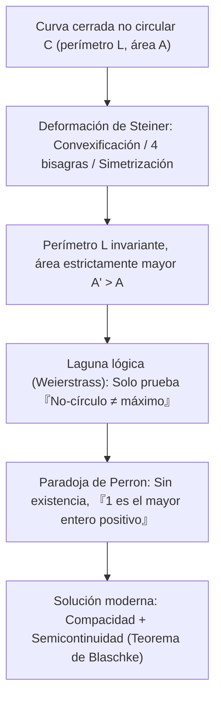
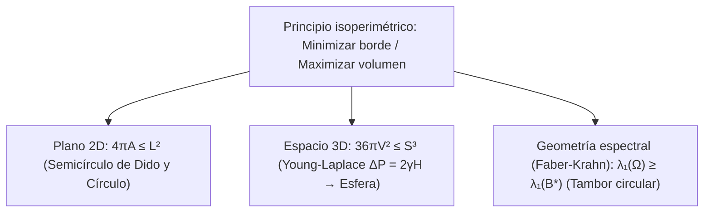

## Introducción: ¿Cuánto reino cabe en una piel de buey?

En la *Eneida* de Virgilio, la princesa fenicia exiliada <strong>Dido</strong> llega a la costa del norte de África y pide comprar tanta tierra «como pueda abarcar la piel de un buey». Dido corta la piel en tiras finísimas para formar una larga cuerda y, usando la costa rectilínea como frontera natural, encierra un enorme <strong>semicírculo</strong> donde funda Cartago.

Matemáticamente, Dido se enfrentaba al problema variacional más antiguo de la historia, el <strong>problema isoperimétrico</strong>: entre todas las curvas planas cerradas simples $C$ de perímetro fijo $L > 0$, ¿cuál encierra la mayor área $A$? La respuesta es el <strong>círculo</strong>. Para toda curva cerrada simple de longitud $L$ y área $A$, se cumple la <strong>desigualdad isoperimétrica plana</strong>:

$$\boxed{4\pi A \le L^2 \quad \Longleftrightarrow \quad Q(C) := \frac{4\pi A}{L^2} \le 1}$$

El <strong>cociente isoperimétrico</strong> adimensional $Q(C) \in (0, 1]$ alcanza el valor $1$ si y solo si $C$ es un círculo perfecto. Aunque parece obvio a la intuición, la humanidad tardó más de dos milenios en lograr una demostración rigurosa.

---

## Capítulo 1: Polígonos regulares y la intuición griega

Ya en el siglo II a. C., <strong>Zenodoro</strong> demostró que entre todos los polígonos de $n$ lados con igual perímetro $L$, el polígono regular maximiza el área:

$$A_n = \frac{L^2}{4n \tan(\pi/n)}, \qquad Q_n = \frac{4\pi A_n}{L^2} = \frac{\pi/n}{\tan(\pi/n)} \xrightarrow{n \to \infty} 1$$

| Figura plana ($L$ fijo) | Área $A(L)$ | Cociente $Q = \frac{4\pi A}{L^2}$ | Eficiencia vs. Círculo (%) |
| :--- | :--- | :--- | :--- |
| <strong>Triángulo equilátero ($n = 3$)</strong> | $\frac{\sqrt{3}}{36} L^2 \approx 0.04811 L^2$ | $\frac{\pi}{3\sqrt{3}} \approx 0.6046$ | $60.46\%$ |
| <strong>Cuadrado ($n = 4$)</strong> | $\frac{1}{16} L^2 = 0.06250 L^2$ | $\frac{\pi}{4} \approx 0.7854$ | $78.54\%$ |
| <strong>Hexágono regular ($n = 6$)</strong> | $\frac{\sqrt{3}}{24} L^2 \approx 0.07217 L^2$ | $\frac{\pi}{2\sqrt{3}} \approx 0.9069$ | $90.69\%$ |
| <strong>Círculo ($n \to \infty$)</strong> | $\frac{1}{4\pi} L^2 \approx 0.07958 L^2$ | <strong>$1.0000$ (Máximo)</strong> | <strong>$100.00\%$</strong> |

Al reflejar la cuerda de Dido de longitud $L_{\text{rope}}$ respecto a la costa recta, se obtiene una curva cerrada de perímetro $2L_{\text{rope}}$; por tanto, la forma óptima apoyada en la costa es el <strong>semicírculo</strong> con área $A_{\max} = \frac{L_{\text{rope}}^2}{2\pi}$.

---

## Capítulo 2: El método de las cuatro bisagras de Steiner y la crítica de Weierstrass

En 1838, <strong>Jakob Steiner</strong> ideó la <strong>simetrización de Steiner</strong> y el <strong>método de las cuatro bisagras</strong>:
1. <strong>Convexificación</strong>: Cualquier tramo cóncavo reflejado hacia afuera conserva $L$ y aumenta estrictamente $A$.
2. <strong>Cuatro bisagras</strong>: Si $P, Q$ bisecan el perímetro y un punto $R$ cumple $\angle PRQ \neq 90^\circ$, se articulan los cuatro segmentos rígidos con bisagras en $P, R, Q, S$ hasta que $\angle PRQ = \angle PSQ = 90^\circ$. Como el área $\frac{1}{2}ab\sin\theta$ es máxima en $\theta = 90^\circ$, ¡el área total crece estrictamente sin cambiar el perímetro! Por el teorema de Tales, solo el <strong>círculo</strong> no admite mejora.

Sin embargo, <strong>Karl Weierstrass</strong> señaló un vacío lógico fatal: Steiner había probado que *si* existe una curva de área máxima, debe ser un círculo, ¡pero no demostró que dicho máximo exista! <strong>Oskar Perron</strong> parodió este fallo con la <strong>paradoja de Perron</strong>: «Supongamos que existe el mayor entero positivo $N$. Si $N > 1$, entonces $N^2 > N$ (contradicción); luego $N = 1$ es el mayor entero». El teorema de selección de Blaschke cerró finalmente esta brecha.

---

## Capítulo 3: La prueba por series de Fourier de Hurwitz (1901)

En 1901, <strong>Adolf Hurwitz</strong> evitó toda hipótesis de existencia empleando <strong>series de Fourier</strong>. Por homotecia, fijemos $L = 2\pi$ y parametricemos $(x(s), y(s))$ por la longitud de arco $s \in [0, 2\pi]$, de modo que $(x')^2 + (y')^2 = 1$:

$$\left(x'(s)\right)^2 + \left(y'(s)\right)^2 = 1 \quad \Longrightarrow \quad L = \int_0^{2\pi} \left(x'(s)^2 + y'(s)^2\right) ds = 2\pi$$

Desarrollando $x(s) = \sum_{n=-\infty}^{\infty} a_n e^{ins}$ e $y(s) = \sum_{n=-\infty}^{\infty} b_n e^{ins}$ ($a_{-n} = \overline{a_n}, b_{-n} = \overline{b_n}$), la <strong>identidad de Parseval</strong> y el <strong>teorema de Green</strong> $A = \frac{1}{2}\oint (x\,dy - y\,dx)$ arrojan:

$$\frac{L}{2\pi} = 1 = \sum_{n \neq 0} n^2 \left(|a_n|^2 + |b_n|^2\right), \qquad \frac{A}{\pi} = \sum_{n \neq 0} i n \left(a_n \overline{b_n} - \overline{a_n} b_n\right)$$

Restando ambas expresiones ($L^2 - 4\pi A = 4\pi^2(1 - A/\pi)$):

$$\boxed{\frac{L^2 - 4\pi A}{4\pi^2} = \sum_{n \neq 0} \Big[ \underbrace{(n^2 - 1)\left(|a_n|^2 + |b_n|^2\right)}_{\ge 0 \ (\forall |n| \ge 1)} + \underbrace{|a_n + i b_n|^2}_{\ge 0} \Big] \ge 0}$$

La igualdad ocurre si y solo si todos los armónicos $|n| \ge 2$ se anulan ($a_n = b_n = 0$) y $a_1 + i b_1 = 0$, lo que describe un <strong>círculo</strong> de radio $R = 1$: un <strong>tono fundamental puro</strong> sin distorsión armónica.

---

## Capítulo 4: Pompas de jabón 3D y el teorema de Faber-Krahn

1. <strong>Desigualdad 3D y pompas de jabón</strong>: En $\mathbb{R}^3$, el área superficial $S$ y el volumen $V$ cumplen <strong>$36\pi V^2 \le S^3$</strong> (igualdad solo en la esfera). Una pompa de jabón minimiza su energía $E = \gamma S$ bajo la <strong>ecuación de Young-Laplace</strong> $\Delta P = 2\gamma H$ (curvatura media constante, esfera por el <strong>teorema de Alexandrov 1956</strong>).
2. <strong>Desigualdad de Faber-Krahn</strong>: Entre todos los tambores $\Omega \subset \mathbb{R}^2$ de igual área, el tambor circular $B^*$ produce la frecuencia fundamental más grave:
   $$\lambda_1(\Omega) = \inf_{u \in H_0^1(\Omega)\setminus\{0\}} \frac{\int_\Omega |\nabla u|^2 \, dx}{\int_\Omega u^2 \, dx} \ge \lambda_1(B^*) = \frac{\pi j_{0,1}^2}{A(\Omega)}$$
