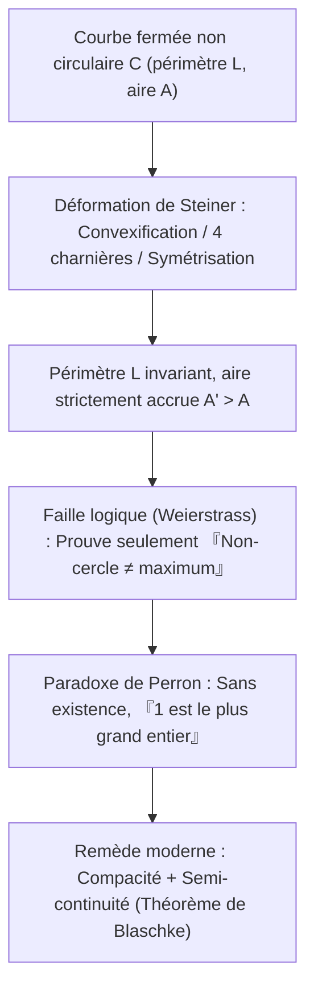
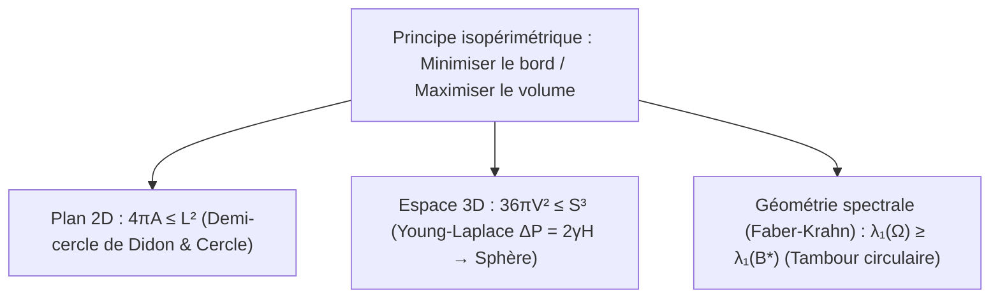

## Introduction : Quel royaume peut-on entourer avec une peau de bœuf ?

Dans l'*Énéide* de Virgile, la princesse phénicienne en exil <strong>Didon</strong> demande à acheter sur la côte nord-africaine autant de terre « que peut en entourer une peau de bœuf ». Elle découpe la peau en lanières extrêmement fines pour former une longue corde et, utilisant le rivage rectiligne comme frontière naturelle, délimite un immense <strong>demi-cercle</strong> où naît Carthage.

Mathématiquement, Didon résolvait le plus ancien problème du calcul des variations, le <strong>problème isopérimétrique</strong> : parmi toutes les courbes planes fermées simples $C$ de périmètre fixé $L > 0$, laquelle renferme l'aire $A$ maximale ? La réponse est le <strong>cercle</strong>. Pour toute courbe fermée simple de longueur $L$ et d'aire $A$, on a l'<strong>inégalité isopérimétrique plane</strong> :

$$\boxed{4\pi A \le L^2 \quad \Longleftrightarrow \quad Q(C) := \frac{4\pi A}{L^2} \le 1}$$

Le <strong>quotient isopérimétrique</strong> sans dimension $Q(C) \in (0, 1]$ vaut $1$ si et seulement si $C$ est un cercle parfait. Bien qu'évident intuitivement, ce théorème a exigé plus de deux millénaires avant de recevoir une démonstration rigoureuse.

---

## Chapitre 1 : Polygones réguliers et intuition grecque

Dès le IIe siècle av. J.-C., <strong>Zénodore</strong> démontra que parmi tous les polygones à $n$ côtés de même périmètre $L$, le polygone régulier maximise l'aire :

$$A_n = \frac{L^2}{4n \tan(\pi/n)}, \qquad Q_n = \frac{4\pi A_n}{L^2} = \frac{\pi/n}{\tan(\pi/n)} \xrightarrow{n \to \infty} 1$$

| Figure plane ($L$ fixé) | Aire $A(L)$ | Quotient $Q = \frac{4\pi A}{L^2}$ | Efficacité vs Cercle (%) |
| :--- | :--- | :--- | :--- |
| <strong>Triangle équilatéral ($n = 3$)</strong> | $\frac{\sqrt{3}}{36} L^2 \approx 0.04811 L^2$ | $\frac{\pi}{3\sqrt{3}} \approx 0.6046$ | $60.46\%$ |
| <strong>Carré ($n = 4$)</strong> | $\frac{1}{16} L^2 = 0.06250 L^2$ | $\frac{\pi}{4} \approx 0.7854$ | $78.54\%$ |
| <strong>Hexagone régulier ($n = 6$)</strong> | $\frac{\sqrt{3}}{24} L^2 \approx 0.07217 L^2$ | $\frac{\pi}{2\sqrt{3}} \approx 0.9069$ | $90.69\%$ |
| <strong>Cercle ($n \to \infty$)</strong> | $\frac{1}{4\pi} L^2 \approx 0.07958 L^2$ | <strong>$1.0000$ (Maximum)</strong> | <strong>$100.00\%$</strong> |

En reflétant la corde de Didon de longueur $L_{\text{rope}}$ par rapport à la côte rectiligne, on obtient une courbe fermée de périmètre $2L_{\text{rope}}$ ; la forme optimale appuyée sur le rivage est donc le <strong>demi-cercle</strong> d'aire $A_{\max} = \frac{L_{\text{rope}}^2}{2\pi}$.

---

## Chapitre 2 : La méthode des quatre charnières de Steiner et la critique de Weierstrass

En 1838, <strong>Jakob Steiner</strong> introduisit la <strong>symétrisation de Steiner</strong> et la <strong>méthode des quatre charnières</strong> :
1. <strong>Convexification</strong> : Toute cuvette concave reflétée vers l'extérieur conserve $L$ et augmente strictement $A$.
2. <strong>Quatre charnières</strong> : Si $P, Q$ bissectent le périmètre et qu'un point $R$ vérifie $\angle PRQ \neq 90^\circ$, on articule les quatre lunules rigides en $P, R, Q, S$ jusqu'à obtenir $\angle PRQ = \angle PSQ = 90^\circ$. Comme l'aire $\frac{1}{2}ab\sin\theta$ est maximale à $\theta = 90^\circ$, l'aire totale croît strictement à périmètre constant ! Par le théorème de Thalès, seul le <strong>cercle</strong> ne peut plus être amélioré.

Toutefois, <strong>Karl Weierstrass</strong> releva une faille logique majeure : Steiner avait prouvé que *si* une courbe d'aire maximale existe, c'est un cercle — mais pas qu'un tel maximum existe ! <strong>Oskar Perron</strong> illustra cette erreur par le <strong>paradoxe de Perron</strong> : « Supposons qu'il existe un plus grand entier $N$. Si $N > 1$, alors $N^2 > N$ (contradiction), donc $N = 1$ est le plus grand entier ! » Il fallut le théorème de sélection de Blaschke pour garantir l'existence.

---

## Chapitre 3 : La preuve par séries de Fourier de Hurwitz (1901)

En 1901, <strong>Adolf Hurwitz</strong> contourna toute hypothèse d'existence grâce aux <strong>séries de Fourier</strong>. Par homothétie, fixons $L = 2\pi$ et paramétrons $(x(s), y(s))$ par la longueur d'arc $s \in [0, 2\pi]$, de sorte que $(x')^2 + (y')^2 = 1$ :

$$\left(x'(s)\right)^2 + \left(y'(s)\right)^2 = 1 \quad \Longrightarrow \quad L = \int_0^{2\pi} \left(x'(s)^2 + y'(s)^2\right) ds = 2\pi$$

En développant $x(s) = \sum_{n=-\infty}^{\infty} a_n e^{ins}$ et $y(s) = \sum_{n=-\infty}^{\infty} b_n e^{ins}$ ($a_{-n} = \overline{a_n}, b_{-n} = \overline{b_n}$), l'<strong>identité de Parseval</strong> et la <strong>formule de Green</strong> $A = \frac{1}{2}\oint (x\,dy - y\,dx)$ donnent :

$$\frac{L}{2\pi} = 1 = \sum_{n \neq 0} n^2 \left(|a_n|^2 + |b_n|^2\right), \qquad \frac{A}{\pi} = \sum_{n \neq 0} i n \left(a_n \overline{b_n} - \overline{a_n} b_n\right)$$

Par soustraction ($L^2 - 4\pi A = 4\pi^2(1 - A/\pi)$) :

$$\boxed{\frac{L^2 - 4\pi A}{4\pi^2} = \sum_{n \neq 0} \Big[ \underbrace{(n^2 - 1)\left(|a_n|^2 + |b_n|^2\right)}_{\ge 0 \ (\forall |n| \ge 1)} + \underbrace{|a_n + i b_n|^2}_{\ge 0} \Big] \ge 0}$$

L'égalité a lieu si et seulement si toutes les harmoniques $|n| \ge 2$ s'annulent ($a_n = b_n = 0$) et $a_1 + i b_1 = 0$, ce qui décrit exactement le <strong>cercle</strong> de rayon $R = 1$ : un <strong>fondamental pur</strong> sans distorsion harmonique.

---

## Chapitre 4 : Bulles de savon 3D et théorème de Faber-Krahn

1. <strong>Inégalité 3D & bulles de savon</strong> : Dans $\mathbb{R}^3$, la surface $S$ et le volume $V$ vérifient <strong>$36\pi V^2 \le S^3$</strong> (égalité pour la sphère). Un film de savon minimise l'énergie $E = \gamma S$ selon l'<strong>équation de Young-Laplace</strong> $\Delta P = 2\gamma H$ (courbure moyenne constante, sphère par le <strong>théorème d'Alexandrov 1956</strong>).
2. <strong>Inégalité de Faber-Krahn</strong> : Parmi tous les tambours $\Omega \subset \mathbb{R}^2$ de même aire, le tambour circulaire $B^*$ possède la plus basse fréquence fondamentale :
   $$\lambda_1(\Omega) = \inf_{u \in H_0^1(\Omega)\setminus\{0\}} \frac{\int_\Omega |\nabla u|^2 \, dx}{\int_\Omega u^2 \, dx} \ge \lambda_1(B^*) = \frac{\pi j_{0,1}^2}{A(\Omega)}$$
