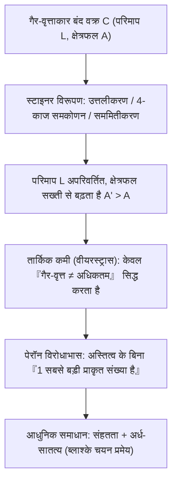
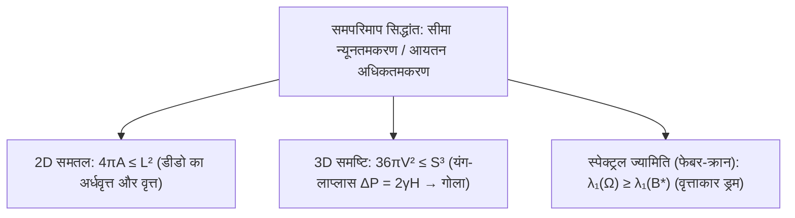

## प्रस्तावना: बैल की एक खाल से कितना बड़ा साम्राज्य घेरा जा सकता है?

रोमन कवि वर्जिल के महाकाव्य *एनीड* में, निर्वासित फोनिशियन राजकुमारी <strong>डीडो (Dido)</strong> उत्तरी अफ्रीका के तट पर पहुँचती हैं और स्थानीय राजा से उतनी भूमि खरीदने का आग्रह करती हैं «जितनी एक बैल की खाल से घेरी जा सके»। डीडो खाल को अत्यंत बारीक पट्टियों में काटकर एक लंबी रस्सी बनाती हैं और सीधी तटरेखा को प्राकृतिक सीमा मानकर एक विशाल <strong>अर्धवृत्त (Semicircle)</strong> घेरती हैं, जहाँ कार्थेज नगर की स्थापना हुई।

गणितीय रूप से, डीडो के सामने इतिहास की सबसे पुरानी विचरण कलन समस्या थी—<strong>समपरिमाप समस्या (Isoperimetric Problem)</strong>: निश्चित परिमाप $L > 0$ वाले सभी समतल सरल बंद वक्रों $C$ में से कौन-सा वक्र अधिकतम क्षेत्रफल $A$ घेरता है? उत्तर <strong>वृत्त (Circle)</strong> है। लंबाई $L$ और क्षेत्रफल $A$ वाले प्रत्येक सरल बंद वक्र के लिए <strong>समतल समपरिमाप असमिका</strong> सत्य होती है:

$$\boxed{4\pi A \le L^2 \quad \Longleftrightarrow \quad Q(C) := \frac{4\pi A}{L^2} \le 1}$$

यहाँ विमाहीन अनुपात $Q(C) \in (0, 1]$ को <strong>समपरिमाप भागफल</strong> कहते हैं, और समता तभी होती है जब $C$ एक पूर्ण वृत्त हो। सहज ज्ञान से स्पष्ट दिखने पर भी इसके कठोर प्रमाण में मानवता को दो हजार से अधिक वर्ष लग गए।

---

## अध्याय 1: समबहुभुज और प्राचीन यूनानी अंतर्दृष्टि

ईसा पूर्व दूसरी शताब्दी में <strong>ज़ेनोडोरस (Zenodorus)</strong> ने सिद्ध किया कि समान परिमाप $L$ वाले सभी $n$-भुजों में सम-$n$-भुज का क्षेत्रफल अधिकतम होता है:

$$A_n = \frac{L^2}{4n \tan(\pi/n)}, \qquad Q_n = \frac{4\pi A_n}{L^2} = \frac{\pi/n}{\tan(\pi/n)} \xrightarrow{n \to \infty} 1$$

| समतल आकृति ($L$ स्थिर) | क्षेत्रफल $A(L)$ | भागफल $Q = \frac{4\pi A}{L^2}$ | वृत्त के सापेक्ष दक्षता (%) |
| :--- | :--- | :--- | :--- |
| <strong>समबाहु त्रिभुज ($n = 3$)</strong> | $\frac{\sqrt{3}}{36} L^2 \approx 0.04811 L^2$ | $\frac{\pi}{3\sqrt{3}} \approx 0.6046$ | $60.46\%$ |
| <strong>वर्ग ($n = 4$)</strong> | $\frac{1}{16} L^2 = 0.06250 L^2$ | $\frac{\pi}{4} \approx 0.7854$ | $78.54\%$ |
| <strong>समषट्भुज ($n = 6$)</strong> | $\frac{\sqrt{3}}{24} L^2 \approx 0.07217 L^2$ | $\frac{\pi}{2\sqrt{3}} \approx 0.9069$ | $90.69\%$ |
| <strong>वृत्त ($n \to \infty$)</strong> | $\frac{1}{4\pi} L^2 \approx 0.07958 L^2$ | <strong>$1.0000$ (अधिकतम)</strong> | <strong>$100.00\%$</strong> |

डीडो की $L_{\text{rope}}$ लंबाई की रस्सी को सीधी तटरेखा के सापेक्ष परावर्तित करने पर $2L_{\text{rope}}$ परिमाप का बंद वक्र बनता है; अतः तट पर इष्टतम आकृति <strong>अर्धवृत्त</strong> है जिसका क्षेत्रफल $A_{\max} = \frac{L_{\text{rope}}^2}{2\pi}$ है।

---

## अध्याय 2: स्टाइनर की चार-काज विधि और वीयरस्ट्रास की आलोचना

1838 में <strong>याकोब स्टाइनर (Jakob Steiner)</strong> ने <strong>स्टाइनर सममितीकरण</strong> और <strong>चार-काज विधि (Four-Hinge Method)</strong> प्रस्तुत की:
1. <strong>उत्तलीकरण</strong>: किसी भी अवतल भाग को बाहर की ओर परावर्तित करने पर $L$ अपरिवर्तित रहता है और $A$ सख्ती से बढ़ता है।
2. <strong>चार-काज विरूपण</strong>: यदि $P, Q$ परिमाप को समद्विभाजित करते हैं और किसी बिंदु $R$ पर $\angle PRQ \neq 90^\circ$ है, तो चार दृढ़ चाप खंडों को $P, R, Q, S$ पर काज (hinges) से घुमाकर $\angle PRQ = \angle PSQ = 90^\circ$ बनाया जाता है। चूंकि त्रिभुज का क्षेत्रफल $\frac{1}{2}ab\sin\theta$ कोण $\theta = 90^\circ$ पर अधिकतम होता है, परिमाप बदले बिना कुल क्षेत्रफल सख्ती से बढ़ जाता है! थेल्स प्रमेय के अनुसार केवल <strong>वृत्त</strong> में ही और वृद्धि संभव नहीं है।

किंतु <strong>कार्ल वीयरस्ट्रास (Karl Weierstrass)</strong> ने एक गंभीर तार्किक कमी उजागर की: स्टाइनर ने केवल यह सिद्ध किया था कि *यदि* अधिकतम क्षेत्रफल वाली आकृति अस्तित्व में है तो वह वृत्त होगी, पर यह सिद्ध नहीं किया कि ऐसी अधिकतम आकृति अस्तित्व में है! <strong>ऑस्कर पेरॉन</strong> ने <strong>पेरॉन विरोधाभास</strong> से इसे स्पष्ट किया: «मान लें सबसे बड़ी प्राकृत संख्या $N$ है। यदि $N > 1$ तो $N^2 > N$ (विरोधाभास), अतः $N = 1$ सबसे बड़ी संख्या है!» ब्लाश्के चयन प्रमेय ने बाद में इस अस्तित्वगत कमी को पूरा किया।

---

## अध्याय 3: हर्विट्ज़ का फूरिये श्रेणी प्रमाण (1901)

1901 में <strong>एडॉल्फ हर्विट्ज़ (Adolf Hurwitz)</strong> ने <strong>फूरिये श्रेणी (Fourier Series)</strong> द्वारा बिना किसी अस्तित्वगत धारणा के सीधा विश्लेषणात्मक प्रमाण दिया। मापन द्वारा $L = 2\pi$ मानें और चाप लंबाई $s \in [0, 2\pi]$ से $(x(s), y(s))$ को प्राचलित करें ताकि $(x')^2 + (y')^2 = 1$:

$$\left(x'(s)\right)^2 + \left(y'(s)\right)^2 = 1 \quad \Longrightarrow \quad L = \int_0^{2\pi} \left(x'(s)^2 + y'(s)^2\right) ds = 2\pi$$

$x(s) = \sum_{n=-\infty}^{\infty} a_n e^{ins}$ और $y(s) = \sum_{n=-\infty}^{\infty} b_n e^{ins}$ ($a_{-n} = \overline{a_n}, b_{-n} = \overline{b_n}$) प्रसार करने पर <strong>पार्सेवल सर्वसमिका</strong> और <strong>ग्रीन प्रमेय</strong> $A = \frac{1}{2}\oint (x\,dy - y\,dx)$ से मिलता है:

$$\frac{L}{2\pi} = 1 = \sum_{n \neq 0} n^2 \left(|a_n|^2 + |b_n|^2\right), \qquad \frac{A}{\pi} = \sum_{n \neq 0} i n \left(a_n \overline{b_n} - \overline{a_n} b_n\right)$$

दोनों को घटाने पर ($L^2 - 4\pi A = 4\pi^2(1 - A/\pi)$):

$$\boxed{\frac{L^2 - 4\pi A}{4\pi^2} = \sum_{n \neq 0} \Big[ \underbrace{(n^2 - 1)\left(|a_n|^2 + |b_n|^2\right)}_{\ge 0 \ (\forall |n| \ge 1)} + \underbrace{|a_n + i b_n|^2}_{\ge 0} \Big] \ge 0}$$

समता तभी होती है जब सभी उच्च संनादी $|n| \ge 2$ शून्य हों ($a_n = b_n = 0$) और $a_1 + i b_1 = 0$, जो त्रिज्या $R = 1$ के <strong>वृत्त</strong> को दर्शाता है—बिना किसी संनादी विरूपण के एक <strong>शुद्ध मूल स्वर</strong>।

---

## अध्याय 4: 3D साबुन के बुलबुले और फेबर-क्रान प्रमेय

1. <strong>3D असमिका और साबुन के बुलबुले</strong>: $\mathbb{R}^3$ में पृष्ठीय क्षेत्रफल $S$ और आयतन $V$ के लिए <strong>$36\pi V^2 \le S^3$</strong> सत्य है (समता केवल गोले के लिए)। साबुन का बुलबुला <strong>यंग-लाप्लास समीकरण</strong> $\Delta P = 2\gamma H$ के अधीन पृष्ठीय ऊर्जा $E = \gamma S$ को न्यूनतम कर अचर माध्य वक्रता (CMC) पृष्ठ बनाता है, जो <strong>अलेक्जेंड्रोव प्रमेय (1956)</strong> से पूर्ण गोला होता है।
2. <strong>फेबर-क्रान असमिका (Faber-Krahn Inequality)</strong>: समान क्षेत्रफल वाली सभी ड्रम झिल्लियों $\Omega \subset \mathbb{R}^2$ में वृत्ताकार ड्रम $B^*$ की मूल आवृत्ति सबसे कम होती है:
   $$\lambda_1(\Omega) = \inf_{u \in H_0^1(\Omega)\setminus\{0\}} \frac{\int_\Omega |\nabla u|^2 \, dx}{\int_\Omega u^2 \, dx} \ge \lambda_1(B^*) = \frac{\pi j_{0,1}^2}{A(\Omega)}$$
