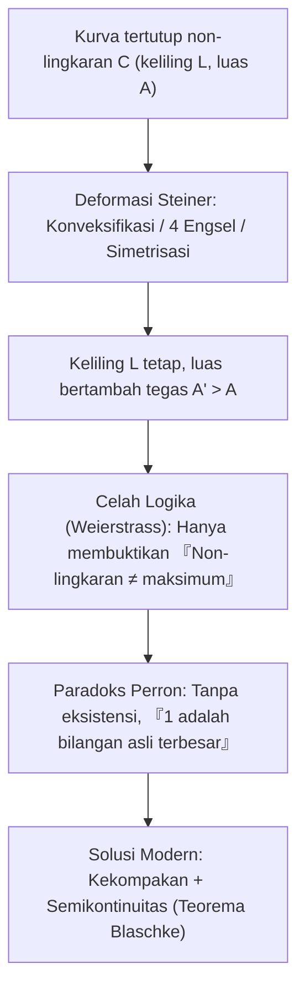
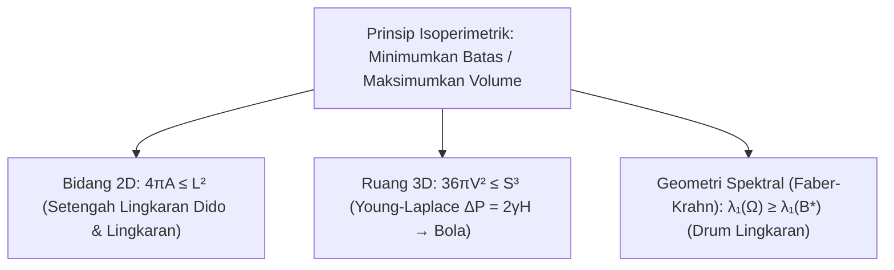

## Pendahuluan: Seberapa Luas Kerajaan yang Bisa Dipagari Selembar Kulit Sapi?

Dalam wiracarita *Aeneid* karya Vergilius, putri Fenisia <strong>Dido</strong> tiba di pesisir Afrika Utara dan meminta membeli tanah «seluas yang dapat dikelilingi oleh selembar kulit sapi». Dido mengiris kulit itu menjadi pita-pita tipis yang disambung menjadi tali panjang, lalu memanfaatkan garis pantai lurus sebagai batas alami untuk memagari <strong>setengah lingkaran</strong> raksasa tempat berdirinya Kartago.

Secara matematis, Dido menghadapi persoalan kalkulus variasi tertua dalam sejarah, <strong>Masalah Isoperimetrik</strong>: di antara semua kurva tertutup sederhana $C$ dengan keliling tetap $L > 0$, kurva mana yang melingkupi luas $A$ terbesar? Jawabannya adalah <strong>lingkaran</strong>. Untuk setiap kurva tertutup sederhana berkeliling $L$ dan luas $A$, berlaku <strong>ketaksamaan isoperimetrik bidang</strong>:

$$\boxed{4\pi A \le L^2 \quad \Longleftrightarrow \quad Q(C) := \frac{4\pi A}{L^2} \le 1}$$

Rasio tak berdimensi $Q(C) \in (0, 1]$ disebut <strong>kuosien isoperimetrik</strong>, dan kesamaan berlaku jika dan hanya jika $C$ adalah lingkaran sempurna. Meski tampak jelas secara intuitif, umat manusia membutuhkan lebih dari dua ribu tahun untuk membuktikannya secara ketat.

---

## Bab 1: Poligon Beraturan dan Intuisi Yunani Kuno

Pada abad ke-2 SM, <strong>Zenodorus</strong> membuktikan bahwa di antara semua segi-$n$ dengan keliling $L$ yang sama, segi-$n$ beraturan memiliki luas terbesar:

$$A_n = \frac{L^2}{4n \tan(\pi/n)}, \qquad Q_n = \frac{4\pi A_n}{L^2} = \frac{\pi/n}{\tan(\pi/n)} \xrightarrow{n \to \infty} 1$$

| Bangun Datar ($L$ tetap) | Luas $A(L)$ | Kuosien $Q = \frac{4\pi A}{L^2}$ | Efisiensi vs. Lingkaran (%) |
| :--- | :--- | :--- | :--- |
| <strong>Segitiga Sama Sisi ($n = 3$)</strong> | $\frac{\sqrt{3}}{36} L^2 \approx 0.04811 L^2$ | $\frac{\pi}{3\sqrt{3}} \approx 0.6046$ | $60.46\%$ |
| <strong>Persegi ($n = 4$)</strong> | $\frac{1}{16} L^2 = 0.06250 L^2$ | $\frac{\pi}{4} \approx 0.7854$ | $78.54\%$ |
| <strong>Segienam Beraturan ($n = 6$)</strong> | $\frac{\sqrt{3}}{24} L^2 \approx 0.07217 L^2$ | $\frac{\pi}{2\sqrt{3}} \approx 0.9069$ | $90.69\%$ |
| <strong>Lingkaran ($n \to \infty$)</strong> | $\frac{1}{4\pi} L^2 \approx 0.07958 L^2$ | <strong>$1.0000$ (Maksimum)</strong> | <strong>$100.00\%$</strong> |

Dengan mencerminkan tali Dido sepanjang $L_{\text{rope}}$ terhadap garis pantai lurus, terbentuk kurva tertutup berkeliling $2L_{\text{rope}}$; maka bentuk optimal yang bersandar pada pantai adalah <strong>setengah lingkaran</strong> dengan luas $A_{\max} = \frac{L_{\text{rope}}^2}{2\pi}$.

---

## Bab 2: Metode Empat Engsel Steiner dan Kritik Weierstrass

Pada 1838, <strong>Jakob Steiner</strong> memperkenalkan <strong>simetrisasi Steiner</strong> dan <strong>metode empat engsel</strong>:
1. <strong>Konveksifikasi</strong>: Bagian cekung yang dicerminkan keluar mempertahankan $L$ dan memperbesar $A$ secara tegas.
2. <strong>Empat Engsel</strong>: Jika $P, Q$ membagi dua keliling dan titik $R$ memenuhi $\angle PRQ \neq 90^\circ$, keempat segmen busur kaku digerakkan pada engsel $P, R, Q, S$ hingga $\angle PRQ = \angle PSQ = 90^\circ$. Karena luas segitiga $\frac{1}{2}ab\sin\theta$ maksimum pada $\theta = 90^\circ$, luas total bertambah tegas tanpa mengubah keliling! Menurut teorema Thales, hanya <strong>lingkaran</strong> yang tak dapat diperbesar lagi.

Namun, <strong>Karl Weierstrass</strong> menunjukkan celah logika fatal: Steiner hanya membuktikan bahwa *jika* kurva berluas maksimum ada, maka ia pasti lingkaran—tetapi belum membuktikan bahwa nilai maksimum itu ada! <strong>Oskar Perron</strong> menyindir celah ini lewat <strong>Paradoks Perron</strong>: «Misalkan ada bilangan asli terbesar $N$. Jika $N > 1$, maka $N^2 > N$ (kontradiksi); jadi $N = 1$ adalah bilangan asli terbesar!» Teorema seleksi Blaschke kemudian menutup celah eksistensi ini.

---

## Bab 3: Bukti Deret Fourier Hurwitz (1901)

Pada 1901, <strong>Adolf Hurwitz</strong> menghindari asumsi eksistensi menggunakan <strong>deret Fourier</strong>. Melalui penskalaan, tetapkan $L = 2\pi$ dan параметrisasikan $(x(s), y(s))$ terhadap panjang busur $s \in [0, 2\pi]$ sehingga $(x')^2 + (y')^2 = 1$:

$$\left(x'(s)\right)^2 + \left(y'(s)\right)^2 = 1 \quad \Longrightarrow \quad L = \int_0^{2\pi} \left(x'(s)^2 + y'(s)^2\right) ds = 2\pi$$

Dengan menguraikan $x(s) = \sum_{n=-\infty}^{\infty} a_n e^{ins}$ dan $y(s) = \sum_{n=-\infty}^{\infty} b_n e^{ins}$ ($a_{-n} = \overline{a_n}, b_{-n} = \overline{b_n}$), <strong>identitas Parseval</strong> dan <strong>teorema Green</strong> $A = \frac{1}{2}\oint (x\,dy - y\,dx)$ menghasilkan:

$$\frac{L}{2\pi} = 1 = \sum_{n \neq 0} n^2 \left(|a_n|^2 + |b_n|^2\right), \qquad \frac{A}{\pi} = \sum_{n \neq 0} i n \left(a_n \overline{b_n} - \overline{a_n} b_n\right)$$

Mengurangkan keduanya ($L^2 - 4\pi A = 4\pi^2(1 - A/\pi)$):

$$\boxed{\frac{L^2 - 4\pi A}{4\pi^2} = \sum_{n \neq 0} \Big[ \underbrace{(n^2 - 1)\left(|a_n|^2 + |b_n|^2\right)}_{\ge 0 \ (\forall |n| \ge 1)} + \underbrace{|a_n + i b_n|^2}_{\ge 0} \Big] \ge 0}$$

Kesamaan terjadi jika dan hanya jika semua harmonik $|n| \ge 2$ bernilai nol ($a_n = b_n = 0$) dan $a_1 + i b_1 = 0$, yang tepat mendefinisikan <strong>lingkaran</strong> berjari-jari $R = 1$: <strong>nada dasar murni</strong> tanpa distorsi harmonik.

---

## Bab 4: Gelembung Sabun 3D dan Teorema Faber-Krahn

1. <strong>Ketaksamaan 3D & Gelembung Sabun</strong>: Di $\mathbb{R}^3$, luas permukaan $S$ dan volume $V$ memenuhi <strong>$36\pi V^2 \le S^3$</strong> (kesamaan hanya pada bola). Gelembung sabun meminimumkan energi permukaan $E = \gamma S$ menurut <strong>persamaan Young-Laplace</strong> $\Delta P = 2\gamma H$ (kelengkungan rata-rata konstan, berbentuk bola menurut <strong>teorema Alexandrov 1956</strong>).
2. <strong>Ketaksamaan Faber-Krahn</strong>: Di antara semua membran drum $\Omega \subset \mathbb{R}^2$ berluas sama, drum lingkaran $B^*$ menghasilkan frekuensi dasar terendah:
   $$\lambda_1(\Omega) = \inf_{u \in H_0^1(\Omega)\setminus\{0\}} \frac{\int_\Omega |\nabla u|^2 \, dx}{\int_\Omega u^2 \, dx} \ge \lambda_1(B^*) = \frac{\pi j_{0,1}^2}{A(\Omega)}$$
