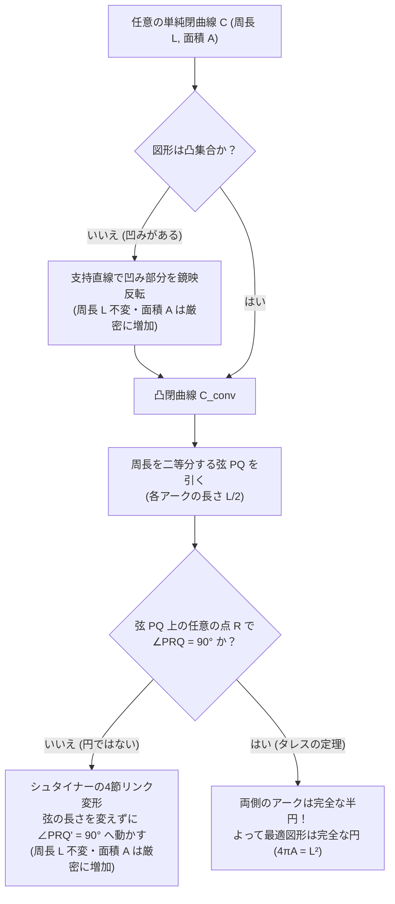
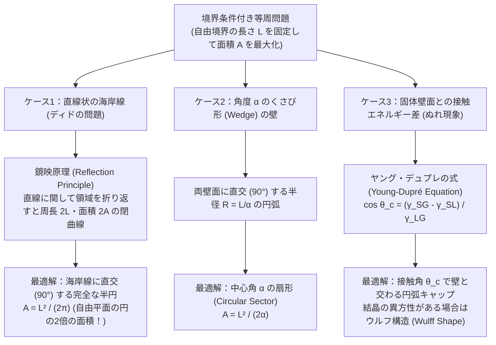

## 1. カルタゴ建国神話とディド女王の問い：形をめぐる最古の変分問題

「長さ $L$ の1本のひもを使って平面上の領域を囲むとき、その内部の面積 $A$ を最大にするにはどのような形を作ればよいか？」

答えは直観的に明らかであるように思える——<strong>「円（Circle）」</strong>だ。しかし、「なぜ円なのか？」「円以外に同じ面積を達成する形は本当に存在しないのか？」「そもそも面積を最大にする形が数学的に『存在する』と言い切れるのか？」という問いに完全無欠の証明を与えようとした瞬間、人類は2000年以上にわたる深い数学の迷宮へと足を踏み入れることになる。この問題は数学史上、<strong>等周問題（Isoperimetric Problem）</strong>と呼ばれ、微分幾何学・変分法・フーリエ解析・測度論・偏微分方程式論の発展を牽引してきた最重要問題の一つである。

### 1.1 ウェルギリウス『アエネーイス』に描かれたディドの知略

等周問題の起源は、紀元前9世紀頃のフェニキア（現在のレバノン周辺）の都市国家ティルスに遡る。ローマの詩人ウェルギリウス（Virgil）の叙事詩『アエネーイス（Aeneid）』第1巻によれば、ティルスの王女<strong>ディド（Dido、別名エリッサ）</strong>は、兄である国王ピュグマリオンに夫アセ르バスを暗殺され、忠実な従者たちとともに船で地中海へと逃れた。

北アフリカ沿岸（現在のチュニジア・チュニス湾）に漂着したディド一行は、先住のベルベル人部族の王イアルバス（Iarbas）に土地の割譲を求めた。よそ者に広大な領土を与えることを渋ったイアルバス王は、嘲笑を込めてこう条件を出した。

> <strong>「牡牛の皮1枚（oxhide）で覆うことができるだけの土地ならば、譲ってやろう」</strong>

ディドはこの一見不可能な条件を即座に受け入れた。彼女は1枚の牡牛の皮を広げると、職人に命じてそれを<strong>剃刀の刃のように極めて細い1本の革ひも（leather thong）</strong>へと螺旋状に切り裂かせたのである。こうして何キロメートルにも及ぶ長大な1本の革ひもを手に入れたディドは、地中海の海岸線を自然の境界として利用し、その革ひもで半円状の広大な土地を囲い込んだ。この丘はギリシャ語で「牛の皮（Byrsa：ビュルサ）」と呼ばれ、後に古代地中海世界を席巻する海洋帝国<strong>カルタゴ（Carthage）</strong>の礎となった。

この伝説にちなみ、境界条件（海岸線）を伴う等周問題は今日でも<strong>「ディドの問題（Queen Dido's Problem）」</strong>と呼ばれている。ディドは直観的に二つの極めて高度な幾何学的最適化を実行していたことになる。
1. 固定された周長 $L$ の曲線で自由平面を囲むなら、<strong>完全な円</strong>が最大面積を与えること。
2. 直線状の海岸線を境界の一部として自由に使えるなら、革ひもを<strong>半円（Semicircle）</strong>の形に張り、海岸線と革ひもが両端で<strong>直角（$90^\circ$）</strong>に交わるように配置するのが最適であること。

### 1.2 ゼノドロス『等周図形について』と正多角形の極限

この神話的直観を最初の数学的命題へと昇華させたのは、紀元前200年頃（アルキメデスの少し後）に活躍した古代ギリシャの数学者<strong>ゼノドロス（Zenodorus）</strong>であった。彼の著作『等周図形について（On Isometric Figures）』の原本は失われたものの、後のアレクサンドリアのパップス（Pappus）やテオン（Theon）による注釈書を通じて、その見事な議論が現代に伝わっている。

ゼノドロスは以下の段階的な命題を幾何学的に証明した。
1. <strong>等脚性の原理</strong>：底辺を共有し、残りの2辺の長さの和が等しいすべての三角形の中で、面積が最大となるのは<strong>二等辺三角形</strong>である。
2. <strong>正多角形の優越性</strong>：周長 $L$ と辺の数 $n$ が固定されたすべての $n$ 角形の中で、面積が最大となるのはすべての辺の長さとすべての内角が等しい<strong>正 $n$ 角形（regular $n$-gon）</strong>である。
3. <strong>辺数の単調増加性</strong>：同じ周長 $L$ を持つ正 $n$ 角形と正 $m$ 角形において、$m > n$ ならば、正 $m$ 角形の面積の方が厳密に大きい。
4. <strong>円の優越性</strong>：周長 $L$ の円は、同じ周長 $L$ を持ついかなる正多角形よりも大きな面積を囲む。

実際に、周長 $L$ を持つ正 $n$ 角形の面積 $A_n$ を現代の三角関数を用いて計算してみよう。1辺の長さは $a = L/n$ であり、中心から各頂点を見込む角は $2\pi/n$、内接円の半径（アポテム：apothem）は $r_n = \frac{a}{2\tan(\pi/n)} = \frac{L}{2n\tan(\pi/n)}$ である。したがって面積 $A_n$ は次のようになる。

$$A_n = \frac{1}{2} L r_n = \frac{L^2}{4n \tan(\pi/n)} = \frac{L^2}{4\pi} \cdot \frac{\pi/n}{\tan(\pi/n)}$$

ここで $x = \pi/n \in (0, \pi/3]$ とおくと、関数 $f(x) = \frac{x}{\tan x}$ は $x \in (0, \pi/2)$ において厳密に単調減少であり、$\lim_{x \to 0^+} \frac{x}{\tan x} = 1$ を満たす。したがって、辺の数 $n$ を $3, 4, 5, 6, \dots, \infty$ と増やしていくと、面積 $A_n$ は単調に増加し、極限において円の面積 $A_{\text{circle}} = \frac{L^2}{4\pi}$ に収束する！

---

## 2. 古典的平面等周不等式と等周商（Isoperimetric Quotient）

### 2.1 等周不等式の厳密な定式化

ユークリッド平面 $\mathbb{R}^2$ 内の単純閉曲線（自己交差を持たない閉曲線）$C$ の長さを $L$、その曲線が囲む有界領域 $\Omega$ の面積を $A$ とする。このとき、<strong>古典的等周不等式（Classical Planar Isoperimetric Inequality）</strong>は次の美しい不等式として記述される。

$$4\pi A \le L^2$$

ここで、等号 $4\pi A = L^2$ が成立するための必要十分条件は、<strong>曲線 $C$ が完全な円であること</strong>である。

また、周長 $L$ と面積 $A$ の組み合わせからスケール（拡大・縮小）の影響を取り除いた無次元量を<strong>等周商（Isoperimetric Quotient）</strong>あるいは<strong>円形度（Circularity）</strong>と呼び、$Q$ で表す。

$$Q = \frac{4\pi A}{L^2} \le 1$$

図形を $k$ 倍に相似拡大すると、周長は $k L$、面積は $k^2 A$ となるため、分子と分母で $k^2$ が相殺され、$Q$ は<strong>相似変換に対して不変（Scale-invariant）</strong>な純粋な「形の効率」を表す指標となる。円のとき $Q = 1$（最大値）をとり、細長く潰れた図形や複雑に入り組んだ海岸線のような図形では $Q \to 0$ に近づく。

### 2.2 さまざまな平面図形の等周商 $Q$ の比較

具体的に代表的な幾何学図形について、周長 $L=1$ に正規化したときの面積 $A$ と等周商 $Q = 4\pi A / L^2$ を比較してみよう。

| 図形の名称 | 幾何学的条件 | 周長 $L$ に対する面積 $A$ | 等周商 $Q = \frac{4\pi A}{L^2}$ の厳密値 | 等周商 $Q$ の数値（小数第4位） | 円に対する面積効率 |
| :--- | :--- | :--- | :--- | :--- | :--- |
| <strong>直角二等辺三角形</strong> | 辺の比 $1 : 1 : \sqrt{2}$ | $\frac{3 - 2\sqrt{2}}{4} L^2$ | $(3 - 2\sqrt{2})\pi$ | $0.5390$ | $53.90\%$ |
| <strong>正三角形</strong> ($n=3$) | すべての辺と角が等しい | $\frac{\sqrt{3}}{36} L^2$ | $\frac{\pi\sqrt{3}}{9}$ | $0.6046$ | $60.46\%$ |
| <strong>長方形（黄金比）</strong> | 辺の比 $1 : \phi$ ($\phi = \frac{1+\sqrt{5}}{2}$) | $\frac{\phi}{4(1+\phi)^2} L^2$ | $\frac{\pi \phi}{(1+\phi)^2} = \frac{\pi}{\sqrt{5}+3}$ | $0.7440$ | $74.40\%$ |
| <strong>正方形</strong> ($n=4$) | すべての辺と角が等しい | $\frac{1}{16} L^2$ | $\frac{\pi}{4}$ | $0.7854$ | $78.54\%$ |
| <strong>正五角形</strong> ($n=5$) | すべての辺と角が等しい | $\frac{1}{20\tan(\pi/5)} L^2$ | $\frac{\pi}{5\tan(\pi/5)}$ | $0.8648$ | $86.48\%$ |
| <strong>正六角形</strong> ($n=6$) | ミツバチのハニカム構造 | $\frac{\sqrt{3}}{24} L^2$ | $\frac{\pi\sqrt{3}}{6}$ | $0.9069$ | $90.69\%$ |
| <strong>半円（閉じたD字型）</strong> | 円弧 $\pi R$ ＋ 直径 $2R$ | $\frac{\pi}{2(\pi+2)^2} L^2$ | $\frac{2\pi^2}{(\pi+2)^2}$ | $0.7468$ | $74.68\%$ |
| <strong>ルーローの三角形</strong> | 定幅図形（最小面積） | $\frac{\pi - \sqrt{3}}{2\pi^2} L^2$ | $\frac{2(\pi - \sqrt{3})}{\pi}$ | $0.8973$ | $89.73\%$ |
| <strong>正十二角形</strong> ($n=12$) | 時計の文字盤の分割 | $\frac{1}{48(2-\sqrt{3})} L^2$ | $\frac{\pi}{12(2-\sqrt{3})}$ | $0.9771$ | $97.71\%$ |
| <strong>完全な円</strong> ($n \to \infty$) | 定曲率閉曲線 $\kappa = \text{const.}$ | $\frac{1}{4\pi} L^2$ | $1$ | $1.0000$ | $100.00\%$ |

この表から分かるように、正方形は円の約 $78.5\%$、正三角形に至っては円のわずか $60.5\%$ の面積しか囲むことができない。一方、ミツバチが巣の部屋（ハニカム）として採用している<strong>正六角形</strong>は、平面を隙間なく敷き詰める（平面充填・タイリングする）ことができる多角形の中で最大の等周商 $Q \approx 0.9069$ を誇っている。円は単独では最適だが、円同士を並べると必ず隙間が生じてしまう。平面を隙間なく分割しつつ、壁材（蜜蝋）の総量 $L$ を最小化して各部屋の面積 $A$ を最大化する問題は<strong>ハニカム予想（Honeycomb Conjecture）</strong>と呼ばれ、2000年以上の歳月を経て1999年にトーマス・ヘイルズ（Thomas Hales）によって正六角形格子が厳密に大域的最適解であることが証明された。

---

## 3. ヤコブ・シュタイナーの幾何学的証明（1838年）とウィアシュトラスの批判

ゼノドロスの時代から2000年近くの間、多角形ではなく「任意の滑らかな（あるいは求長可能な）閉曲線」に対する等周不等式の証明は大きな壁に阻まれていた。19世紀に入り、総合幾何学（Synthetic Geometry）の巨匠<strong>ヤコブ・シュタイナー（Jakob Steiner, 1796–1863）</strong>は、1838年から1842年にかけて、微積分を一切使わない驚くほどエレガントな5種類もの幾何学的証明を発表した。

ここでは、シュタイナーの代表的な2つの手法——<strong>「4節リンク（4-Hinge）法」</strong>と<strong>「シュタイナー対称化（Steiner Symmetrization）」</strong>——を詳しく解説し、その後に待ち受けていた解析学史上最大の論理的ドラマである<strong>カール・ウィアシュトラス（Karl Weierstrass）の批判</strong>を見ていこう。

### 3.1 シュタイナーの第1の手法：凹みの折り返しと4節リンク（4-Hinge）法

シュタイナーは背理法（対偶）的なアプローチをとった。「もし閉曲線 $C$ が円でないならば、周長 $L$ を一切変えることなく、面積 $A$ を厳密に大きくする幾何学的変形が必ず存在する」ことを示すのである。

#### ステップ1：非凸図形の凸化（Reflection across a Supporting Line）
もし閉曲線 $C$ が囲む領域 $\Omega$ が<strong>凸（Convex）でない</strong>ならば、領域の外側を通りつつ曲線と2点 $A, B$ で接するような支持直線（Supporting Line）$\ell$ が存在する。このとき、2点 $A, B$ の間にある曲線のアーク（凹んでいる部分）を、直線 $\ell$ に関して外側に鏡映反転（折り返し）させる。
すると、折り返したアークの長さは元のアークと全く同じであるため、全体の周長 $L$ は不変である。一方、元の領域には含まれていなかった「凹みとその鏡像に挟まれたレンズ状の領域」が新たに加わるため、面積 $A$ は<strong>厳密に増加する</strong>。したがって、面積最大の図形は必ず<strong>凸図形</strong>でなければならない。

#### ステップ2：周長二等分弦と4節リンク機構（Four-Hinge Mechanism）
凸閉曲線 $C$ 上に2点 $P, Q$ をとり、曲線に沿って $P$ から $Q$ へ至る2つのアーク $C_1, C_2$ の長さがちょうど半分ずつ（それぞれ $L/2$）になるようにする。線分 $PQ$ は領域 $\Omega$ を2つの部分領域 $\Omega_1, \Omega_2$（面積 $A_1, A_2$）に分割する。もし $A_1 \neq A_2$（たとえば $A_1 > A_2$）であれば、面積の小さい側 $C_2$ を取り除き、代わりに $C_1$ を弦 $PQ$ に関して鏡映反転させた曲線で置き換えれば、周長は $L/2 + L/2 = L$ のまま、面積は $A_1 + A_2 < 2A_1$ となって厳密に増加する。よって、最大面積を与える曲線においては $A_1 = A_2$ であり、上側の半周 $C_1$ 自身が「長さ $L/2$ のアークと直線弦 $PQ$（長さは自由）で囲まれる面積 $A_1$ を最大化する曲線」になっていなければならない。

では、上側のアーク $C_1$ が直径 $PQ$ の<strong>半円</strong>でなかったと仮定しよう。<strong>タレスの定理（Thales's Theorem）</strong>の逆により、$C_1$ が半円でないならば、アーク $C_1$ 上に少なくとも1つの点 $R$ が存在し、内接角 $\angle PRQ \neq 90^\circ$ となる。

ここでシュタイナーの天才的なアイデアが登場する。弦 $PR$ とアーク $PR$ で囲まれた三日月状の剛体領域 $S_1$ と、弦 $RQ$ とアーク $RQ$ で囲まれた三日月状の剛体領域 $S_2$ の2つを、<strong>形状と面積を完全に保ったまま、点 $R$ を蝶番（ヒンジ：Hinge）として回転させ、さらに両端 $P, Q$ を直線上にスライドさせる</strong>のである！
この変形において：
- アーク $C_1$ の長さは、剛体領域 $S_1, S_2$ の境界そのものであるから $L/2$ のまま不変である。
- 三日月領域 $S_1, S_2$ の面積も剛体移動なので不変である。
- 辺の長さ $a = |PR|$ と $b = |RQ|$ も不変である。
- 変化するのは、底辺 $P'Q'$ と2辺 $a, b$ が作る三角形 $\triangle P'RQ'$ の面積 $\operatorname{Area}(\triangle P'RQ') = \frac{1}{2} a b \sin(\angle P'RQ')$ だけである！

$\sin \theta$ は $\theta = 90^\circ$（$\pi/2$ ラジアン）のときに唯一最大値 $1$ をとる。もともと $\angle PRQ \neq 90^\circ$ であったから、ヒンジ $R$ を動かして $\angle P'RQ' = 90^\circ$ となるように端点 $P', Q'$ の間隔を調整すれば、$\operatorname{Area}(\triangle P'RQ') > \operatorname{Area}(\triangle PRQ)$ となり、上側全体の面積 $A_1$ は<strong>厳密に増加する</strong>（下側も全く同じ幅 $P'Q'$ の鏡像に置き換えれば、周長 $L$ を保ったまま全体の面積 $A$ が厳密に増加する）。

したがって、面積が最大となる曲線では、アーク $C_1$ 上の<strong>すべての点 $R$ において $\angle PRQ = 90^\circ$</strong> でなければならない。初等幾何学により、この性質を満たす曲線は $PQ$ を直径とする<strong>完全な半円</strong>に限られる！

### 3.2 シュタイナーの第2の手法：シュタイナー対称化（Steiner Symmetrization）

シュタイナーが考案したもう一つの強力な手法が<strong>シュタイナー対称化（Steiner Symmetrization）</strong>である。この手法は、平面だけでなく3次元や $n$ 次元ユークリッド空間 $\mathbb{R}^n$、さらには偏微分方程式の固有値問題（ファバー・クラーンの不等式など）にもそのまま拡張できるという圧倒的な汎用性を持っている。

平面上の任意の有界閉領域 $\Omega$ と、1本の直線 $H$（対称軸、たとえば $x$ 軸）を考える。直線 $H$ に垂直なすべての直線群 $L_x$（$x \in \mathbb{R}$）で領域 $\Omega$ をスライスする。
各スライス断面 $\Omega \cap L_x$ の1次元ルベーグ測度（線分の長さの総和）を $\ell(x)$ とする。このとき、直線 $L_x$ 上において、対称軸 $H$ 上の点 $(x, 0)$ を中心とする長さ $\ell(x)$ の単一の閉線分：

$$I_x = \left\{ (x, y) \in \mathbb{R}^2 \;\middle|\; -\frac{\ell(x)}{2} \le y \le \frac{\ell(x)}{2} \right\}$$

を作り、これらをすべての $x$ にわたって集めた新しい領域を $\Omega^* = \bigcup_{x} I_x$ と定義する。この操作 $\Omega \mapsto \Omega^*$ を直線 $H$ に関する<strong>シュタイナー対称化</strong>と呼ぶ。

シュタイナー対称化は以下の2つの驚異的な性質を持つ。
1. <strong>面積（体積）の完全保存（カヴァリエリの原理）</strong>：
   各スライス断面 $x$ における切り口の長さ $\ell(x)$ が全く変わらないため、フビニの定理（カヴァリエリの原理）により、対称化後の面積は元の面積と完全に一致する。
   $$\operatorname{Area}(\Omega^*) = \int_{-\infty}^{\infty} \ell(x)\,dx = \operatorname{Area}(\Omega)$$
2. <strong>周長（表面積）の単調減少性</strong>：
   領域 $\Omega$ が凸であり、上側境界が $y = y_1(x)$、下側境界が $y = y_2(x)$ で表されているとしよう。このとき断面長は $\ell(x) = y_1(x) - y_2(x)$ であり、対称化後の上下の境界は $y = \pm \frac{\ell(x)}{2} = \pm \frac{y_1(x) - y_2(x)}{2}$ となる。
   ある区間 $[a, b]$ における元の曲線の上下アーク長の和は、
   $$L_{\text{orig}} = \int_a^b \left( \sqrt{1 + (y_1'(x))^2} + \sqrt{1 + (y_2'(x))^2} \right) dx$$
   一方、対称化後の上下アーク長の和は、
   $$L_{\text{sym}} = 2 \int_a^b \sqrt{1 + \left(\frac{y_1'(x) - y_2'(x)}{2}\right)^2}\,dx$$
   ここで関数 $\phi(t) = \sqrt{1 + t^2}$ は厳密に凸関数（$\phi''(t) = (1+t^2)^{-3/2} > 0$）であるため、イェンセンの不等式（あるいはミンコフスキーの三角不等式）により、任意の $u = y_1'(x), v = -y_2'(x)$ に対して、
   $$\frac{\sqrt{1 + u^2} + \sqrt{1 + v^2}}{2} \ge \sqrt{1 + \left(\frac{u+v}{2}\right)^2}$$
   が常に成り立つ！しかも等号がすべての $x$ で成立するのは $u = v$、すなわち $y_1'(x) = -y_2'(x)$（$y_1(x) + y_2(x) = \text{const.}$）のとき、つまり<strong>元の図形 $\Omega$ が最初から直線 $H$ と平行なある直線に関して完全に対称であった場合に限られる</strong>。

したがって、もし図形 $\Omega$ が円でないならば、対称軸にならない方向 $H$ が少なくとも1つ存在し、その直線に関してシュタイナー対称化を行えば、<strong>面積 $A$ を不変に保ったまま、周長 $L$ を厳密に減少させることができる</strong>（双対的に言えば、縮小した周長を元の周長 $L$ に戻るまで相似拡大すれば、面積 $A$ は厳密に増加する）。すべての方向の直線に関して線対称な有界閉図形は<strong>円（円板）</strong>以外に存在しないため、円こそが唯一の最適解である！

### 3.3 ウィアシュトラスの痛烈な批判と「ペロンのパラドックス」

シュタイナーの証明はあまりにも鮮やかであったため、当時の数学界の誰もが等周問題は完全に解決されたと信じた。しかし、近代解析学の父<strong>カール・ウィアシュトラス（Karl Weierstrass）</strong>だけは、シュタイナーの議論に潜む<strong>致命的な論理的欠陥（Logical Gap）</strong>を見抜いていた。

シュタイナーが証明したのは、正確には次の命題である。
> 「円でない任意の図形 $C$ に対して、それよりも大きな面積を持つ別の図形 $C'$ を作ることができる（したがって、<strong>もし面積を最大にする図形が存在するならば</strong>、それは円でなければならない）。」

ウィアシュトラスは指摘した——<strong>「そもそも面積を最大にする図形（Maximizer）が『存在する』ことを、シュタイナーはどこでも証明していないではないか！」</strong>

当時、エドモン・ラゲールやシュタイナー自身でさえ、「面積には上限があり（たとえば一辺 $L/2$ の正方形の中に必ず収まるので $A \le L^2/4$）、円以外のどの図形も改良できるのだから、当然円が最大に決まっている」と考えた。しかし、無限次元空間である「すべての閉曲線の空間」においては、<strong>上限（Supremum）が存在することと、その上限を達成する最大元（Maximum）が存在することは全く別問題</strong>である。また、「対象 $X$ 以外のすべてが最適でない」ことから「$X$ が最適である」を導く推論は、最大元の存在が保証されていない限り完全に破綻する。

この論理的陥穽を最も鮮烈に示すのが、20世紀初頭にオスカー・ペロン（Oskar Perron）が考案した<strong>ペロンのパラドックス（Perron's Paradox）</strong>である。

> <strong>【ペロンの偽証明：「すべての正の整数の中で最大のものは $N = 1$ である」】</strong>
> 1. すべての正の整数の中で最大のものを $N$ とする。
> 2. もし $N > 1$ であると仮定すると、$N^2 > N$ となり、「$N$ より大きい正の整数 $N^2$」が作れてしまう。これは $N$ の最大性に矛盾する。
> 3. したがって、$N > 1$ ではあり得ない。よって最大の正の整数は $N = 1$ でなければならない！

ペロンの議論のステップ2（「$N \neq 1$ ならば、より大きい整数 $N^2$ を構成できる」）は100%正しい。それにもかかわらず結論「$N = 1$ が最大である」が荒唐無稽な誤りである理由はただ一つ、ステップ1で仮定した<strong>「最大の正の整数 $N$ が存在する」という前提そのものが偽だから</strong>である！

同様に、変分問題においても「最大値（最小値）を達成する関数・図形が存在しない」ケースは無数に存在する。たとえば、「2点 $(-1, 0)$ と $(1, 0)$ を結び、原点 $(0, 0)$ において $y$ 軸と垂直に交わる滑らかな曲線の中で、長さが最小のものを求めよ」という問題を考えると、曲線の長さの下限（Infimum）は直線の長さ $2$ であるが、原点の近くだけ急激に曲げればいくらでも長さ $2.00001$ に近づけられるものの、滑らかさを保ったまま原点で垂直に交わりつつ長さ $2$ を達成する曲線は<strong>存在しない</strong>のである。

このウィアシュトラスの批判を完全に克服し、シュタイナーの証明を厳密化するためには、20世紀の位相空間論と測度論の発展を待たねばならなかった。
- <strong>ブラシュケの選択定理（Blaschke Selection Theorem, 1916年）</strong>：有界な閉領域に含まれるすべてのコンパクト凸集合の空間は、<strong>ハウスドルフ距離（Hausdorff Distance）</strong>に関して<strong>コンパクト（Compact）</strong>である。また、面積汎関数 $A(\Omega)$ と周長汎関数 $L(\Omega)$ は凸集合の空間上で連続である。コンパクト空間上の連続関数は必ず最大値を達成する（ウィアシュトラスの最大値定理）ため、これにより「凸図形の中に面積最大のものが確実に存在する」ことが証明され、シュタイナーの証明はついに完全なものとなった。
- <strong>ド・ジョルジの有限周長集合（Sets of Finite Perimeter / Caccioppoli Sets, 1950年代）</strong>：凸性を仮定しない一般の可測集合に対しても、エンニオ・ド・ジョルジ（Ennio De Giorgi）が特性関数 $\chi_\Omega$ の超関数微分 $\nabla \chi_\Omega$ の全変動（Total Variation）として周長 $P(\Omega) = \int_{\mathbb{R}^n} |\nabla \chi_\Omega|$ を定義し、コンパクト埋め込み定理（Rellich-Kondrachovの定理の $BV$ 空間版）と周長の下半連続性を用いて、一般次元における等周問題の解の存在と正則性を完全に解決した。

---

## 4. フルヴィッツによるフーリエ級数を用いた解析的完全証明（1901年）

存在性の証明を別途必要とする幾何学的手法に対し、「最大元の存在を仮定することなく、最初から $L^2 - 4\pi A \ge 0$ の引き算を直接計算して非負性を示し、等号条件から円のパラメータ表示を直接導き出す」という、非の打ち所がない解析的証明を1901年に発表したのが、ドイツの数学者<strong>アドルフ・フルヴィッツ（Adolf Hurwitz, 1859–1919）</strong>である。

フルヴィッツは、閉曲線が「1周すると元の位置に戻る周期関数である」という事実に着目し、<strong>フーリエ級数（Fourier Series）</strong>と<strong>パーセバルの等式（Parseval's Identity）</strong>を適用することで、わずか数行の計算で等周不等式と等号成立条件の双方を同時に証明してみせた。その美しさから、この証明は数学者ポール・エルデシュが語った「天書（The Book：神が持つ最も美しい証明を記した本）」に載るべき証明の筆頭として知られている。

### 4.1 弧長パラメータ表示と周期 $2\pi$ への正規化

平面上の滑らかな（あるいは区分的に $C^1$ 級の）単純閉曲線 $C$ を考える。曲線上の基準点からの<strong>弧長（Arc Length）</strong>を $s \in [0, L]$ とすると、曲線は $(x(s), y(s))$ とパラメータ表示され、弧長パラメータの定義からいたるところで単位接線ベクトルを持つ。

$$\left(\frac{dx}{ds}\right)^2 + \left(\frac{dy}{ds}\right)^2 = 1$$

ここで、パラメータ $s \in [0, L]$ を定数倍して、周期 $2\pi$ の標準角度パラメータ $t \in [0, 2\pi]$ へと変数変換する。

$$t = \frac{2\pi s}{L} \quad \Longleftrightarrow \quad s = \frac{L}{2\pi} t$$

連鎖律（Chain Rule）により $\frac{dx}{dt} = \frac{dx}{ds} \frac{ds}{dt} = \frac{L}{2\pi} \frac{dx}{ds}$ となるため、微分 $(x'(t), y'(t)) = \left(\frac{dx}{dt}, \frac{dy}{dt}\right)$ はすべての $t \in [0, 2\pi]$ において次の関係式を満たす。

$$\left(x'(t)\right)^2 + \left(y'(t)\right)^2 = \left(\frac{L}{2\pi}\right)^2 \left[ \left(\frac{dx}{ds}\right)^2 + \left(\frac{dy}{ds}\right)^2 \right] = \frac{L^2}{4\pi^2}$$

両辺を $t = 0$ から $2\pi$ まで積分すると、周長 $L$ の2乗が導関数の $L^2$ ノルムとして表される。

$$\int_0^{2\pi} \left( (x'(t))^2 + (y'(t))^2 \right) dt = \int_0^{2\pi} \frac{L^2}{4\pi^2}\,dt = \frac{L^2}{2\pi}$$

### 4.2 複素フーリエ級数展開とグリーンの定理・パーセバルの等式

計算を最も見通しよくするため、平面 $\mathbb{R}^2$ を複素平面 $\mathbb{C}$ と同一視し、曲線 $C$ を周期 $2\pi$ の複素数値関数 $z(t) = x(t) + i y(t)$ として表そう。$z(t)$ は周期 $2\pi$ の滑らかな閉曲線であるため、一様収束する複素フーリエ級数に展開できる。

$$z(t) = \sum_{n=-\infty}^{\infty} a_n e^{int}, \qquad a_n = \frac{1}{2\pi} \int_0^{2\pi} z(t) e^{-int}\,dt \in \mathbb{C}$$

この項別微分をとると、導関数 $z'(t) = x'(t) + i y'(t)$ のフーリエ級数展開が得られる。

$$z'(t) = \sum_{n=-\infty}^{\infty} i n a_n e^{int}$$

ここで<strong>パーセバルの等式（Parseval's Identity）</strong>を $z'(t)$ に適用すると、先ほど求めた周長 $L$ の積分はフーリエ係数 $|a_n|^2$ の無限級数へと変換される。

$$\frac{L^2}{2\pi} = \int_0^{2\pi} |z'(t)|^2\,dt = 2\pi \sum_{n=-\infty}^{\infty} |i n a_n|^2 = 2\pi \sum_{n=-\infty}^{\infty} n^2 |a_n|^2$$

両辺に $2\pi$ を掛けると、周長の2乗 $L^2$ の完全なフーリエ表現が得られる！

$$L^2 = 4\pi^2 \sum_{n=-\infty}^{\infty} n^2 |a_n|^2$$

次に、曲線 $C$ が囲む符号付き面積 $A$（反時計回りを正の向きとする）を<strong>グリーンの定理（Green's Theorem）</strong>を用いて計算する。

$$A = \frac{1}{2} \oint_C (x\,dy - y\,dx) = \frac{1}{2} \int_0^{2\pi} \left( x(t) y'(t) - y(t) x'(t) \right) dt$$

複素数 $z = x + iy$ とその共役 $\overline{z} = x - iy$ を用いると、$\overline{z(t)} z'(t) = (x - iy)(x' + iy') = (xx' + yy') + i(xy' - yx')$ となるため、被積分関数は虚部 $\operatorname{Im}\left(\overline{z(t)} z'(t)\right)$ に他ならない！

$$A = \frac{1}{2} \operatorname{Im} \int_0^{2\pi} \overline{z(t)} z'(t)\,dt$$

ここにフーリエ展開 $z(t) = \sum_{m=-\infty}^{\infty} a_m e^{imt}$ と $z'(t) = \sum_{n=-\infty}^{\infty} i n a_n e^{int}$ を代入し、基底関数系 $\{e^{int}\}_{n \in \mathbb{Z}}$ の直交関係 $\int_0^{2\pi} e^{-imt} e^{int}\,dt = 2\pi \delta_{mn}$ を用いると、クロスターム（$m \neq n$）はすべて消滅し、対角項（$m = n$）だけが残る。

$$\int_0^{2\pi} \overline{z(t)} z'(t)\,dt = \sum_{n=-\infty}^{\infty} 2\pi i n |a_n|^2$$

この虚部をとって $\frac{1}{2}$ を掛ければ、面積 $A$ のフーリエ表現が得られる！

$$A = \pi \sum_{n=-\infty}^{\infty} n |a_n|^2$$

### 4.3 決定的な引き算と円の唯一性の導出

いまや $L^2$ と $4\pi A$ の双方が、同じフーリエ係数 $|a_n|^2$ を用いた無限級数として表された。両者の差 $L^2 - 4\pi A$ をとってみよう。

$$L^2 - 4\pi A = 4\pi^2 \sum_{n=-\infty}^{\infty} n^2 |a_n|^2 - 4\pi^2 \sum_{n=-\infty}^{\infty} n |a_n|^2 = 4\pi^2 \sum_{n=-\infty}^{\infty} (n^2 - n) |a_n|^2$$

ここで、級数の各係数に現れる整数関数 $f(n) = n^2 - n = n(n - 1)$ の符号をすべての整数 $n \in \mathbb{Z}$ について調べてみよう！
- $n = 0$ のとき：$0^2 - 0 = 0$
- $n = 1$ のとき：$1^2 - 1 = 0$
- $n \ge 2$ の正の整数のとき：$n^2 - n = n(n-1) \ge 2 > 0$（たとえば $n=2 \Rightarrow 2$, $n=3 \Rightarrow 6$, $n=4 \Rightarrow 12, \dots$）
- $n \le -1$ の負の整数のとき：$n^2 - n = |n|(|n|+1) \ge 2 > 0$（たとえば $n=-1 \Rightarrow 2$, $n=-2 \Rightarrow 6$, $n=-3 \Rightarrow 12, \dots$）

なんと、<strong>すべての整数 $n \in \mathbb{Z}$ に対して $n^2 - n \ge 0$ が成り立ち、しかも $n^2 - n = 0$ となるのは $n = 0$ と $n = 1$ の2つだけ</strong>なのである！もちろん $|a_n|^2 \ge 0$ であるから、無限級数のすべての項は非負であり、直ちに等周不等式が従う。

$$L^2 - 4\pi A = 4\pi^2 \sum_{n \neq 0, 1} n(n - 1) |a_n|^2 \ge 0 \quad \Longrightarrow \quad 4\pi A \le L^2$$

さらに、等号 $L^2 - 4\pi A = 0$ が成立するための必要十分条件は、$n(n-1) > 0$ であるすべての項（すなわち $n \neq 0, 1$ のすべての整数 $n$）について、フーリエ係数がゼロになることである。

$$a_n = 0 \quad (\forall n \in \mathbb{Z} \setminus \{0, 1\})$$

したがって、等号を達成する曲線 $z(t)$ は、高調波成分（$n \ge 2$ の歪み成分や $n \le -1$ の逆回転成分）を一切持たず、定数項 $n=0$ と基本波 $n=1$ のみからなる次の関数に限られる。

$$z(t) = a_0 + a_1 e^{it}$$

これは複素平面において、<strong>中心 $a_0 \in \mathbb{C}$、半径 $R = |a_1| = \frac{L}{2\pi}$ を持つ完全な円</strong>のパラメータ表示そのものである！
このようにフルヴィッツの証明は、形状をフーリエ空間（周波数領域）へと変換することで、「基本周波数 $n=1$（純粋な円運動）以外のいかなる高次高調波 $n \ge 2$ や逆回転モード $n \le -1$ も、面積 $A$ に対する寄与（$\propto n$）よりも周長 $L^2$ に対するペナルティ（$\propto n^2$）の方がはるかに大きいため、エネルギー効率（等周商）を必然的に悪化させる」という物理的・スペクトル的な本質を完璧に暴き出している。

---

## 5. 変分法と物理現象：オイラー・ラグランジュ方程式とヤング・ラプラスの法則

等周問題は、レオンハルト・オイラー（Leonhard Euler）とジョゼフ＝ルイ・ラグランジュ（Joseph-Louis Lagrange）が18世紀に創始した<strong>変分法（Calculus of Variations）</strong>の直接の母体となった問題でもある。変分法の視点から等周問題を解くと、「なぜシャボン玉や水滴は丸くなるのか？」という物理学の根本法則が自然に導き出される。

### 5.1 束縛条件付き変分問題とラグランジュの未定乗数法

曲線 $C$ をパラメータ $t \in [t_0, t_1]$ で $(x(t), y(t))$ と表すとき、周長汎関数 $L[x, y]$ を一定値 $L_0$ に固定したのもとで、面積汎関数 $A[x, y]$ を停留（極大）化する問題を考える。

$$A[x, y] = \frac{1}{2} \int_{t_0}^{t_1} (x \dot{y} - y \dot{x})\,dt \longrightarrow \text{Maximize}, \qquad \text{subject to } L[x, y] = \int_{t_0}^{t_1} \sqrt{\dot{x}^2 + \dot{y}^2}\,dt = L_0$$

ここで<strong>ラグランジュの未定乗数（Lagrange Multiplier）</strong> $\lambda \in \mathbb{R}$ を導入し、拡大汎関数 $J[x, y] = A[x, y] - \lambda L[x, y] = \int_{t_0}^{t_1} \mathcal{L}(x, y, \dot{x}, \dot{y})\,dt$ を構成する。被積分関数（ラグランジアン）$\mathcal{L}$ は次のようになる。

$$\mathcal{L}(x, y, \dot{x}, \dot{y}) = \frac{1}{2}(x \dot{y} - y \dot{x}) - \lambda \sqrt{\dot{x}^2 + \dot{y}^2}$$

このラグランジアンに対して $x(t)$ および $y(t)$ に関する<strong>オイラー・ラグランジュ方程式（Euler-Lagrange Equations）</strong>を書き下す。

$$\frac{\partial \mathcal{L}}{\partial x} - \frac{d}{dt}\left(\frac{\partial \mathcal{L}}{\partial \dot{x}}\right) = 0, \qquad \frac{\partial \mathcal{L}}{\partial y} - \frac{d}{dt}\left(\frac{\partial \mathcal{L}}{\partial \dot{y}}\right) = 0$$

それぞれの偏導関数を計算すると、
$$\frac{\partial \mathcal{L}}{\partial x} = \frac{1}{2}\dot{y}, \qquad \frac{\partial \mathcal{L}}{\partial \dot{x}} = -\frac{1}{2}y - \lambda \frac{\dot{x}}{\sqrt{\dot{x}^2 + \dot{y}^2}}$$
$$\frac{\partial \mathcal{L}}{\partial y} = -\frac{1}{2}\dot{x}, \qquad \frac{\partial \mathcal{L}}{\partial \dot{y}} = \frac{1}{2}x - \lambda \frac{\dot{y}}{\sqrt{\dot{x}^2 + \dot{y}^2}}$$

これらをオイラー・ラグランジュ方程式に代入して整理すると、次の連立微分方程式が得られる。

$$\dot{y} + \lambda \frac{d}{dt}\left(\frac{\dot{x}}{\sqrt{\dot{x}^2 + \dot{y}^2}}\right) = 0, \qquad -\dot{x} + \lambda \frac{d}{dt}\left(\frac{\dot{y}}{\sqrt{\dot{x}^2 + \dot{y}^2}}\right) = 0$$

ここで曲線のパラメータ $t$ として弧長 $s$ を選べば、$\sqrt{\dot{x}^2 + \dot{y}^2} = 1$ であるから、単位接線ベクトル $\mathbf{T}(s) = (x'(s), y'(s))$ と単位法線ベクトル $\mathbf{N}(s) = (-y'(s), x'(s))$ を用いて、上式は次のように極めて簡潔に書ける。

$$\frac{d}{ds}\left(x'(s)\right) = -\frac{1}{\lambda} y'(s), \qquad \frac{d}{ds}\left(y'(s)\right) = \frac{1}{\lambda} x'(s)$$

平面曲線の<strong>曲率（Curvature）</strong> $\kappa(s)$ は、フルネ・セレの公式（Frenet-Serret Formulas）$\frac{d\mathbf{T}}{ds} = \kappa(s) \mathbf{N}(s)$ により $\kappa(s) = x'(s) y''(s) - y'(s) x''(s)$ で与えられる。上の2式を代入すると、

$$\kappa(s) = x'(s)\left(\frac{1}{\lambda} x'(s)\right) - y'(s)\left(-\frac{1}{\lambda} y'(s)\right) = \frac{1}{\lambda}\left((x'(s))^2 + (y'(s))^2\right) = \frac{1}{\lambda} = \text{const.}$$

すなわち、<strong>等周問題の停留曲線は、いたるところで曲率 $\kappa(s)$ が一定値 $\kappa = 1/\lambda$ をとる定曲率曲線（Constant Curvature Curve）でなければならない！</strong> 平面上で曲率が一定の正の値 $\kappa = 1/R > 0$ をとる閉曲線は、半径 $R = \lambda$ の<strong>円（またはその円弧）</strong>以外に存在しない。さらに、先ほどの微分方程式を $s$ で1回積分すれば、

$$(x(s) - x_0) = -\lambda y'(s), \qquad (y(s) - y_0) = \lambda x'(s) \quad \Longrightarrow \quad (x(s) - x_0)^2 + (y(s) - y_0)^2 = \lambda^2 = R^2$$

となり、積分定数 $(x_0, y_0)$ を中心、未定乗数 $\lambda = R$ を半径とする円の方程式が直接導出されるのである。

### 5.2 シャボン膜の物理とヤング・ラプラス方程式

このラグランジュ未定乗数 $\lambda = R = 1/\kappa$ には、明確な物理的意味がある。
水平な石鹸水膜（シャボン膜）の上に長さ $L$ の柔軟な糸のループを浮かべ、ループの内部の石鹸膜だけを針で突いて破ると、外側の石鹸膜の表面張力 $\gamma$ が糸をあらゆる方向へ外向きに引っ張り、糸のループは瞬時に<strong>完全な真円</strong>へと広がる！
これは、外側の石鹸膜の面積を最小化する（＝糸の内部の空洞面積 $A$ を最大化する）という表面自由エネルギー最小化の原理が物理的に実行された結果である。

より一般に、内部と外部で圧力差 $\Delta P = P_{\text{in}} - P_{\text{out}}$ があり、界面が表面張力（単位長さ・単位面積あたりの界面自由エネルギー）$\gamma$ を持つとき、全自由エネルギー汎関数 $F = \gamma L - \Delta P \cdot A$ の変分 $\delta F = 0$ をとると、未定乗数は $\lambda = \frac{\gamma}{\Delta P}$ に対応する。したがって曲率 $\kappa = 1/\lambda$ の関係式は、界面物理学の基本法則である<strong>ヤング・ラプラス方程式（Young-Laplace Equation）</strong>そのものとなる！

$$\Delta P = \gamma \kappa = \frac{\gamma}{R} \quad (\text{2次元}), \qquad \Delta P = 2\gamma H = \gamma \left(\frac{1}{R_1} + \frac{1}{R_2}\right) \quad (\text{3次元：平均曲率 } H)$$

---

## 6. 境界条件による違い：ディドの半円・くさび形領域・ぬれ角とウルフ構造

これまでは何もない自由平面 $\mathbb{R}^2$ 内での等周問題を考えてきたが、実世界の最適化問題や物理現象では<strong>「境界条件（Boundary Conditions）」</strong>が課されることが多い。境界条件が変わると、最適図形はどのように変化するのだろうか？

### 6.1 直線境界（ディドの海岸線問題）と鏡映原理

第1節で紹介したディド女王の問題を数学的に定式化しよう。無限に続く直線状の海岸線 $\ell$（たとえば $x$ 軸）があり、長さ $L$ の革ひも $C$ の両端 $P, Q$ を直線 $\ell$ 上の自由な位置に置いて、革ひも $C$ と直線 $\ell$ の線分 $PQ$ で囲まれる領域 $\Omega$ の面積 $A$ を最大化する。

この問題は、<strong>鏡映原理（Reflection Principle）</strong>を用いることで、一切の追加計算なしに一瞬で解くことができる！
曲線 $C$ と領域 $\Omega$ を、直線 $\ell$ に関して反対側（下側半平面）へと鏡映反転させたものをそれぞれ $C', \Omega'$ とする。すると、元の曲線 $C$ と鏡像曲線 $C'$ をつなぎ合わせた曲線 $\widetilde{C} = C \cup C'$ は、<strong>周長 $\widetilde{L} = 2L$ を持ち、面積 $\widetilde{A} = 2A$ の領域 $\widetilde{\Omega} = \Omega \cup \Omega'$ を囲む平面上の単純閉曲線</strong>となる。

この合成閉曲線 $\widetilde{C}$ に対して古典的等周不等式 $4\pi \widetilde{A} \le \widetilde{L}^2$ を適用すると、

$$4\pi (2A) \le (2L)^2 \quad \Longleftrightarrow \quad 8\pi A \le 4L^2 \quad \Longleftrightarrow \quad A \le \frac{L^2}{2\pi}$$

が得られる！しかも等号が成立するのは、合成曲線 $\widetilde{C}$ が<strong>完全な円</strong>になるとき、すなわち直線 $\ell$ がその円の中心を通る直径となり、<strong>上側の曲線 $C$ が直径を直線 $\ell$ 上に持つ完全な半円（Semicircle）であるとき、かつそのときに限られる</strong>。
このとき、革ひも $C$ は両端 $P, Q$ において海岸線 $\ell$ と<strong>厳密に直角（$\theta = 90^\circ$）</strong>に交わる（横断性条件：Transversality Condition）。そしてディドが手に入れた面積 $A_{\text{semicircle}} = \frac{L^2}{2\pi}$ は、革ひもだけで円を作った場合の面積 $A_{\text{circle}} = \frac{L^2}{4\pi}$ の<strong>ちょうど2倍</strong>に達するのである。

### 6.2 角度 $\alpha$ のくさび形領域（Wedge Domain）と横断性条件

海岸線が直線ではなく、頂角 $\alpha \in (0, 2\pi)$ で交わる2本の半直線壁 $\ell_1, \ell_2$（くさび形領域・扇形の壁）である場合はどうなるだろうか？長さ $L$ のひもの両端をそれぞれ壁 $\ell_1, \ell_2$ 上で自由にスライドさせられるとき、囲まれる面積 $A$ を最大にする曲線を求める。

変分法のオイラー・ラグランジュ方程式は曲線の内部だけで決まるため、停留曲線が<strong>定曲率の円弧（Circular Arc）</strong>でなければならないという事実は変わらない。また、端点が壁 $\ell_1, \ell_2$ 上を自由に動けるという<strong>自由境界条件（Natural / Free Boundary Condition）</strong>から、境界項の変分がゼロになる条件（横断性条件）を計算すると、曲線は両方の壁 $\ell_1, \ell_2$ に対して<strong>直角（$90^\circ$）</strong>に交わらなければならないことが導かれる。

2本の半直線 $\ell_1, \ell_2$ の両方に直交する円弧とは、くさびの頂点 $O$ を中心とし、半径 $R = L/\alpha$ を持つ<strong>中心角 $\alpha$ の扇形（Circular Sector）の円弧</strong>である！このときの最大面積と等周不等式は次のようになる。

$$A \le \frac{L^2}{2\alpha}$$

- $\alpha = 2\pi$（壁が半直線1本に重なり、実質的に全平面を囲む場合）：$A \le \frac{L^2}{4\pi}$（円）
- $\alpha = \pi$（180°の直線海岸線：ディドの問題）：$A \le \frac{L^2}{2\pi}$（半円）
- $\alpha = \pi/2$（90°の部屋の隅・直角コーナーを利用する場合）：$A \le \frac{L^2}{\pi}$（四分円：円の4倍の面積！）

このように、利用可能な壁の角度 $\alpha$ が鋭角になるほど、同じ長さ $L$ のひもで囲める面積 $A = \frac{L^2}{2\alpha}$ は反比例して増大していく。

### 6.3 固体壁面上の液滴（ぬれ角 $\theta_c$）と結晶のウルフ構造（Wulff Construction）

もし壁面と接している部分にもエネルギー（界面張力）が存在する場合はどうなるだろうか？
固体基板（Solid）の上に置かれた液滴（Liquid）が気体（Gas）と接している系を考える。気液界面の張力を $\gamma_{LG} = \gamma$、固液界面の張力を $\gamma_{SL}$、固気界面の張力を $\gamma_{SG}$ とし、液滴と気体の接触弧の長さを $L_{\text{free}}$、液滴と固体基板の接触幅を $L_{\text{wall}}$ とすると、面積 $A$ が一定の条件のもとで最小化すべき全界面自由エネルギー $E$ は次のようになる。

$$E = \gamma L_{\text{free}} + (\gamma_{SL} - \gamma_{SG}) L_{\text{wall}} = \gamma \left( L_{\text{free}} - \beta L_{\text{wall}} \right)$$

ここで $\beta = \frac{\gamma_{SG} - \gamma_{SL}}{\gamma} \in [-1, 1]$ は固体壁の親水性（ぬれやすさ）を表すパラメータである。この重み付き等周問題の変分をとると：
1. 気液界面はやはり定曲率の<strong>円弧（Circular Cap）</strong>となる。
2. 自由端点における横断性条件から、円弧が固体壁面と交わる<strong>接触角（Contact Angle）</strong> $\theta_c$ は、トマス・ヤング（Thomas Young, 1805年）の式を満たす。
   $$\cos \theta_c = \frac{\gamma_{SG} - \gamma_{SL}}{\gamma_{LG}} = \beta$$

- $\beta = 0$（壁との接触にエネルギー得失がない場合）：$\cos \theta_c = 0 \implies \theta_c = 90^\circ$ となり、ディドの半円問題に完全に一致する。
- $\beta \to 1$（完全ぬれ・超親水性）：$\theta_c \to 0^\circ$ となり、液滴は平らな薄膜へと広がる。
- $\beta \to -1$（完全非ぬれ・超撥水性、ハスの葉の上の水滴）：$\theta_c \to 180^\circ$ となり、液滴は壁面と点接触する<strong>完全な真円（球）</strong>となる。

さらに、液体のようにあらゆる方向で表面張力 $\gamma$ が一定（等方的：Isotropic）なのではなく、<strong>結晶（Crystal）</strong>のように表面の法線ベクトル $\mathbf{n} = (\cos\theta, \sin\theta)$ の向きによって表面エネルギー密度 $\gamma(\mathbf{n})$ が異なる<strong>異方的等周問題（Anisotropic Isoperimetric Problem）</strong>を考えると、面積 $A$ を固定して異方的周長エネルギー $\int_C \gamma(\mathbf{n})\,ds$ を最小化する形状はもはや円ではなく、ファセット（平坦な結晶面）や角を持つ多面体形状となる。この最適結晶形状は1901年にゲオルク・ウルフ（Georg Wulff）によって幾何学的に構成され、<strong>ウルフ形状（Wulff Shape / Wulff Construction）</strong>と呼ばれている。雪の結晶が六角柱や美しい樹枝状になるのも、食塩（NaCl）の結晶が立方体になるのも、すべてこの異方的等周問題の厳密解の現れなのである。

---

## 7. 三次元・高次元への拡張と現代幾何学への広がり

平面（2次元）の等周問題が解決されると、数学者たちの関心は自然に<strong>3次元空間の曲面（シャボン玉）</strong>、さらには<strong>一般の $n$ 次元ユークリッド空間 $\mathbb{R}^n$ やリーマン多様体</strong>、そして<strong>固有値問題（太鼓の音）</strong>へと広がっていった。

### 7.1 3次元・$n$ 次元の等周不等式とブルン・ミンコフスキーの不等式

3次元ユークリッド空間 $\mathbb{R}^3$ において、表面積 $S$ を持つ閉曲面が囲む領域の体積を $V$ とする。このとき、<strong>3次元等周不等式</strong>は次のように表される。

$$36\pi V^2 \le S^3 \quad \Longleftrightarrow \quad Q_{3\text{D}} = \frac{36\pi V^2}{S^3} \le 1$$

等号が成立するための必要十分条件は、領域が<strong>完全な球（Sphere：半径 $R$ のとき $S = 4\pi R^2, V = \frac{4}{3}\pi R^3$ で $36\pi (\frac{4}{3}\pi R^3)^2 = 64\pi^3 R^6 = (4\pi R^2)^3$）</strong>であることである。

一般に、$n$ 次元ユークリッド空間 $\mathbb{R}^n$ の有界領域 $\Omega$ の $n$ 次元体積（ルベーグ測度）を $|\Omega|$、その境界 $\partial\Omega$ の $(n-1)$ 次元表面積（ハウスドルフ測度）を $|\partial\Omega|$、$n$ 次元単位球体 $B_1^n$ の体積を $\omega_n = \frac{\pi^{n/2}}{\Gamma(n/2 + 1)}$（単位球面の表面積は $n\omega_n$）とすると、<strong>$n$ 次元等周不等式</strong>は次の統一的な形で与えられる。

$$n \omega_n^{1/n} |\Omega|^{\frac{n-1}{n}} \le |\partial\Omega| \quad \Longleftrightarrow \quad \frac{|\partial\Omega|^n}{|\Omega|^{n-1}} \ge n^n \omega_n$$

では、高次元ではフーリエ級数が使えないのに、どうやってこの不等式を証明するのだろうか？最もエレガントな現代的証明は、凸幾何学の金字塔である<strong>ブルン・ミンコフスキーの不等式（Brunn-Minkowski Inequality）</strong>からわずか数行で導かれる！

2つの空でないコンパクト集合 $A, B \subset \mathbb{R}^n$ に対し、その<strong>ミンコフスキー和（Minkowski Sum）</strong>を $A + B = \{ a + b \mid a \in A, b \in B \}$ と定義する。ブルン・ミンコフスキーの不等式は、体積の $1/n$ 乗がミンコフスキー和に関して凹関数的（超加法的）であることを主張する。

$$|A + B|^{1/n} \ge |A|^{1/n} + |B|^{1/n}$$

ここで、集合 $A$ として領域 $\Omega$ をとり、集合 $B$ として半径 $\varepsilon > 0$ の微小な球体 $\varepsilon B_1^n$ をとってみよう！
すると、ミンコフスキー和 $\Omega + \varepsilon B_1^n$ は「領域 $\Omega$ から距離 $\varepsilon$ 以内にあるすべての点の集合（$\varepsilon$-近傍）」となるため、$\varepsilon \to 0^+$ のとき、その体積の増分を $\varepsilon$ で割った極限は、定義により境界 $\partial\Omega$ の<strong>ミンコフスキー外表面積（表面積 $|\partial\Omega|$）</strong>に他ならない！

$$|\partial\Omega| = \lim_{\varepsilon \to 0^+} \frac{|\Omega + \varepsilon B_1^n| - |\Omega|}{\varepsilon}$$

この式の分子 $|\Omega + \varepsilon B_1^n|$ に対して、ブルン・ミンコフスキーの不等式 $|\Omega + \varepsilon B_1^n| \ge \left( |\Omega|^{1/n} + |\varepsilon B_1^n|^{1/n} \right)^n = \left( |\Omega|^{1/n} + \varepsilon \omega_n^{1/n} \right)^n$ を代入し、$\varepsilon$ で1次まで二項展開すると、

$$|\Omega + \varepsilon B_1^n| - |\Omega| \ge \left( |\Omega| + \varepsilon n |\Omega|^{\frac{n-1}{n}} \omega_n^{1/n} + O(\varepsilon^2) \right) - |\Omega| = \varepsilon n \omega_n^{1/n} |\Omega|^{\frac{n-1}{n}} + O(\varepsilon^2)$$

両辺を $\varepsilon > 0$ で割って $\varepsilon \to 0^+$ の極限をとれば、直ちに $n$ 次元等周不等式が得られる！

$$|\partial\Omega| \ge n \omega_n^{1/n} |\Omega|^{\frac{n-1}{n}}$$

この「体積の微分が表面積であり、ブルン・ミンコフスキーの不等式の無限小極限が等周不等式である」という発見は、ヘルマン・ミンコフスキー（Hermann Minkowski）による幾何学的測度論の最高傑作の一つである。

### 7.2 アレクサンドロフの石鹸玉定理と「二重シャボン玉予想（Double Bubble Theorem）」

3次元空間で体積 $V$ を固定して表面積 $S$ を極小化する問題（変分問題のオイラー・ラグランジュ方程式）を考えると、ヤング・ラプラス方程式で見たように、曲面の<strong>平均曲率（Mean Curvature）$H = \frac{1}{2}(\kappa_1 + \kappa_2)$ がいたるところで一定（Constant Mean Curvature: CMC曲面）</strong>でなければならないという条件が導かれる。
1956年、ロシアの幾何学者<strong>アレクサンドロフ（Aleksandr Danilovich Aleksandrov）</strong>は、「移動平面法（Method of Moving Planes）」という独創的な鏡映原理を発明し、<strong>「$\mathbb{R}^n$ 内に埋め込まれた（自己交差のない）コンパクトな定平均曲率（CMC）超曲面は、完全な球面に限られる」</strong>という<strong>アレクサンドロフの定理</strong>を証明した。これが「空中に浮かぶ単独のシャボン玉は必ず完全な球形になる」ことの数学的証明である。

では、<strong>2つのシャボン玉が合体して、2つの異なる体積 $V_1, V_2$ の空気を閉じ込めるとき、総表面積（外側の膜＋2つの部屋を仕切る共通の隔壁膜）を最小にする形は何か？</strong>
この問題は<strong>二重シャボン玉問題（Double Bubble Problem）</strong>と呼ばれ、19世紀の物理学者ジョゼフ・プラトー（Joseph Plateau）以来、100年以上にわたって未解決の難問であった。子どもでも知っているように、2つのシャボン玉がくっつくと、3枚の球面膜（外側の2枚の球面キャップと、内部の1枚の球面または平面の隔壁）が1本の円周に沿って<strong>互いに $120^\circ$（$2\pi/3$ ラジアン）の角度</strong>をなして交わる形（標準二重シャボン玉：Standard Double Bubble）になる。もし $V_1 = V_2$ ならば、真ん中の隔壁は曲率ゼロの平坦な円板となり、$V_1 < V_2$ ならば、小さい方のシャボン玉の内圧の方が高い（$\Delta P = 2\gamma/R$）ため、隔壁は大きい方のシャボン玉の側へと膨らんだ球面キャップとなる。

「複数のドーナツ状の部屋に分かれたような奇想天外な泡ではなく、この標準二重シャボン玉こそが本当に最小表面積を達成する唯一の解である」という<strong>二重シャボン玉予想（Double Bubble Conjecture）</strong>は、2000年（論文出版は2002年）にマイケル・ハッチングス（Michael Hutchings）、フランク・モーガン（Frank Morgan）、マヌエル・リトレ（Manuel Ritoré）、アントニオ・ロス（Antonio Ros）の4人の数学者によってついに完全証明された！さらに2022年には、エマニュエル・ミルマン（Emanuel Milman）とジョー・ニーマン（Joe Neeman）によって、3個や4個のシャボン玉（Triple / Quadruple Bubble Conjecture）の厳密解も高次元において解決されるなど、等周問題は今なお最先端の研究テーマであり続けている。

### 7.3 太鼓の形と固有値：ファバー・クラーンの不等式とソボレフ不等式

等周不等式の威力は、純粋な図形の面積・体積にとどまらず、<strong>偏微分方程式論や量子力学・音響学</strong>にまで直結している。

1877年、物理学者<strong>レイリー卿（Lord Rayleigh）</strong>は名著『音響の理論（The Theory of Sound）』の中で、次のような予想を立てた。
> <strong>「同じ面積 $A$ を持つあらゆる形の太鼓の膜 $\Omega \subset \mathbb{R}^2$（境界 $\partial\Omega$ を固定）の中で、基本音（第1固有振動数・最も低い音）が最も低くなるのは、円形の太鼓である。」</strong>

太鼓の膜の振動は、ラプラシアン $\Delta = \frac{\partial^2}{\partial x^2} + \frac{\partial^2}{\partial y^2}$ のディリクレ固有値問題によって記述される。

$$-\Delta u = \lambda u \quad \text{in } \Omega, \qquad u = 0 \quad \text{on } \partial\Omega$$

ここで最小固有値 $\lambda_1(\Omega) > 0$ は、膜の基本振動数 $\omega_1$ の2乗に比例する（レイリー商の表示では $\lambda_1(\Omega) = \inf_{u \in H_0^1(\Omega) \setminus \{0\}} \frac{\int_\Omega |\nabla u|^2\,dx}{\int_\Omega u^2\,dx}$）。

1920年代、ゲオルク・ファバー（Georg Faber, 1923年）とエドガー・クラーン（Edgar Krahn, 1925年）は独立に、<strong>等周不等式と等積再配列（Symmetric Decreasing Rearrangement / Polya-Szegőの不等式）</strong>を関数の等高線集合 $\{ x \in \Omega \mid u(x) > t \}$ に適用することで、レイリーの予想を完全に証明した！これが<strong>ファバー・クラーンの不等式（Faber-Krahn Inequality）</strong>である。

$$\lambda_1(\Omega) \ge \lambda_1(B_R) = \frac{\pi j_{0,1}^2}{\operatorname{Area}(\Omega)}$$

ここで $B_R$ は $\Omega$ と同じ面積 $\pi R^2 = \operatorname{Area}(\Omega)$ を持つ円板であり、$j_{0,1} \approx 2.4048255577$ は0次の第1種ベッセル関数 $J_0(x)$ の最初の正の零点である。等号が成立するのは、やはり<strong>太鼓 $\Omega$ が完全な円であるときに限られる</strong>。
なぜ等周不等式が太鼓の固有値を支配するのか？直観的には、関数 $u(x)$ の各高さ $t$ における等高線 $\{u = t\}$ を、同じ面積を持つ同心円へと「円形対称化（シュワルツ対称化）」すると、等周不等式によって各等高線の周長が短くなるため、関数の勾配エネルギー $\int_\Omega |\nabla u|^2\,dx$ が厳密に減少し、結果として基本振動数 $\lambda_1$ が下がるのである。

さらに、現代の偏微分方程式論の基礎である<strong>ソボレフ不等式（Sobolev Inequality）</strong>（$n$ 次元空間上の滑らかなコンパクト台を持つ関数 $f \in C_c^\infty(\mathbb{R}^n)$ に対する $L^1$-ソボレフ不等式）：

$$\|f\|_{L^{\frac{n}{n-1}}(\mathbb{R}^n)} = \left( \int_{\mathbb{R}^n} |f(x)|^{\frac{n}{n-1}}\,dx \right)^{\frac{n-1}{n}} \le \frac{1}{n \omega_n^{1/n}} \int_{\mathbb{R}^n} |\nabla f(x)|\,dx$$

は、実は<strong>$n$ 次元等周不等式と完全に同値（Equivalent）</strong>である！
- ソボレフ不等式において、関数 $f$ を領域 $\Omega$ の特性関数 $\chi_\Omega$ の滑らかな近似列にとれば、左辺は $|\Omega|^{\frac{n-1}{n}}$、右辺の勾配積分は境界の表面積 $|\partial\Omega|$ に収束し、最良定数 $\frac{1}{n\omega_n^{1/n}}$ ごと<strong>等周不等式そのもの</strong>が復元される。
- 逆に、等周不等式を関数 $|f(x)|$ の各等高面 $\{|f| > t\}$ に適用し、フェデラーの<strong>余面積公式（Coarea Formula）</strong> $\int_{\mathbb{R}^n} |\nabla f|\,dx = \int_0^\infty |\partial\{|f| > t\}|\,dt$ を使って $t$ で積分すれば、直ちにソボレフ不等式が導出される。

---

## 8. まとめ：1本のひもが紡いだ2000年の数学史

カルタゴのディド女王が1枚の牛の皮を細く切り裂いて海岸線を囲んだという古代の物語は、単なる歴史の逸話にとどまらず、人類に「形と空間の最適性」をめぐる最も深い数学的問いを投げかけた。

| 歴史的段階・分野 | 中心人物・年代 | 数学的アプローチと核心概念 | 解決された本質・現代への影響 |
| :--- | :--- | :--- | :--- |
| <strong>古代ギリシャ幾何学</strong> | ゼノドロス (紀元前200年頃) | 多角形の等脚化と正多角形の比較 | 同じ周長の $n$ 角形では正 $n$ 角形が最大であり、円はすべての正多角形を上回る |
| <strong>総合幾何学と対称化</strong> | ヤコブ・シュタイナー (1838年) | 4節リンク機構・シュタイナー対称化 | 任意の非円形図形に対し、周長を保って面積を増やす（面積を保って周長を減らす）構成的変形 |
| <strong>解析的厳密性と存在論</strong> | ウィアシュトラス、ブラシュケ、ド・ジョルジ | コンパクト性・有限周長集合 ($BV$ 空間) | 「最大元の存在」という論理的ギャップの克服、幾何学的測度論の創始 |
| <strong>フーリエ解析と調和解析</strong> | アドルフ・フルヴィッツ (1901年) | 複素フーリエ級数・グリーンの定理・パーセバルの等式 | $L^2 - 4\pi A = 4\pi^2 \sum (n^2-n)|a_n|^2 \ge 0$ による存在仮定なしの完全証明 |
| <strong>変分法と界面物理学</strong> | オイラー、ラグランジュ、ヤング、ラプラス | オイラー・ラグランジュ方程式・未定乗数 $\lambda = 1/\kappa$ | 定曲率条件 $\Delta P = \gamma\kappa$、ディドの半円、ぬれ接触角、結晶のウルフ構造 |
| <strong>高次元幾何学とPDE</strong> | ミンコフスキー、アレクサンドロフ、ファバー・クラーン | ブルン・ミンコフスキー不等式・余面積公式・対称減少再配列 | 3次元・$n$ 次元等周不等式、シャボン玉の球形性、太鼓の第1固有値最小化、ソボレフ不等式 |

「同じ長さのひもで最も広い面積を囲む形は円である」——この一見するとあまりにも素朴な命題の背後には、空間の対称性（シュタイナー対称化）、周波数スペクトルのエネルギー効率（フーリエ級数における $n^2 \ge n$）、曲率と表面張力の釣り合い（変分法とヤング・ラプラス方程式）、そして関数空間における微分の積分と関数の大きさの関係（ソボレフ不等式とファバー・クラーンの不等式）という、現代数学と物理学の根幹をなす大統一ネットワークが広がっているのである。
