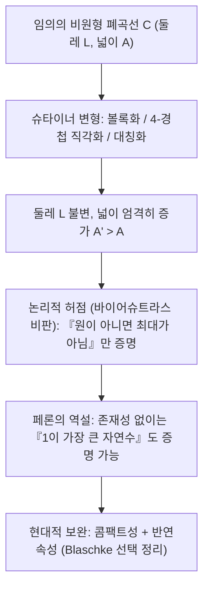
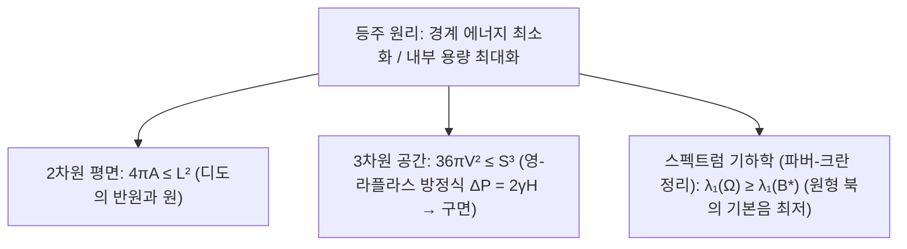

## 들어가며: 소가죽 한 장으로 얼마나 넓은 왕국을 둘러쌀 수 있을까?

고대 로마 시인 베르길리우스의 서사시 《아이네이스》에는 페니키아의 망명 공주 <strong>디도(Dido)</strong>가 북아프리카 해안에 도착해 현지 왕에게 "황소 가죽 한 장으로 둘러쌀 수 있는 만큼의 땅"을 달라고 청하는 이야기가 나옵니다. 디도는 소가죽을 아주 가느다란 끈으로 잘라 이어 붙인 뒤, 직선 해안선을 자연 경계로 삼아 거대한 <strong>반원(Semicircle)</strong> 모양으로 땅을 둘러싸고 고대 도시 카르타고를 세웠습니다.

신화의 외피를 벗기면 디도가 마주한 것은 수학사에서 가장 오래된 변분법 문제인 <strong>등주 문제(Isoperimetric Problem)</strong>입니다. 둘레의 길이가 $L > 0$으로 고정된 평면 위의 단순 폐곡선 $C$ 가운데 가장 넓은 넓이 $A$를 둘러싸는 도형은 무엇일까요?

정답은 <strong>원(Circle)</strong>입니다. 둘레가 $L$이고 둘러싼 넓이가 $A$인 임의의 평면 단순 폐곡선에 대해 항상 다음의 <strong>평면 등주 부등식(Planar Isoperimetric Inequality)</strong>이 성립합니다.

$$\boxed{4\pi A \le L^2 \quad \Longleftrightarrow \quad Q(C) := \frac{4\pi A}{L^2} \le 1}$$

여기서 무차원 비율 $Q(C) \in (0, 1]$를 <strong>등주 몫(Isoperimetric Quotient)</strong>이라 부르며, 등호는 오직 곡선 $C$가 완벽한 원일 때만 성립합니다. 직관적으로는 당연해 보이지만, 인류가 이 정리를 빈틈없이 증명하는 데에는 2천 년이 넘는 세월이 걸렸습니다.

---

## 제1장: 정다각형의 극한과 고대 그리스의 기하학적 직관

기원전 2세기 그리스 수학자 <strong>제노도로스(Zenodorus)</strong>는 둘레가 같은 모든 $n$각형 중 정$n$각형의 넓이가 가장 크며, 변의 개수 $n$이 커질수록 넓이가 증가함을 증명했습니다. 둘레가 $L$인 정$n$각형의 넓이와 등주 몫은 다음과 같습니다.

$$A_n = \frac{L^2}{4n \tan(\pi/n)}, \qquad Q_n = \frac{4\pi A_n}{L^2} = \frac{\pi/n}{\tan(\pi/n)} \xrightarrow{n \to \infty} 1$$

| 평면 폐곡선 ($L$ 고정) | 넓이 공식 $A(L)$ | 등주 몫 $Q = \frac{4\pi A}{L^2}$ | 원 대비 효율 (%) |
| :--- | :--- | :--- | :--- |
| <strong>정삼각형 ($n = 3$)</strong> | $\frac{\sqrt{3}}{36} L^2 \approx 0.04811 L^2$ | $\frac{\pi}{3\sqrt{3}} \approx 0.6046$ | $60.46\%$ |
| <strong>정사각형 ($n = 4$)</strong> | $\frac{1}{16} L^2 = 0.06250 L^2$ | $\frac{\pi}{4} \approx 0.7854$ | $78.54\%$ |
| <strong>정육각형 ($n = 6$)</strong> | $\frac{\sqrt{3}}{24} L^2 \approx 0.07217 L^2$ | $\frac{\pi}{2\sqrt{3}} \approx 0.9069$ | $90.69\%$ |
| <strong>원 ($n \to \infty$)</strong> | $\frac{1}{4\pi} L^2 \approx 0.07958 L^2$ | <strong>$1.0000$ (이론적 상한)</strong> | <strong>$100.00\%$</strong> |

디도 여왕처럼 직선 해안선을 활용하는 경우에는 곡선을 해안선에 대해 대칭 이동하여 둘레 $2L_{\text{rope}}$인 폐곡선으로 만들면 최대 전체 넓이가 $\frac{(2L_{\text{rope}})^2}{4\pi}$가 되므로, 최적해는 <strong>반원</strong>($A_{\max} = \frac{L_{\text{rope}}^2}{2\pi}$)이 됩니다.

---

## 제2장: 슈타이너의 기하학적 대칭화와 바이어슈트라스의 비판

1838년 스위스 기하학자 <strong>야코프 슈타이너(Jakob Steiner)</strong>는 독창적인 <strong>슈타이너 대칭화(Steiner Symmetrization)</strong>와 <strong>4-경첩 기법(Four-Hinge Method)</strong>을 고안했습니다.
1. <strong>볼록화</strong>: 오목한 부분이 있으면 지지 접선에 대해 바깥으로 뒤집어 둘레 $L$을 유지한 채 넓이 $A$를 엄격히 늘립니다.
2. <strong>4-경첩 변형</strong>: 둘레를 이등분하는 두 점 $P, Q$에 대해 경계 위의 점 $R$에서 $\angle PRQ \neq 90^\circ$라면, 네 개의 활꼴 영역을 유지한 채 $P, R, Q, S$를 경첩처럼 움직여 $\angle PRQ = \angle PSQ = 90^\circ$로 만듭니다. 삼각형 넓이 $\frac{1}{2}ab\sin\theta$는 $\theta = 90^\circ$에서 최대이므로 호의 길이는 불변인 채 전체 넓이가 엄격히 증가합니다! 탈레스 정리에 의해 모든 점에서 $\angle PRQ = 90^\circ$인 도형은 오직 <strong>원</strong>뿐입니다.

그러나 해석학의 거장 <strong>카를 바이어슈트라스(Karl Weierstrass)</strong>는 치명적인 허점을 지적했습니다. 슈타이너는 <strong>"최대 넓이 도형이 존재한다면 그것은 원이다"</strong>라는 필요조건만 보였을 뿐, <strong>"최대 넓이 도형이 존재한다"</strong>는 사실을 증명하지 않았던 것입니다! 수학자 <strong>오스카 페론(Oskar Perron)</strong>은 이를 풍자하여 <strong>페론의 역설</strong>을 제시했습니다. "가장 큰 자연수 $N$이 존재한다고 가정하자. $N > 1$이면 $N^2 > N$이어서 모순이므로 가장 큰 자연수는 $N = 1$이다!" 이 빈틈은 훗날 블라슈케 선택 정리와 변분법의 직접 해법에 의해 메워졌습니다.

---

## 제3장: 후르비츠(1901)의 푸리에 급수 증명 — 원은 순수한 기본파다

1901년 <strong>아돌프 후르비츠(Adolf Hurwitz)</strong>는 존재성 가정을 전혀 쓰지 않고 <strong>푸리에 급수(Fourier Series)</strong>와 파르세발 항등식만으로 단 몇 줄 만에 등주 부등식을 완벽히 증명했습니다. 닮음 변환을 통해 둘레를 $L = 2\pi$로 두고 호의 길이 $s \in [0, 2\pi]$로 매개화하면 접선 벡터의 크기는 항상 1입니다.

$$\left(x'(s)\right)^2 + \left(y'(s)\right)^2 = 1 \quad \Longrightarrow \quad L = \int_0^{2\pi} \left(x'(s)^2 + y'(s)^2\right) ds = 2\pi$$

주기 $2\pi$인 좌표를 복소 푸리에 급수 $x(s) = \sum_{n=-\infty}^{\infty} a_n e^{ins}$, $y(s) = \sum_{n=-\infty}^{\infty} b_n e^{ins}$ ($a_{-n} = \overline{a_n}, b_{-n} = \overline{b_n}$)로 전개하면, <strong>파르세발 항등식(Parseval's Identity)</strong>과 <strong>그린 정리(Green's Theorem)</strong> $A = \frac{1}{2}\oint (x\,dy - y\,dx)$에 의해 다음을 얻습니다.

$$\frac{L}{2\pi} = 1 = \sum_{n \neq 0} n^2 \left(|a_n|^2 + |b_n|^2\right), \qquad \frac{A}{\pi} = \sum_{n \neq 0} i n \left(a_n \overline{b_n} - \overline{a_n} b_n\right)$$

두 식을 빼서 완전제곱식으로 묶으면($L = 2\pi$에서 $L^2 - 4\pi A = 4\pi^2(1 - A/\pi)$):

$$\boxed{\frac{L^2 - 4\pi A}{4\pi^2} = \sum_{n \neq 0} \Big[ \underbrace{(n^2 - 1)\left(|a_n|^2 + |b_n|^2\right)}_{\ge 0 \ (\forall |n| \ge 1)} + \underbrace{|a_n + i b_n|^2}_{\ge 0} \Big] \ge 0}$$

등호가 성립하려면 모든 고조파 계수 $|n| \ge 2$가 0($a_n = b_n = 0$)이고 $a_1 + i b_1 = 0$이어야 하며, 이때 곡선은 반지름 $R = 1$인 완벽한 <strong>원</strong>이 됩니다! 푸리에 해석의 관점에서 <strong>원은 고차 고조파 왜곡이 전혀 없는 순수한 1차 기본파(Pure Fundamental Tone)</strong>입니다.

---

## 제4장: 3차원 비누방울과 북소리의 기하학 — 파버-크란 정리

1. <strong>3차원 등주 부등식과 비누방울</strong>: $\mathbb{R}^3$에서 부피 $V$를 감싸는 닫힌 곡면의 겉넓이 $S$는 <strong>$36\pi V^2 \le S^3$</strong>을 만족하며 등호는 구면(Sphere)에서만 성립합니다. 비누방울은 표면에너지 $E = \gamma S$를 최소화하기 위해 <strong>영-라플라스 방정식(Young-Laplace Equation)</strong> $\Delta P = 2\gamma H$에 따라 일정 평균 곡률(CMC) 곡면을 이루며, <strong>알렉산드로프 정리(1956)</strong>에 의해 완벽한 구가 됩니다.
2. <strong>파버-크란 정리(Faber-Krahn Inequality)와 북의 기본 주파수</strong>: 넓이가 같은 모든 북면 $\Omega \subset \mathbb{R}^2$ 중에서 라플라스 연산자의 제1 디리클레 고윳값(가장 낮은 기본음 주파수의 제곱)을 최소화하는 도형 역시 <strong>원형 북 $B^*$</strong>입니다.
   $$\lambda_1(\Omega) = \inf_{u \in H_0^1(\Omega)\setminus\{0\}} \frac{\int_\Omega |\nabla u|^2 \, dx}{\int_\Omega u^2 \, dx} \ge \lambda_1(B^*) = \frac{\pi j_{0,1}^2}{A(\Omega)}$$
