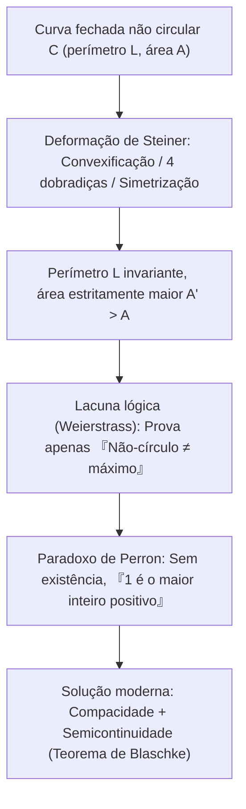
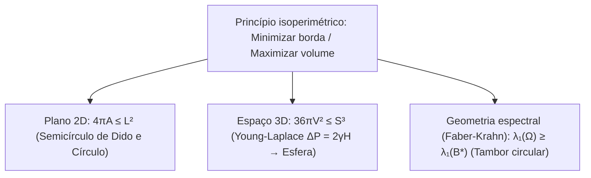

## Introdução: Quanto reino cabe no couro de um boi?

Na *Eneida* de Virgílio, a princesa fenícia exilada <strong>Dido</strong> chega à costa do norte da África e pede para comprar tanta terra «quanto o couro de um boi possa cercar». Dido corta o couro em tiras finíssimas para formar uma longa corda e, usando a costa retilínea como fronteira natural, cerca um enorme <strong>semicírculo</strong> onde funda Cartago.

Matematicamente, Dido enfrentava o problema variacional mais antigo da história, o <strong>problema isoperimétrico</strong>: entre todas as curvas planas fechadas simples $C$ de perímetro fixo $L > 0$, qual encerra a maior área $A$? A resposta é o <strong>círculo</strong>. Para toda curva fechada simples de comprimento $L$ e área $A$, vale a <strong>desigualdade isoperimétrica plana</strong>:

$$\boxed{4\pi A \le L^2 \quad \Longleftrightarrow \quad Q(C) := \frac{4\pi A}{L^2} \le 1}$$

O <strong>quociente isoperimétrico</strong> adimensional $Q(C) \in (0, 1]$ atinge o valor $1$ se e somente se $C$ for um círculo perfeito. Embora pareça óbvio à intuição, a humanidade levou mais de dois milênios para obter uma demonstração rigorosa.

---

## Capítulo 1: Polígonos regulares e a intuição grega

Já no século II a.C., <strong>Zenodoro</strong> demonstrou que entre todos os polígonos de $n$ lados com o mesmo perímetro $L$, o polígono regular maximiza a área:

$$A_n = \frac{L^2}{4n \tan(\pi/n)}, \qquad Q_n = \frac{4\pi A_n}{L^2} = \frac{\pi/n}{\tan(\pi/n)} \xrightarrow{n \to \infty} 1$$

| Figura plana ($L$ fixo) | Área $A(L)$ | Quociente $Q = \frac{4\pi A}{L^2}$ | Eficiência vs. Círculo (%) |
| :--- | :--- | :--- | :--- |
| <strong>Triângulo equilátero ($n = 3$)</strong> | $\frac{\sqrt{3}}{36} L^2 \approx 0.04811 L^2$ | $\frac{\pi}{3\sqrt{3}} \approx 0.6046$ | $60.46\%$ |
| <strong>Quadrado ($n = 4$)</strong> | $\frac{1}{16} L^2 = 0.06250 L^2$ | $\frac{\pi}{4} \approx 0.7854$ | $78.54\%$ |
| <strong>Hexágono regular ($n = 6$)</strong> | $\frac{\sqrt{3}}{24} L^2 \approx 0.07217 L^2$ | $\frac{\pi}{2\sqrt{3}} \approx 0.9069$ | $90.69\%$ |
| <strong>Círculo ($n \to \infty$)</strong> | $\frac{1}{4\pi} L^2 \approx 0.07958 L^2$ | <strong>$1.0000$ (Máximo)</strong> | <strong>$100.00\%$</strong> |

Ao refletir a corda de Dido de comprimento $L_{\text{rope}}$ em relação à costa reta, obtém-se uma curva fechada de perímetro $2L_{\text{rope}}$; portanto, a forma ótima apoiada na costa é o <strong>semicírculo</strong> com área $A_{\max} = \frac{L_{\text{rope}}^2}{2\pi}$.

---

## Capítulo 2: O método das quatro dobradiças de Steiner e a crítica de Weierstrass

Em 1838, <strong>Jakob Steiner</strong> criou a <strong>simetrização de Steiner</strong> e o <strong>método das quatro dobradiças</strong>:
1. <strong>Convexificação</strong>: Qualquer trecho côncavo refletido para fora conserva $L$ e aumenta estritamente $A$.
2. <strong>Quatro dobradiças</strong>: Se $P, Q$ bissectam o perímetro e um ponto $R$ satisfaz $\angle PRQ \neq 90^\circ$, articulam-se os quatro segmentos rígidos com dobradiças em $P, R, Q, S$ até que $\angle PRQ = \angle PSQ = 90^\circ$. Como a área $\frac{1}{2}ab\sin\theta$ é máxima em $\theta = 90^\circ$, a área total cresce estritamente sem alterar o perímetro! Pelo teorema de Tales, apenas o <strong>círculo</strong> não pode ser melhorado.

Contudo, <strong>Karl Weierstrass</strong> apontou uma falha lógica fatal: Steiner provara que *se* existir uma curva de área máxima, ela deve ser um círculo, mas não provou que tal máximo existe! <strong>Oskar Perron</strong> ironizou esse erro com o <strong>paradoxo de Perron</strong>: «Suponha que exista o maior inteiro positivo $N$. Se $N > 1$, então $N^2 > N$ (contradição); logo $N = 1$ é o maior inteiro». O teorema de seleção de Blaschke preencheu finalmente essa lacuna.

---

## Capítulo 3: A prova por séries de Fourier de Hurwitz (1901)

Em 1901, <strong>Adolf Hurwitz</strong> contornou qualquer hipótese de existência usando <strong>séries de Fourier</strong>. Por homotetia, fixemos $L = 2\pi$ e parametrizemos $(x(s), y(s))$ pelo comprimento de arco $s \in [0, 2\pi]$, de modo que $(x')^2 + (y')^2 = 1$:

$$\left(x'(s)\right)^2 + \left(y'(s)\right)^2 = 1 \quad \Longrightarrow \quad L = \int_0^{2\pi} \left(x'(s)^2 + y'(s)^2\right) ds = 2\pi$$

Expandindo $x(s) = \sum_{n=-\infty}^{\infty} a_n e^{ins}$ e $y(s) = \sum_{n=-\infty}^{\infty} b_n e^{ins}$ ($a_{-n} = \overline{a_n}, b_{-n} = \overline{b_n}$), a <strong>identidade de Parseval</strong> e o <strong>teorema de Green</strong> $A = \frac{1}{2}\oint (x\,dy - y\,dx)$ fornecem:

$$\frac{L}{2\pi} = 1 = \sum_{n \neq 0} n^2 \left(|a_n|^2 + |b_n|^2\right), \qquad \frac{A}{\pi} = \sum_{n \neq 0} i n \left(a_n \overline{b_n} - \overline{a_n} b_n\right)$$

Subtraindo ambas as expressões ($L^2 - 4\pi A = 4\pi^2(1 - A/\pi)$):

$$\boxed{\frac{L^2 - 4\pi A}{4\pi^2} = \sum_{n \neq 0} \Big[ \underbrace{(n^2 - 1)\left(|a_n|^2 + |b_n|^2\right)}_{\ge 0 \ (\forall |n| \ge 1)} + \underbrace{|a_n + i b_n|^2}_{\ge 0} \Big] \ge 0}$$

A igualdade ocorre se e somente se todos os harmônicos $|n| \ge 2$ se anulam ($a_n = b_n = 0$) e $a_1 + i b_1 = 0$, descrevendo exatamente um <strong>círculo</strong> de raio $R = 1$: um <strong>tom fundamental puro</strong> sem distorção harmônica.

---

## Capítulo 4: Bolhas de sabão 3D e o teorema de Faber-Krahn

1. <strong>Desigualdade 3D e bolhas de sabão</strong>: Em $\mathbb{R}^3$, a área superficial $S$ e o volume $V$ satisfazem <strong>$36\pi V^2 \le S^3$</strong> (igualdade apenas na esfera). Uma bolha de sabão minimiza sua energia $E = \gamma S$ sob a <strong>equação de Young-Laplace</strong> $\Delta P = 2\gamma H$ (curvatura média constante, esfera pelo <strong>teorema de Alexandrov 1956</strong>).
2. <strong>Desigualdade de Faber-Krahn</strong>: Entre todos os tambores $\Omega \subset \mathbb{R}^2$ de mesma área, o tambor circular $B^*$ produz a frequência fundamental mais grave:
   $$\lambda_1(\Omega) = \inf_{u \in H_0^1(\Omega)\setminus\{0\}} \frac{\int_\Omega |\nabla u|^2 \, dx}{\int_\Omega u^2 \, dx} \ge \lambda_1(B^*) = \frac{\pi j_{0,1}^2}{A(\Omega)}$$
