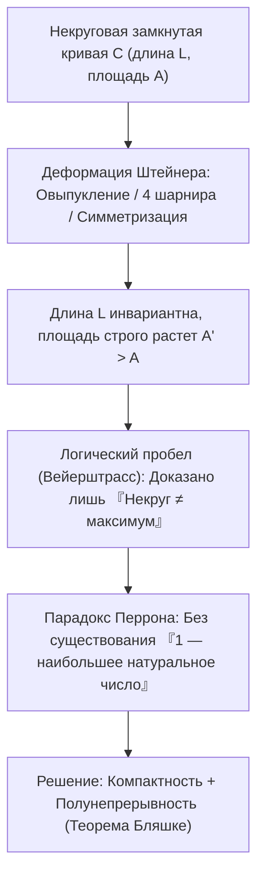
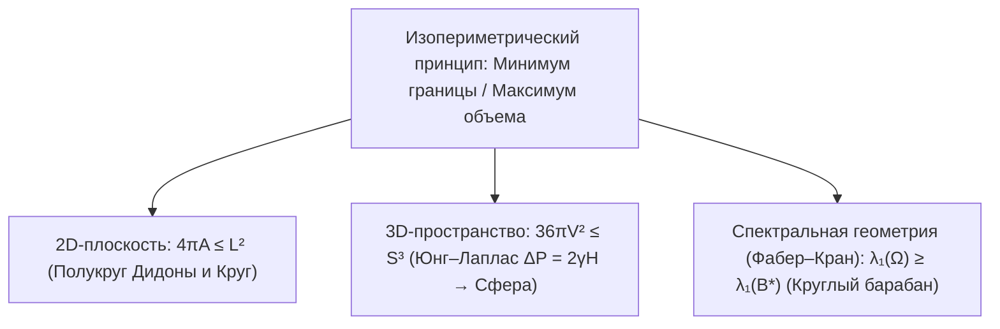

## Введение: сколько царства поместится в бычьей шкуре?

В «Энеиде» Вергилия финикийская царевна <strong>Дидона</strong> просит у правителя Северной Африки продать ей столько земли, «сколько можно охватить бычьей шкурой». Дидона разрезает шкуру на тончайшие ремешки, связывает их в длинную веревку и, используя прямой берег моря как границу, очерчивает огромный <strong>полукруг</strong>, основав Карфаген.

Математически Дидона решала древнейшую вариационную задачу — <strong>изопериметрическую задачу</strong>: какая простая замкнутая плоская кривая $C$ фиксированной длины $L > 0$ ограничивает наибольшую площадь $A$? Ответ — <strong>круг</strong>. Для любой простой замкнутой кривой длины $L$ и площади $A$ выполняется <strong>плоское изопериметрическое неравенство</strong>:

$$\boxed{4\pi A \le L^2 \quad \Longleftrightarrow \quad Q(C) := \frac{4\pi A}{L^2} \le 1}$$

Безразмерный <strong>изопериметрический коэффициент</strong> $Q(C) \in (0, 1]$ равен $1$ тогда и только тогда, когда $C$ — окружность. Несмотря на очевидность ответа, человечеству потребовалось более двух тысяч лет для строгого доказательства.

---

## Глава 1: Правильные многоугольники и античная интуиция

Еще во II веке до н. э. <strong>Зенодор</strong> доказал, что среди всех $n$-угольников периметра $L$ наибольшую площадь имеет правильный $n$-угольник:

$$A_n = \frac{L^2}{4n \tan(\pi/n)}, \qquad Q_n = \frac{4\pi A_n}{L^2} = \frac{\pi/n}{\tan(\pi/n)} \xrightarrow{n \to \infty} 1$$

| Плоская фигура ($L$ фикс.) | Площадь $A(L)$ | Коэффициент $Q = \frac{4\pi A}{L^2}$ | Эффективность к кругу (%) |
| :--- | :--- | :--- | :--- |
| <strong>Правильный треугольник ($n = 3$)</strong> | $\frac{\sqrt{3}}{36} L^2 \approx 0.04811 L^2$ | $\frac{\pi}{3\sqrt{3}} \approx 0.6046$ | $60.46\%$ |
| <strong>Квадрат ($n = 4$)</strong> | $\frac{1}{16} L^2 = 0.06250 L^2$ | $\frac{\pi}{4} \approx 0.7854$ | $78.54\%$ |
| <strong>Правильный шестиугольник ($n = 6$)</strong> | $\frac{\sqrt{3}}{24} L^2 \approx 0.07217 L^2$ | $\frac{\pi}{2\sqrt{3}} \approx 0.9069$ | $90.69\%$ |
| <strong>Круг ($n \to \infty$)</strong> | $\frac{1}{4\pi} L^2 \approx 0.07958 L^2$ | <strong>$1.0000$ (Максимум)</strong> | <strong>$100.00\%$</strong> |

Отразив веревку Дидоны длины $L_{\text{rope}}$ относительно прямой береговой линии, получаем замкнутую кривую периметра $2L_{\text{rope}}$; значит, оптимальная форма у берега — <strong>полукруг</strong> с площадью $A_{\max} = \frac{L_{\text{rope}}^2}{2\pi}$.

---

## Глава 2: Метод четырех шарниров Штейнера и критика Вейерштрасса

В 1838 году <strong>Якоб Штейнер</strong> предложил <strong>симметризацию Штейнера</strong> и <strong>метод четырех шарниров</strong>:
1. <strong>Овыпукление</strong>: Любая впадина, отраженная наружу относительно опорной прямой, сохраняет $L$ и строго увеличивает $A$.
2. <strong>Четыре шарнира</strong>: Если точки $P, Q$ делят периметр пополам, а точка $R$ дает $\angle PRQ \neq 90^\circ$, четыре жестких сегмента поворачиваются на шарнирах в $P, R, Q, S$ до $\angle PRQ = \angle PSQ = 90^\circ$. Так как площадь $\frac{1}{2}ab\sin\theta$ максимальна при $\theta = 90^\circ$, общая площадь строго растет при неизменном периметре! По теореме Фалеса улучшить нельзя только <strong>окружность</strong>.

Однако <strong>Карл Вейерштрасс</strong> указал на фатальный пробел: Штейнер доказал лишь, что *если* максимальная фигура существует, то это круг, но не доказал само существование максимума! <strong>Оскар Перрон</strong> проиллюстрировал ошибку <strong>парадоксом Перрона</strong>: «Пусть существует наибольшее натуральное число $N$. Если $N > 1$, то $N^2 > N$ (противоречие), значит $N = 1$ — наибольшее число!» Пробел был закрыт теоремой выбора Бляшке.

---

## Глава 3: Доказательство Гурвица через ряды Фурье (1901)

В 1901 году <strong>Адольф Гурвиц</strong> обошел проблему существования с помощью <strong>рядов Фурье</strong>. Масштабированием положим $L = 2\pi$ и параметризуем $(x(s), y(s))$ длиной дуги $s \in [0, 2\pi]$, так что $(x')^2 + (y')^2 = 1$:

$$\left(x'(s)\right)^2 + \left(y'(s)\right)^2 = 1 \quad \Longrightarrow \quad L = \int_0^{2\pi} \left(x'(s)^2 + y'(s)^2\right) ds = 2\pi$$

Разлагая $x(s) = \sum_{n=-\infty}^{\infty} a_n e^{ins}$ и $y(s) = \sum_{n=-\infty}^{\infty} b_n e^{ins}$ ($a_{-n} = \overline{a_n}, b_{-n} = \overline{b_n}$), из <strong>равенства Парсеваля</strong> и <strong>формулы Грина</strong> $A = \frac{1}{2}\oint (x\,dy - y\,dx)$ получаем:

$$\frac{L}{2\pi} = 1 = \sum_{n \neq 0} n^2 \left(|a_n|^2 + |b_n|^2\right), \qquad \frac{A}{\pi} = \sum_{n \neq 0} i n \left(a_n \overline{b_n} - \overline{a_n} b_n\right)$$

Вычитая одно из другого ($L^2 - 4\pi A = 4\pi^2(1 - A/\pi)$):

$$\boxed{\frac{L^2 - 4\pi A}{4\pi^2} = \sum_{n \neq 0} \Big[ \underbrace{(n^2 - 1)\left(|a_n|^2 + |b_n|^2\right)}_{\ge 0 \ (\forall |n| \ge 1)} + \underbrace{|a_n + i b_n|^2}_{\ge 0} \Big] \ge 0}$$

Равенство достигается тогда и только тогда, когда все высшие гармоники $|n| \ge 2$ равны нулю ($a_n = b_n = 0$) и $a_1 + i b_1 = 0$, что задает <strong>окружность</strong> радиуса $R = 1$ — <strong>чистый основной тон</strong> без гармонических искажений.

---

## Глава 4: Трехмерные мыльные пузыри и теорема Фабера–Крана

1. <strong>3D-неравенство и мыльные пузыри</strong>: В $\mathbb{R}^3$ площадь поверхности $S$ и объем $V$ связаны неравенством <strong>$36\pi V^2 \le S^3$</strong> (равенство только для сферы). Мыльная пленка минимизирует энергию $E = \gamma S$ согласно <strong>уравнению Юнга–Лапласа</strong> $\Delta P = 2\gamma H$ (поверхность постоянной средней кривизны — сфера по <strong>теореме Александрова 1956</strong>).
2. <strong>Неравенство Фабера–Крана</strong>: Среди всех мембран барабана $\Omega \subset \mathbb{R}^2$ одинаковой площади круглая мембрана $B^*$ имеет наименьшую основную частоту:
   $$\lambda_1(\Omega) = \inf_{u \in H_0^1(\Omega)\setminus\{0\}} \frac{\int_\Omega |\nabla u|^2 \, dx}{\int_\Omega u^2 \, dx} \ge \lambda_1(B^*) = \frac{\pi j_{0,1}^2}{A(\Omega)}$$
