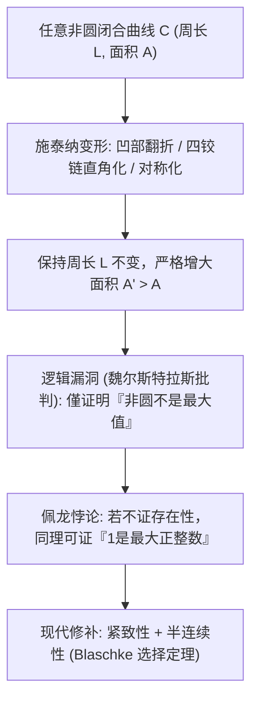
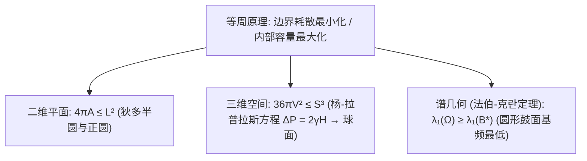

## 引言：一张牛皮能围出多大的王国？

在古罗马诗人维吉尔的史诗《埃涅阿斯纪》中，流亡的腓尼基公主<strong>狄多（Dido）</strong>来到北非海岸，请求当地国王卖给她“一张公牛皮所能围住的土地”。国王以为这不过立锥之地便欣然应允。然而狄多将牛皮剪成极细的皮条，首尾相接成一条长绳，并以笔直的海岸线为天然边界，围成了一个巨大的<strong>半圆形</strong>，建立了强盛的迦太基城（古城堡 Byrsa 在希腊语中正是“牛皮”之意）。

剥去神话外衣，狄多面对的是数学史上最古老的变分问题——<strong>等周问题（Isoperimetric Problem）</strong>：在所有周长固定为 $L > 0$ 的平面简单闭合曲线 $C$ 中，哪一条能围出最大的面积 $A$？反之，在围住给定面积 $A$ 的图形中，哪一个周长 $L$ 最短？

答案是<strong>圆</strong>。对于任意周长为 $L$、所围面积为 $A$ 的平面简单闭合曲线，恒成立<strong>平面等周不等式（Planar Isoperimetric Inequality）</strong>：

$$\boxed{4\pi A \le L^2 \quad \Longleftrightarrow \quad Q(C) := \frac{4\pi A}{L^2} \le 1}$$

其中无量纲比值 $Q(C) \in (0, 1]$ 称为<strong>等周商（Isoperimetric Quotient）</strong>，等号成立当且仅当曲线 $C$ 是完美的圆。尽管直觉上显而易见，人类却耗费了两千多年才给出严密无懈可击的证明。

---

## 第一章：多边形的逼近与古希腊的几何直觉

早在公元前2世纪，古希腊数学家<strong>泽诺多罗斯（Zenodorus）</strong>在《论等周图形》中就证明了：在周长相等的所有 $n$ 边形中，正 $n$ 边形面积最大；且边数越多面积越大。对周长为 $L$ 的正 $n$ 边形，边长 $a = L/n$，内切圆半径 $r = \frac{L}{2n\tan(\pi/n)}$，其面积与等周商为：

$$A_n = \frac{L^2}{4n \tan(\pi/n)}, \qquad Q_n = \frac{4\pi A_n}{L^2} = \frac{\pi/n}{\tan(\pi/n)} \xrightarrow{n \to \infty} 1$$

| 平面闭合图形 ($L$ 固定) | 面积公式 $A(L)$ | 等周商 $Q = \frac{4\pi A}{L^2}$ | 相对圆的效率 (%) |
| :--- | :--- | :--- | :--- |
| <strong>正三角形 ($n = 3$)</strong> | $\frac{\sqrt{3}}{36} L^2 \approx 0.04811 L^2$ | $\frac{\pi}{3\sqrt{3}} \approx 0.6046$ | $60.46\%$ |
| <strong>正方形 ($n = 4$)</strong> | $\frac{1}{16} L^2 = 0.06250 L^2$ | $\frac{\pi}{4} \approx 0.7854$ | $78.54\%$ |
| <strong>正六边形 ($n = 6$)</strong> | $\frac{\sqrt{3}}{24} L^2 \approx 0.07217 L^2$ | $\frac{\pi}{2\sqrt{3}} \approx 0.9069$ | $90.69\%$ |
| <strong>圆 ($n \to \infty$)</strong> | $\frac{1}{4\pi} L^2 \approx 0.07958 L^2$ | <strong>$1.0000$（理论上限）</strong> | <strong>$100.00\%$</strong> |

至于狄多女王借用海岸线的情形，通过将曲线关于直线海岸镜像反射，半周长 $L_{\text{rope}}$ 与镜像合成总长 $2L_{\text{rope}}$ 的闭合曲线，最大总面积为 $\frac{(2L_{\text{rope}})^2}{4\pi}$，故最优解正是<strong>半圆</strong>（$A_{\max} = \frac{L_{\text{rope}}^2}{2\pi}$，达到无边界圆面积的2倍）。

---

## 第二章：施泰纳的巧妙几何构造与魏尔斯特拉斯的致命批判

1838年，瑞士几何学家<strong>雅各布·施泰纳（Jakob Steiner）</strong>提出了精妙的<strong>施泰纳对称化（Steiner Symmetrization）</strong>与<strong>四铰链法（Four-Hinge Method）</strong>：
1. <strong>凸化</strong>：若图形有凹陷，将凹陷段沿支撑切线向外翻折，周长 $L$ 不变而面积 $A$ 严格增大。
2. <strong>四铰链变形</strong>：设曲线被点 $P, Q$ 平分周长。若在边界任取一点 $R$ 使得 $\angle PRQ \neq 90^\circ$，将四块刚性弓形区域保留在曲线上，仅在 $P, R, Q, S$ 四处装上铰链，把内接四边形张开使 $\angle PRQ = \angle PSQ = 90^\circ$。由于直角三角形面积 $\frac{1}{2}ab\sin\theta$ 在 $\theta = 90^\circ$ 最大，弧长不变而总面积严格增大！由泰勒斯定理，唯有当所有点都满足 $\angle PRQ = 90^\circ$（即<strong>圆</strong>）时面积才无法继续增大。

施泰纳宣称证明已经完成，但分析学大师<strong>卡尔·魏尔斯特拉斯（Karl Weierstrass）</strong>指出了致命的逻辑漏洞：施泰纳证明的是<strong>“如果最大面积图形存在，它必定是圆”</strong>，却没有证明<strong>“最大面积图形一定存在”</strong>！数学家<strong>奥斯卡·佩龙（Oskar Perron）</strong>给出了著名的反讽（<strong>佩龙悖论</strong>）：假设存在“最大的正整数 $N$”，若 $N > 1$ 则 $N^2 > N$ 矛盾，故 $N = 1$ 是最大正整数！直到布拉施克（Blaschke）利用紧致性与下半连续性填补了存在性，施泰纳法才真正完备。

---

## 第三章：赫维茨（1901）的傅里叶级数证明——圆是纯粹的基波

1901年，<strong>阿道夫·赫维茨（Adolf Hurwitz）</strong>完全绕开变分存在性陷阱，利用<strong>傅里叶级数（Fourier Series）</strong>给出了几行之内直击本质的解析证明。通过相似缩放，不妨设曲线周长为 $L = 2\pi$，以弧长 $s \in [0, 2\pi]$ 参数化为 $(x(s), y(s))$，则切向量模长恒为1：

$$\left(x'(s)\right)^2 + \left(y'(s)\right)^2 = 1 \quad \Longrightarrow \quad L = \int_0^{2\pi} \left(x'(s)^2 + y'(s)^2\right) ds = 2\pi$$

将周期为 $2\pi$ 的复坐标展开为傅里叶级数 $x(s) = \sum_{n=-\infty}^{\infty} a_n e^{ins}$，$y(s) = \sum_{n=-\infty}^{\infty} b_n e^{ins}$（实函数满足 $a_{-n} = \overline{a_n}, b_{-n} = \overline{b_n}$）。求导得 $x'(s) = \sum in a_n e^{ins}$，由<strong>帕塞瓦尔恒等式（Parseval's Identity）</strong>及<strong>格林公式（Green's Theorem）</strong> $A = \frac{1}{2}\oint (x\,dy - y\,dx)$，我们得到周长与面积的频域表达式：

$$\frac{L}{2\pi} = 1 = \sum_{n \neq 0} n^2 \left(|a_n|^2 + |b_n|^2\right), \qquad \frac{A}{\pi} = \sum_{n \neq 0} i n \left(a_n \overline{b_n} - \overline{a_n} b_n\right)$$

将两式相减并配成完全平方（对 $L = 2\pi$，注意 $L^2 - 4\pi A = 4\pi^2(1 - A/\pi)$）：

$$\boxed{\frac{L^2 - 4\pi A}{4\pi^2} = \sum_{n \neq 0} \Big[ \underbrace{(n^2 - 1)\left(|a_n|^2 + |b_n|^2\right)}_{\ge 0 \ (\forall |n| \ge 1)} + \underbrace{|a_n + i b_n|^2}_{\ge 0} \Big] \ge 0}$$

等号成立当且仅当所有高次谐波 $|n| \ge 2$ 系数全为零（$a_n = b_n = 0$），且基波满足 $a_1 + i b_1 = 0$，此时曲线恰好退化为半径 $R = 1$ 的<strong>正圆</strong>！在傅里叶视角下，<strong>圆就是没有任何高次谐波畸变的纯粹一阶基波（Pure Fundamental Tone）</strong>，任何凹凸褶皱都会将弧长能量浪费在 $n^2$ 权重的高频谐波上。

---

## 第四章：三维肥皂泡与听音辨鼓——法伯-克란定理

1. <strong>三维等周不等式与肥皂泡</strong>：在 $\mathbb{R}^3$ 中，包围体积 $V$ 的闭合曲面面积 $S$ 满足 <strong>$36\pi V^2 \le S^3$</strong>，等号仅对球面成立。肥皂膜为使表面自由能 $E = \gamma S$ 最小，在<strong>杨-拉普拉斯方程（Young-Laplace Equation）</strong> $\Delta P = 2\gamma H$ 下形成常平均曲率（CMC）曲面；由<strong>亚历山德罗夫定理（1956）</strong>，紧致无自交的常平均曲率曲面必为完美球面。
2. <strong>法伯-克란定理（Faber-Krahn Inequality）与鼓面基频</strong>：19世纪瑞利勋爵猜想：在面积相同的所有鼓面 $\Omega \subset \mathbb{R}^2$ 中，圆形鼓面 $B^*$ 的第一狄利克雷特征值（基音频率平方）最低。1920年代法伯与克란利用施泰纳径向重排严格证明了：
   $$\lambda_1(\Omega) = \inf_{u \in H_0^1(\Omega)\setminus\{0\}} \frac{\int_\Omega |\nabla u|^2 \, dx}{\int_\Omega u^2 \, dx} \ge \lambda_1(B^*) = \frac{\pi j_{0,1}^2}{A(\Omega)}$$
   从牛皮圈地、傅里叶基波、肥皂泡到拉普拉斯算子的声学特征值，圆与球始终稳坐宇宙几何效率的最高王座。
