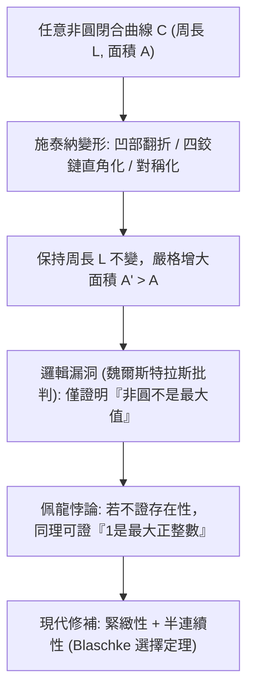
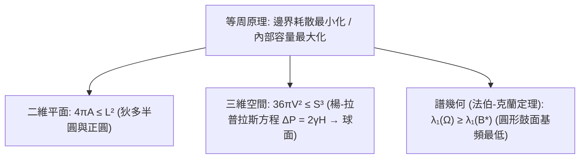

## 引言：一張牛皮能圍出多大的王國？

在古羅馬詩人維吉爾的史詩《埃涅阿斯紀》中，流亡的腓尼基公主<strong>狄多（Dido）</strong>來到北非海岸，請求當地國王賣給她「一張公牛皮所能圍住的土地」。國王以為這不過立錐之地便欣然應允。然而狄多將牛皮剪成極細的皮條，首尾相接成一條長繩，並以筆直的海岸線為天然邊界，圍成了一個巨大的<strong>半圓形</strong>，建立了強盛的迦太基城（古城堡 Byrsa 在希臘語中正是「牛皮」之意）。

剝去神話外衣，狄多面對的是數學史上最古老的變分問題——<strong>等周問題（Isoperimetric Problem）</strong>：在所有周長固定為 $L > 0$ 的平面簡單閉合曲線 $C$ 中，哪一條能圍出最大的面積 $A$？反之，在圍住給定面積 $A$ 的圖形中，哪一個周長 $L$ 最短？

答案是<strong>圓</strong>。對於任意周長為 $L$、所圍面積為 $A$ 的平面簡單閉合曲線，恆成立<strong>平面等周不等式（Planar Isoperimetric Inequality）</strong>：

$$\boxed{4\pi A \le L^2 \quad \Longleftrightarrow \quad Q(C) := \frac{4\pi A}{L^2} \le 1}$$

其中無因次比值 $Q(C) \in (0, 1]$ 稱為<strong>等周商（Isoperimetric Quotient）</strong>，等號成立當且僅當曲線 $C$ 是完美的圓。儘管直覺上顯而易見，人類卻耗費了兩千多年才給出嚴密無懈可擊的證明。

---

## 第一章：多邊形的逼近與古希臘的幾何直覺

早在西元前2世紀，古希臘數學家<strong>澤諾多羅斯（Zenodorus）</strong>在《論等周圖形》中就證明了：在周長相等的所有 $n$ 邊形中，正 $n$ 邊形面積最大；且邊數越多面積越大。對周長為 $L$ 的正 $n$ 邊形，邊長 $a = L/n$，內切圓半徑 $r = \frac{L}{2n\tan(\pi/n)}$，其面積與等周商為：

$$A_n = \frac{L^2}{4n \tan(\pi/n)}, \qquad Q_n = \frac{4\pi A_n}{L^2} = \frac{\pi/n}{\tan(\pi/n)} \xrightarrow{n \to \infty} 1$$

| 平面閉合圖形 ($L$ 固定) | 面積公式 $A(L)$ | 等周商 $Q = \frac{4\pi A}{L^2}$ | 相對圓的效率 (%) |
| :--- | :--- | :--- | :--- |
| <strong>正三角形 ($n = 3$)</strong> | $\frac{\sqrt{3}}{36} L^2 \approx 0.04811 L^2$ | $\frac{\pi}{3\sqrt{3}} \approx 0.6046$ | $60.46\%$ |
| <strong>正方形 ($n = 4$)</strong> | $\frac{1}{16} L^2 = 0.06250 L^2$ | $\frac{\pi}{4} \approx 0.7854$ | $78.54\%$ |
| <strong>正六邊形 ($n = 6$)</strong> | $\frac{\sqrt{3}}{24} L^2 \approx 0.07217 L^2$ | $\frac{\pi}{2\sqrt{3}} \approx 0.9069$ | $90.69\%$ |
| <strong>圓 ($n \to \infty$)</strong> | $\frac{1}{4\pi} L^2 \approx 0.07958 L^2$ | <strong>$1.0000$（理論上限）</strong> | <strong>$100.00\%$</strong> |

至於狄多女王借用海岸線的情形，透過將曲線關於直線海岸鏡像反射，半周長 $L_{\text{rope}}$ 與鏡像合成總長 $2L_{\text{rope}}$ 的閉合曲線，最大總面積為 $\frac{(2L_{\text{rope}})^2}{4\pi}$，故最優解正是<strong>半圓</strong>（$A_{\max} = \frac{L_{\text{rope}}^2}{2\pi}$，達到無邊界圓面積的2倍）。

---

## 第二章：施泰納的巧妙幾何構造與魏爾斯特拉斯的致命批判

1838年，瑞士幾何學家<strong>雅各布·施泰納（Jakob Steiner）</strong>提出了精妙的<strong>施泰納對稱化（Steiner Symmetrization）</strong>與<strong>四鉸鏈法（Four-Hinge Method）</strong>：
1. <strong>凸化</strong>：若圖形有凹陷，將凹陷段沿支撐切線向外翻折，周長 $L$ 不變而面積 $A$ 嚴格增大。
2. <strong>四鉸鏈變形</strong>：設曲線被點 $P, Q$ 平分周長。若在邊界任取一點 $R$ 使得 $\angle PRQ \neq 90^\circ$，將四塊剛性弓形區域保留在曲線上，僅在 $P, R, Q, S$ 四處裝上鉸鏈，把內接四邊形張開使 $\angle PRQ = \angle PSQ = 90^\circ$。由於直角三角形面積 $\frac{1}{2}ab\sin\theta$ 在 $\theta = 90^\circ$ 最大，弧長不變而總面積嚴格增大！由泰勒斯定理，唯有當所有點都滿足 $\angle PRQ = 90^\circ$（即<strong>圓</strong>）時面積才無法繼續增大。

施泰納宣稱證明已經完成，但分析學大師<strong>卡爾·魏爾斯特拉斯（Karl Weierstrass）</strong>指出了致命的邏輯漏洞：施泰納證明的是<strong>「如果最大面積圖形存在，它必定是圓」</strong>，卻沒有證明<strong>「最大面積圖形一定存在」</strong>！數學家<strong>奧斯卡·佩龍（Oskar Perron）</strong>給出了著名的反諷（<strong>佩龍悖論</strong>）：假設存在「最大的正整數 $N$」，若 $N > 1$ 則 $N^2 > N$ 矛盾，故 $N = 1$ 是最大正整數！直到布拉施克（Blaschke）利用緊緻性與下半連續性填補了存在性，施泰納法才真正完備。

---

## 第三章：赫維茨（1901）的傅立葉級數證明——圓是純粹的基波

1901年，<strong>阿道夫·赫維茨（Adolf Hurwitz）</strong>完全繞開變分存在性陷阱，利用<strong>傅立葉級數（Fourier Series）</strong>給出了幾行之內直擊本質的解析證明。透過相似縮放，不妨設曲線周長為 $L = 2\pi$，以弧長 $s \in [0, 2\pi]$ 參數化為 $(x(s), y(s))$，則切向量模長恆為1：

$$\left(x'(s)\right)^2 + \left(y'(s)\right)^2 = 1 \quad \Longrightarrow \quad L = \int_0^{2\pi} \left(x'(s)^2 + y'(s)^2\right) ds = 2\pi$$

將週期為 $2\pi$ 的複座標展開為傅立葉級數 $x(s) = \sum_{n=-\infty}^{\infty} a_n e^{ins}$，$y(s) = \sum_{n=-\infty}^{\infty} b_n e^{ins}$（實函數滿足 $a_{-n} = \overline{a_n}, b_{-n} = \overline{b_n}$）。求導得 $x'(s) = \sum in a_n e^{ins}$，由<strong>帕塞瓦爾恆等式（Parseval's Identity）</strong>及<strong>格林公式（Green's Theorem）</strong> $A = \frac{1}{2}\oint (x\,dy - y\,dx)$，我們得到周長與面積的頻域表達式：

$$\frac{L}{2\pi} = 1 = \sum_{n \neq 0} n^2 \left(|a_n|^2 + |b_n|^2\right), \qquad \frac{A}{\pi} = \sum_{n \neq 0} i n \left(a_n \overline{b_n} - \overline{a_n} b_n\right)$$

將兩式相減並配成完全平方（對 $L = 2\pi$，注意 $L^2 - 4\pi A = 4\pi^2(1 - A/\pi)$）：

$$\boxed{\frac{L^2 - 4\pi A}{4\pi^2} = \sum_{n \neq 0} \Big[ \underbrace{(n^2 - 1)\left(|a_n|^2 + |b_n|^2\right)}_{\ge 0 \ (\forall |n| \ge 1)} + \underbrace{|a_n + i b_n|^2}_{\ge 0} \Big] \ge 0}$$

等號成立當且僅當所有高次諧波 $|n| \ge 2$ 係數全為零（$a_n = b_n = 0$），且基波滿足 $a_1 + i b_1 = 0$，此時曲線恰好退化為半徑 $R = 1$ 的<strong>正圓</strong>！在傅立葉視角下，<strong>圓就是沒有任何高次諧波畸變的純粹一階基波（Pure Fundamental Tone）</strong>，任何凹凸褶皺都會將弧長能量浪費在 $n^2$ 權重的高頻諧波上。

---

## 第四章：三維肥皂泡與聽音辨鼓——法伯-克蘭定理

1. <strong>三維等周不等式與肥皂泡</strong>：在 $\mathbb{R}^3$ 中，包圍體積 $V$ 的閉合曲面面積 $S$ 滿足 <strong>$36\pi V^2 \le S^3$</strong>，等號僅對球面成立。肥皂膜為使表面自由能 $E = \gamma S$ 最小，在<strong>楊-拉普拉斯方程（Young-Laplace Equation）</strong> $\Delta P = 2\gamma H$ 下形成常平均曲率（CMC）曲面；由<strong>亞歷山德羅夫定理（1956）</strong>，緊緻無自交的常平均曲率曲面必為完美球面。
2. <strong>法伯-克蘭定理（Faber-Krahn Inequality）與鼓面基頻</strong>：19世紀瑞利勳爵猜想：在面積相同的所有鼓面 $\Omega \subset \mathbb{R}^2$ 中，圓形鼓面 $B^*$ 的第一狄利克雷特徵值（基音頻率平方）最低。1920年代法伯與克蘭利用施泰納徑向重排嚴格證明了：
   $$\lambda_1(\Omega) = \inf_{u \in H_0^1(\Omega)\setminus\{0\}} \frac{\int_\Omega |\nabla u|^2 \, dx}{\int_\Omega u^2 \, dx} \ge \lambda_1(B^*) = \frac{\pi j_{0,1}^2}{A(\Omega)}$$
   從牛皮圈地、傅立葉基波、肥皂泡到拉普拉斯算子的聲學特徵值，圓與球始終穩坐宇宙幾何效率的最高王座。
