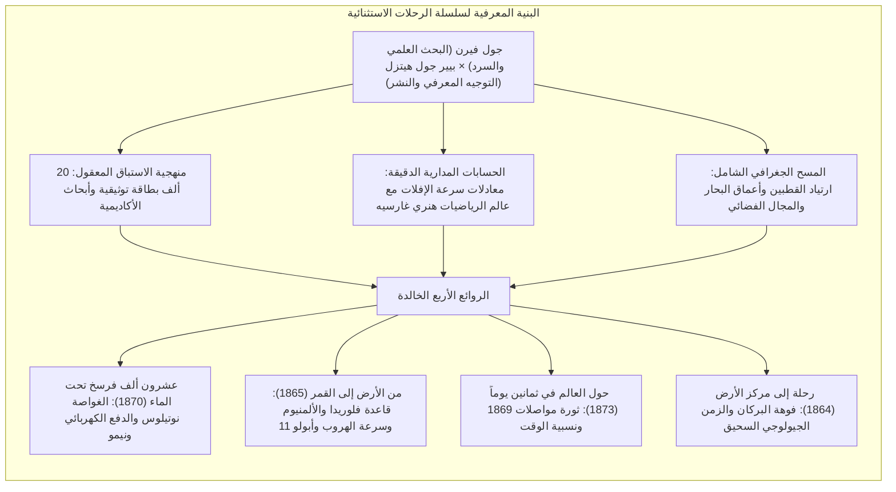
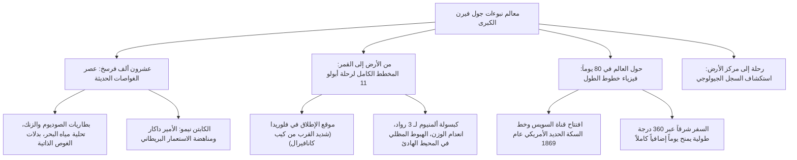

في النصف الثاني من القرن التاسع عشر، حينما نجح المحرك البخاري وشبكات البرق التلغرافي وقناة السويس في تقليص أبعاد الكوكب الأرضي، صاغ الروائي الفرنسي <strong>جول فيرن (1828–1905)</strong> المعالم الكبرى للمخيلة العلمية الحديثة.

يُعد جول فيرن، إلى جانب هـ. ج. ويلز، الأب الروحي لأدب الخيال العلمي؛ إلا أن فيرن تميز بسلسلته الملحمية <strong>«الرحلات الاستثنائية» (Voyages Extraordinaires)</strong> المؤلفة من 62 رواية، والتي هدفت بالتعاون مع الناشر الفذ <strong>بيير جول هيتزل</strong> إلى تقديم موسوعة سردية شاملة تضم أحدث معارف الجغرافيا والفيزياء والفلك والجيولوجيا في قوالب روائية دقيقة علمياً.

من رواد الفضاء الأوائل مثل <strong>قسطنطين تسيولكوفسكي</strong> و<strong>روبرت غودارد</strong> و<strong>فيرنر فون براون</strong>، إلى مستكشف المحيطات <strong>جاك إيف كوستو</strong> ورواد رحلة «أبولو 11»، أجمع مهندسو القرن العشرين على حقيقة واحدة: *«لقد بدأت أحلامنا الكبرى بين صفحات روايات جول فيرن»*.

---

## 1. شراكته مع هيتزل ورسالة التنوير العلمي

ولد فيرن عام 1828 في ميناء نانت، وتفتحت مداركه على مراقبة السفن العابرة للمحيطات. ورغم دراسته للقانون في باريس وعمله في المسرح، فقد أدرك ضرورة ابتكار نمط أدبي جديد: <strong>الرواية العلمية الاستشرافية (Roman Scientifique)</strong>.

في عام 1862، التقى بالناشر <strong>بيير جول هيتزل</strong> الذي وقع معه عقداً طويلاً لنشر مجلدين سنوياً في *مجلة التعليم والترفيه*، بهدف تثقيف الجيل الصاعد بروح التفكير العلمي الوضعي.

---

## 2. المنهجية العلمية: 20 ألف بطاقة وحسابات غارسيه

لم تكن نبوءات فيرن مجرد أوهام خيالية، بل استندت إلى <strong>بحث وثائقي واستقراء فيزيائي دقيق</strong>:
- <strong>الأرشيف الشخصي الضخم:</strong> احتفظ فيرن في مكتبه بأكثر من 20 ألف بطاقة مفهرسة تضم أحدث الاكتشافات المنشورة في المجلات العلمية المتخصصة.
- <strong>حسابات عالم الرياضيات هنري غارسيه:</strong> في روايته «من الأرض إلى القمر»، تعاون فيرن مع ابن عمه أستاذ الرياضيات هنري غارسيه لحساب <strong>سرعة الهروب</strong> المطلوبة لفك الارتباط بجاذبية الأرض:

$$v_{\text{esc}} = \sqrt{\frac{2GM}{R}} \approx 11{,}2 \text{ كم/ثانية}$$

- <strong>الخلاف المنهجي مع هـ. ج. ويلز:</strong> عاب فيرن على ويلز ابتداعه لمعدن «الكافوريت» الخيالي المضاد للجاذبية قائلاً: *«أنا أستخدم قوانين الفيزياء والميكانيكا والحديد الحقيقي، بينما يبتكر ويلز معادن خيالية تعطل الجاذبية، وهذا أدب فانتازي لا صلة له بالعلم الحقيقي»*.

---

## 3. تفكيك الروائع الكبرى الأربع

### 3.1 «عشرون ألف فرسخ تحت الماء» (1870)
تعد الغواصة <strong>نوتيلوس</strong> إنجازاً مذهلاً: فهي تعمل بالدفع الكهربائي المستمد من استخلاص الصوديوم من ماء البحر، ومزودة بأجهزة تنقية الهواء ومصابيح القوس الكهربائي. كما جسد الكابتن نيمو (الأمير الهندي داكار الهارب من البطش الاستعماري) النضال من أجل الحرية المطلقة في أعماق المحيط التي تعلو فوق سيادة الدول المستبدة.

### 3.2 «من الأرض إلى القمر» (1865) ورحلة أبولو 11
تطابقت تفاصيل الرواية بصورة مذهلة مع رحلة «أبولو 11» عام 1969: موقع الإطلاق في <strong>فلوريدا</strong>، صنع الكبسولة من معدن <strong>الألمنيوم</strong> خفيف الوزن، طاقم مؤلف من <strong>ثلاثة رجال</strong>، وسرعة انطلاق تعادل <strong>11.2 كم/ثانية</strong>، والهبوط النهائي عبر <strong>السقوط المظلي في المحيط الهادئ</strong> والتقاط الرواد بسفينة حربية أمريكية.

### 3.3 «حول العالم في ثمانين يوماً» (1873)
استثمرت الرواية البنية التحتية العالمية لعام 1869. واعتمدت حبكتها النهائية على فيزياء خطوط الطول: فقطع 360 درجة طولية باتجاه الشرق جعل المسافر يربح يوماً شمسياً كاملاً (24 ساعة) دون أن يدري، محققاً الفوز في اللحظة الأخيرة.

---

## 4. التحول المتأخر: من التفاؤل إلى ديستوبيا الخراب

عقب حرب 1870، تحول فكر فيرن نحو نقد التكنوقراطية العمياء:
- <strong>«باريس في القرن العشرين» (كُتبت 1863، نُشرت 1994):</strong> تنبأت بباريس عام 1960 بقطاراتها الكهربائية وشبكات الفاكس والحواسيب، لكنها حذرت من مجتمع مادي خانق سحق الآداب والفنون.
- <strong>«أمام الراية» (1896):</strong> حذرت من اختراع المتفجرات التدميرية الفائقة («الفولغوراتور») التي سبقت فكرة الصواريخ النووية الموجهة، وما تجلبه من كوارث حين تقع في أيدي القراصنة والمستبدين.

---

## 5. الإرث الخالد لجول فيرن

في عام 1954، أطلقت البحرية الأمريكية اسم <strong>يو إس إس نوتيلوس</strong> على أول غواصة نووية في التاريخ. وفي ديسمبر 1968، وجّه رواد «أبولو 8» تحية وفاء لجول فيرن من مدار القمر.

تظل كلماته المحفورة على ضريحه نبراساً للبشرية: <strong>«كل ما يستطيع رجل واحد أن يتخيله، يستطيع رجال آخرون أن يحققوه»</strong>.
