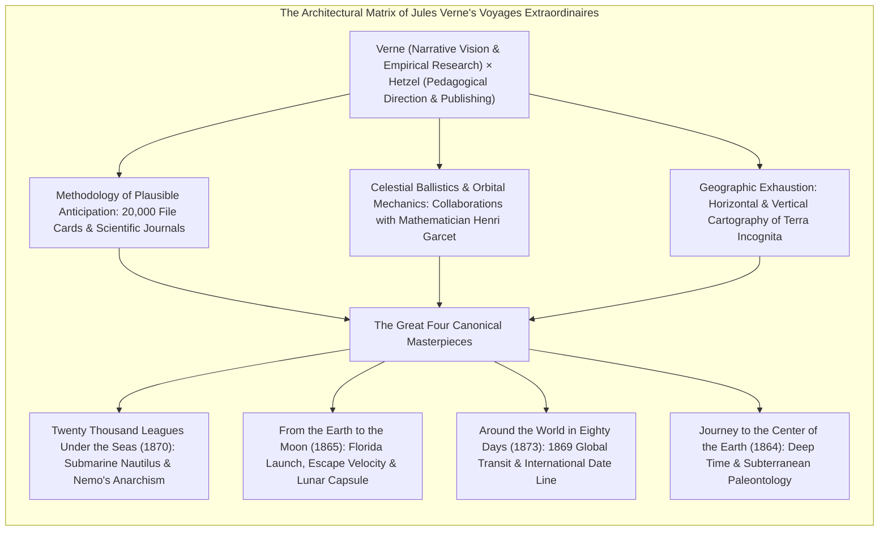
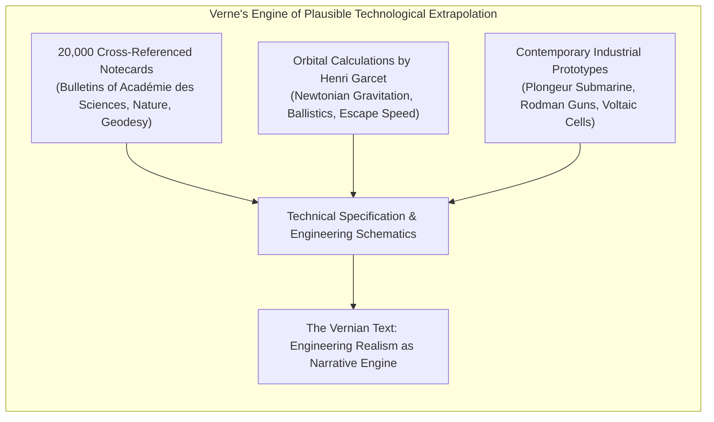
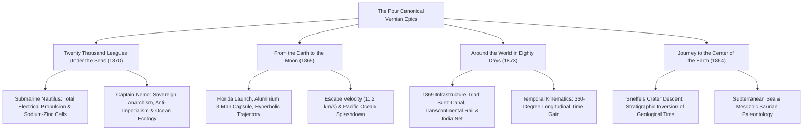
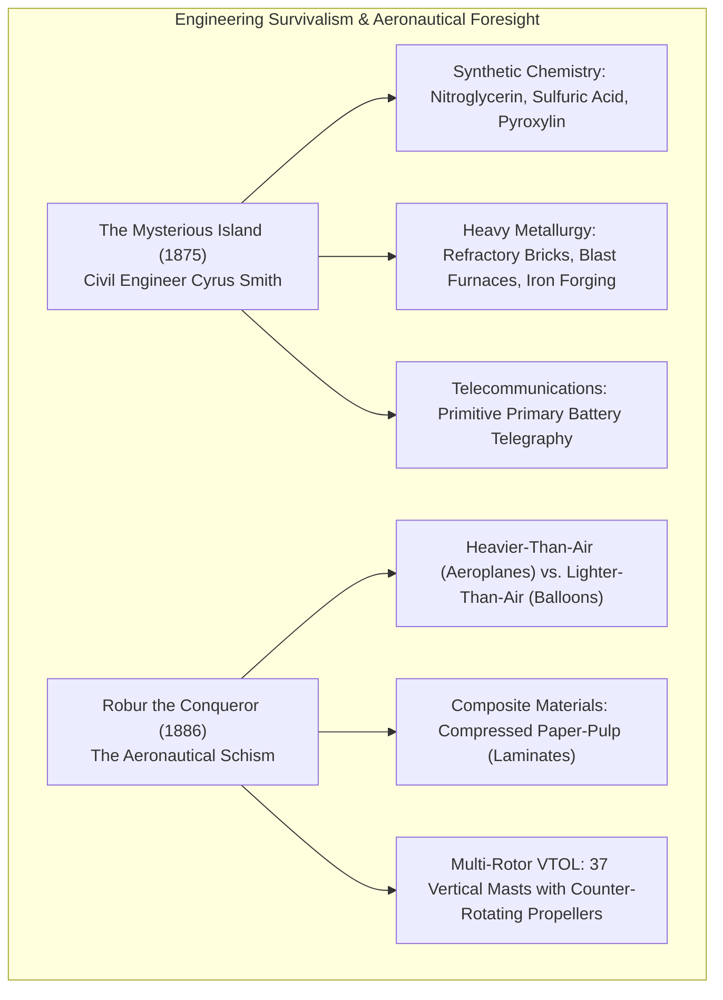
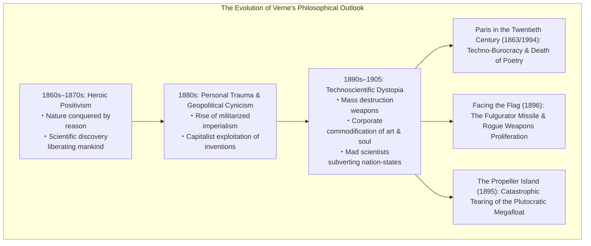
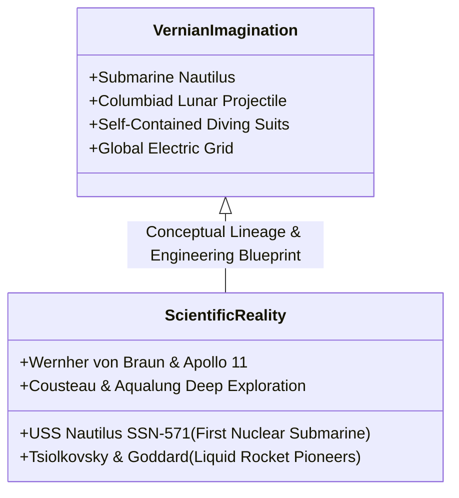

In the second half of the nineteenth century, as the Industrial Revolution violently remapped the terrestrial globe through the triumvirate of the steam engine, the electric telegraph, and global railway corridors, a single visionary writer charted the imaginative frontiers of the modern mind: the French novelist <strong>Jules Verne (1828–1905)</strong>.

Universally celebrated alongside H.G. Wells as the founding father of modern science fiction, Verne accomplished something far grander than mere pulp adventure. Across his monumental fifty-four-novel sequence published during his lifetime (expanding to sixty-two novels posthumously) under the umbrella title <strong>Voyages Extraordinaires (Extraordinary Voyages)</strong>, Verne executed an unprecedented pedagogical, geographic, and scientific cartography of the earth and the cosmos. 

His mission, forged in intimate collaboration with the visionary publisher <strong>Pierre-Jules Hetzel</strong>, was nothing less than to summarize all modern knowledge accumulated by geography, geology, physics, astronomy, and chemistry, and to dramatize it within narratives of rigorous technological plausibility.

From rocketry pioneers <strong>Konstantin Tsiolkovsky</strong>, <strong>Robert H. Goddard</strong>, and <strong>Wernher von Braun</strong>, to oceanic explorer <strong>Jacques-Yves Cousteau</strong>, and the Apollo 11 astronauts who made humanity’s first footprints upon the lunar regolith, the architects of twentieth-century exploration have testified with one voice: *our dreams were born in the pages of Jules Verne*.

---

## 1. The Hetzel Partnership and the Conception of the *Voyages Extraordinaires*

Jules Verne's transformation from an obscure Parisian playwright and stockbroker into a global literary phenomenon was mediated by the publisher <strong>Pierre-Jules Hetzel (1814–1886)</strong>.

### 1.1 From the Port of Nantes to Parisian Dramaturgy

Born in 1828 in the bustling maritime port of Nantes at the mouth of the Loire River, Verne spent his childhood mesmerized by merchant three-masters, whalers, and early paddle-steamers outbound for the Americas and the Indies. Though dispatched to Paris by his authoritarian attorney father to pursue a legal career, Verne was inexorably seduced by the bohemian literary world, befriending Alexandre Dumas père and writing librettos and comedies for the Théâtre Lyrique.

Disenchanted by the prevailing French literary fashions of bourgeois domestic melodrama and historical romance, Verne intuited an uncolonized narrative space: <strong>a novelistic form that married the drama of geographic exploration with the rigor of contemporary physical science</strong>. In 1862, he presented a manuscript recounting an aerial traverse of the African interior via hydrogen balloon to Hetzel. Titled *Five Weeks in a Balloon* (*Cinq semaines en ballon*, 1863), the book became an immediate international sensation.

### 1.2 Hetzel's Pedagogical Manifesto

Hetzel, who had published Victor Hugo, Honoré de Balzac, and George Sand, possessed a master publisher’s sociological instinct. He recognized in Verne the ideal instrument for an educational crusade: instructing post-revolutionary French youth in the rationalist, secular disciplines of natural science through the intoxicating vehicle of adventure.

In the inaugural 1864 issue of the *Magasin d'éducation et de récréation*, Hetzel issued the defining manifesto of the *Voyages Extraordinaires*:

> "Its aim is to summarize all the geographical, geological, physical, and astronomical knowledge amassed by modern science, and to recount, in an entertaining and picturesque format... the history of the universe."

Under a contractual obligation that demanded the delivery of two full-length novels per year, Verne labored for four decades, turning his study in Amiens into a precision laboratory of literary production.

---

## 2. The Methodology of Plausible Anticipation

The enduring legend of Verne as a clairvoyant prophet who "foretold" television, submarines, helicopters, and space travel fundamentally obscures his true genius. Verne was not an occult seer; he was <strong>the supreme archivist and extrapolator of 19th-century applied science</strong>.

### 2.1 The Archive of 20,000 Notecards

In his mansion in Amiens, Verne maintained an encyclopedic archive consisting of over <strong>20,000 meticulously classified file cards</strong>, compiled from daily subscriptions to scientific periodicals such as *La Nature*, the *Revue des Deux Mondes*, the bulletins of the Société de Géographie, and British and American technical treatises.

Rising at 5:00 AM every morning, Verne spent several hours digesting the latest advances in metallurgy, chemistry, thermodynamics, and electrical engineering. Consequently, virtually every technological marvel in his novels represented <strong>the quantitative extrapolation and industrial integration of physical principles already validated in contemporary laboratories</strong>.

### 2.2 Mathematical Verification: Henri Garcet

Nowhere is Verne’s fidelity to mathematical truth more evident than in his space novels, *From the Earth to the Moon* (1865) and *Around the Moon* (1870). Rather than hand-waving the physics of orbital mechanics, Verne enlisted his cousin, the distinguished mathematician and Lycée Henri-IV professor <strong>Henri Garcet (1815–1871)</strong>.

Garcet performed the rigorous Newtonian celestial mechanics required to compute the exact <strong>escape velocity</strong> necessary for a projectile to overcome the gravitational potential well of the Earth:

$$v_{\text{esc}} = \sqrt{\frac{2GM}{R}} \approx 11,186 \text{ m/s} \quad (\approx 11.2 \text{ km/s} \text{ or } 36,700 \text{ ft/s})$$

Verne incorporated Garcet's differential equations directly into the text in the form of a memorandum from the Cambridge Observatory. The volume of propellant (400,000 pounds of guncotton), the length of the Columbiad cast-iron cannon (900 feet), and the hyperbolic trajectory past the lunar limb were not decorative flourishes, but verifiable ballistics.

### 2.3 Methodological Duel: Verne versus H.G. Wells

The epistemological boundary separating Verne from his younger British counterpart <strong>H.G. Wells (1866–1946)</strong> illuminates the fundamental divergence between "hard" engineering anticipation and speculative allegorical romance.

| Analytic Dimension | Jules Verne (1828–1905) | H.G. Wells (1866–1946) |
|---|---|---|
| <strong>Literary Genre</strong> | *Roman Scientifique* / Plausible Anticipation | Scientific Romance / Speculative Parable |
| <strong>Epistemological Basis</strong> | Rigorous quantitative extrapolation of known physics | Heuristic suspension of natural laws (Cavorite, Time Travel) |
| <strong>Materiality of Technology</strong> | Industrial metals, batteries, compressed air, ballistics | Fictional alloys, gravitational shields, invisible optics |
| <strong>Aesthetic Philosophy</strong> | *"My stories are built on manufactured steel and iron"* | *"The invention is merely a device to examine social morality"* |

In a famous 1904 interview with Robert Sherard, Verne famously articulated his critique of Wells's *The First Men in the Moon* (1901):

> "I consider that his methods are entirely different from mine... I make use of physics. He invents. I go to the moon in a cannon-ball discharged from a cannon. Here there is no invention. He goes to the moon in an air-ship which he constructs of a metal which does away with the law of gravitation. *Ça c'est très joli*, but show me this metal. Let him produce it!"
---

## 3. Anatomies of the Canonical Masterworks

The summit of Verne’s literary and prophetic achievement rests upon four monumental works published between 1864 and 1873, an epoch of astonishing creative fecundity that mapped the technological horizons of the next century.

### 3.1 *Twenty Thousand Leagues Under the Seas* (1870): The Submersible State

Serialized between 1869 and 1870 in the *Magasin d'éducation et de récréation*, *Vingt mille lieues sous les mers* remains Verne’s crowning literary synthesis of natural history, engineering realism, and political tragedy.

#### The Engineering of the Nautilus
At a time when contemporary naval submersibles were lethal deathtraps—such as the Confederate hand-cranked submarine *H.L. Hunley* (1864) or the French Navy’s compressed-air powered *Plongeur* (1863)—Verne’s <strong>Nautilus</strong> represented a revolutionary leap forward:
- <strong>All-Electric Drive:</strong> Captain Nemo famously announces: *"There is a powerful agent, obedient, rapid, easy, which conforms to every use, and reigns supreme on board my vessel. Everything is done by means of it. It lights me, it warms me, it is the soul of my mechanical apparatus. This agent is electricity."*
- <strong>Sodium Extraction Chemistry:</strong> Power is generated not through hazardous steam boilers, but via giant Bunsen-style primary batteries utilizing zinc and <strong>elemental sodium extracted directly from sea-water</strong>.
- <strong>Environmental Life-Support:</strong> Distillation apparatus producing pure drinking water, reservoirs of compressed air for submarine divers equipped with Rouquayrol-Denayrouze apparatus, and electric arc floodlights capable of penetrating the abyssal twilight.

#### The Political Philosophy of Captain Nemo
Captain Nemo is neither a deranged mad scientist nor a misanthropic pirate. As revealed in *The Mysterious Island* (1875), he is <strong>Prince Dakkar</strong>, the disinherited son of an Indian raja of Bundelkhand and a descendant of the Muslim hero Tipu Sultan. Having witnessed his wife and children butchered by British imperial forces during the Indian Mutiny of 1857, Dakkar renounced civilization.

For Nemo, the ocean floor is <strong>the sole remaining extraterritorial sanctuary immune to the tyrannical jurisdiction of nation-states</strong>:

> "The sea does not belong to despots. Upon its surface men can still exercise unjust laws, fight, tear each other to pieces, and be carried away with terrestrial horrors. But at thirty feet below its level, their power ceases, their influence is quenched, and their dominion vanishes! Ah, monsieur, live in the bosom of the waters! There alone is independence! There I recognize no master! There I am free!"

Nemo finances revolutionary wars against imperial monarchies, salvaging millions in gold bullion from sunken Spanish galleons in Vigo Bay to secretly deliver to Cretan insurgents fighting the Ottoman Empire. His submarine is not an instrument of territorial conquest, but an <strong>autonomous floating micro-state of anti-colonial resistance</strong>.

---

### 3.2 *From the Earth to the Moon* (1865): The Apollo Prefiguration

Verne’s space diptych—*De la Terre à la Lune* (1865) and *Autour de la Lune* (1870)—contains the most astonishing array of technological anticipations in the history of literature, predicting the core engineering parameters of the NASA Apollo Program with uncanny fidelity:

| Design Dimension | Jules Verne’s Fiction (1865) | NASA Apollo 11 Mission (1969) |
|---|---|---|
| <strong>Launch Site</strong> | Stone’s Hill, near Tampa, Florida ($27^\circ 7' \text{ N}$) | Launch Complex 39A, Cape Canaveral, Florida ($28^\circ 36' \text{ N}$) |
| <strong>Geophysical Rationale</strong> | Maximum tangential velocity from Earth's equatorial rotation | Identical orbital mechanics consideration (rotational boost) |
| <strong>Structural Metallurgy</strong> | <strong>Aluminium</strong> (Selected for low density and high tensile strength) | <strong>Aluminium-Lithium & Titanium Alloys</strong> (Primary aerospace material) |
| <strong>Crew Complement</strong> | <strong>Three Men</strong> (Barbicane, Nicholl, Michel Ardan) | <strong>Three Men</strong> (Armstrong, Aldrin, Collins) |
| <strong>Ballistic Escape Velocity</strong> | <strong>11.2 km/s</strong> (Calculated by Henri Garcet) | <strong>11.2 km/s</strong> (Translunar Injection speed) |
| <strong>In-Flight Phenomenon</strong> | Freefall <strong>Weightlessness</strong> (Described at gravitational neutral point) | Zero-G environment throughout freefall translunar coast |
| <strong>Mid-Course Correction</strong> | Thrusters / External Explosive Rockets | Service Propulsion System (SPS) hypergolic burn |
| <strong>Re-entry & Recovery</strong> | Atmospheric friction deceleration & <strong>Pacific Ocean Splashdown</strong> | Direct atmospheric entry & <strong>Pacific Ocean Splashdown</strong> |
| <strong>Recovery Vessel</strong> | United States Navy Corvette (*USS Susquehanna*) | United States Navy Aircraft Carrier (*USS Hornet*) |

While Verne’s propulsion mechanism—firing passengers from a nine-hundred-foot smoothbore cannon embedded in the earth—would subject the human body to thousands of Gs of fatal acceleration (an anatomical obstacle Verne attempted to mitigate through hydraulic shock-absorbing pistons), his treatment of orbital trajectories, translunar freefall, gravitational neutralization, and optical observation through the Mount Longs Peak reflector telescope (analogous to Palomar Observatory) provided the conceptual architecture that guided 20th-century astronautics.

---

### 3.3 *Around the World in Eighty Days* (1873): The Geometry of Global Transit

Published in the wake of the Franco-Prussian War, *Le Tour du monde en quatre-vingts jours* celebrated the triumph of global transportation infrastructure.

The journey undertaken by the eccentric, mathematically disciplined London gentleman <strong>Phileas Fogg</strong> was rendered historically possible by three monumental technological breakthroughs completed in the single miraculous year of <strong>1869</strong>:
1. The opening of the <strong>Suez Canal</strong> (November 1869), connecting the Mediterranean directly to the Red Sea, eliminating the circumnavigation of the Cape of Good Hope;
2. The completion of the <strong>First Transcontinental Railroad</strong> at Promontory Summit, Utah (May 1869), reducing the traverse across North America from months to six days;
3. The completion of the Great Indian Peninsula Railway linking Bombay and Calcutta.

Fogg embodies the Cartesian, mechanical spirit of the nineteenth century: a man who moves across the planet with the precision of a chronometer.

The narrative climax—wherein Fogg believes he has lost his wager by arriving in London five minutes late, only to discover that he arrived twenty-four hours early—is rooted in the physics of <strong>longitudinal time zones</strong>:

$$\Delta t = \frac{360^\circ}{15^\circ/\text{hr}} = 24 \text{ hours} = 1 \text{ solar day}$$

By traveling eastward in the direction of the Earth’s rotation, Fogg experienced eighty sunrises while only seventy-nine days had elapsed for those stationary in Greenwich. Verne transformed an obscure astronomical consequence of terrestrial rotation into one of the most brilliant dramatic reversals in world literature.

---

### 3.4 *Journey to the Center of the Earth* (1864): Stratigraphy and Deep Time

In *Voyage au centre de la Terre*, Verne reversed the vector of exploration: descending vertically through the basalt chimney of the extinct Icelandic volcano <strong>Snæfellsjökull</strong>.

Guided by the runic parchment of 16th-century alchemist Arne Saknussemm, Professor Otto Lidenbrock and his nephew Axel descend into the subterranean bowels of the planet. As they delve beneath the Earth's crust, they do not merely travel through geographic space; they descend through <strong>deep geological time</strong>:
- Descending through primary, secondary, and tertiary rock strata;
- Discovering a vast subterranean ocean illuminated by electrical aurora phenomena;
- Walking through forests of gigantic Carboniferous tree-ferns and giant lycopods;
- Witnessing an epic battle between prehistoric marine apex predators: an <strong>Ichthyosaurus</strong> and a <strong>Plesiosaurus</strong>.

Verne popularized the pioneering geological theories of <strong>Charles Lyell</strong> (*Principles of Geology*) and contemporary discoveries of prehistoric hominid remains by Jacques Boucher de Perthes, transforming the static subterranean world into a dynamic, living museum of planetary evolution.

---

## 4. Engineering Survival and Aerial Anticipation: *The Mysterious Island* and *Robur the Conqueror*

Verne’s engineering imagination expanded beyond exploration into the domain of industrial civil engineering and early aeronautics.

### 4.1 *The Mysterious Island* (1875): The Epic of Industrial Autarky
In *L’Île mystérieuse*, five Union prisoners escaping the Siege of Richmond in a storm-tossed balloon crash upon an uncharted South Pacific island. Led by the brilliant railway and mining engineer <strong>Cyrus Smith</strong>, the castaways reenact the entire history of human technological civilization from absolute zero:
- Smith constructs a blast furnace from refractory clay, smelting iron ore using local anthracite coal;
- He manufactures sulfuric acid from iron pyrites, using it to react with guano (nitrates) to synthesize nitric acid, culminating in the production of <strong>nitroglycerin</strong> and guncotton for blasting rock channels;
- He lays an electric telegraph across the island using battery cells fabricated from zinc, carbon, and volcanic minerals.

Verne transformed Daniel Defoe’s solitary, religiously introspective *Robinson Crusoe* into a collective epic of <strong>secular scientific conquest and systematic ecological mastery</strong>.

### 4.2 *Robur the Conqueror* (1886): The VTOL Rotorcraft
Two decades before the Wright brothers’ historic flight at Kitty Hawk, Verne intervened in the heated nineteenth-century aeronautical debate between advocates of "lighter-than-air" dirigible balloons and champions of "heavier-than-air" mechanical aircraft.

In *Robur-le-Conquérant*, the mysterious inventor Robur crashes a meeting of the Weldon Institute in Philadelphia, declaring: *"True flight belongs only to machines heavier than air!"* His aerial warship, the <strong>Albatross</strong>, anticipated modern rotorcraft engineering:
- Constructed from <strong>compressed papier-mâché impregnated with dextrin and resins</strong>—the historical ancestor of modern composite carbon-fiber polymers;
- Sustained aloft by thirty-seven vertical masts, each equipped with dual counter-rotating propellers, providing <strong>vertical take-off and landing (VTOL)</strong> and altitude stabilization, while bow and stern propellers provided horizontal thrust.

---

## 5. The Darkening Horizon: From Technophilia to Dystopian Pessimism

The common view of Jules Verne as an uncritical apostle of Victorian scientific progress is dismantled by an examination of his later, darker works. Following the trauma of the Franco-Prussian War (1870–1871), the death of his publisher Hetzel in 1886, and a near-fatal shooting by his mentally disturbed nephew Gaston, Verne’s fiction turned sharply toward <strong>technological skepticism, dystopian alienation, and apocalyptic foreboding</strong>.

### 5.1 *Paris in the Twentieth Century* (1863 / 1994): The Suppressed Dystopia
Written in 1863 but rejected by Hetzel as a commercially disastrous, excessively bleak vision, the manuscript of *Paris au XXe siècle* remained locked in an iron safe for 130 years until its miraculous discovery and publication in 1994.

Set in the year 1960, Verne’s Paris is an astonishingly prescient proto-cyberpunk dystopia:
- Elevated trains driven by compressed air, gasoline-powered carriages (*voitures sans chevaux*) congesting asphalt boulevards;
- Global telecommunications networks featuring <strong>facsimile machines</strong> that transmit text and images across oceans, linked to central calculation machines (the precursors of computers and the Internet);
- <strong>The Death of Culture:</strong> The humanities, poetry, and classical literature have been purged from society as economically unproductive. The Sorbonne has been converted into a school of commerce and applied chemistry. Young poets starve in the snow beneath flickering electric advertisements, victims of a hyper-rationalist, dehumanized corporate technocracy.

### 5.2 *Facing the Flag* (1896): Weapons of Mass Destruction
In *Face au drapeau*, Verne anticipated the existential terror of the nuclear age. The brilliant but unhinged chemist Thomas Roch invents the <strong>Fulgurator</strong>, an explosive rocket weapon capable of annihilating entire fleets and cities from vast distances. Rebuffed by bureaucratic military ministries, Roch sells his weapon of mass destruction to an international pirate syndicate operating within a volcanic island in Bermuda.

Verne captures the catastrophic moral peril of <strong>technological proliferation</strong>: when transcendent scientific power is uncoupled from ethical allegiance, it becomes the ultimate instrument of planetary blackmail.

---

## 6. The Living Legacy: How Verne Shaped 20th-Century Science

Jules Verne's impact upon real-world science transcends literature: his books served as the direct intellectual catalyst for the men who built the aerospace, submarine, and scientific infrastructure of the modern world.

### 6.1 The First Nuclear Submarine: *USS Nautilus* (SSN-571)
When the United States Navy commissioned the world’s first nuclear-powered vessel in 1954, it officially christened her <strong>USS Nautilus</strong> in homage to Captain Nemo’s craft. Capable of remaining submerged indefinitely because its nuclear reactor consumed no oxygen, the vessel realized Verne’s dream in August 1958 by completing <strong>the first submerged transit of the geographic North Pole beneath the polar ice pack</strong>.

### 6.2 The Fathers of Astronautics
- <strong>Konstantin Tsiolkovsky:</strong> The Russian founder of theoretical cosmonautics wrote: *"The great French writer Jules Verne awakened my mind to the possibility of interplanetary flight."*
- <strong>Robert H. Goddard:</strong> The American inventor of the liquid-fueled rocket recalled that reading *From the Earth to the Moon* at age sixteen established his lifelong obsession with rocketry.
- <strong>Wernher von Braun:</strong> The designer of the Saturn V rocket that propelled Apollo 11 declared that Verne was the primary inspiration of his life.

In December 1968, as <strong>Apollo 8</strong> orbited the Moon during humanity's first crewed lunar voyage, mission commander <strong>Frank Borman</strong> beamed a live television broadcast back to Earth:

> "There is a great writer in France today named Jules Verne, who a century ago wrote a book about travel to the moon... And we on Apollo 8 would like to express our profound respects to this magnificent French visionary."

---

## 7. Conclusion: The Prophecy of Reason

Jules Verne’s enduring maxim, inscribed upon his memorial monument in Amiens, proclaims:

> <strong>"Whatever one man is capable of imagining, other men will be capable of realizing."</strong>
> *(Tout ce qu'un homme est capable d'imaginer, d'autres hommes seront capables de le réaliser.)*

Verne’s genius was not that he indulged in idle fantasy, but that he understood the profound mechanics of human ingenuity. By anchoring his imagination in the bedrock of empirical physics, mathematics, and geography, he did not merely anticipate the future—<strong>he provided the technological blueprint that summoned that future into existence</strong>.
