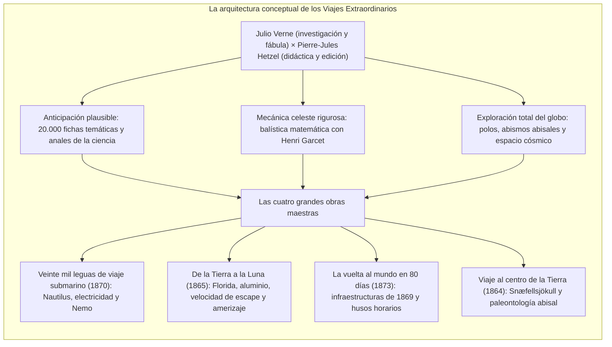
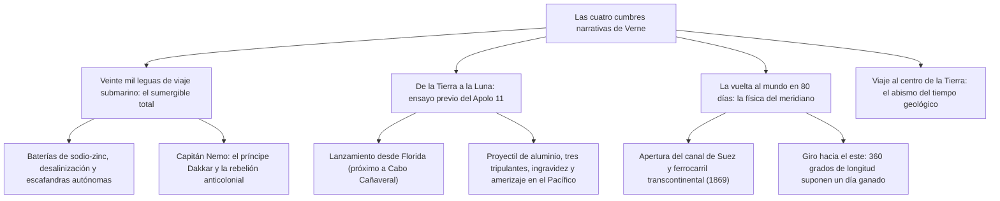

En la segunda mitad del siglo XIX, cuando el vapor, el telégrafo eléctrico y la apertura del canal de Suez transformaron la geografía global, el escritor francés <strong>Julio Verne (1828–1905)</strong> concibió la cartografía fundamental de la imaginación científica moderna.

Aclamado junto con H.G. Wells como el patriarca de la ciencia ficción, Verne trascendió el relato de aventuras mediante su imponente ciclo de los <strong>Viajes Extraordinarios (Voyages Extraordinaires)</strong>: sesenta y dos novelas consagradas a sintetizar en clave narrativa los avances de la geografía, la física, la astronomía y la geología de su tiempo, en fecunda sociedad con el editor <strong>Pierre-Jules Hetzel</strong>.

Desde los pioneros de la astronáutica como <strong>Konstantín Tsiolkovski</strong>, <strong>Robert Goddard</strong> y <strong>Wernher von Braun</strong>, hasta oceanógrafos como <strong>Jacques-Yves Cousteau</strong> y los astronautas del programa Apolo, los forjadores de la ciencia del siglo XX confesaron que sus hazañas germinaron en las páginas de Julio Verne.

---

## 1. El pacto con Hetzel y la creación del canon

Nacido en el puerto fluvial de Nantes en 1828, Verne absorbió desde niño la fascinación por los grandes navíos transoceánicos. Tras estudiar leyes en París y frecuentar los círculos dramáticos de Dumas, vislumbró una corriente literaria virgen: <strong>la novela de anticipación científica</strong>.

En 1862 presentó a <strong>Pierre-Jules Hetzel</strong> el manuscrito de *Cinco semanas en globo*. Hetzel intuyó de inmediato el poder educativo de esa prosa y selló con el autor un contrato para alimentar el *Magasin d'éducation et de récréation*, fijando la producción de dos volúmenes al año para ilustrar a la sociedad burguesa en los principios del método científico.

---

## 2. La metodología de la anticipación plausible

La legendaria clarividencia de Verne no descansaba en quimeras esotéricas, sino en un <strong>meticuloso rigor documental y cuantitativo</strong>:
- <strong>El fichero de 20.000 notas:</strong> Verne extractaba sistemáticamente las actas de la Académie des Sciences y revistas como *La Nature*.
- <strong>Cálculos matemáticos con Henri Garcet:</strong> Para *De la Tierra a la Luna*, su primo Henri Garcet, catedrático de matemáticas, calculó la <strong>velocidad de escape</strong> gravitatoria necesaria:

$$v_{\text{esc}} = \sqrt{\frac{2GM}{R}} \approx 11{,}2 \text{ km/s}$$

- <strong>Contraste con H.G. Wells:</strong> Mientras Wells recurría a la fantasía de la *cavorita* (metal antigravitatorio), Verne replicaba: *«Mis máquinas se apoyan en leyes de la física, en hierro y pólvora reales; lo de Wells es pura fábula romántica»*.

---

## 3. Análisis de las cuatro obras fundamentales

### 3.1 *Veinte mil leguas de viaje submarino* (1870)
El <strong>Nautilus</strong> anticipó la ingeniería moderna: propulsión eléctrica total alimentada por sodio extraído del agua de mar, purificación de aire y escafandras autónomas. Su comandante, el capitán Nemo (el príncipe indio Dakkar), transformó las profundidades marinas en un bastión inexpugnable contra la tiranía imperial británica.

### 3.2 *De la Tierra a la Luna* (1865) y el programa Apolo
Los paralelismos con la misión del Apolo 11 en 1969 resultan sobrecogedores: emplazamiento del lanzamiento en <strong>Florida</strong>, cápsula de <strong>aluminio ligero</strong>, tripulación de <strong>tres astronautas</strong>, velocidad parabólica de <strong>11,2 km/s</strong>, experiencia de ingravidez y <strong>amerizaje en el océano Pacífico</strong> con rescate naval militar.

### 3.3 *La vuelta al mundo en ochenta días* (1873)
La travesía de Phileas Fogg se apoya en los grandes hitos de 1869 (canal de Suez y tren transcontinental). Su desenlace constituye una lección magistral de cinemática astronómica: al marchar hacia el oriente, el viajero se anticipa a las rotaciones solares, ganando exactamente 24 horas al cruzar la totalidad de los husos horarios.

---

## 4. El giro crepuscular: del optimismo al pesimismo distópico

Afectado por la guerra franco-prusiana y el declive personal, el optimismo inicial de Verne derivó hacia una lúcida amargura ante los peligros de la tecnocracia:
- <strong>París en el siglo XX (escrita en 1863, hallada en 1994):</strong> Describe el París de 1960 dominado por redes de fax, calculadoras y coches de gas, donde la poesía y las humanidades han sido extirpadas en aras de un capitalismo frío y deshumanizado.
- <strong>Ante la bandera (1896):</strong> El fulgurador ideado por el químico Thomas Roch prefigura los misiles teledirigidos y el chantaje de las armas de destrucción masiva.

---

## 5. El legado imperecedero

En 1954, la marina estadounidense bautizó como <strong>USS Nautilus</strong> al primer submarino atómico del planeta. En 1968, los astronautas del Apolo 8 homenajearon a Verne desde la órbita de la Luna.

Su inmortal aforismo resume la aventura del saber humano: <strong>«Todo lo que un hombre es capaz de imaginar, otros hombres serán capaces de realizarlo.»</strong>
