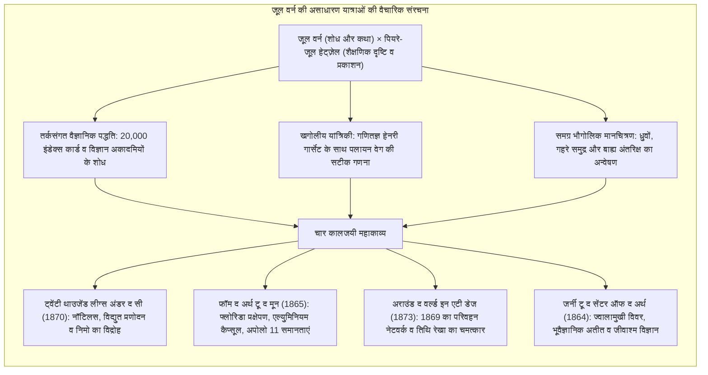
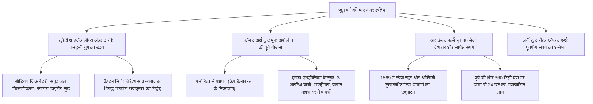

उन्नीसवीं सदी के उत्तरार्ध में, जब भाप के इंजन, इलेक्ट्रिक टेलीग्राफ और स्वेज नहर ने पृथ्वी की भौगोलिक दूरियों को समेट दिया, फ्रांसीसी उपन्यासकार <strong>जूल वर्न (1828–1905)</strong> ने आधुनिक तकनीकी कल्पना का वैश्विक मानचित्र तैयार किया।

एच.जी. वेल्स के साथ आधुनिक विज्ञान कथा के जनक माने जाने वाले वर्न ने अपने 62 उपन्यासों के महाकाव्यात्मक चक्र <strong>'एक्स्ट्राऑर्डिनरी वॉयेजेस' (Voyages Extraordinaires)</strong> के माध्यम से भूगोल, खगोल विज्ञान, भौतिकी और भूविज्ञान के समकालीन ज्ञान को साहसिक उपन्यासों में समाहित किया। प्रकाशक <strong>पियरे-जूल हेट्ज़ेल</strong> के मार्गदर्शन में यह परियोजना मानवता के वैज्ञानिक प्रबोधन का महान दस्तावेज़ बन गई।

रॉकेट विज्ञान के प्रणेता <strong>कॉन्स्टेंटिन त्सिओल्कोवस्की</strong>, <strong>रॉबर्ट गोडार्ड</strong> और <strong>वर्नर वॉन ब्रौन</strong> से लेकर गहरे समुद्र के खोजकर्ता <strong>जैक्स-यवेस कस्टो</strong> और अपोलो 11 के अंतरिक्ष यात्रियों तक, 20वीं सदी के वैज्ञानिकों ने सर्वसम्मति से स्वीकारा: *«हमारे सपनों की उत्पत्ति जूल वर्न के पन्नों में हुई थी»*।

---

## 1. हेट्ज़ेल से भेंट और 'असाधारण यात्राओं' का उदय

1828 में नांत के बंदरगाह पर जन्मे वर्न बचपन से ही महासागरीय जहाजों को देखकर मुग्ध होते थे। पेरिस में कानून की पढ़ाई और अलेक्जेंड्रे ड्यूमा के साथ नाट्य लेखन के बाद, उन्होंने <strong>वैज्ञानिक साहसिक उपन्यास (Roman Scientifique)</strong> की नई विधा की नींव रखी।

1862 में उन्होंने *फाइव वीक्स इन अ बैलून* की पांडुलिपि प्रकाशक <strong>पियरे-जूल हेट्ज़ेल</strong> को सौंपी। हेट्ज़ेल ने युवाओं में वैज्ञानिक चेतना जागृत करने के उद्देश्य से वर्न के साथ दीर्घकालिक अनुबंध किया, जिसके तहत वर्न ने प्रतिवर्ष दो उपन्यास लिखे।

---

## 2. वैज्ञानिक कार्यप्रणाली: 20,000 कार्ड और हेनरी गार्सेट

वर्न की भविष्यवाणियां किसी रहस्यमयी अंतर्ज्ञान पर नहीं, बल्कि गहन वैज्ञानिक अध्ययन पर आधारित थीं:
- <strong>20,000 संदर्भ कार्ड:</strong> वर्न प्रतिदिन विज्ञान पत्रिकाओं और भौगोलिक शोधपत्रों का गहन अध्ययन करते थे।
- <strong>हेनरी गार्सेट की कक्षीय गणनाएं:</strong> *फ्रॉम द अर्थ टू द मून* के लिए उनके चचेरे भाई और गणित के प्राध्यापक हेनरी गार्सेट ने न्यूटन के नियमों के आधार पर पृथ्वी का <strong>पलायन वेग</strong> निकाला:

$$v_{\text{esc}} = \sqrt{\frac{2GM}{R}} \approx 11.2 \text{ km/s}$$

- <strong>एच.जी. वेल्स से तुलना:</strong> वेल्स ने *द फर्स्ट मेन इन द मून* में गुरुत्वाकर्षण रोधी काल्पनिक धातु 'केवोराइट' बनाई, जिस पर वर्न ने कहा: *«मेरी रचनाएं वास्तविक भौतिक नियमों और लोहे-बारूद पर आधारित हैं। वेल्स विशुद्ध कल्पना रचते हैं, जो विज्ञान नहीं है»*।

---

## 3. चार युगांतरकारी कृतियों का विश्लेषण

### 3.1 *ट्वेंटी थाउजेंड लीग्स अंडर द सी* (1870)
पनडुब्बी <strong>नॉटिलस</strong> समुद्र के जल से सोडियम निकालकर बनाई गई बैटरियों द्वारा पूर्णतः विद्युत चालित थी। कैप्टन निमो (1857 के सिपाही विद्रोह में परिवार गंवाने वाले भारतीय राजकुमार डक्कार) ने समुद्र की अतल गहराइयों को साम्राज्यवादी अत्याचारों से मुक्त स्वायत्त क्षेत्र बना लिया था।

### 3.2 *फ्रॉम द अर्थ टू द मून* (1865) और अपोलो 11
1969 के अपोलो 11 मिशन से इसकी समानताएं विस्मयकारी हैं: प्रक्षेपण स्थल <strong>फ्लोरिडा</strong>, अंतरिक्ष यान का निर्माण <strong>हल्के एल्युमिनियम</strong> से, चालक दल में <strong>तीन यात्री</strong>, आवश्यक गति <strong>11.2 किमी/सेकंड</strong>, भारहीनता का अनुभव, और <strong>प्रशांत महासागर में स्प्लैशडाउन</strong> व नौसेना द्वारा बचाव।

### 3.3 *अराउंड द वर्ल्ड इन एटी डेज* (1873)
1869 के वैश्विक बुनियादी ढांचे के निर्माण से यह यात्रा संभव हुई। कहानी का चरमोत्कर्ष खगोलीय भौतिकी पर टिका है: पूर्व दिशा में यात्रा करते हुए 360 डिग्री देशांतर पार करने से यात्रियों को 24 घंटे (एक अतिरिक्त दिन) का लाभ हुआ।

---

## 4. उत्तरकालीन निराशावाद: तकनीकी डिस्टोपिया की चेतावनी

1870 के युद्ध के बाद वर्न का वैज्ञानिक आशावाद गंभीर निराशावाद में बदल गया:
- <strong>पेरिस इन द ट्वेंटिएथ सेंचुरी (1863 में लिखित, 1994 में प्रकाशित):</strong> 1960 के पेरिस में मेट्रो, फैक्स और कंप्यूटर का सटीक चित्रण किया गया, परंतु मानवीय संवेदनाओं और साहित्य के विनाश का दर्दनाक डिस्टोपिया दिखाया गया।
- <strong>फेसिंग द फ्लैग (1896):</strong> सुपर-विस्फोटक 'फुल्गुरेटर' का आविष्कार सामूहिक विनाश के हथियारों और आधुनिक परमाणु ब्लैकमेल की भयावह भविष्यवाणी करता है।

---

## 5. जूल वर्न की शाश्वत विरासत

1954 में विश्व की प्रथम परमाणु पनडुब्बी का नाम <strong>USS नॉटिलस</strong> रखा गया। 1968 में अपोलो 8 के अंतरिक्ष यात्रियों ने चंद्रमा की कक्षा से जूल वर्न को आधिकारिक श्रद्धांजलि दी।

उनकी समाधि पर उत्कीर्ण अमर वाक्य आज भी मानवता का मार्गदर्शन करता है: <strong>«जो कुछ एक मनुष्य सोच सकता है, दूसरे मनुष्य उसे अवश्य साकार कर सकते हैं»</strong>।
