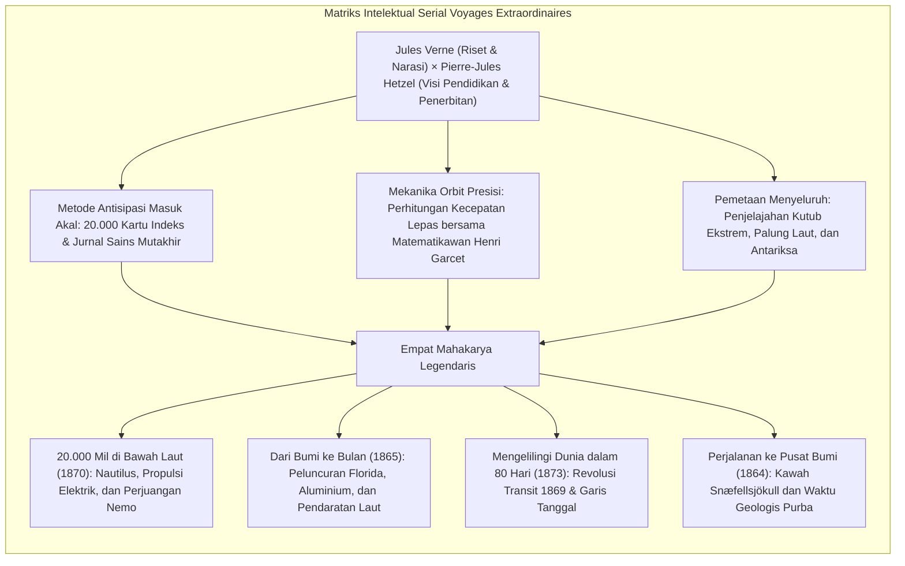
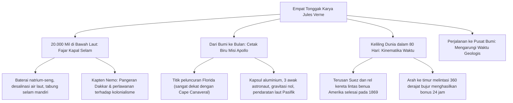

Pada paruh kedua abad ke-19, ketika lokomotif uap, telegraf kabel bawah laut, dan Terusan Suez memampatkan ruang geografis bumi, sastrawan Prancis <strong>Jules Verne (1828–1905)</strong> merancang arsitektur imajinasi sains modern dunia.

Dihormati bersama H.G. Wells sebagai bapak fiksi ilmiah modern, Verne mempersembahkan mahakarya monumental melalui serial <strong>Voyages Extraordinaires (Perjalanan Luar Biasa)</strong>: 62 novel panjang yang memadukan data astronomi, geologi, oseanografi, dan termodinamika mutakhir ke dalam kisah petualangan berbobot ilmiah tinggi di bawah bimbingan penerbit <strong>Pierre-Jules Hetzel</strong>.

Mulai dari peletak dasar astronautika modern seperti <strong>Konstantin Tsiolkovsky</strong>, <strong>Robert H. Goddard</strong>, dan <strong>Wernher von Braun</strong>, hingga penjelajah samudra legendaris <strong>Jacques-Yves Cousteau</strong> dan para astronaut Apollo 11, para pionir penjelajah abad ke-20 bersaksi serempak: *impian kami bermula dari lembaran buku Jules Verne*.

---

## 1. Kemitraan Hetzel dan Visi Edukasi Modern

Lahir di kota pelabuhan Nantes pada tahun 1828, Verne tumbuh dengan menyaksikan kapal layar samudra. Setelah menempuh studi hukum di Paris dan berkecimpung di panggung teater, Verne mencetuskan gagasan inovatif: <strong>roman ilmiah antisipasi (Roman Scientifique)</strong>.

Pada 1862, naskah *Lima Minggu di Atas Balon Udara* diterima oleh penerbit <strong>Pierre-Jules Hetzel</strong>. Hetzel segera mengikat Verne dalam kontrak jangka panjang untuk majalah *Magasin d'éducation et de récréation*, dengan misi mencerdaskan pemuda melalui integrasi ilmu pengetahuan empiris dan drama petualangan.

---

## 2. Metodologi Sains Verne: 20.000 Kartu Catatan dan Henri Garcet

Kemampuan prediksi Verne berakar pada riset pustaka yang mendalam dan kalkulasi fisik:
- <strong>Arsip 20.000 Kartu Catatan:</strong> Verne mencatat perkembangan harian dari buletin Académie des Sciences dan jurnal ilmiah terkemuka.
- <strong>Kalkulasi Orbit Henri Garcet:</strong> Untuk novel *Dari Bumi ke Bulan*, sepupunya yang merupakan profesor matematika, Henri Garcet, menghitung <strong>kecepatan lepas (escape velocity)</strong> secara presisi:

$$v_{\text{esc}} = \sqrt{\frac{2GM}{R}} \approx 11{,}2 \text{ km/detik}$$

- <strong>Perbandingan dengan H.G. Wells:</strong> Verne mengkritik konsep logam antigravitasi 'Cavorite' buatan Wells: *«Mesin saya berdiri di atas hukum fisika dan perhitungan metalurgi nyata. Wells menciptakan fantasi murni tanpa dasar mekanika ilmiah.»*

---

## 3. Empat Pilar Mahakarya Verne

### 3.1 *20.000 Mil di Bawah Laut* (1870)
Kapal selam <strong>Nautilus</strong> digerakkan sepenuhnya oleh tenaga listrik dari baterai natrium-seng yang diekstraksi dari air laut, dilengkapi lampu sorot busur listrik dan tabung pernapasan mandiri. Kapten Nemo (Pangeran Dakkar yang kehilangan keluarga akibat kebrutalan kolonial Inggris di India) menjadikan kedalaman samudra sebagai suaka kebebasan mutlak dari tirani kekuasaan daratan.

### 3.2 *Dari Bumi ke Bulan* (1865) dan Apollo 11
Kemiripan dengan misi Apollo 11 tahun 1969 sangat menakjubkan: lokasi peluncuran di <strong>Florida</strong>, kapsul dari logam ringan <strong>aluminium</strong>, awak berjumlah <strong>tiga orang</strong>, kecepatan luncur <strong>11,2 km/s</strong>, sensasi bobot nol, dan <strong>pendaratan di Samudra Pasifik (splashdown)</strong> dengan evakuasi armada angkatan laut Amerika Serikat.

### 3.3 *Mengelilingi Dunia dalam 80 Hari* (1873)
Ekspedisi kilat Phileas Fogg dimungkinkan berkat selesainya Terusan Suez dan rel transkontinental AS pada 1869. Klimaks kisah ini bertumpu pada mekanika astronomi: melaju ke timur melintasi 360 derajat bujur membuat penjelajah menyongsong matahari lebih cepat, sehingga memperoleh keuntungan waktu satu hari penuh (24 jam) saat tiba di London.

---

## 4. Pergeseran Pandangan: Menuju Pesimisme Distopia

Tragedi Perang Prancis-Prusia 1870 dan pengalaman getir kehidupan mengubah optimisme awal Verne menjadi peringatan keras terhadap bahaya teknokrasi:
- <strong>Paris di Abad ke-20 (ditulis 1863, diterbitkan 1994):</strong> Menggambarkan Paris tahun 1960 yang dijejali kereta layang, mesin faksimili, dan kalkulator mekanik, namun sastra dan kemanusiaan dilenyapkan oleh kapitalisme mekanis yang dingin.
- <strong>Menghadapi Sang Saka (1896):</strong> Penemuan roket peledak dahsyat *Fulgurator* oleh kimiawan Thomas Roch memperingatkan umat manusia akan ancaman senjata pemusnah massal dan pemerasan nuklir modern.

---

## 5. Warisan Abadi Jules Verne

Pada 1954, kapal selam nuklir pertama di dunia dinamai <strong>USS Nautilus</strong>. Pada Desember 1968, awak Apollo 8 menyiarkan penghormatan resmi kepada Jules Verne dari orbit bulan.

Semboyan terkenalnya abadi di tugu makamnya: <strong>«Apa pun yang sanggup dibayangkan oleh manusia, manusia lain pasti sanggup mewujudkannya.»</strong>
