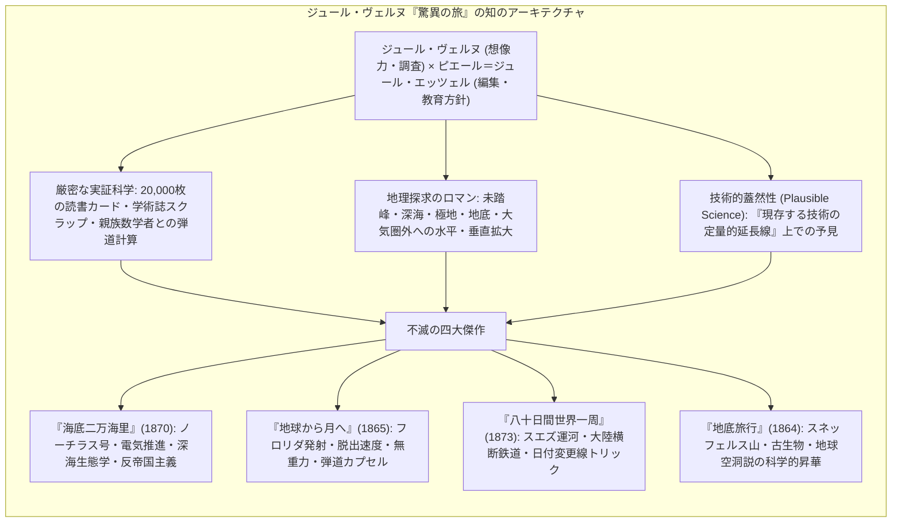
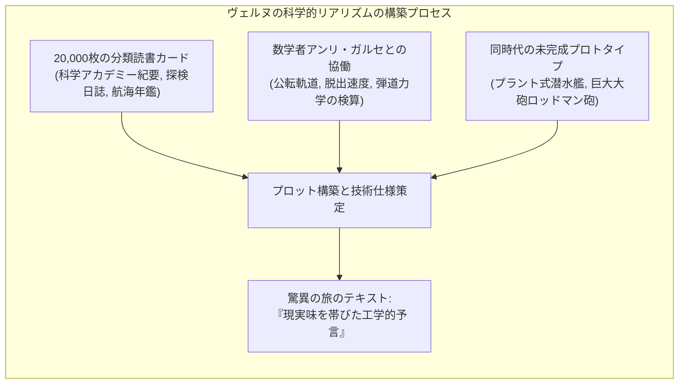
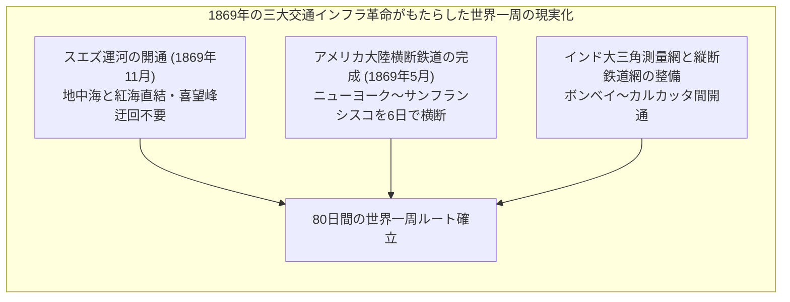
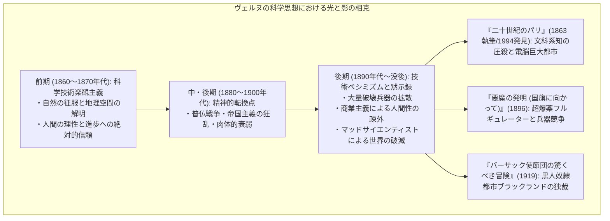
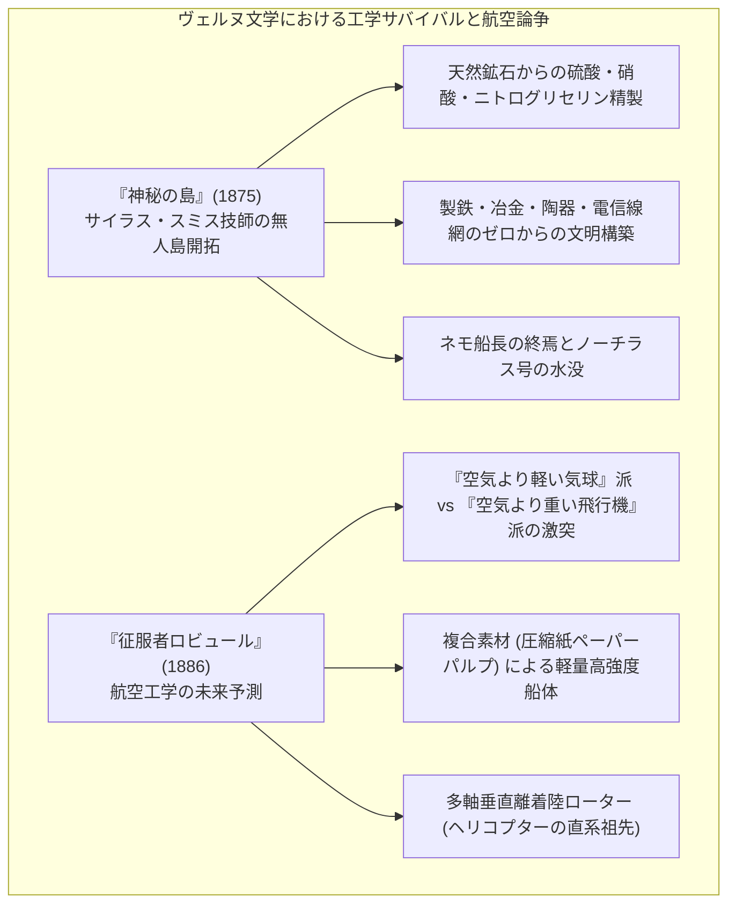
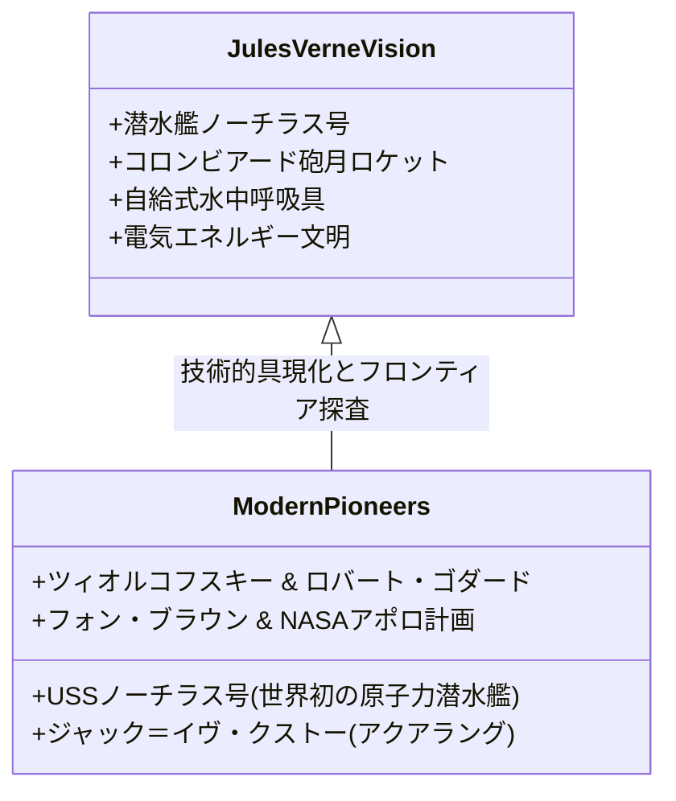

19世紀後半、人類が蒸気機関、電信網、大陸横断鉄道、スエズ運河によって地球規模の地理的空間を一気に圧縮し、産業革命の圧倒的推進力のもとで「自然の完全征服」を夢見ていた時代に、世界中の読者を未踏の極限世界へと誘った不世出の巨人がいました。フランスの作家<strong>ジュール・ヴェルヌ（Jules Verne, 1828–1905）</strong>です。

ヴェルヌが生涯を通じて著した全62編の長編小説と18編の短編・エッセイからなる壮大な連作集<strong>『驚異の旅（Voyages Extraordinaires）』</strong>は、単なる通俗的な冒険活劇ではありません。それは、当時の最先端を行く天文学、海洋学、地質学、熱力学、電気工学のデータを緻密に織り込み、<strong>「人間理性による世界の可視化と地理教育」</strong>を目指した人類知の記念碑的プロジェクトでした。

宇宙船アポロ11号で人類初の月面着陸を果たしたニール・アームストロング、近代ロケット工学の父コンスタンチン・ツィオルコフスキーやロバート・ゴダード、深海探査の先駆者ジャック＝イヴ・クストーに至るまで、20世紀以降の科学技術フロンティアを切り拓いた無数の先駆者たちが「我々の夢の原点はジュール・ヴェルヌにあった」と異口同音に証言しています。

ヴェルヌの文学は、いかにして「未来の青写真」を描き出し、そして科学技術の傲慢がもたらす破滅の影を予見したのでしょうか。

---

## 1. エッツェルとの邂逅と『驚異の旅』の構想

ジュール・ヴェルヌの文学的達成は、名編集者・出版者である<strong>ピエール＝ジュール・エッツェル（Pierre-Jules Hetzel, 1814–1886）</strong>との歴史的協力関係なしには語れません。

### 1.1 ナントの港からパリの文学座へ

1828年、フランス西部の港町ナントに生まれたヴェルヌは、ロワール川を行き交う大西洋航路の帆船や蒸気船を眺めながら育ちました。法律家としての道を歩ませようとする厳格な弁護士の父の意に反し、パリで法律を学びながらも演劇や文学に熱中し、アレクサンドル・デュマ父子と親交を結んで劇場用の戯曲を執筆していました。

当時のフランス文壇において主流であったロマン主義小説や風俗小説に飽き足らなかったヴェルヌは、<strong>「地理学・物理学・探検史の最新知識をプロットに融合させた、まったく新しい形式の小説」</strong>を着想します。1862年、気球によるアフリカ横断を描いた原稿『気球に乗って五週間（Cinq semaines en ballon）』をエッツェルの出版社に持ち込んだことが、彼の運命を決定づけました。

### 1.2 エッツェルの教育的マニフェスト

バルザックやジョルジュ・サンドの版元でもあった慧眼の出版者エッツェルは、ヴェルヌの才能を一目で見抜き、20年間の専属長期契約を締結しました。エッツェルは自ら創刊した『教育娯楽雑誌（Magasin d'éducation et de récréation）』の創刊号において、『驚異の旅』シリーズの壮大なマニフェストを宣言しています：

> 「この連作の目的は、現代科学によって蓄積された地理学、地質学、物理学、天文学のすべての知識を総括し、独自の魅力的な物語形式の中に再構成することである。これによって、全地球、いや全宇宙の驚異の旅を読者に追体験させるのだ。」

ヴェルヌとエッツェルは、1年に長編2編という驚異的な執筆ペースを維持しながら、フランス第三共和政下の少年少女や一般大衆に「科学する精神」を啓蒙する国民的プロジェクトを推進していきました。

---

## 2. 驚異的先見性の秘密：ヴェルヌの科学的方法論

ジュール・ヴェルヌが「予言者」と呼ばれる理由は、彼が超能力やオカルティックな直観を持っていたからではありません。その先見性の正体は、<strong>「圧倒的な文献調査」</strong>と<strong>「現存する科学原理の極限までの定量的延長」</strong>にありました。

### 2.1 20,000枚の読書カードと科学雑誌のスクラップ

ヴェルヌのアミアンの書斎には、当時のフランス科学アカデミーの会報、地理学会紀要、科学普及雑誌『ラ・ナチュール（La Nature）』、英仏の新聞記事から几帳面に切り抜かれた<strong>20,000枚を超える読書カード</strong>が分類保管されていました。

ヴェルヌは毎朝5時に起床し、昼までの数時間を新刊の学術書や論文の精読に費やしました。彼が描いた技術のほぼすべては、<strong>「当時の実験室ですでに理論的・基礎的に実証されていた技術の、スケールアップと統合」</strong>だったのです。

### 2.2 親族数学者アンリ・ガルセによる厳密な軌道計算

『地球から月へ』および『月世界へ行く』を執筆するにあたり、ヴェルヌは従兄弟でありリセ・アンリ4世校の著名な数学教授であった<strong>アンリ・ガルセ（Henri Garcet, 1815–1871）</strong>に協力を要請しました。

ガルセは、ニュートンの万有引力の法則に基づき、地球の重力圏を脱出して月に到達するために必要な<strong>第二宇宙速度（脱出速度）</strong>を厳密に計算しました：

$$v_{	ext{esc}} = \sqrt{rac{2GM}{R}} pprox 11.2 	ext{ km/s} \quad (36,700 	ext{ フィート/秒})$$

作中では、ケンブリッジ天文台の回答書という体裁をとり、砲弾の口径、大砲コロンビアード号の長さ（900フィート）、装薬量（綿火薬40万ポンド）に至るまで、当時の物理学水準において寸分の狂いもない数式とデータが記載されています。この数学的誠実さこそが、物語に圧倒的な説得力を付与したのです。

### 2.3 H.G.ウェルズとの方法論的対比

ヴェルヌと同時代に「SFの父」と並び称されたイギリスの<strong>H.G.ウェルズ（H.G. Wells, 1866–1946）</strong>との対比は、ヴェルヌの科学観を理解する上で極めて示唆的です。

| 比較項目 | ジュール・ヴェルヌ（Jules Verne） | H.G.ウェルズ（H.G. Wells） |
|---|---|---|
| <strong>文学ジャンル</strong> | 科学的驚異小説（Roman Scientifique / Anticipation） | 科学ロマンス（Scientific Romance / 思考実験） |
| <strong>科学的根拠</strong> | 現存する力学・電磁気学・工学の定量的延長 | 架空の物質や法則の導入（重力遮断物質ケイヴォライト、時間移動機） |
| <strong>推進力</strong> | 巨大大砲（弾道力学）、電気蓄電池、圧縮空気 | 反重力、不可視化薬、熱線兵器 |
| <strong>作家の自負</strong> | 「私の船は実在する鉄板と機械でできている」 | 「科学的仮説をテコにした社会・哲学的寓話の創出」 |

ヴェルヌは晩年、ウェルズの『月世界最初の人間（The First Men in the Moon, 1901）』を評して次のように述べています：

> 「私は物理学の法則に反しない方法で月へ行った。私のコロンビアード砲は実在する火薬と鉄の計算に基づいている。しかしウェルズ氏は『ケイヴォライト』という重力を遮断する架空の金属を発明して飛んでいく。彼の手法は純粋なファンタジーであり、私の科学的探求とは根本的に異なる。」
---

## 3. 四大傑作の解剖：予言はいかにして現実となったか

『驚異の旅』シリーズの頂点に位置する四大傑作は、19世紀の技術的フロンティアを正確に照射し、20世紀以降の科学的現実を驚くべき精度で予見していました。

### 3.1 『海底二万海里』：ノーチラス号の工学とネモ船長のアナーキズム

1870年に発表された『海底二万海里（Vingt mille lieues sous les mers）』は、海洋文学とSFが奇跡的な融合を遂げた不朽の金字塔です。

#### 工学的リアリズム：完全電化された潜水艦
ヴェルヌが描いた潜水艦<strong>ノーチラス号（Nautilus）</strong>は、当時まだ蒸気機関や手動クランクで辛うじて潜航していた原始的な潜水艇（アメリカ南北戦争のハンリー号やフランス海軍のプロンジュール号）を遥かに超越していました：
- <strong>電気推進システム：</strong> ネモ船長は「すべては電気によって動く（Mobilis in mobile）」と宣言します。動力源は、海水から豊富に抽出できるナトリウムと亜鉛を用いた<strong>巨大なナトリウム＝亜鉛ガルバニ一次電池</strong>でした。
- <strong>生命維持と航法装置：</strong> 海水を電気蒸留する淡水化装置、圧縮空気を充填した潜水ボンベ（ルカイロール・ドゥヌールーズ式自給式呼吸器の発展形）、電球による強力な探照灯、遠隔圧力計。
- <strong>深海生態学の先駆：</strong> ピエール・アロナックス教授の眼を通して語られる深海生物の生態、熱水噴出孔のような海底火山活動、サンゴ礁の生息圏の記述は、当時の海洋生物学の最高水準を反映していました。

#### 政治哲学的深度：ネモ船長のアナーキズムと反植民地主義
ネモ船長（Captain Nemo：ラテン語で「誰でもない者」）は、単なる偏屈な隠遁者ではありません。続編『神秘の島（L'Île mystérieuse, 1875）』で明かされる彼の正体は、大英帝国の過酷な植民地支配によって祖国と妻子を奪われた<strong>インドのマハラジャの遺児ダカール王子（Prince Dakkar）</strong>でした。

ネモにとって、深海とは<strong>「地上の専制君主や帝国主義国家の主権が一切及ばない、唯一残された絶対的自由の聖域」</strong>でした。彼は海底の沈没船から回収した莫大な金銀財宝を、ギリシャ独立戦争をはじめとする世界各地の被抑圧民族の解放闘争へ秘密裏に提供していました。科学技術を権力の道具としてではなく、<strong>「帝国主義的抑圧からの完全な脱出と自由の獲得」</strong>のために行使するネモの姿は、ヴェルヌ文学における最も高潔かつ悲劇的な反英雄像です。

---

### 3.2 『地球から月へ』とアポロ計画の奇跡的暗合

1865年の『地球から月へ（De la Terre à la Lune）』および1870年の『月世界へ行く（Autour de la Lune）』においてヴェルヌが提示した宇宙旅行のディテールは、100余年後の1969年に実現した<strong>NASAのアポロ11号計画と鳥肌が立つほどの暗合</strong>を示しています。

| 比較項目 | ヴェルヌの予言（1865年） | NASA アポロ計画（1968〜1969年） |
|---|---|---|
| <strong>発射場所</strong> | アメリカ・フロリダ州タンパ近郊（ストーンズ・ヒル） | アメリカ・フロリダ州ケネディ宇宙センター（メリット島） |
| <strong>地理的選定理由</strong> | 地球自転の遠心力を最大限に利用できる赤道に近い低緯度地域 | 全く同一の物理的理由（自転速度の付加速度獲得） |
| <strong>砲弾・宇宙船の素材</strong> | <strong>アルミニウム</strong>（当時極めて高価だった新素材の先駆的採用） | <strong>アルミニウム合金</strong>（極限の軽量化と強度の両立） |
| <strong>乗組員の人数</strong> | <strong>3名</strong>（バービケイン、ニコル、ミシェル・アルダン） | <strong>3名</strong>（アームストロング、オルドリン、コリンズ） |
| <strong>脱出初速度</strong> | <strong>11.2 km/s</strong>（秒速36,700フィート） | <strong>約11.2 km/s</strong>（第二宇宙速度に完全に一致） |
| <strong>帰還方式</strong> | 太平洋上への<strong>着水（スプラッシュダウン）</strong> | 太平洋上への<strong>着水（スプラッシュダウン）</strong> |
| <strong>回収部隊</strong> | アメリカ海軍の軍艦（コルベット艦サスケハナ号） | アメリカ海軍の空母（USSホーネット等） |

ヴェルヌは、発射時の凄まじい衝撃（数百G）に対する緩衝装置として「水圧緩衝ピストン」を考案し、宇宙空間での姿勢制御に「小型逆噴射ロケット」の理論的着想を盛り込みました。また、地球と月の引力が正確に拮抗する中立点において乗組員が体験する<strong>無重力状態（無重量現象）</strong>の物理的描写は、近代宇宙物理学の精緻な予行演習そのものでした。

---

### 3.3 『八十日間世界一周』：交通革命とグローバル時空の圧縮

1873年に発表された『八十日間世界一周（Le Tour du monde en quatre-vingts jours）』は、ヴェルヌの生きた19世紀後半における<strong>「グローバリゼーションの黎明」</strong>を祝福した傑作です。

主人公フィリアス・フォッグは、時計の秒針のように正確で無感情な英国紳士であり、<strong>「近代機械文明の合理主義的人格」</strong>を具現化しています。

この物語の最大の白眉は、結末における<strong>「日付変更線の物理的トリック」</strong>です。ロンドンを出発して東へ東へと進んだフォッグ一行は、太陽の運行と逆方向に進むことで、<strong>「自転1回転ごとに太陽を1回多く横切る（見かけの昼夜が1回多くなる）」</strong>ため、ロンドンに到着した瞬間、自分たちの暦より現実のロンドンが1日進んでいたことに土壇場で気づきます。

$$\Delta t = \frac{360^\circ}{15^\circ/\text{時間}} = 24 \text{ 時間} = 1 \text{ 日}$$

時間という物理的実体が、地球の幾何学と移動速度の関数として相対化されるこの結末は、地球規模の通信・交通網が敷設された時代だからこそ成立した、天体力学と地理学の最高峰の知恵比べでした。

---

### 3.4 『地底旅行』：地球内部の垂直探査と深層時間

1864年の『地底旅行（Voyage au centre de la Terre）』において、ヴェルヌは探査のベクトルを宇宙や海洋といった水平方向から、地球の内部という<strong>「垂直方向の深層時間（Deep Time）」</strong>へと転換しました。

アイスランドの休火山スネッフェルス山の火口から侵入したリーデンブロック教授と甥のアクセルは、地下深く降下するにつれて、地質年代の層を逆行していきます。
- 炭骨紀の巨大シダ類が生い茂る地下の森
- 巨大な地底海（リーデンブロック海）
- 中生代の海棲爬虫類<strong>イクチオサウルスとプレシオサウルスの死闘</strong>

当時確立されつつあったチャールズ・ライエルの斉一説地質学や、古生物学の知見を物語に組み込むことで、ヴェルヌは読者に「地球という天体が内包する数十億年の記憶」を体感させました。

---

## 4. ヴェルヌの思想的変遷：技術楽観主義から破滅的ペシミズムへ

ヴェルヌは生涯を通じて単なる「技術賛美の預言者」にとどまり続けたわけではありません。彼の作家キャリアは、エッツェルが生きていた前期の明るい科学啓蒙主義から、普仏戦争の敗北、私生活の悲劇（甥による狙撃事件で片足を負傷）、そして老いとともに、<strong>「制御を失った技術文明がもたらす破滅」を見据える暗鬱なペシミズム</strong>へと劇的に深化していきました。

### 4.1 封印された黙示録：『二十世紀のパリ』の衝撃

ヴェルヌの真の予見性の恐ろしさを証明するのが、1863年に執筆されながら編集者エッツェルから「あまりに暗く荒唐無稽で売れない」と猛反対されて金庫に封印され、130年後の1994年に曾孫によって発見・出版された幻の処女作<strong>『二十世紀のパリ（Paris au XXe siècle）』</strong>です。

1960年のパリを描いたこの作品で、ヴェルヌが予言した近代都市の光景は背筋が凍るほど現代と一致しています：
- ガソリン内燃機関と圧縮空気で走る無数の自動車、高架鉄道網
- 電信網で結ばれた巨大ファックス機と、複雑な計算を瞬時に処理する機械式計算機（電脳ネットワークの先駆）
- 街中を昼夜問わず照らし出す巨大な電光広告
- <strong>精神の荒廃：</strong> 文学、詩、絵画、哲学などの人文知が「経済的利益を生まない無駄」として大学から追放され、社会全体が銀行、証券取引所、工業技術の数字だけに支配された徹底的な物質主義ディストピア。

ヴェルヌは、科学技術が極限まで発展した未来において、人間性が豊かになるどころか、魂の疎外と孤独が極まることを最初から見抜いていたのです。

### 4.2 『悪魔の発明』と大量破壊兵器の脅威

1896年の『悪魔の発明（国旗に向かって / Face au drapeau）』において、ヴェルヌは現代の<strong>核兵器や誘導ミサイルの出現を予見</strong>しました。

天才科学者トマ・ロシュは、あらゆる物質を半径数キロにわたって一瞬で原子分解・粉砕する超爆薬「フルギュレーター（爆発性ロケット）」を発明します。しかし、祖国フランス政府にその価値を認められず精神病院に隔離されたロシュは、海賊ケール・カラジェに拉致され、バミューダの孤島基地で大量破壊兵器を量産し、世界を脅迫する狂気の道具へと身を落とします。

科学者が自己の研究欲と名誉欲に溺れ、その発明がテロリストや軍国主義国家の手に渡ったとき、地球規模の破滅がもたらされるという警告は、20世紀のオッペンハイマーとマンハッタン計画のジレンマをそのまま先取りしていました。

---

---

## 5. 工学サバイバルと航空先駆：『神秘の島』と『征服者ロビュール』

ヴェルヌの科学的想像力は、四大傑作のみにとどまらず、工学技術の実践的応用と未来の航空工学においても極めて先駆的な足跡を残しました。

### 5.1 『神秘の島』：ゼロからの近代化学・治金工学の再現

1875年の大作『神秘の島（L'Île mystérieuse）』は、アメリカ南北戦争の捕虜収容所を気球で脱出し、南太平洋の無人島（リンカーン島）に漂着した5人の男たちによる<strong>「工学サバイバルの最高傑作」</strong>です。

指導者である鉄道技師<strong>サイラス・スミス（Cyrus Smith）</strong>は、近代科学の百科全書的な知恵を駆使し、ポケットナイフ一本持たない丸裸の状態から、わずか数年で島を近代産業基地へと変貌させます：
- <strong>耐火粘土と製陶技術：</strong> 粘土層を発見してレンガを焼き、高熱に耐える反射炉を構築。
- <strong>鉱石の精錬と治金：</strong> 鉄鉱石と石炭を採掘し、木炭ガスと送風機を用いて鉄を精錬、鉄器、ノミ、鋸を自作。
- <strong>化学肥料と火薬の精製：</strong> 海鳥のグアノ（硝石）と硫黄から硫酸を製造し、硝酸を化合させて<strong>ニトログリセリン（ダイナマイトの主成分）</strong>および綿火薬の合成に成功。
- <strong>通信インフラ：</strong> 亜鉛板と銅板を酸に浸した電池を自作し、島の各拠点を結ぶ電信網を敷設。

この物語は、ダニエル・デフォーの『ロビンソン・クルーソー』が持っていた宗教的信仰による孤独の克服を、<strong>「集団的協働作業と近代科学技術による自然の合理的大改造」</strong>へとアップデートした、19世紀産業文明の勝利の叙事詩でした。

### 5.2 『征服者ロビュール』：多翼ヘリコプターと航空宇宙の未来

1886年の『征服者ロビュール（Robur-le-Conquérant）』において、ヴェルヌはライト兄弟の初飛行（1903年）より20年も早く、<strong>「航空工学の歴史的分水嶺」</strong>を正確に描き出しました。

フィラデルフィアの気球愛好家クラブ「ウェルドン協同組合」が「操縦可能な巨大気球」の開発方針を巡って激論を交わす中、謎の技術者ロビュールが乱入し、<strong>「真の飛行は、空気より重い機械によってのみ達成される（Il faut être plus lourd que l'air）」</strong>と熱弁を振るいます。

ロビュールが建造した飛行船<strong>アルトロス号（Albatross）</strong>の工学的仕様は、驚くべき先見性に満ちていました：
1. <strong>複合素材の採用：</strong> 金属フレームの代わりに、ゼラチンとデキストリンで固めた圧縮紙パルプを採用し、軽量性と驚異的な耐衝撃性を両立。
2. <strong>多軸推進ローター：</strong> 37本の垂直マストにそれぞれ二重反転プロペラを配置し、垂直離着陸（VTOL）と高度維持を実現。前後に配置された牽引・推進用プロペラで水平飛行を行う、<strong>現代のマルチコプター型ドローンやヘリコプターの直系プロトタイプ</strong>でした。

### 5.3 『蒸気の家』とスチームパンクの始祖：機械巨象と植民地史の深淵

1880年に発表された『蒸気の家（La Maison à vapeur）』は、今日の<strong>スチームパンク（Steampunk）ジャンルの直接の原点</strong>と評される傑作です。

イギリス軍の退役技師バンクス大佐が設計した<strong>「スチーム・エレファント（The Steam Elephant）」</strong>は、精巧な鋼鉄製の巨象の姿をした蒸気機関車であり、象の胴体内に石炭ボイラーとシリンダーを内蔵し、巨大な牙が排気煙突として機能します。この機械象は、2両の豪華な移動式客車（サロン、寝室、図書室、厨房完備）を牽引しながら、道路なきインド亜大陸の密林やサバンナを踏破し、水上では外輪船のように河川を航行できる水陸両用探検車でした。

この奇抜な冒険活劇の背後には、<strong>1857年のインド大反乱（セポイの乱）</strong>の生々しい歴史的傷痕が横たわっています。機械象の一行を執拗に追撃する宿敵は、反乱の指導者ナナー・サーヒブ（Nana Sahib）であり、大英帝国の過酷な植民地支配に対する先住民の血の復讐と、近代機械文明の軍事力との凄惨な激突が描かれます。科学技術が植民地主義的支配の尖兵として機能する現実を直視した、ヴェルヌ屈指の重厚な歴史科学小説です。

### 5.4 『動く人工島』：巨大海洋メガフロート都市の興亡

1895年の『動く人工島（L'Île à hélice）』において、ヴェルヌは現代の<strong>海洋メガフロート（Megafloat）やメガストラクチャー構想</strong>を完全に先取りしました。

太平洋を周航する巨大な人工島「ミリオン・シティ（Standard Island）」は、長さ7キロメートル、幅5キロメートルに及ぶ巨大な浮体式鋼鉄構造物であり、内部には公園、宮殿、発電所、電信網を備え、左右両舷に配置された数十万馬力の巨大スクリューによって自由に航行することができます。

この島にはアメリカの超富裕層（大資本家）のみが居住を許されており、国家の徴税や政治的混乱から逃れた「究極の人工楽園」として設計されました。しかし、島内の南北の富豪派閥による権力闘争が激化し、双方がスクリューの操縦権を奪い合って逆方向に全力運転させた結果、島は巨大な応力によって真二つに引き裂かれ、太平洋上で自滅します。

ヴェルヌは、<strong>「どれほど超絶的な土木工学的メガストラクチャーを構築しても、人間の強欲と党派的エゴイズムを制御できなければ、その技術そのものが自壊の凶器となる」</strong>という痛烈な社会批評を提示したのです。

## 6. 現代テクノロジーへの直接的影響と科学者たちの証言

ジュール・ヴェルヌが現代の科学探査や技術開発に与えた影響は、単なる文学的インスピレーションを超え、現実の工学史そのものを駆動するエンジンとなりました。

### 5.1 世界初の原子力潜水艦「ノーチラス号」

1954年、アメリカ海軍が就役させた<strong>人類史上初の原子力潜水艦（USS Nautilus, SSN-571）</strong>は、ヴェルヌのノーチラス号に敬意を表して命名されました。核分裂エネルギーによって「空気を一切消費せずに無限に潜航し続ける」この原子力潜水艦は、1958年に歴史上初めて<strong>北極点氷架の下を潜航横断</strong>し、かつてヴェルヌが描いた夢を完全に具現化しました。

### 5.2 宇宙工学の父たちの証言

現代の航空宇宙工学を創始した巨人たちは、揃ってヴェルヌからの影響を公言しています：
- <strong>コンスタンチン・ツィオルコフスキー（ロシアの宇宙工学の父）：</strong>「宇宙旅行という偉大な事業において、私に最初の推進力を与えてくれたのはジュール・ヴェルヌであった。」
- <strong>ロバート・ゴダード（近代ロケットの父）：</strong> 少年時代にヴェルヌの『地球から月へ』を読み、生涯をロケットエンジンの開発に捧げる決意を固めた。
- <strong>ヴェルナー・フォン・ブラウン（サターンVロケット開発者）：</strong>「ヴェルヌの著作を読んだことのない宇宙工学者など、世界中どこを探しても存在しないだろう。」

1968年12月、人類初の有人月周回飛行を達成した<strong>アポロ8号</strong>の船長フランク・ボーマンは、月を周回しながら地球の地上管制センターへ向けて次のような感動的なメッセージを生中継で送りました：

> 「今夜、月を周回する我々が乗るこのカプセルから、1世紀以上も前にこの光景を完璧に描き出していたフランスの偉大な作家、ジュール・ヴェルヌに心からの敬意を捧げたい。」

---

## 7. 結語：夢想の力と現代科学技術へのメッセージ

ジュール・ヴェルヌの残した最も有名な言葉があります：

> <strong>「人間が想像できることは、人間が必ず実現できる（Tout ce qu'un homme est capable d'imaginer, d'autres hommes seront capables de le réaliser.）」</strong>

この言葉は、単なる無責任な技術万能主義の標語ではありません。ヴェルヌの生涯と作品全体を俯瞰するとき、そこには<strong>「人間理性の限界を見極め、自然への畏敬を失わず、技術がもたらす破滅の誘惑に立ち向かい続けること」</strong>という、極めて成熟した知の態度が刻まれています。

私たちが火星探査機の着陸を見守り、深海探査船でマリアナ海溝の最深部を照らし、AIや核融合という新たな天火を制御しようと苦闘するとき、私たちの傍らには常に、あの19世紀の港町ナントで海を見つめていたジュール・ヴェルヌの、好奇心に満ちた誇り高き眼差しが存在しているのです。

ヴェルヌが描いた数々の旅路は、地理的空白が埋め尽くされた地球から、未踏の宇宙、極微の原子、そして情報空間へと拡張し続ける現代の科学探査の道標であり続けています。私たちが新しい技術を手にするたび、問われるのは常に「その技術で人間は何を成し遂げようとするのか」という根本的な哲学です。ジュール・ヴェルヌが遺した『驚異の旅』は、科学への飽くなき憧憬と、倫理的自省を両輪として未来へ漕ぎ出すための、永遠の航海羅針盤なのです。
