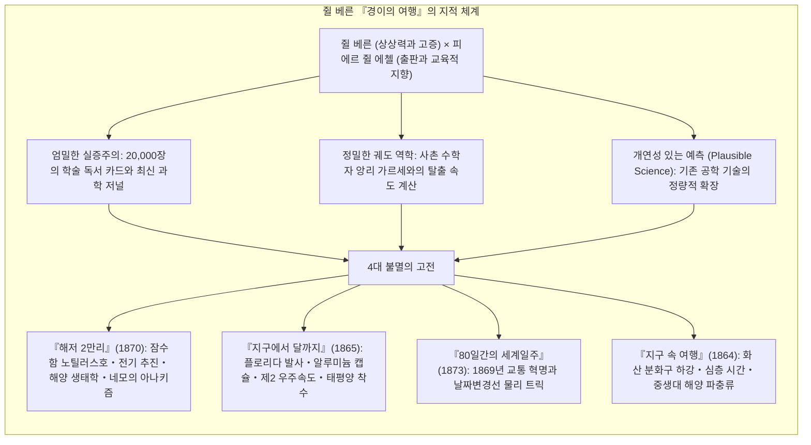
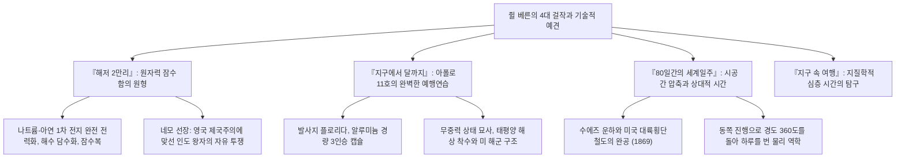

19세기 후반, 증기 기관과 대륙횡단철도, 해저 전신망과 수에즈 운하가 지구의 지리적 시공간을 급격히 압축하고 자연 정복의 열망이 폭발하던 시대에, 전 세계 독자들을 미지의 극지방과 우주로 이끈 거인이 있었습니다. 바로 <strong>'공상과학소설의 아버지' 쥘 베른(Jules Verne, 1828–1905)</strong>입니다.

베른이 평생에 걸쳐 집필한 62편의 장편 소설과 18편의 단편으로 이루어진 기념비적 총서 <strong>『경이의 여행(Voyages Extraordinaires)』</strong>은 단순한 모험담이 아니었습니다. 그것은 당대 최첨단 천문학, 해양학, 지질학, 열역학 데이터를 소설 형식으로 집대성하여 인류 이성의 지평을 넓히고자 했던 <strong>'지리 교육과 과학 계몽의 거대한 프로젝트'</strong>였습니다.

인류 최초로 달에 착륙한 아폴로 11호의 닐 암스트롱, 현대 로켓 공학의 선구자 콘스탄틴 치올콥스키와 로버트 고다드, 심해 탐사의 거장 자크 이브 쿠스토에 이르기까지, 20세기 과학기술의 최전선을 개척한 수많은 인물들이 "우리의 모든 꿈의 원천은 쥘 베른이었다"고 고백했습니다.

---

## 1. 에첼과의 만남과 『경이의 여행』 프로젝트

프랑스 낭트의 항구도시에서 태어난 베른은 범선과 증기선을 보며 미지의 세계에 대한 동경을 키웠습니다. 파리에서 법학을 공부하며 알렉상드르 뒤마와 교유하던 베른은, 당시 유행하던 통속 소설 대신 <strong>"최신 과학과 지리 탐험을 서사와 결합한 완전히 새로운 장르"</strong>를 구상했습니다.

1862년 출판업자 <strong>피에르 쥘 에첼(Pierre-Jules Hetzel)</strong>을 만나 『기구를 타고 5주일』을 출간하면서 그의 운명은 결정되었습니다. 에첼은 프랑스 대중과 청소년에게 합리적 과학 정신을 고양하기 위해 『경이의 여행』을 기획했고, 베른은 매년 2편씩의 소설을 발표하며 40년간 집필을 이어갔습니다.

---

## 2. 쥘 베른의 과학적 방법론: 20,000장의 카드와 앙리 가르세

베른의 놀라운 예지력은 신비로운 직관이 아니라 <strong>압도적인 문헌 조사와 엄밀한 수학적 계산</strong>에서 나왔습니다.
- <strong>20,000장의 독서 카드:</strong> 베른은 매일 아침 과학 아카데미 회보와 지리학회 학술지를 정독하며 기술 데이터를 꼼꼼히 정리했습니다.
- <strong>사촌 수학자 앙리 가르세와의 협업:</strong> 『지구에서 달까지』를 쓸 때 베른은 수학 교수였던 사촌 앙리 가르세에게 의뢰하여 지구 중력을 탈출하는 데 필요한 <strong>제2 우주속도(탈출 속도)</strong>를 뉴턴 역학으로 정밀하게 산출했습니다:

$$v_{\text{esc}} = \sqrt{\frac{2GM}{R}} \approx 11.2 \text{ km/s}$$

- <strong>H.G. 웰스와의 방법론 대결:</strong> 웰스가 중력을 차단하는 가상의 물질 '케이보라이트'를 자유롭게 창작한 반면, 베른은 "내 소설의 기계는 실제 존재하는 철과 화약, 물리 법칙 위에 서 있다"며 기술적 개연성을 고수했습니다.

---

## 3. 4대 걸작의 해부와 현실화된 예언들

### 3.1 『해저 2만리』와 네모 선장의 자유
노틸러스호는 해수에서 추출한 나트륨을 사용하는 배터리로 <strong>완전 전기 추진</strong>을 실현했습니다. 네모 선장은 1857년 인도 세포이 항쟁에서 가족을 잃은 다카르 왕자로서, 지상의 제국주의 국가권력이 미치지 않는 심해에서 절대적 자유를 누리며 억압받는 피식민 민족의 해방 투쟁을 지원합니다.

### 3.2 『지구에서 달까지』와 아폴로 계획의 기적적 일치
베른의 소설은 1969년 아폴로 11호와 경이로울 정도로 일치합니다. 발사 장소는 플로리다주, 선체는 당시 신소재였던 <strong>가벼운 알루미늄</strong>, 탑승 인원은 <strong>3명</strong>, 탈출 속도는 <strong>초속 11.2km</strong>, 귀환 방식은 <strong>태평양 해상 착수(Splashdown)</strong>였으며 미 해군 군함에 의해 구조되었습니다.

### 3.3 『80일간의 세계일주』와 시간의 상대성
1869년 수에즈 운하와 미국 대륙횡단철도의 개통으로 비로소 가능해진 지구 일주. 주인공 포그는 동쪽으로 이동함으로써 매일 해를 일찍 마주하여 <strong>지구 자전에 따라 하루(24시간)를 번다는 날짜변경선의 물리 법칙</strong>을 통해 극적인 승리를 거둡니다.

---

## 4. 후기 사상의 암전: 기술 낙관주의에서 디스트피아로

보불전쟁의 패배와 개인적 비극 속에서 베른의 후기작은 기술 문명의 통제 불능한 파멸을 경고하는 어두운 비관주의로 전환되었습니다:
- <strong>『20세기 파리』(1863년 집필 / 1994년 발견):</strong> 1960년 파리를 무대로 가솔린 자동차, 고가 철도, 팩스 전송망을 정확히 예견했으나, 인문학과 예술이 폐기되고 금융과 기계 물질주의에 영혼을 빼앗긴 차가운 디스토피아를 고발했습니다.
- <strong>『악마의 발명』(1896):</strong> 현대의 유도 미사일과 핵무기를 연상시키는 초강력 폭약 '풀규라토르'를 다루며, 과학자의 맹목적 연구욕이 해적과 군국주의자들의 손에 들어갔을 때 벌어질 지구적 종말을 경고했습니다.

---

## 5. 영원한 유산: 과학 탐사의 길잡이

1954년 세계 최초의 원자력 잠수함은 그의 이름을 기려 <strong>USS 노틸러스호</strong>로 명명되었고, 1968년 아폴로 8호의 우주비행사들은 달 궤도에서 쥘 베른에게 경의를 표했습니다.

<strong>"사람이 상상할 수 있는 모든 것은, 언젠가 다른 사람이 반드시 실현해낼 것이다."</strong> 쥘 베른의 이 위대한 격언은, 오늘도 우리가 우주와 심해, 그리고 지식의 한계를 향해 나아가는 모든 여정의 영원한 나침반이 되고 있습니다.
