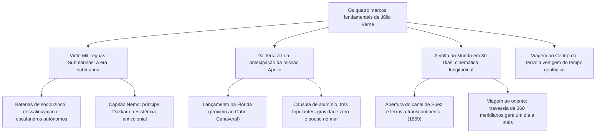

Na segunda metade do século XIX, quando a máquina a vapor, o telégrafo transatlântico e o canal de Suez aceleraram o ritmo da história humana, o romancista francês <strong>Júlio Verne (1828–1905)</strong> desenhou o mapa definitivo da imaginação científica moderna.

Consagrado com H.G. Wells como pioneiro da ficção científica, Verne edificou com a série <strong>Voyages Extraordinaires (Viagens Extraordinárias)</strong> um ambicioso monumento enciclopédico. Ao longo de 62 romances concebidos em diálogo com o editor <strong>Pierre-Jules Hetzel</strong>, Verne sintetizou a geografia, a física balística, a oceanografia e a astronomia em enredos de rigorosa plausibilidade técnica.

De pioneiros da astronáutica como <strong>Konstantin Tsiolkovsky</strong>, <strong>Robert Goddard</strong> e <strong>Wernher von Braun</strong> a exploradores do oceano como <strong>Jacques-Yves Cousteau</strong> e os astronautas do programa Apollo, as mentes que inauguraram a era moderna reconheceram que sua centelha original nasceu nas páginas de Júlio Verne.

---

## 1. A aliança com Hetzel e a criação do projeto

Nascido em Nantes em 1828, Verne contemplava desde a infância o vaivém dos grandes navios no rio Loire. Após estudar direito em Paris e conviver com Alexandre Dumas nos círculos teatrais, concebeu o projeto de fundar <strong>o romance científico moderno</strong>.

Em 1862, entregou o original de *Cinco Semanas em Balão* a <strong>Pierre-Jules Hetzel</strong>. Percebendo o vigor intelectual da narrativa, Hetzel contratou Verne para produzir dois volumes anuais no *Magasin d'éducation et de récréation*, com a meta de apresentar ao público o panorama vivo das ciências exatas.

---

## 2. A metodologia da antecipação plausível

A clarividência verniana erguia-se sobre <strong>rigorosa pesquisa bibliográfica e cálculo matemático</strong>:
- <strong>O arquivo de 20.000 fichas:</strong> Verne colecionava assiduamente extratos da Académie des Sciences e da revista *La Nature*.
- <strong>Henri Garcet e a mecânica newtoniana:</strong> Para calcular o lançamento cósmico em *Da Terra à Lua*, seu primo Henri Garcet, professor de matemática, obteve a <strong>velocidade de escape</strong> exata:

$$v_{\text{esc}} = \sqrt{\frac{2GM}{R}} \approx 11{,}2 \text{ km/s}$$

- <strong>O contraponto a H.G. Wells:</strong> Em resposta a *Os Primeiros Homens na Lua* de Wells, Verne frisava: *«Minhas criações baseiam-se em leis físicas e metalurgia tangível; Wells inventa um metal que anula a gravidade. O método dele é pura fantasia, o meu assenta na física observável.»*

---

## 3. Dissecação das quatro grandes obras-primas

### 3.1 *Vinte Mil Léguas Submarinas* (1870)
O <strong>Nautilus</strong> materializou a engenharia naval de vanguarda: tração totalmente elétrica suprida por baterias de sódio extraído do mar, iluminação a arco e reservatórios de ar comprimido. O capitão Nemo (o príncipe indiano Dakkar) fez dos abismos oceânicos um santuário de liberdade absoluta, financiando insurreições contra impérios opressores.

### 3.2 *Da Terra à Lua* (1865) e a Apollo 11
As correlações com a alunissagem de 1969 são espantosas: disparo na <strong>Flórida</strong>, casco feito de <strong>alumínio</strong>, tripulação de <strong>três homens</strong>, velocidade de <strong>11,2 km/s</strong>, ausência de peso no vácuo e <strong>amerissagem no oceano Pacífico</strong> com recolha por belonaves da marinha americana.

### 3.3 *A Volta ao Mundo em Oitenta Dias* (1873)
Graças à infraestrutura inaugurada em 1869 (canal de Suez e ferrovia transcontinental nos EUA), Phileas Fogg concretizou seu périplo. O desfecho genial traduz as leis do fuso horário: avançando em direção ao leste, o viajante ganha 24 horas ao completar 360 graus de longitude antes de regressar a Londres.

---

## 4. O horizonte sombrio: do entusiasmo à distopia

Abalado pela guerra franco-prussiana de 1870 e por crises existenciais, o autor adotou uma postura cética quanto ao destino da técnica:
- <strong>Paris no Século XX (escrito em 1863, publicado em 1994):</strong> Retrata um 1960 hipertecnológico dominado por trens pneumáticos, aparelhos de fax e calculadoras mecânicas, mas onde as humanidades e as artes foram banidas por uma burocracia desalmada.
- <strong>Face à Bandeira (1896):</strong> Descreve o explosivo de destruição maciça *Fulgurator*, antecipando as tragédias da proliferação bélica e da chantagem planetária.

---

## 5. O legado imorredouro de Júlio Verne

Em 1954, o primeiro submarino nuclear da história foi batizado como <strong>USS Nautilus</strong>. Em 1968, os tripulantes da Apollo 8 enviaram uma transmissão em órbita lunar celebrando a genialidade do escritor francês.

Sua máxima consagrada permanece indelével: <strong>«Tudo o que um homem é capaz de imaginar, outros homens serão capazes de realizar.»</strong>
