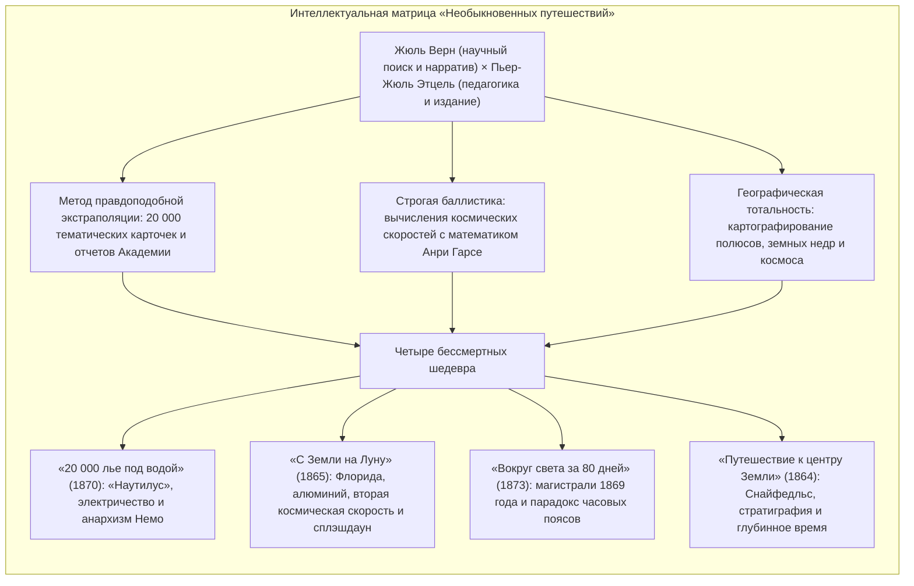

Во второй половине XIX века, когда энергия пара, электрический телеграф и Суэцкий канал сжали планетарные расстояния, французский писатель <strong>Жюль Верн (1828–1905)</strong> заложил фундамент современного технологического воображения.

Почитаемый вместе с Гербертом Уэллсом как отец научной фантастики, Верн создал не просто приключенческие романы, а грандиозную 62-томную серию <strong>«Необыкновенные путешествия» (Voyages Extraordinaires)</strong>. В тесном сотрудничестве с выдающимся издателем <strong>Пьером-Жюлем Этцелем</strong> Верн поставил перед собой беспрецедентную цель: синтезировать в увлекательной романной форме все новейшие географические, физические, геологические и астрономические знания своей эпохи.

От пионеров теоретической и практической космонавтики — <strong>Константина Циолковского</strong>, <strong>Роберта Годдарда</strong> и <strong>Вернера фон Брауна</strong> — до исследователя океанских глубин <strong>Жака-Ива Кусто</strong> и участников лунной экспедиции «Аполлон-11», творцы технологической эры единодушно признавали: *«Наши мечты зародились на страницах книг Жюля Верна»*.

---

## 1. Союз с Этцелем и педагогическая миссия

Родившись в 1828 году в морском порту Нанта, Верн с юных лет грезил океанскими экспедициями. Получив юридическое образование в Париже и вращаясь в театральных кругах Александра Дюма, он осознал наступление эпохи <strong>научного романа (Roman Scientifique)</strong>.

В 1862 году он передал рукопись романа «Пять недель на воздушном шаре» <strong>Пьеру-Жюлю Этцелю</strong>. Издатель Бальзака и Жорж Санд оценил просветительскую силу замысла и заключил с автором долгосрочный договор на два тома в год для журнала *Magasin d'éducation et de récréation*.

---

## 2. Эмпирический метод: 20 000 карточек и Анри Гарсе

Предвидения Верна базировались на строгой математической и физической дисциплине:
- <strong>Картотека из 20 000 записей:</strong> Верн ежедневно изучал отчеты Парижской академии наук и географические вестники.
- <strong>Расчеты Анри Гарсе:</strong> Для романа «С Земли на Луну» его кузен, профессор математики Анри Гарсе, с опорой на механику Ньютона вычислил <strong>вторую космическую скорость</strong> (скорость убегания):

$$v_{\text{esc}} = \sqrt{\frac{2GM}{R}} \approx 11{,}2 \text{ км/с}$$

- <strong>Полемика с Г. Уэллсом:</strong> В ответ на роман Уэллса «Первые люди на Луне» Верн подчеркивал: *«Мои корабли построены из реального металла, пороха и физических законов. Уэллс выдумывает антигравитационный металл кейворит — это поэтическая сказка, а не наука»*.

---

## 3. Разбор четырех великих шедевров

### 3.1 «20 000 лье под водой» (1870)
Подводный корабль <strong>«Наутилус»</strong> предвосхитил технологии XX века: полностью электрический привод на натрий-цинковых элементах, опреснение морской воды и дыхательные аппараты. Капитан Немо (индийский принц Даккар, мстивший британским колонизаторам за гибель семьи) превратил морские глубины в единственное убежище абсолютной свободы от государственной тирании.

### 3.2 «С Земли на Луну» (1865) и программа «Аполлон»
Параллели с миссией «Аполлон-11» 1969 года феноменальны: стартовая площадка во <strong>Флориде</strong>, легкий корпус из <strong>алюминия</strong>, экипаж из <strong>трех человек</strong>, скорость отрыва <strong>11,2 км/с</strong>, невесомость на траектории полета и <strong>приводнение в Тихом океане</strong> с подъемом на борт американского военного корабля.

### 3.3 «Вокруг света за 80 дней» (1873)
Путешествие Филеаса Фогга стало возможным благодаря глобальным инфраструктурным проектам 1869 года (Суэцкий канал и железная дорога через США). Развязка сюжета основана на астрономической кинематике: двигаясь на восток навстречу солнцу, путешественник пересек 360 градусов долготы и выиграл ровно 24 часа.

---

## 4. Поздний пессимизм: от веры в прогресс к антиутопии

Поражение Франции в войне 1870 года и личные потрясения привели Верна к глубокому скепсису относительно будущего техногенной цивилизации:
- <strong>«Париж в XX веке» (написан в 1863 г., обнаружен и издан в 1994 г.):</strong> Образ Парижа 1960 года с эстакадным транспортом, факсимильной связью и вычислительными машинами, где гуманитарная культура уничтожена ради бесчеловечного культа прибыли.
- <strong>«Флаг родины» (1896):</strong> Изобретение суперснаряда «Фульгуратор» гениальным, но безумным химиком Тома Рошем предупреждает об ужасах оружия массового поражения и ядерного шантажа.

---

## 5. Бессмертное наследие Жюля Верна

В 1954 году первая в мире атомная подводная лодка ВМС США была названа <strong>USS Nautilus</strong>. В декабре 1968 года экипаж «Аполлона-8» с лунной орбиты передал слова благодарности великому французскому писателю.

Его бессмертный афоризм гласит: <strong>«Все, что один человек способен представить в воображении, другие сумеют претворить в жизнь»</strong>.
