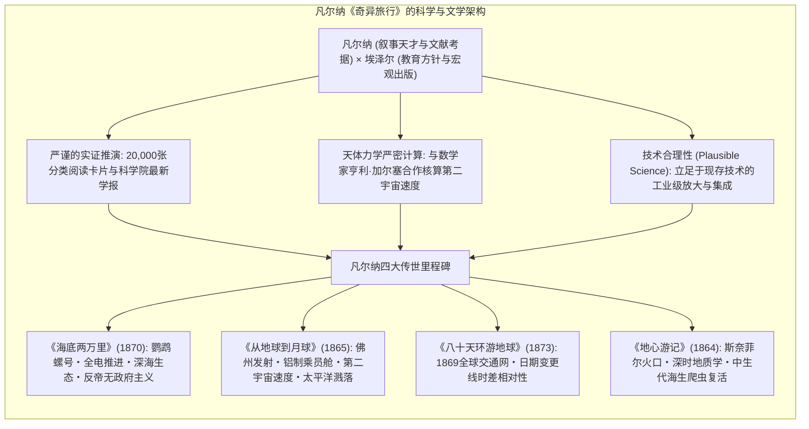
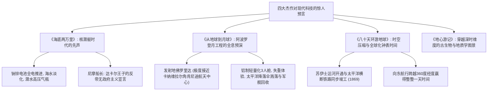

19世纪后半叶，当蒸汽机、电报网络、跨大陆铁路与苏伊士运河以雷霆之势重塑地球空间，工业革命催生出“征服自然”的巨大狂热时，一位法国作家以其不可思议的先知之笔，引领全世界读者跨越地理的极境与星辰的幽界。他就是被誉为<strong>“科幻小说之父”的儒勒·凡尔纳（Jules Verne, 1828–1905）</strong>。

凡尔纳一生创作了包含62部长篇小说和18部短篇的宏伟丛书<strong>《奇异旅行（Voyages Extraordinaires）》</strong>。在远见卓识的出版家<strong>皮埃尔-儒勒·埃泽尔（Pierre-Jules Hetzel）</strong>的推动下，这一系列绝非廉价的通俗历险故事，而是一场旨在将人类当时所掌握的地理学、地质学、物理学、天文学与化学全部融于叙事之中的<strong>“人类地理与科学启蒙大宪章”</strong>。

从开启人类首次载人登月的阿波罗11号宇航员阿姆斯特朗，到现代火箭之父齐奥尔科夫斯基、戈达德与冯·布劳恩，再到深海潜水先驱雅克-伊夫·库斯托，20世纪人类向极端边界迈进的拓荒者们无不深情致敬：“我们童年梦想的起点，皆源自儒勒·凡尔纳。”

---

## 1. 埃泽尔联盟与《奇异旅行》的诞生

1828年出生于法国西部海港南特的凡尔纳，自幼凝望着卢瓦尔河上远航美洲的帆船与明轮汽船。尽管父亲极力期望他继承律师衣钵，但凡尔纳在巴黎求学期间迅速投身于大仲马父子的戏剧沙龙。

凡尔纳敏锐地意识到，浪漫主义的贵族传奇正走向黄昏，一个<strong>“将近代科学探索的英雄主义与地理冒险融为一体的新型小说范式”</strong>即将诞生。1862年，他将《气球上的五星期》书稿交予慧眼识珠的出版家埃泽尔，由此拉开了长达四十余年紧密合作的序幕。埃泽尔在《教育与娱乐杂志》创刊号上庄严宣告：《奇异旅行》的宗旨是将现代科学积聚的全部自然奥秘“总括并重构于一部史诗般的宇宙历险之中”。

---

## 2. 惊人预言的科学方法论

凡尔纳之所以被后世奉为“科技预言大师”，并非源于不可捉摸的通灵幻觉，而是建立在<strong>不可动摇的文献穷尽考据</strong>与<strong>对既有物理定律的定性定量推演</strong>之上：

### 2.1 20,000张卡片库与数学家加尔塞的演算

在亚眠的寓所中，凡尔纳建立了拥有20,000余张分类剪报与摘要卡片的私人资料库。在撰写《从地球到月球》时，为确保轨道飞行的物理严谨性，凡尔纳特邀其表兄、著名数学教授<strong>亨利·加尔塞（Henri Garcet）</strong>进行天体力学轨道演算。

加尔塞运用牛顿万有引力定律，精确推导出了克服地球引力阱所必需的<strong>第二宇宙速度（逃逸速度）</strong>：

$$v_{	ext{esc}} = \sqrt{rac{2GM}{R}} pprox 11.2 	ext{ km/s}$$

书中所列的哥伦比亚炮装药量（40万磅火棉）、炮身长度（900英尺）及双曲线轨道参数，完全经得起当时经典力学的严苛检验。

### 2.2 与H.G.威尔斯的理性主义论辩

凡尔纳与英国作家H.G.威尔斯并称现代科幻鼻祖，但两人的创作哲学存在着根本性鸿沟。凡尔纳坚持“合理推演（Plausible Anticipation）”，批评威尔斯在《月球第一批人》中虚构反重力金属“卡弗莱特（Cavorite）”的做法：

> “我的月球探险是建立在牛顿力学、实存的钢铁铸炮和大炮弹的真实计算之上的。而威尔斯先生发明了一种能够隔绝万有引力的神奇金属飞向月球。这固然巧妙，但请他拿出这种金属来给我看看！他的方法是纯粹的幻想，与我扎根于物理定律的探索截然不同。”

---

## 3. 四大杰作与科技现实的惊人印证

### 3.1 《海底两万里》：鹦鹉螺号与反帝无政府主义
鹦鹉螺号（Nautilus）不仅拥有超越时代的<strong>全电动力系统</strong>（以海水提取钠制成大型钠锌电池供电）、海水淡化和压缩空气潜水装备，更寄托了尼摩船长激进的政治理想。尼摩是1857年印度民族大起义中遭英帝国屠杀妻儿的达卡尔王子，深海对他而言是<strong>“绝对摆脱地面帝国主义国家主权压迫的自由乐土”</strong>。他用沉船黄金秘密资助希腊独立起义，展现了技术作为抵抗霸权工具的高尚悲剧性。

### 3.2 《从地球到月球》与阿波罗计划的奇迹暗合
凡尔纳在1865年所设定的参数，与1969年NASA阿波罗11号登月任务形成了惊心动魄的吻合：发射地选在佛罗里达州（为利用地球自转线速度）；飞船采用当时罕贵昂贵的<strong>轻质金属铝</strong>制造；乘员恰为<strong>3人</strong>；脱出初速度严格等于<strong>11.2 km/s</strong>；返回地球时同样采用<strong>太平洋溅落（Splashdown）</strong>并由美军军舰打捞。

### 3.3 《八十天环游地球》：全球化交通与相对时间
1869年苏伊士运河开通、美国首条横贯大陆铁路通车、印度铁路网贯通，使环球旅行在80天内成为可能。主人公福格恪守几何学般精准的时间律，并在终局揭示了<strong>经度与地球自转带来的时间相对性</strong>：向东航行横跨360度经度，使他们比留驻格林尼治的人多见了一次日出，凭空“赢回”了宝贵的24小时。

---

## 4. 晚期思想蜕变：从技术乐观到反乌托邦悲观主义

经历了普法战争的战败、法国社会的动荡以及晚年伤病，凡尔纳的创作由早期的科技乐观主义转向了深沉的反乌托邦与技术末世论：
- <strong>《二十世纪的巴黎》（1863写就/1994尘封130年后首度出版）：</strong> 描绘了1960年被电车、传真网络、计算机器与巨型电光广告统治的高科技巴黎，但人文诗歌被全面清洗，社会堕入唯利是图的冰冷荒原。
- <strong>《恶魔的发明》（1896）：</strong> 预言了大规模杀伤性超级炸药（弗尔古拉托尔火箭），揭示了天才科学家托马·罗什被海盗集团利用，制造末日武器勒索全人类的核时代恐怖图景。

---

## 5. 永恒遗产：启迪人类探索星辰与深海

凡尔纳的墓志铭上镌刻着那句震烁古今的名言：<strong>“凡人所能想象之事，必有人能将其实现。”</strong>

1954年世界首艘核潜艇“鹦鹉螺号（SSN-571）”以其小说命名；1968年阿波罗8号绕月宇航员向全世界广播致敬凡尔纳；现代火箭与海洋学拓荒者们踩着他笔下的坐标，将19世纪的墨水一步步化作21世纪探索火星与马里亚纳海沟的金属与火焰。凡尔纳不仅定义了科幻文学，更成为了人类迈向未知宇宙的永恒指南针。
