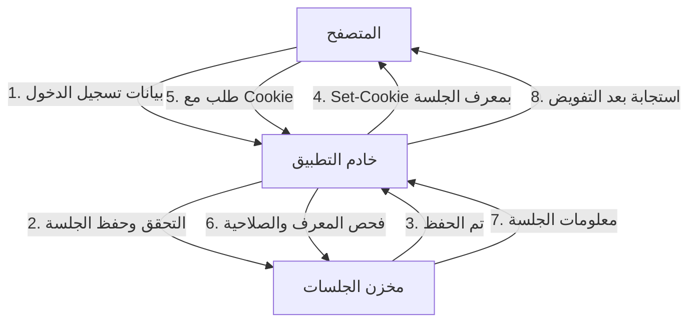
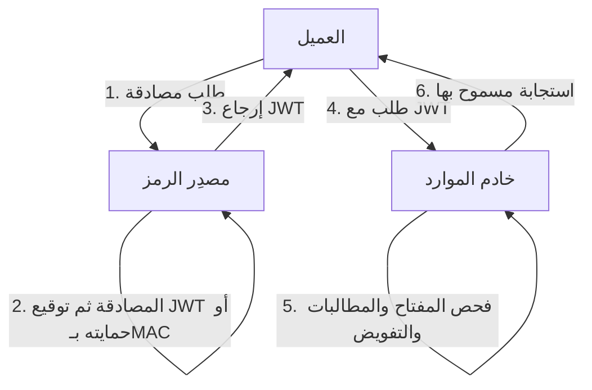
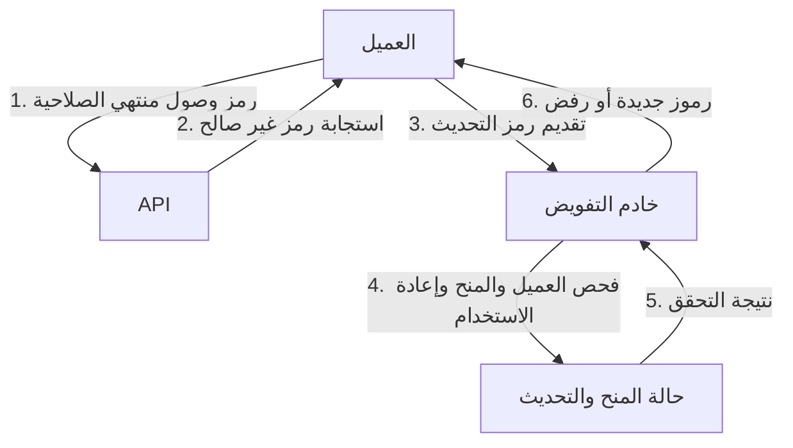

JWT صيغة لنقل المطالبات (claims) بين الأنظمة. لا يجعل اعتماده المصادقة أو التفويض أو إدارة الجلسات آمنة تلقائياً. تفصل هذه المقالة تصميم جلسات تسجيل الدخول في المتصفح عن التحقق من رموز API وإبطالها.

أولاً، **JWT صيغة رمز، أما Cookie فهي آلية تخزين وإرسال في المتصفح**. يمكن لملف تعريف الارتباط أن يحمل JWT أو معرف جلسة عشوائياً. المقارنة بين «Cookie أم JWT» وحدها تخلط بين قرارات تصميم مختلفة.

## كيف تعمل الجلسات على الخادم

يصدر التصميم المعتاد معرف جلسة يصعب توقعه بعد نجاح تسجيل الدخول، ويخزن على الخادم علاقته بالمستخدم ووقت الانتهاء وسائر معلومات الجلسة. يتلقى المتصفح المعرف في Cookie. يفترض المخطط HTTPS ويحذف سمات Cookie ومسارات الفشل.

يسهل المخزن إدارة الإبطال وتسجيل الخروج وتغيير الصلاحيات. لكن الذاكرات المخبئية أو النسخ المتماثلة التي لم تتلق الحذف بعد قد تؤخر أثره. يجب أن يحدد التصميم الموزع أي خادم يرى أي إصدار من الحالة، ومتى.

معرفات الجلسة صغيرة عادة، وتغني عن كشف معلومات المستخدم للعميل. لكن المعرف المسروق قد يساء استخدامه. يلزم تعذر توقعه وتجديده عند تسجيل الدخول، وإدارة الانتهاء وHTTPS وسمات Cookie والحماية من XSS وCSRF. للوصول إلى المخزن أيضاً تكاليف حمل وتوافر وتشغيل يجب تقييمها بحسب الحجم المطلوب.

## JWT والتحقق المحلي

يمثل JWT مجموعة مطالبات JSON باستخدام توقيعات أو MAC في JWS و/أو تشفير JWE. يستخدم توقيع المفتاح العام مفتاح المصدِر الخاص ومفتاح المتحقق العام؛ أما HMAC فيستخدم سراً مشتركاً. تركز بقية المقالة على JWT مكتفٍ بذاته ومحمي بتوقيع أو MAC.

**التوقيع ليس تشفيراً.** يمكن قراءة مطالبات JWT الموقَّع فقط، فلا تضع أسراراً فيه دون تمعن. فك ترميز base64url يختلف أيضاً عن التحقق من صلاحية الرمز.

قد يسمح التحقق المحلي بمفتاح مصدِر موثوق بالاستغناء عن استعلام مخزن جلسات مركزي مع كل طلب. لكن جلب المفاتيح وتحديثها، وتعليق الحسابات، ومعلومات الإبطال أو الصلاحيات الحالية قد تظل تتطلب اتصالاً أو حالة. لا يلغي JWT كل وصول إلى قاعدة البيانات ولا يضمن أداء أفضل.

يجب أن يحدد التطبيق الخوارزميات والمفاتيح المسموح بها. إلى جانب التحقق التشفيري، افحص المصدِر `iss` والخدمة المقصودة `aud` والانتهاء `exp` وبداية الصلاحية `nbf` عند الحاجة، والغرض من الرمز وصلاحية العملية المطلوبة. أوجب المطالبات بحسب الملف التطبيقي (profile) المعتمد. لا تفرض مواصفة JWT العامة حتى `exp` في جميع الحالات. يجب أن يحدد تصميم تسجيل الدخول أو ضبط الوصول سياسة الصلاحية وينفذها صراحة.

## 1. الإبطال ممكن لكنه يتطلب تصميماً

لا يستطيع خادم يتحقق دون اتصال من الحماية التشفيرية وشروط الوقت فقط، ولا يستعلم عن أي حالة إضافية، معرفة إبطال رمز بعينه أو تغيير كلمة المرور بعد إصداره. في هذا التصميم قد يبقى رمز bearer صالح مسروق قابلاً للاستخدام حتى ينتهي. حذفه من العميل لا يوقف نسخة مسروقة.

تشمل الخيارات مدد صلاحية قصيرة وقوائم إبطال وأرقام إصدارات لكل مستخدم أو جلسة والاستعلام عن حالة الرمز (introspection). إبطال مفتاح التوقيع يؤثر أيضاً في الرموز الأخرى الصادرة به، ويتطلب نشر التغيير إلى مخابئ المفاتيح والمتحققين. تقصر الصلاحية القصيرة مدة التعرض للخطر، لكنها لا تحل محل الإبطال الفوري لرمز فردي.

إضافة حالة أو اتصال ليست فشلاً بحد ذاتها. فحص الحالة في كل API، أو عند التحديث فقط، أو توزيع أحداث الإبطال، خيارات مختلفة الخصائص. اختر سرعة الإبطال وكلفة التشغيل المطلوبتين. إبطال رمز تحديث لا يبطل بالضرورة رموز الوصول الصادرة سابقاً التي تواصل واجهات API قبولها بالتحقق المحلي.

## 2. اختيار الخوارزميات والخلط بين أغراض الرموز

تعني `alg: none` صيغة بلا توقيع أو MAC. ينبغي ألا تقبلها نقطة مصادقة أو وصول تشترط رموزاً موقعة. لا تدع `alg` المستلم يغير سياسة التحقق. يميز RFC 8725 بين قبول `none` على نحو غير صحيح وخلط الخوارزميات الذي يستخدم مفتاح RSA العام كسِر HMAC.

استخدم مكتبة يجري صيانتها، واضبط الخوارزميات المسموح بها وعلاقة المفاتيح بالمصدِرين والجهات المستقبلة وقواعد التحقق لكل نوع رمز. امنع قبول رموز لغرض مختلف، مثل استخدام رمز هوية بدلاً من رمز وصول إلى API. لا يمكن ضمان أمان جميع المكتبات أو حالة إصلاحاتها الحالية بصورة شاملة.

## 3. تخزين المتصفح وXSS وCSRF

يمكن لـJavaScript من الأصل نفسه قراءة `localStorage` و`sessionStorage`. لذلك قد يسرب XSS رموز bearer المخزنة فيهما. قصر مدة تخزين `sessionStorage` لا يمنع هذه القراءة.

تمنع Cookie ذات `HttpOnly` قراءة قيمتها مباشرة من JavaScript، لكنها لا تمنع XSS ككل. قد يظل الكود الخبيث من الأصل نفسه قادراً على تنفيذ عمليات مصادق عليها بملفات Cookie أو قراءة المعلومات المسترجعة.

عندما ترسل Cookie تلقائياً وفق شروط المتصفح، عالج CSRF أيضاً. اضبط `Secure` وقيمة مناسبة لـ`SameSite` ونطاق إرسال ضيقاً، وصمم حماية مثل رموز CSRF أو فحص Origin للعمليات التي تغير الحالة. لا تفترض أن `SameSite` يغطي كل الحالات، ولا تغير الحالة عبر GET. ينطبق ذلك سواء احتوت Cookie على JWT أو معرف جلسة. انظر [شرح XSS وCSRF](/ar/p/cross-site-scripting-xss-csrf-security/).

يتوقف التخزين أيضاً على المعمارية. يمكن التفكير في إبقاء رموز API على الخادم والتعامل مع المتصفح عبر Cookie جلسة، دون تسليمه تلك الرموز. قرر وفق حدود التطبيق والعمليات اللازمة.

## 4. رموز التحديث وموضع الحالة

رموز التحديث إحدى طرق الحصول على رموز وصول جديدة قصيرة العمر. إصدارها اختياري؛ استخدام JWT لا يفرضها تلقائياً. «15 دقيقة» مثال لمدة صلاحية، وليست قيمة عامة تفرضها مواصفة.

يوضح المخطط تصميماً يدير حالة التحديث. احم رموز التحديث كأسرار وحدد معالجة الإبطال وإعادة الاستخدام. يفرض RFC 9700 على رموز التحديث الصادرة للعملاء العموميين ربطاً تشفيرياً بالمرسل أو تدويراً. يبطل التدوير الرمز السابق مع الاحتفاظ بعلاقته بالجديد؛ وتشمل عملية التصميم معالجة إعادة الاستخدام المكتشفة.

لا يعني ذلك وجوب تخزين كل رمز كنص صريح في قاعدة بيانات. أدر تمثيلاً آمناً والحالة المرتبطة به، وتحقق من علاقته بالمستخدم والعميل ومنح التفويض (authorization grant). يمكن إدارة الحالة عند التحديث مع التحقق المحلي من رموز الوصول في كل API.

## الخلاصة: قارن بحسب الغرض والمتطلبات

يفيد JWT في نقل مطالبات قابلة للتحقق بين الخدمات. لا تبرر الشبكة الداخلية تجاوز التحقق من المصدِر والجهة المقصودة والصلاحيات. لا تقتصر رموز وصول OAuth على صيغة JWT. أما رموز هوية OIDC فهي JWT تنقل نتيجة المصادقة إلى العميل. لا تستخدمها بديلاً لرموز وصول API.

لا يجعل JWT رابط إعادة تعيين كلمة المرور أو تأكيد البريد لمرة واحدة تلقائياً. تظل الصلاحية وقيود الجهة المقصودة والغرض وتتبع الاستخدام ضرورية. إذا لبى رمز عشوائي بسيط المتطلبات فلا حاجة إلى JWT.

للأنظمة المتمحورة حول المتصفح والتي تحتاج إبطالاً سريعاً، تكون الجلسات على الخادم نقطة بدء للمقارنة. JWT أيضاً خيار عندما يلزم التحقق المحلي بين الخدمات. هذا قرار تصميم بحسب المتطلبات، وليس ادعاء أن خياراً دائماً أكثر أماناً أو سرعة. قارن تأخر الإبطال المقبول وحداثة المعلومات ونوع العميل وإدارة المفاتيح والتخزين وحركة البيانات وعبء التشغيل.

## المراجع

- [RFC 7519: صيغة JWT والمطالبات، §3–4](https://www.rfc-editor.org/rfc/rfc7519.html)
- [RFC 8725: التحقق من الخوارزميات والمصدِر والجهة المقصودة والغرض، §2.1 و§3](https://www.rfc-editor.org/rfc/rfc8725.html)
- [RFC 7009: تصميم إبطال رموز OAuth، §3](https://www.rfc-editor.org/rfc/rfc7009.html)
- [RFC 9700: حماية رموز التحديث، §2.2.2 و§4.14](https://www.rfc-editor.org/rfc/rfc9700.html)
- [RFC 6749: رموز الوصول والتحديث، §1.4–1.5](https://www.rfc-editor.org/rfc/rfc6749.html)
- [OpenID Connect Core 1.0: رمز الهوية، §2](https://openid.net/specs/openid-connect-core-1_0.html)
- [OWASP: الجلسات وسمات Cookie](https://cheatsheetseries.owasp.org/cheatsheets/Session_Management_Cheat_Sheet.html)
- [OWASP: أمن Web Storage](https://cheatsheetseries.owasp.org/cheatsheets/HTML5_Security_Cheat_Sheet.html)
- [OWASP: رموز إعادة تعيين كلمة المرور](https://cheatsheetseries.owasp.org/cheatsheets/Forgot_Password_Cheat_Sheet.html)
