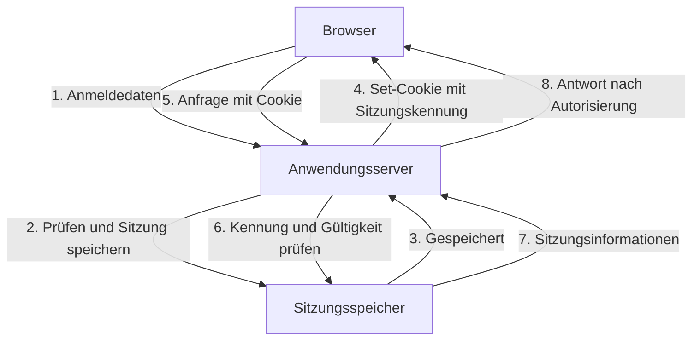
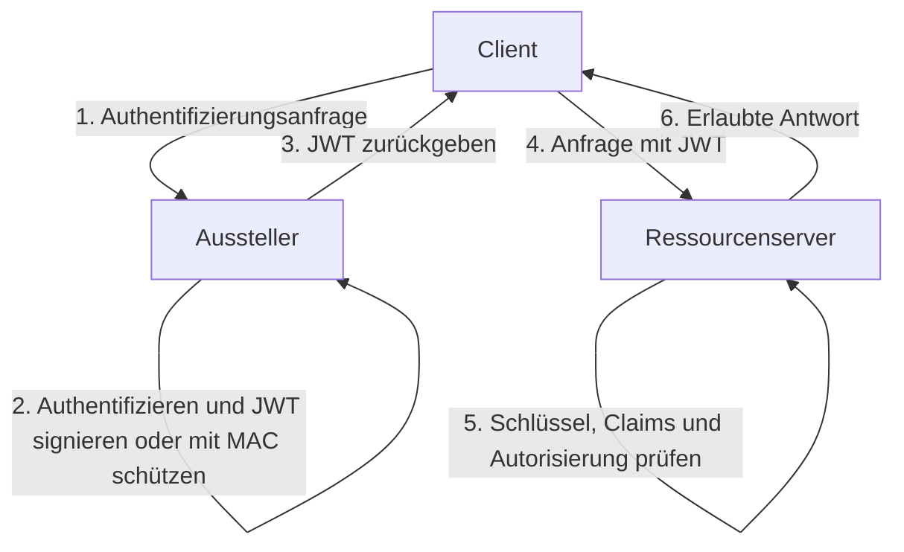
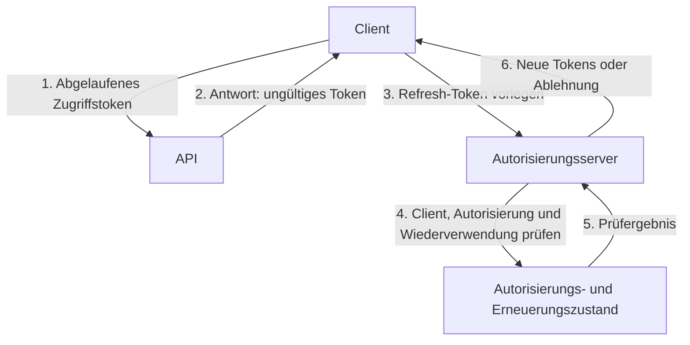

JWT ist ein Format zum Übertragen von Claims zwischen Systemen. Sein Einsatz macht Authentifizierung, Autorisierung oder Sitzungsverwaltung nicht automatisch sicher. Dieser Artikel trennt die Gestaltung von Browser-Anmeldesitzungen von der Validierung und dem Widerruf von API-Tokens.

Zunächst gilt: **JWT ist ein Tokenformat; Cookies sind ein Speicher- und Übertragungsmechanismus des Browsers**. Ein Cookie kann ein JWT oder eine zufällige Sitzungskennung enthalten. Ein bloßer Vergleich „Cookies gegen JWT“ vermischt unterschiedliche Entscheidungen.

## So funktionieren serverseitige Sitzungen

Ein typischer Entwurf erzeugt nach erfolgreicher Anmeldung eine nicht vorhersagbare Sitzungskennung und speichert auf dem Server ihre Zuordnung zu Benutzer, Ablaufzeit und weiteren Daten. Der Browser erhält die Kennung als Cookie. Die Übersicht setzt HTTPS voraus und lässt Cookie-Attribute und Fehlerfälle aus.

Der Sitzungsspeicher erleichtert Widerruf, Abmeldung und Berechtigungsänderungen. Caches oder Replikate, die eine Löschung noch nicht übernommen haben, können deren Wirkung jedoch verzögern. Ein verteilter Entwurf muss festlegen, welcher Server wann welche Version des Zustands sieht.

Sitzungskennungen sind meist kompakt und vermeiden die Offenlegung von Benutzerinformationen gegenüber dem Client. Eine gestohlene Kennung kann dennoch missbraucht werden. Unvorhersagbarkeit, Erneuerung der Kennung bei der Anmeldung, Ablaufregeln, HTTPS, Cookie-Attribute sowie XSS- und CSRF-Schutz sind erforderlich. Der Speicherzugriff verursacht auch Last, Verfügbarkeitsanforderungen und Betriebskosten, die entsprechend der benötigten Größenordnung bewertet werden müssen.

## JWT und lokale Validierung

JWT stellt eine Menge von JSON-Claims mit JWS-Signaturen oder MACs und/oder JWE-Verschlüsselung dar. Bei Public-Key-Signaturen wird mit dem privaten Schlüssel des Ausstellers signiert und mit dem öffentlichen Schlüssel verifiziert; HMAC verwendet ein gemeinsames Geheimnis. Im Folgenden geht es hauptsächlich um in sich geschlossene JWTs mit Signatur- oder MAC-Schutz.

**Signieren ist nicht Verschlüsseln.** Die Claims eines lediglich signierten JWT sind lesbar; legen Sie dort nicht unbedacht Geheimnisse ab. Auch base64url-Dekodierung ist etwas anderes als Tokenvalidierung.

Lokale Validierung mit dem Schlüssel eines vertrauenswürdigen Ausstellers kann die Abfrage eines zentralen Sitzungsspeichers bei jeder Anfrage vermeiden. Schlüsselbeschaffung und -aktualisierung, Kontosperren, Widerrufsinformationen oder aktuelle Berechtigungen können weiterhin Kommunikation oder Zustand erfordern. JWT beseitigt nicht jeden Datenbankzugriff und garantiert keine bessere Leistung.

Die Anwendung muss erlaubte Algorithmen und Schlüssel festlegen. Neben der kryptografischen Prüfung sind Aussteller `iss`, vorgesehener Dienst `aud`, Ablaufzeit `exp`, gegebenenfalls Gültigkeitsbeginn `nbf`, Tokenzweck und Berechtigung für die angeforderte Aktion zu prüfen. Verlangen Sie die nach dem gewählten Profil erforderlichen Claims. Die allgemeine JWT-Spezifikation schreibt nicht einmal `exp` in jedem Fall vor. Ein Entwurf für Anmeldung oder Zugriffskontrolle muss seine Gültigkeitsregeln ausdrücklich definieren und durchsetzen.

## 1. Widerruf ist möglich, erfordert aber einen Entwurf

Ein Server, der offline nur kryptografischen Schutz und Zeitbedingungen prüft und keinerlei zusätzlichen Zustand abfragt, kann vom Widerruf eines einzelnen Tokens oder einer Passwortänderung nach dessen Ausstellung nichts erfahren. In diesem Entwurf kann ein gestohlenes gültiges Bearer-Token bis zum Ablauf nutzbar bleiben. Das Löschen auf dem Client stoppt eine gestohlene Kopie nicht.

Möglichkeiten sind kurze Laufzeiten, Widerrufslisten, Versionsnummern je Benutzer oder Sitzung und Token-Introspektion. Das Ungültigmachen eines Signaturschlüssels betrifft auch andere mit ihm ausgestellte Tokens und muss an Schlüsselcaches und Prüfer weitergegeben werden. Eine kurze Laufzeit begrenzt die Exposition, ersetzt aber nicht den sofortigen Widerruf eines einzelnen Tokens.

Zustand oder Kommunikation einzuführen ist nicht an sich ein Fehlschlag. Zustandsprüfung an jeder API, Prüfung nur bei der Erneuerung und Verteilung von Widerrufsereignissen haben unterschiedliche Eigenschaften. Wählen Sie die erforderliche Widerrufsgeschwindigkeit und die passenden Betriebskosten. Ein widerrufenes Refresh-Token macht bereits ausgestellte Zugriffstokens nicht zwangsläufig ungültig, wenn die APIs diese weiterhin nur lokal validieren.

## 2. Algorithmuswahl und Verwechslung von Tokenzwecken

`alg: none` bezeichnet eine Form ohne Signatur oder MAC. Ein Authentifizierungs- oder Zugriffsendpunkt, der signierte Tokens verlangt, darf sie nicht akzeptieren. Lassen Sie das empfangene `alg` nicht die Prüfregeln ändern. RFC 8725 unterscheidet die unzulässige Annahme von `none` von einer Algorithmusverwechslung, die einen öffentlichen RSA-Schlüssel als HMAC-Geheimnis verwendet.

Nutzen Sie eine gepflegte Bibliothek und konfigurieren Sie erlaubte Algorithmen, die Zuordnung zwischen Schlüsseln und Ausstellern, Empfänger sowie Prüfregeln für jeden Tokentyp. Verhindern Sie, dass Tokens für andere Zwecke akzeptiert werden, etwa ein ID-Token als API-Zugriffstoken. Sicherheit oder aktueller Patchstand sämtlicher Bibliotheken lassen sich nicht pauschal garantieren.

## 3. Browserspeicher, XSS und CSRF

JavaScript desselben Ursprungs kann sowohl `localStorage` als auch `sessionStorage` lesen. XSS kann daher dort gespeicherte Bearer-Tokens offenlegen. Die kürzere Speicherdauer von `sessionStorage` verhindert dieses Auslesen nicht.

Ein `HttpOnly`-Cookie verhindert das direkte Auslesen seines Werts durch JavaScript, aber nicht XSS insgesamt. Bösartiger Code desselben Ursprungs kann weiterhin authentifizierte Aktionen mit Cookies ausführen oder abgerufene Informationen lesen.

Wenn Cookies unter den geltenden Browserbedingungen automatisch mitgesendet werden, ist auch CSRF zu berücksichtigen. Setzen Sie `Secure`, einen passenden `SameSite`-Wert und einen engen Übertragungsbereich und planen Sie für zustandsändernde Aktionen Schutz wie CSRF-Tokens oder Origin-Prüfungen. Verlassen Sie sich nicht darauf, dass `SameSite` alle Fälle abdeckt, und ändern Sie keinen Zustand per GET. Dies gilt unabhängig davon, ob ein Cookie ein JWT oder eine Sitzungskennung enthält. Siehe die [Erklärung zu XSS und CSRF](/de/p/cross-site-scripting-xss-csrf-security/).

Die Speicherwahl hängt auch von der Architektur ab. Erwägen Sie, API-Tokens auf dem Server zu halten und mit dem Browser über ein Sitzungscookie zu kommunizieren, statt ihm diese Tokens zu geben. Entscheiden Sie anhand der Anwendungsgrenzen und erforderlichen Aktionen.

## 4. Refresh-Tokens und der Ort des Zustands

Refresh-Tokens sind eine Möglichkeit, neue kurzlebige Zugriffstokens zu erhalten. Ihre Ausstellung ist optional; JWT-Nutzung macht sie nicht automatisch erforderlich. „15 Minuten“ ist ein Laufzeitbeispiel und kein von einem Standard pauschal vorgeschriebener Wert.

Das Diagramm zeigt einen Entwurf mit Verwaltung des Erneuerungszustands. Schützen Sie Refresh-Tokens als Geheimnisse und legen Sie den Umgang mit Widerruf und Wiederverwendung fest. RFC 9700 verlangt für an öffentliche Clients ausgegebene Refresh-Tokens eine kryptografische Bindung an den Absender oder Rotation. Rotation macht das vorherige Token ungültig und erhält seine Beziehung zum neuen; auch die Reaktion auf erkannte Wiederverwendung gehört zum Entwurf.

Das bedeutet nicht, jedes Token zwingend im Klartext in einer Datenbank zu speichern. Verwalten Sie eine sichere Darstellung und den zugehörigen Zustand und prüfen Sie die Beziehung zum Benutzer, zum Client und zur erteilten Autorisierung (authorization grant). Zustand kann bei der Erneuerung verwaltet werden, während jede API Zugriffstokens lokal validiert.

## Fazit: anhand von Zweck und Anforderungen vergleichen

JWT kann dazu dienen, überprüfbare Claims zwischen Diensten zu übertragen. Ein internes Netzwerk rechtfertigt es nicht, Aussteller-, Empfänger- oder Berechtigungsprüfungen wegzulassen. OAuth-Zugriffstokens sind nicht auf das JWT-Format beschränkt. OIDC-ID-Tokens hingegen sind JWTs, die einem Client das Authentifizierungsergebnis mitteilen. Sie dürfen API-Zugriffstokens nicht ersetzen.

JWT macht auch eine URL zum Zurücksetzen eines Passworts oder Bestätigen einer E-Mail-Adresse nicht automatisch einmalig nutzbar. Ablauf, Empfänger- und Zweckbeschränkungen sowie die Verwaltung des Nutzungsstatus bleiben erforderlich. Erfüllt ein einfaches Zufallstoken die Anforderungen, ist JWT unnötig.

Bei browserzentrierten Anwendungen mit Bedarf an schnellem Widerruf sind serverseitige Sitzungen ein Ausgangspunkt für den Vergleich. JWT kommt ebenfalls infrage, wenn lokale Validierung über mehrere Dienste benötigt wird. Dies ist eine anforderungsbezogene Entwurfsentscheidung und keine Aussage, dass eine Option stets sicherer oder schneller sei. Vergleichen Sie akzeptable Widerrufsverzögerung, Aktualität der Informationen, Clienttyp, Schlüsselverwaltung, Speicherung, Datenverkehr und Betriebsaufwand.

## Quellen

- [RFC 7519: JWT-Format und Claims, §3–4](https://www.rfc-editor.org/rfc/rfc7519.html)
- [RFC 8725: Prüfung von Algorithmen, Aussteller, Empfänger und Zweck, §2.1 und §3](https://www.rfc-editor.org/rfc/rfc8725.html)
- [RFC 7009: Entwurf der OAuth-Tokenwiderrufsfunktion, §3](https://www.rfc-editor.org/rfc/rfc7009.html)
- [RFC 9700: Schutz von Refresh-Tokens, §2.2.2 und §4.14](https://www.rfc-editor.org/rfc/rfc9700.html)
- [RFC 6749: Zugriffs- und Refresh-Tokens, §1.4–1.5](https://www.rfc-editor.org/rfc/rfc6749.html)
- [OpenID Connect Core 1.0: ID-Token, §2](https://openid.net/specs/openid-connect-core-1_0.html)
- [OWASP: Sitzungen und Cookie-Attribute](https://cheatsheetseries.owasp.org/cheatsheets/Session_Management_Cheat_Sheet.html)
- [OWASP: Sicherheit von Web Storage](https://cheatsheetseries.owasp.org/cheatsheets/HTML5_Security_Cheat_Sheet.html)
- [OWASP: Tokens zum Zurücksetzen von Passwörtern](https://cheatsheetseries.owasp.org/cheatsheets/Forgot_Password_Cheat_Sheet.html)
