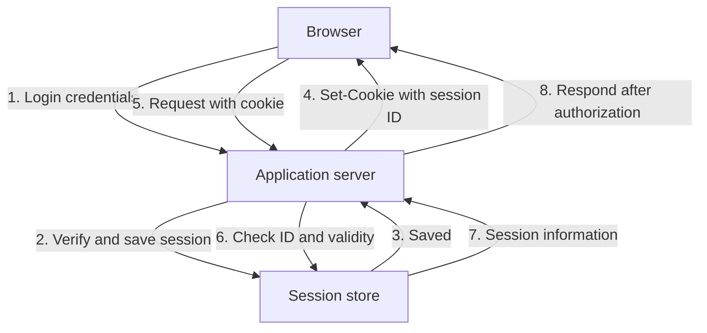
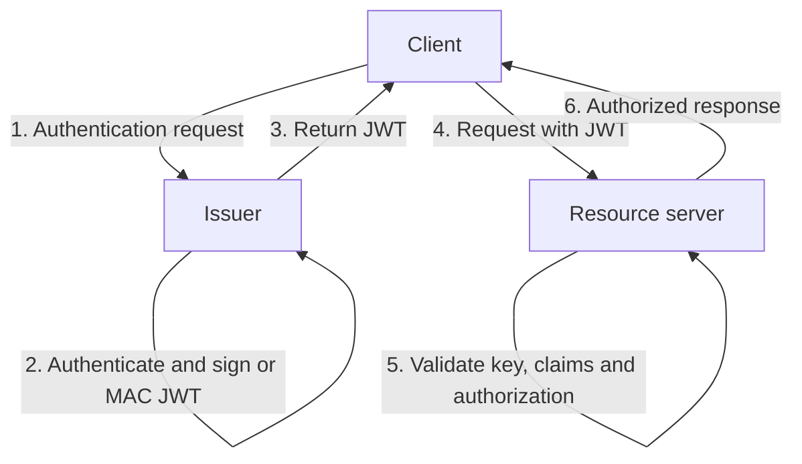
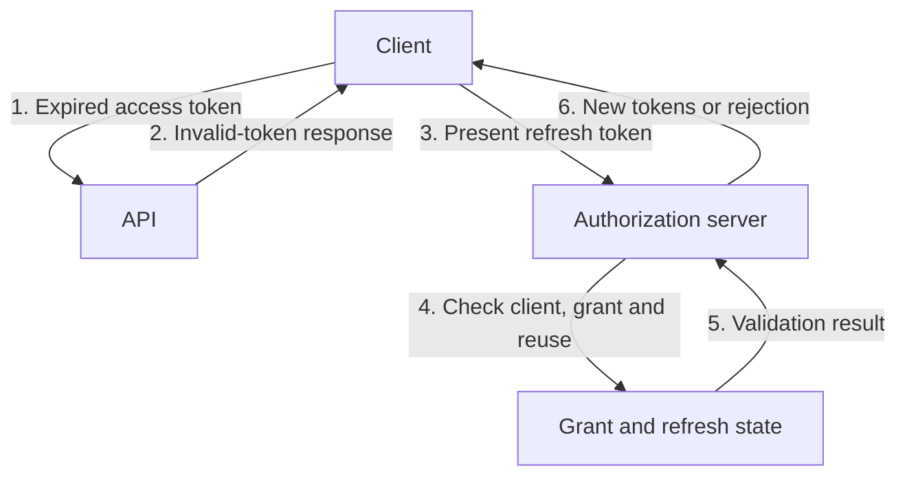

JWT is a format for passing claims between systems. Adopting it does not automatically make authentication, authorization or session management secure. This article separates the design of browser login sessions from validation and revocation of API tokens.

First, **JWT is a token format; cookies are a browser storage and transmission mechanism**. A cookie can carry a JWT or a random session ID. Comparing only “cookies versus JWT” mixes different design choices.

## How Server-Side Sessions Work

A typical design issues an unpredictable session ID after successful login and stores its association with the user, expiration and other session data on the server. The browser receives the ID in a cookie. This overview assumes HTTPS and omits cookie attributes and failure paths.

The store makes revocation, logout and permission changes easier to manage. However, caches or replicas that have not observed a deletion can delay its effect. Distributed designs must specify which server sees which version of the state and when.

Session IDs are usually compact and avoid exposing user information to the client. A stolen ID can still be abused. Unpredictability, ID renewal on login, expiration, HTTPS, cookie attributes, and XSS and CSRF defenses are necessary. Store access also has load, availability and operational costs that should be evaluated for the required scale.

## JWT and Local Validation

JWT represents a JSON claims set using JWS signatures or MACs and/or JWE encryption. Public-key signatures use the issuer’s private key and the verifier’s public key; HMAC uses a shared secret. The rest of this article mainly concerns self-contained JWTs protected by a signature or MAC.

**Signing is not encryption.** Claims in a signed-only JWT are readable, so do not casually put secrets in them. Decoding base64url is also different from validating a token.

Local validation with a trusted issuer’s key can avoid consulting a central session store on every request. Key retrieval and updates, account suspension, revocation information or current permissions may still require communication or state. JWT does not eliminate every database access or guarantee better performance.

The application must define allowed algorithms and keys. In addition to cryptographic verification, check the issuer `iss`, intended service `aud`, expiration `exp`, validity start `nbf` where applicable, token purpose and permission for the requested operation. Require claims according to the adopted profile. The generic JWT specification does not make even `exp` mandatory in every case. A login or access-management design must explicitly define and enforce its validity-period policy.

## 1. Revocation Is Possible, but Requires a Design

A server that checks only cryptographic protection and time conditions offline, without consulting additional state, cannot learn that an individual token was revoked or that a password changed after issuance. In that design, a stolen valid bearer token may remain usable until expiration. Deleting it on the client does not stop a stolen copy.

Options include short lifetimes, revocation lists, user or session version numbers, and token introspection. Invalidating a signing key also affects other tokens issued with that key and requires propagation to key caches and verifiers. Short expiration limits exposure but does not replace immediate individual revocation.

Introducing state or communication is not itself a failure. Checking state at every API, checking only during refresh, and distributing revocation events have different properties. Choose the revocation speed and operational cost required. Revoking a refresh token does not necessarily invalidate access tokens already accepted through local validation by each API.

## 2. Algorithm Selection and Confusion Between Token Purposes

`alg: none` denotes a form without a signature or MAC. An authentication or access endpoint that requires signed tokens must not accept it. Do not let the received `alg` change your verification policy. RFC 8725 treats inappropriate acceptance of `none` and misuse of an RSA public key as an HMAC secret as separate problems.

Use a maintained library and configure allowed algorithms, key-to-issuer associations, intended recipients and validation rules for each token type. Prevent tokens issued for another purpose from being accepted, such as using an ID token as an API access token. No blanket assurance can establish the security or current patch status of every library.

## 3. Browser Storage, XSS and CSRF

Same-origin JavaScript can read both `localStorage` and `sessionStorage`. XSS may therefore expose bearer tokens stored in either. The shorter storage lifetime of `sessionStorage` does not prevent this reading.

An `HttpOnly` cookie prevents JavaScript from directly reading its value, but it does not prevent XSS as a whole. Malicious same-origin code may still perform authenticated cookie-bearing operations or read retrieved information.

When cookies are sent automatically under the applicable browser conditions, address CSRF too. Set `Secure`, an appropriate `SameSite` value and a narrow transmission scope, and design protections such as CSRF tokens or Origin checks for state-changing operations. Do not assume `SameSite` covers every case, and do not change state through GET. These considerations apply whether the cookie contains a JWT or a session ID. See the [XSS and CSRF explanation](/en/p/cross-site-scripting-xss-csrf-security/).

Storage choices also depend on the architecture. Consider a design that keeps API tokens on the server and uses a session cookie for the browser instead of handing API tokens to it. Decide according to application boundaries and the operations required.

## 4. Refresh Tokens and Where State Lives

Refresh tokens are one way to obtain new short-lived access tokens. Issuing them is optional; JWT use does not automatically require them. “15 minutes” is an example lifetime, not a universal value imposed by a standard.

This diagram outlines a design that manages refresh state. Protect refresh tokens as secrets and decide how to handle revocation and reuse. RFC 9700 requires refresh tokens issued to public clients to be sender-constrained or rotated. Rotation invalidates the previous token while retaining its relationship to the new one; handling detected reuse is part of the design.

This does not mean storing every token verbatim in a database. Manage a secure representation and associated state, checking its relationship to the user, client and authorization grant. State can be managed during refresh while access tokens are validated locally at each API.

## Conclusion: Compare Designs Against Their Requirements

JWT can be useful for transferring verifiable claims between services. An internal network does not justify skipping issuer, audience or permission validation. OAuth access tokens are not limited to JWT format. OIDC ID tokens, on the other hand, are JWTs that convey authentication results to a client. They must not be treated as interchangeable with API access tokens.

A JWT does not automatically make a password-reset or email-verification URL single-use. Expiration, recipient and purpose restrictions, and tracking whether it has been used still matter. If a simple random token meets the requirements, JWT is unnecessary.

For browser-focused applications needing prompt revocation, server-side sessions are a useful starting point for comparison. JWT is also a candidate when local validation across services is needed. This is a requirements-based design judgment, not a claim that either approach is always safer or faster. Compare acceptable revocation delay, information freshness, client type, key management, storage, traffic and operational load.

## References

- [RFC 7519: JWT format and claims, §3–4](https://www.rfc-editor.org/rfc/rfc7519.html)
- [RFC 8725: algorithm, issuer, audience and purpose validation, §2.1 and §3](https://www.rfc-editor.org/rfc/rfc8725.html)
- [RFC 7009: OAuth token revocation design, §3](https://www.rfc-editor.org/rfc/rfc7009.html)
- [RFC 9700: refresh-token protection, §2.2.2 and §4.14](https://www.rfc-editor.org/rfc/rfc9700.html)
- [RFC 6749: access tokens and refresh tokens, §1.4–1.5](https://www.rfc-editor.org/rfc/rfc6749.html)
- [OpenID Connect Core 1.0: ID Token, §2](https://openid.net/specs/openid-connect-core-1_0.html)
- [OWASP: session management and cookie attributes](https://cheatsheetseries.owasp.org/cheatsheets/Session_Management_Cheat_Sheet.html)
- [OWASP: Web Storage security](https://cheatsheetseries.owasp.org/cheatsheets/HTML5_Security_Cheat_Sheet.html)
- [OWASP: password-reset tokens](https://cheatsheetseries.owasp.org/cheatsheets/Forgot_Password_Cheat_Sheet.html)
