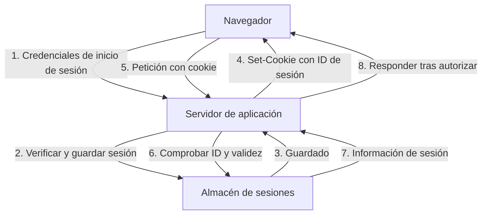
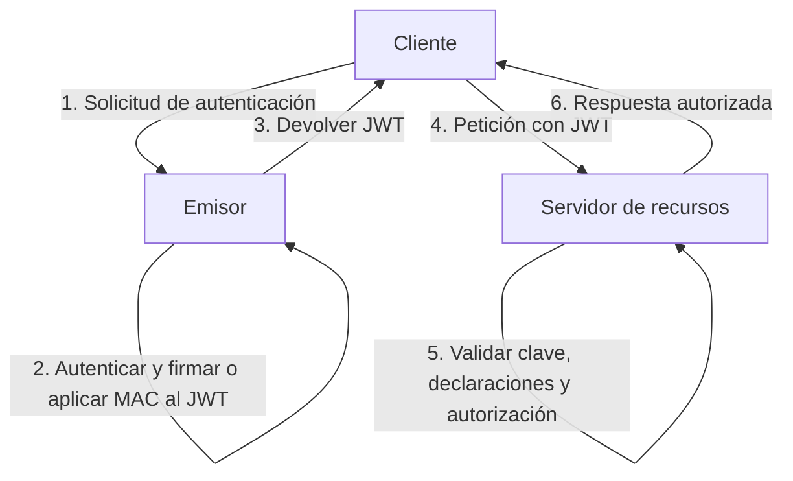
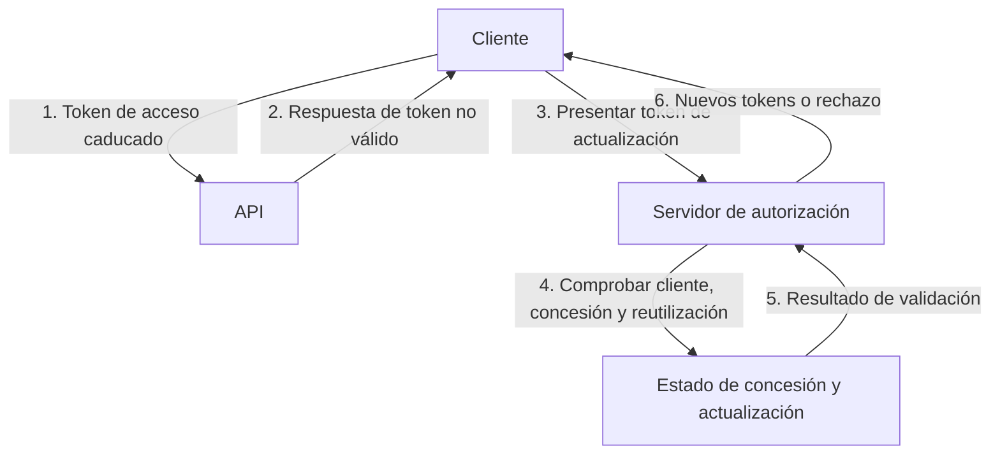

JWT es un formato para transmitir declaraciones (*claims*) entre sistemas. Adoptarlo no hace que la autenticación, la autorización o la gestión de sesiones sean seguras automáticamente. Este artículo distingue el diseño de las sesiones de inicio de sesión del navegador de la validación y revocación de tokens para API.

Primero, **JWT es un formato de token; las cookies son un mecanismo de almacenamiento y envío del navegador**. Una cookie puede contener un JWT o un identificador de sesión aleatorio. Comparar solo «cookies frente a JWT» mezcla decisiones distintas.

## Cómo funcionan las sesiones en el servidor

Un diseño típico genera un identificador de sesión impredecible después de un inicio de sesión correcto y guarda en el servidor su relación con el usuario, la caducidad y otros datos. El navegador recibe el identificador en una cookie. Este esquema presupone HTTPS y omite los atributos de la cookie y los casos de error.

El almacén facilita la revocación, el cierre de sesión y los cambios de permisos. Sin embargo, las cachés o réplicas que todavía no hayan recibido una eliminación pueden retrasar su efecto. Un diseño distribuido debe especificar qué servidor observa cada versión del estado y cuándo.

Los identificadores de sesión suelen ser compactos y evitan exponer información del usuario al cliente. Un identificador robado puede seguir utilizándose indebidamente. Se necesitan impredecibilidad, renovación del identificador al iniciar sesión, caducidad, HTTPS, atributos de cookie y defensas contra XSS y CSRF. El acceso al almacén también tiene costes de carga, disponibilidad y operación que deben evaluarse según la escala necesaria.

## JWT y validación local

JWT representa un conjunto de declaraciones JSON mediante firmas o MAC de JWS y/o cifrado JWE. Las firmas de clave pública usan la clave privada del emisor y la pública del verificador; HMAC usa un secreto compartido. A continuación tratamos principalmente JWT autocontenidos protegidos por firma o MAC.

**Firmar no es cifrar.** Las declaraciones de un JWT solo firmado son legibles; no incluya secretos sin más. Decodificar base64url también es distinto de validar un token.

La validación local con la clave de un emisor de confianza puede evitar consultar un almacén central de sesiones en cada petición. Obtener y actualizar claves, suspender cuentas, consultar revocaciones o permisos actuales puede seguir exigiendo comunicación o estado. JWT no elimina todos los accesos a bases de datos ni garantiza mejor rendimiento.

La aplicación debe definir los algoritmos y las claves permitidos. Además de la verificación criptográfica, compruebe el emisor `iss`, el servicio destinatario `aud`, la caducidad `exp`, el inicio de validez `nbf` cuando corresponda, el propósito del token y el permiso para la operación solicitada. Exija las declaraciones que imponga el perfil adoptado. La especificación genérica de JWT ni siquiera exige `exp` en todos los casos. Un diseño de inicio de sesión o control de acceso debe definir y aplicar expresamente su política de validez.

## 1. La revocación es posible, pero requiere un diseño

Un servidor que solo comprueba sin conexión la protección criptográfica y las condiciones temporales, sin consultar estado adicional, no puede enterarse de la revocación de un token concreto ni de un cambio de contraseña posterior a su emisión. En ese diseño, un token bearer válido robado puede seguir utilizándose hasta caducar. Borrarlo del cliente no detiene una copia robada.

Las opciones incluyen vidas cortas, listas de revocación, números de versión por usuario o sesión e introspección de tokens. Invalidar una clave de firma también afecta a otros tokens emitidos con ella y exige propagar el cambio a las cachés y verificadores. Una caducidad corta limita la exposición, pero no sustituye la revocación inmediata de un token individual.

Introducir estado o comunicación no es un fracaso por sí mismo. Consultar el estado en cada API, hacerlo solo al renovar o distribuir eventos de revocación tiene propiedades distintas. Elija la velocidad de revocación y el coste operativo necesarios. Revocar un token de actualización no invalida necesariamente los tokens de acceso ya emitidos que cada API sigue aceptando mediante validación local.

## 2. Selección de algoritmos y confusión de propósitos

`alg: none` indica una forma sin firma ni MAC. Un punto de entrada de autenticación o acceso que exige tokens firmados no debe aceptarla. No permita que el `alg` recibido cambie su política de verificación. RFC 8725 distingue la aceptación indebida de `none` de la confusión de algoritmos que utiliza una clave pública RSA como secreto HMAC.

Use una biblioteca mantenida y configure los algoritmos permitidos, la asociación de claves y emisores, los destinatarios y las reglas de validación para cada tipo de token. Impida aceptar tokens destinados a otros fines, como usar un token de ID como token de acceso de una API. No puede garantizarse de manera general la seguridad ni el estado actual de los parches de todas las bibliotecas.

## 3. Almacenamiento en el navegador, XSS y CSRF

JavaScript del mismo origen puede leer tanto `localStorage` como `sessionStorage`. Un XSS puede, por tanto, exponer los tokens bearer guardados en ellos. La menor duración del almacenamiento en `sessionStorage` no impide esa lectura.

Una cookie `HttpOnly` evita que JavaScript lea directamente su valor, pero no impide XSS en general. El código malicioso del mismo origen aún puede ejecutar operaciones autenticadas con cookies o leer la información obtenida.

Cuando las cookies se envían automáticamente según las condiciones del navegador, también hay que abordar CSRF. Configure `Secure`, un valor apropiado de `SameSite` y un ámbito de envío limitado, y diseñe protecciones como tokens CSRF o comprobaciones de Origin para operaciones que cambien el estado. No suponga que `SameSite` cubre todos los casos ni modifique el estado mediante GET. Esto se aplica tanto si la cookie contiene un JWT como un identificador de sesión. Véase la [explicación de XSS y CSRF](/es/p/cross-site-scripting-xss-csrf-security/).

El almacenamiento también depende de la arquitectura. Puede considerar mantener los tokens de API en el servidor y utilizar una cookie de sesión con el navegador, sin entregarle dichos tokens. Decida según los límites de la aplicación y las operaciones requeridas.

## 4. Tokens de actualización y ubicación del estado

Los tokens de actualización son una forma de obtener nuevos tokens de acceso de corta duración. Su emisión es opcional; usar JWT no los hace obligatorios. «15 minutos» es un ejemplo de duración, no un valor universal impuesto por una norma.

El diagrama muestra un diseño que gestiona el estado de actualización. Proteja los tokens de actualización como secretos y decida cómo tratar la revocación y la reutilización. RFC 9700 exige que los tokens de actualización emitidos a clientes públicos estén vinculados criptográficamente al remitente o se roten. La rotación invalida el token anterior y conserva su relación con el nuevo; gestionar la reutilización detectada también forma parte del diseño.

Esto no significa guardar necesariamente cada token en texto claro en una base de datos. Gestione una representación segura y el estado asociado, y compruebe su relación con el usuario, el cliente y la concesión de autorización. Es posible gestionar estado al renovar y validar localmente los tokens de acceso en cada API.

## Conclusión: comparar según el propósito y los requisitos

JWT puede servir para transmitir declaraciones verificables entre servicios. Una red interna no justifica omitir la validación del emisor, el destinatario o los permisos. Los tokens de acceso OAuth no se limitan al formato JWT. En cambio, los tokens de ID de OIDC son JWT que comunican al cliente el resultado de la autenticación. No deben usarse como sustitutos de los tokens de acceso a una API.

JWT tampoco hace que una URL de restablecimiento de contraseña o verificación de correo sea automáticamente de un solo uso. Siguen siendo necesarios la caducidad, las restricciones de destinatario y propósito y el control de si ya se ha utilizado. Si un token aleatorio sencillo satisface los requisitos, JWT es innecesario.

Para aplicaciones centradas en el navegador que requieren revocación rápida, las sesiones en el servidor son un punto de partida para comparar. JWT también es candidato cuando se necesita validación local entre servicios. Es una decisión de diseño según los requisitos, no una afirmación de que alguna opción siempre sea más segura o rápida. Compare la demora de revocación admisible, la actualidad de la información, el tipo de cliente, la gestión de claves, el almacenamiento, el tráfico y la carga operativa.

## Referencias

- [RFC 7519: formato y declaraciones JWT, §3–4](https://www.rfc-editor.org/rfc/rfc7519.html)
- [RFC 8725: validación de algoritmos, emisor, destinatario y propósito, §2.1 y §3](https://www.rfc-editor.org/rfc/rfc8725.html)
- [RFC 7009: diseño de la revocación de tokens OAuth, §3](https://www.rfc-editor.org/rfc/rfc7009.html)
- [RFC 9700: protección de tokens de actualización, §2.2.2 y §4.14](https://www.rfc-editor.org/rfc/rfc9700.html)
- [RFC 6749: tokens de acceso y actualización, §1.4–1.5](https://www.rfc-editor.org/rfc/rfc6749.html)
- [OpenID Connect Core 1.0: token de ID, §2](https://openid.net/specs/openid-connect-core-1_0.html)
- [OWASP: sesiones y atributos de cookies](https://cheatsheetseries.owasp.org/cheatsheets/Session_Management_Cheat_Sheet.html)
- [OWASP: seguridad de Web Storage](https://cheatsheetseries.owasp.org/cheatsheets/HTML5_Security_Cheat_Sheet.html)
- [OWASP: tokens de restablecimiento de contraseña](https://cheatsheetseries.owasp.org/cheatsheets/Forgot_Password_Cheat_Sheet.html)
