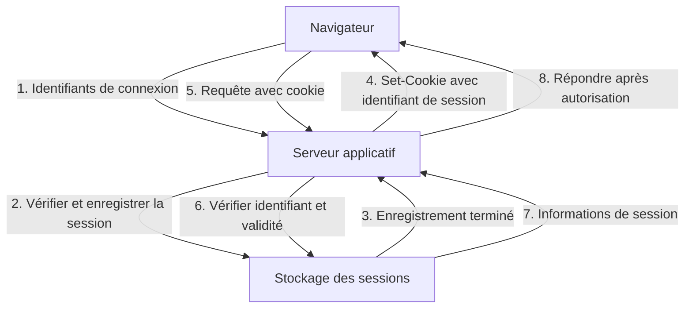
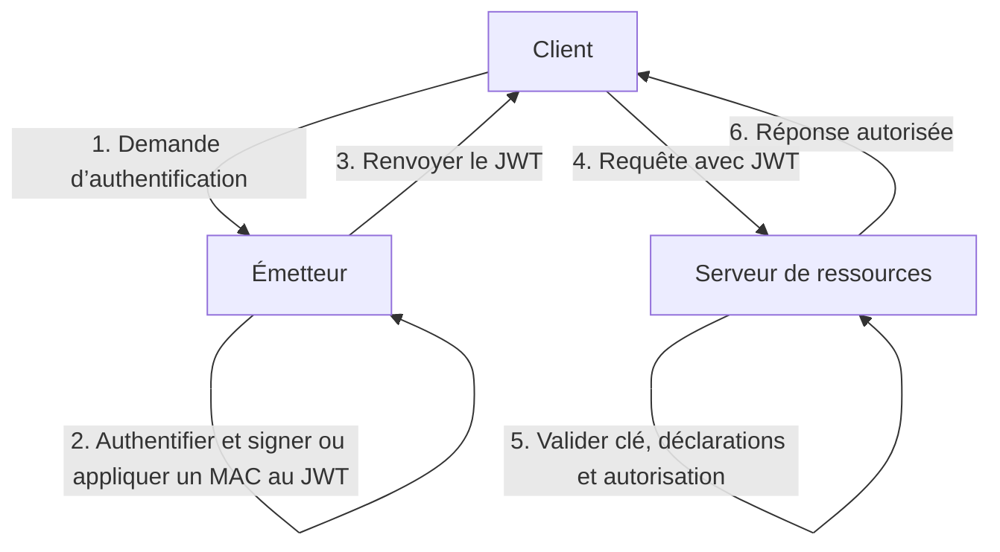
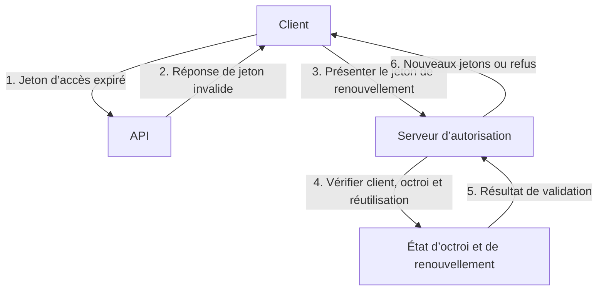

JWT est un format permettant de transmettre des déclarations (*claims*) entre systèmes. L’adopter ne sécurise pas automatiquement l’authentification, l’autorisation ou la gestion des sessions. Cet article distingue la conception des sessions de connexion du navigateur de la validation et de la révocation des jetons d’API.

D’abord, **JWT est un format de jeton ; les cookies sont un mécanisme de stockage et d’envoi du navigateur**. Un cookie peut transporter un JWT ou un identifiant de session aléatoire. Comparer uniquement « cookies ou JWT » mélange des choix différents.

## Fonctionnement des sessions côté serveur

Une conception classique génère un identifiant de session imprévisible après une connexion réussie et conserve côté serveur son association avec l’utilisateur, l’expiration et d’autres données. Le navigateur reçoit l’identifiant dans un cookie. Ce schéma suppose HTTPS et omet les attributs du cookie et les cas d’échec.

Le stockage facilite la révocation, la déconnexion et les changements de permissions. Cependant, des caches ou répliques n’ayant pas encore constaté une suppression peuvent retarder son effet. Une conception distribuée doit préciser quel serveur voit quelle version de l’état, et quand.

Les identifiants de session sont généralement compacts et évitent d’exposer les informations utilisateur au client. Un identifiant volé peut néanmoins être détourné. Imprévisibilité, renouvellement de l’identifiant à la connexion, expiration, HTTPS, attributs de cookie et protections XSS et CSRF sont nécessaires. L’accès au stockage entraîne aussi des coûts de charge, de disponibilité et d’exploitation à évaluer selon l’échelle requise.

## JWT et validation locale

JWT représente un ensemble de déclarations JSON à l’aide de signatures ou de MAC JWS et/ou de chiffrement JWE. Les signatures à clé publique utilisent la clé privée de l’émetteur et la clé publique du vérificateur ; HMAC utilise un secret partagé. La suite concerne principalement des JWT autonomes protégés par une signature ou un MAC.

**Signer n’est pas chiffrer.** Les déclarations d’un JWT seulement signé sont lisibles : n’y placez pas de secrets sans précaution. Décoder base64url est également différent de valider un jeton.

La validation locale avec la clé d’un émetteur de confiance peut éviter de consulter un stockage central des sessions à chaque requête. Obtenir et actualiser les clés, suspendre des comptes, consulter les révocations ou les permissions actuelles peut encore exiger des communications ou un état. JWT n’élimine pas tous les accès aux bases de données et ne garantit pas de meilleures performances.

L’application doit définir les algorithmes et clés autorisés. Outre la vérification cryptographique, contrôlez l’émetteur `iss`, le service destinataire `aud`, l’expiration `exp`, le début de validité `nbf` si nécessaire, la finalité du jeton et la permission d’effectuer l’opération demandée. Exigez les déclarations imposées par le profil adopté. La spécification générique JWT n’impose même pas `exp` dans tous les cas. Une conception de connexion ou de contrôle d’accès doit définir et appliquer explicitement sa politique de validité.

## 1. La révocation est possible, mais doit être conçue

Un serveur qui vérifie seulement hors ligne la protection cryptographique et les conditions temporelles, sans consulter d’état supplémentaire, ne peut pas apprendre la révocation d’un jeton individuel ni un changement de mot de passe postérieur à son émission. Dans cette conception, un jeton bearer valide volé peut rester utilisable jusqu’à expiration. Le supprimer du client n’arrête pas une copie volée.

Les options incluent des durées courtes, des listes de révocation, des numéros de version par utilisateur ou session et l’introspection des jetons. Invalider une clé de signature affecte aussi les autres jetons émis avec cette clé et nécessite de propager le changement aux caches et vérificateurs. Une expiration courte réduit l’exposition, mais ne remplace pas la révocation immédiate d’un jeton individuel.

Introduire un état ou des communications n’est pas en soi un échec. Consulter l’état à chaque API, seulement au renouvellement, ou distribuer des événements de révocation présente des propriétés différentes. Choisissez la vitesse de révocation et le coût d’exploitation nécessaires. Révoquer un jeton de renouvellement n’invalide pas nécessairement les jetons d’accès déjà émis que chaque API continue d’accepter par validation locale.

## 2. Choix des algorithmes et confusion des finalités

`alg: none` désigne une forme sans signature ni MAC. Un point d’entrée d’authentification ou d’accès qui exige des jetons signés ne doit pas l’accepter. Ne laissez pas le `alg` reçu modifier votre politique de vérification. RFC 8725 distingue l’acceptation indue de `none` de la confusion d’algorithmes utilisant une clé publique RSA comme secret HMAC.

Utilisez une bibliothèque maintenue et configurez les algorithmes permis, les associations entre clés et émetteurs, les destinataires et les règles de validation propres à chaque type de jeton. Empêchez l’acceptation de jetons destinés à un autre usage, par exemple un jeton d’identité utilisé comme jeton d’accès à une API. On ne peut garantir globalement la sécurité ni l’état actuel des correctifs de toutes les bibliothèques.

## 3. Stockage dans le navigateur, XSS et CSRF

JavaScript de même origine peut lire `localStorage` et `sessionStorage`. Un XSS peut donc exposer les jetons bearer qui y sont stockés. La durée de stockage plus courte de `sessionStorage` n’empêche pas cette lecture.

Un cookie `HttpOnly` empêche JavaScript de lire directement sa valeur, mais ne bloque pas XSS dans son ensemble. Du code malveillant de même origine peut encore effectuer des opérations authentifiées avec les cookies ou lire les informations obtenues.

Lorsque les cookies sont envoyés automatiquement selon les conditions du navigateur, il faut aussi traiter CSRF. Définissez `Secure`, une valeur adaptée de `SameSite` et une portée d’envoi limitée, puis prévoyez des protections telles que des jetons CSRF ou des contrôles d’Origin pour les opérations modifiant l’état. Ne supposez pas que `SameSite` couvre tous les cas et ne modifiez pas l’état par GET. Ces considérations s’appliquent à un cookie contenant un JWT comme à un identifiant de session. Voir l’[explication de XSS et CSRF](/fr/p/cross-site-scripting-xss-csrf-security/).

Le stockage dépend aussi de l’architecture. On peut envisager de conserver les jetons d’API côté serveur et d’utiliser un cookie de session avec le navigateur, sans lui remettre ces jetons. Décidez selon les frontières de l’application et les opérations nécessaires.

## 4. Jetons de renouvellement et emplacement de l’état

Les jetons de renouvellement (*refresh tokens*) sont une manière d’obtenir de nouveaux jetons d’accès à courte durée de vie. Leur émission est facultative ; utiliser JWT ne les rend pas obligatoires. « 15 minutes » est un exemple de durée, pas une valeur universelle imposée par une norme.

Ce schéma présente une conception gérant l’état de renouvellement. Protégez ces jetons comme des secrets et décidez du traitement de la révocation et de la réutilisation. RFC 9700 exige que les jetons de renouvellement émis aux clients publics soient liés cryptographiquement à l’instance cliente qui les présente ou soumis à une rotation. Celle-ci invalide le jeton précédent tout en conservant son lien avec le nouveau ; gérer la réutilisation détectée fait également partie de la conception.

Cela ne signifie pas conserver nécessairement chaque jeton en clair dans une base de données. Gérez une représentation sûre et l’état associé, en vérifiant leur lien avec l’utilisateur, le client et l’octroi d’autorisation. On peut gérer l’état lors du renouvellement tout en validant localement les jetons d’accès dans chaque API.

## Conclusion : comparer selon les finalités et les exigences

JWT peut servir à transmettre des déclarations vérifiables entre services. Un réseau interne ne justifie pas d’omettre la validation de l’émetteur, du destinataire ou des permissions. Les jetons d’accès OAuth ne se limitent pas au format JWT. Les jetons d’identité OIDC, en revanche, sont des JWT qui transmettent au client le résultat de l’authentification. Ils ne doivent pas remplacer les jetons d’accès à une API.

JWT ne rend pas non plus une URL de réinitialisation de mot de passe ou de confirmation d’adresse électronique automatiquement à usage unique. Expiration, restrictions de destinataire et de finalité, et suivi de l’utilisation restent nécessaires. Si un simple jeton aléatoire satisfait les exigences, JWT est inutile.

Pour des applications centrées sur le navigateur qui demandent une révocation rapide, les sessions côté serveur constituent un point de départ pour comparer. JWT est aussi candidat lorsque la validation locale entre services est nécessaire. C’est un choix de conception fondé sur les exigences, pas l’affirmation qu’une option est toujours plus sûre ou plus rapide. Comparez le délai de révocation admissible, la fraîcheur de l’information, le type de client, la gestion des clés, le stockage, le trafic et la charge d’exploitation.

## Références

- [RFC 7519 : format et déclarations JWT, §3–4](https://www.rfc-editor.org/rfc/rfc7519.html)
- [RFC 8725 : validation des algorithmes, émetteur, destinataire et finalité, §2.1 et §3](https://www.rfc-editor.org/rfc/rfc8725.html)
- [RFC 7009 : conception de la révocation de jetons OAuth, §3](https://www.rfc-editor.org/rfc/rfc7009.html)
- [RFC 9700 : protection des jetons de renouvellement, §2.2.2 et §4.14](https://www.rfc-editor.org/rfc/rfc9700.html)
- [RFC 6749 : jetons d’accès et de renouvellement, §1.4–1.5](https://www.rfc-editor.org/rfc/rfc6749.html)
- [OpenID Connect Core 1.0 : jeton d’identité, §2](https://openid.net/specs/openid-connect-core-1_0.html)
- [OWASP : sessions et attributs des cookies](https://cheatsheetseries.owasp.org/cheatsheets/Session_Management_Cheat_Sheet.html)
- [OWASP : sécurité de Web Storage](https://cheatsheetseries.owasp.org/cheatsheets/HTML5_Security_Cheat_Sheet.html)
- [OWASP : jetons de réinitialisation de mot de passe](https://cheatsheetseries.owasp.org/cheatsheets/Forgot_Password_Cheat_Sheet.html)
