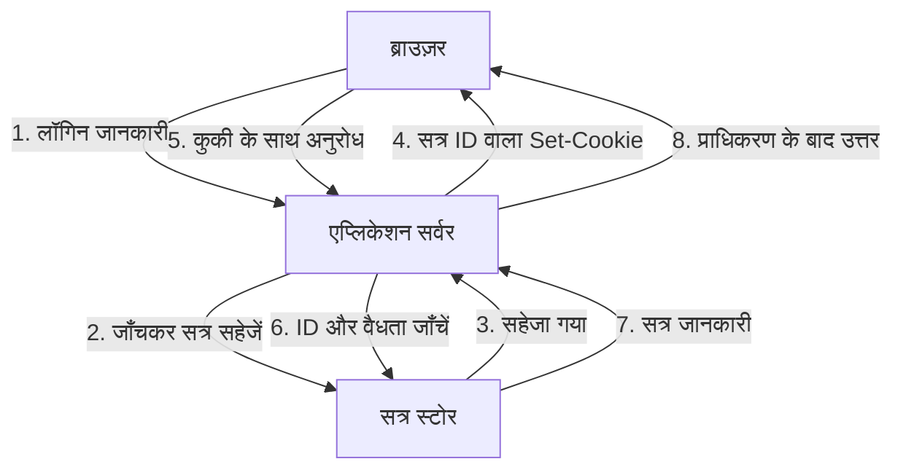
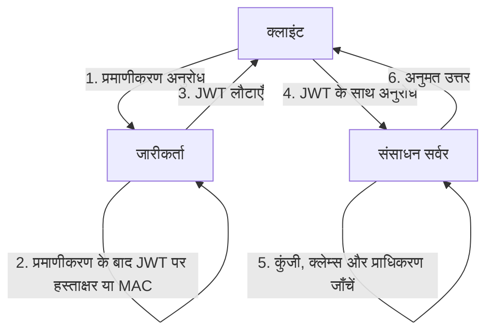
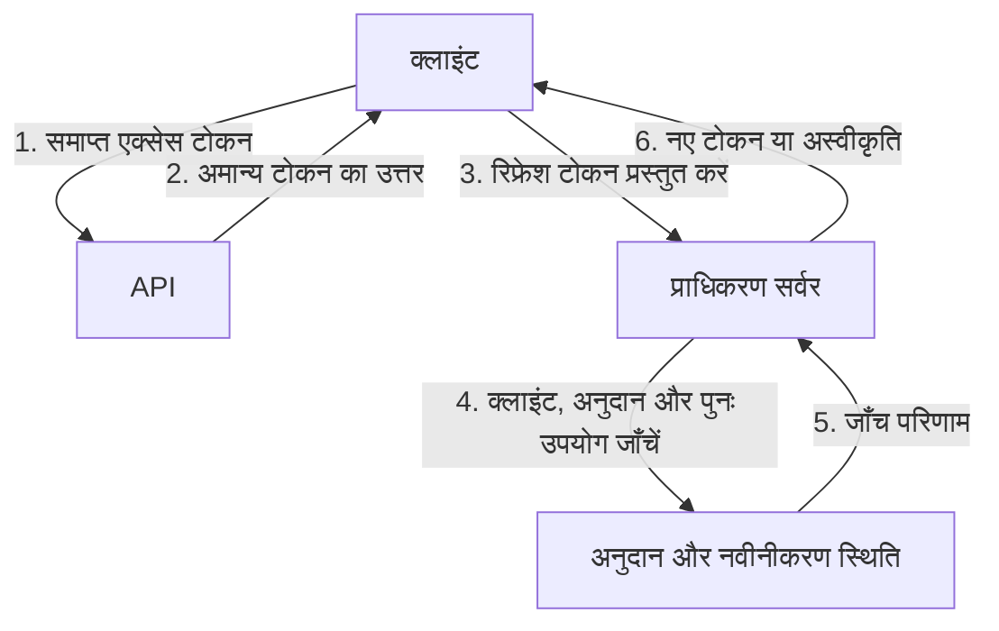

JWT प्रणालियों के बीच क्लेम्स (claims) भेजने का प्रारूप है। इसे अपनाने से प्रमाणीकरण, प्राधिकरण या सत्र प्रबंधन अपने आप सुरक्षित नहीं हो जाते। यह लेख ब्राउज़र के लॉगिन सत्रों की डिज़ाइन को API टोकनों के सत्यापन और निरस्तीकरण से अलग रखकर समझाता है।

पहले यह अंतर समझें: **JWT टोकन का प्रारूप है; कुकी ब्राउज़र में डेटा रखने और भेजने की व्यवस्था है**। कुकी में JWT या यादृच्छिक सत्र ID, दोनों रखे जा सकते हैं। केवल “कुकी बनाम JWT” की तुलना अलग-अलग डिज़ाइन निर्णयों को मिला देती है।

## सर्वर पर सत्र कैसे काम करते हैं

सामान्य डिज़ाइन में सफल लॉगिन के बाद ऐसा सत्र ID जारी होता है जिसका अनुमान लगाना कठिन हो। सर्वर के स्टोर में उसका उपयोगकर्ता, समाप्ति समय और अन्य सत्र जानकारी से संबंध रखा जाता है। ब्राउज़र को ID कुकी में मिलता है। नीचे का चित्र HTTPS मानता है और कुकी गुणों तथा विफलता के रास्तों को नहीं दिखाता।

स्टोर से निरस्तीकरण, लॉगआउट और अनुमति में बदलाव का प्रबंधन आसान होता है। लेकिन हटाए गए सत्र की जानकारी अभी न पाने वाले कैश या प्रतिरूप के कारण असर में देरी हो सकती है। वितरित डिज़ाइन में यह तय करना चाहिए कि कौन-सा सर्वर कब स्थिति का कौन-सा संस्करण देखता है।

सत्र ID सामान्यतः छोटा होता है और उपयोगकर्ता की जानकारी क्लाइंट को बताना आवश्यक नहीं होता। फिर भी चोरी हुए ID का दुरुपयोग हो सकता है। अनुमान लगाने में कठिनाई, लॉगिन पर ID बदलना, समय-सीमा, HTTPS, कुकी गुण और XSS व CSRF से बचाव जरूरी हैं। स्टोर तक पहुँच में लोड, उपलब्धता और संचालन की लागत भी होती है; आवश्यक पैमाने के अनुसार उसका मूल्यांकन करें।

## JWT और स्थानीय सत्यापन

JWT JSON क्लेम्स के समूह को दर्शाता है और JWS के हस्ताक्षर या MAC तथा/अथवा JWE एन्क्रिप्शन का उपयोग कर सकता है। सार्वजनिक-कुंजी हस्ताक्षर में जारीकर्ता की निजी कुंजी और जाँचकर्ता की सार्वजनिक कुंजी लगती है; HMAC में साझा गुप्त कुंजी लगती है। आगे मुख्यतः हस्ताक्षर या MAC से सुरक्षित, स्व-संपूर्ण JWT की चर्चा है।

**हस्ताक्षर करना एन्क्रिप्शन नहीं है।** केवल हस्ताक्षर वाले JWT के क्लेम्स पढ़े जा सकते हैं; उनमें बिना सोचे गुप्त जानकारी न रखें। base64url डिकोड करना भी टोकन की वैधता जाँचने से अलग है।

विश्वसनीय जारीकर्ता की कुंजी से स्थानीय सत्यापन करके ऐसी व्यवस्था बनाई जा सकती है जिसमें हर अनुरोध पर केंद्रीय सत्र स्टोर न देखना पड़े। लेकिन कुंजी प्राप्त करने और बदलने, खाते रोकने, निरस्तीकरण या नवीनतम अनुमतियों की जानकारी के लिए फिर भी संचार या स्थिति चाहिए हो सकती है। JWT सभी डेटाबेस पहुँच समाप्त नहीं करता और बेहतर प्रदर्शन की गारंटी नहीं देता।

अनुमत एल्गोरिथम और कुंजियाँ एप्लिकेशन को तय करनी चाहिए। क्रिप्टोग्राफिक जाँच के साथ जारीकर्ता `iss`, लक्षित सेवा `aud`, समाप्ति `exp`, आवश्यक होने पर वैधता का आरंभ `nbf`, टोकन का उद्देश्य और माँगी गई कार्रवाई की अनुमति जाँचें। अपनाए गए प्रोफ़ाइल के अनुसार आवश्यक क्लेम्स अनिवार्य करें। सामान्य JWT विनिर्देश में `exp` तक हर परिस्थिति में अनिवार्य नहीं है। लॉगिन या पहुँच-नियंत्रण की डिज़ाइन में वैधता-अवधि की नीति स्पष्ट करके लागू करनी चाहिए।

## 1. निरस्तीकरण संभव है, लेकिन डिज़ाइन चाहिए

जो सर्वर ऑफ़लाइन केवल क्रिप्टोग्राफिक सुरक्षा और समय की शर्तें जाँचता है तथा अतिरिक्त स्थिति बिल्कुल नहीं देखता, वह किसी विशेष टोकन के निरस्तीकरण या जारी होने के बाद पासवर्ड बदलने की जानकारी नहीं पा सकता। ऐसी डिज़ाइन में चोरी हुआ वैध Bearer टोकन समाप्ति तक चल सकता है। केवल क्लाइंट से हटाना चोरी हुई प्रति को नहीं रोकता।

विकल्पों में छोटी वैधता-अवधि, निरस्तीकरण सूची, उपयोगकर्ता या सत्र के संस्करण क्रमांक और टोकन इंट्रोस्पेक्शन शामिल हैं। हस्ताक्षर कुंजी अमान्य करने से उसी कुंजी के अन्य टोकन भी प्रभावित होते हैं और बदलाव कुंजी कैश तथा जाँचकर्ताओं तक पहुँचाना पड़ता है। छोटी अवधि जोखिम का समय घटाती है, लेकिन किसी एक टोकन के तत्काल निरस्तीकरण की जगह नहीं लेती।

स्थिति या संचार जोड़ना अपने आप में विफलता नहीं है। हर API पर स्थिति देखना, केवल नवीनीकरण के समय देखना और निरस्तीकरण घटनाएँ वितरित करना अलग गुण रखते हैं। आवश्यक निरस्तीकरण गति और संचालन लागत चुनें। रिफ्रेश टोकन रद्द करने पर भी, पहले से जारी एक्सेस टोकन जरूरी नहीं कि अपने आप अमान्य हों, यदि API उन्हें केवल स्थानीय सत्यापन से स्वीकार करते रहें।

## 2. एल्गोरिथम चयन और टोकन के उद्देश्यों में भ्रम

`alg: none` बिना हस्ताक्षर या MAC वाला रूप है। जहाँ प्रमाणीकरण या पहुँच के लिए हस्ताक्षरित टोकन अनिवार्य हैं, वहाँ इसे स्वीकार न करें। प्राप्त `alg` के अनुसार जाँच नीति न बदलें। RFC 8725, `none` को अनुचित रूप से स्वीकार करने और RSA की सार्वजनिक कुंजी को HMAC की गुप्त कुंजी मान लेने वाले एल्गोरिथम भ्रम को अलग समस्याएँ बताता है।

रखरखाव वाली लाइब्रेरी इस्तेमाल करें और अनुमत एल्गोरिथम, कुंजियों व जारीकर्ताओं का संबंध, लक्षित प्राप्तकर्ता और हर प्रकार के टोकन की जाँच के नियम तय करें। दूसरे उद्देश्य के टोकन स्वीकार न हों, जैसे API एक्सेस टोकन की जगह ID टोकन। सभी लाइब्रेरियों की सुरक्षा या वर्तमान पैच स्थिति की एकमुश्त गारंटी नहीं दी जा सकती।

## 3. ब्राउज़र स्टोरेज, XSS और CSRF

समान ओरिजिन का JavaScript, `localStorage` और `sessionStorage` दोनों पढ़ सकता है। इसलिए XSS से वहाँ रखे Bearer टोकन लीक हो सकते हैं। `sessionStorage` की छोटी भंडारण अवधि इस पढ़ने को नहीं रोकती।

`HttpOnly` कुकी JavaScript को उसका मान सीधे पढ़ने से रोकती है, लेकिन संपूर्ण XSS को नहीं रोकती। समान ओरिजिन का दुर्भावनापूर्ण कोड कुकी के साथ प्रमाणित कार्रवाइयाँ कर सकता है या मिली जानकारी पढ़ सकता है।

जब ब्राउज़र की शर्तों के अनुसार कुकी स्वतः भेजी जाती है, तो CSRF से भी बचाव करें। `Secure`, उपयुक्त `SameSite` और भेजने का सीमित दायरा तय करें। स्थिति बदलने वाली कार्रवाइयों में CSRF टोकन या Origin जाँच जैसी सुरक्षा रखें। `SameSite` से हर मामला सुरक्षित मानकर न चलें और GET से स्थिति न बदलें। ये बातें कुकी में JWT हो या सत्र ID, दोनों पर लागू हैं। [XSS और CSRF की व्याख्या](/hi/p/cross-site-scripting-xss-csrf-security/) भी देखें।

स्टोरेज का चुनाव आर्किटेक्चर पर भी निर्भर है। API टोकन ब्राउज़र को देने के बजाय सर्वर पर रखकर, ब्राउज़र से सत्र कुकी द्वारा संवाद करने पर भी विचार करें। एप्लिकेशन की सीमाओं और आवश्यक कार्रवाइयों के अनुसार तय करें।

## 4. रिफ्रेश टोकन और स्थिति रखने की जगह

रिफ्रेश टोकन नए अल्पकालिक एक्सेस टोकन पाने का एक तरीका हैं। उन्हें जारी करना वैकल्पिक है; JWT इस्तेमाल करने से वे अनिवार्य नहीं हो जाते। “15 मिनट” अवधि का उदाहरण है, मानक द्वारा सबके लिए तय किया गया मान नहीं।

चित्र ऐसी डिज़ाइन का उदाहरण है जिसमें नवीनीकरण की स्थिति प्रबंधित होती है। रिफ्रेश टोकन को गुप्त रखें और निरस्तीकरण व पुनः उपयोग पर क्या करना है, यह तय करें। RFC 9700 सार्वजनिक क्लाइंटों को जारी रिफ्रेश टोकन के लिए प्रेषक से क्रिप्टोग्राफिक बंधन या रोटेशन अनिवार्य करता है। रोटेशन में पिछला टोकन अमान्य होता है, लेकिन नए से उसका संबंध बना रहता है। पुनः उपयोग मिलने पर कार्रवाई भी डिज़ाइन का हिस्सा है।

इसका अर्थ हर टोकन को डेटाबेस में सादे पाठ में अनिवार्यतः रखना नहीं है। सुरक्षित निरूपण और संबंधित स्थिति प्रबंधित करें तथा उपयोगकर्ता, क्लाइंट और प्राधिकरण अनुदान (authorization grant) से संबंध जाँचें। नवीनीकरण के समय स्थिति प्रबंधित करते हुए हर API पर एक्सेस टोकन का स्थानीय सत्यापन संभव है।

## निष्कर्ष: उद्देश्य और आवश्यकताओं से तुलना करें

JWT सेवाओं के बीच सत्यापन योग्य क्लेम्स पहुँचाने में उपयोगी हो सकता है। आंतरिक नेटवर्क होने मात्र से जारीकर्ता, लक्ष्य या अनुमति की जाँच न छोड़ें। OAuth एक्सेस टोकन JWT प्रारूप तक सीमित नहीं हैं। दूसरी ओर OIDC के ID टोकन JWT हैं और क्लाइंट को प्रमाणीकरण का परिणाम बताते हैं। उन्हें API एक्सेस टोकन की जगह इस्तेमाल न करें।

JWT से पासवर्ड रीसेट या ईमेल पुष्टि URL अपने आप एकबारगी नहीं बनता। अवधि, प्राप्तकर्ता और उद्देश्य की सीमाएँ तथा उपयोग हो चुका है या नहीं, इसका प्रबंधन जरूरी है। साधारण यादृच्छिक टोकन से आवश्यकताएँ पूरी हों, तो JWT आवश्यक नहीं।

ब्राउज़र-केंद्रित एप्लिकेशन में तेज निरस्तीकरण जरूरी हो, तो सर्वर के सत्र तुलना का प्रारंभिक विकल्प हैं। सेवाओं के बीच स्थानीय सत्यापन चाहिए, तो JWT भी विकल्प है। यह आवश्यकताओं पर आधारित डिज़ाइन निर्णय है, कोई विकल्प हमेशा अधिक सुरक्षित या तेज होने का दावा नहीं। स्वीकार्य निरस्तीकरण देरी, जानकारी की नवीनता, क्लाइंट प्रकार, कुंजी प्रबंधन, स्टोरेज, संचार और संचालन भार की तुलना करें।

## संदर्भ

- [RFC 7519: JWT प्रारूप और क्लेम्स, §3–4](https://www.rfc-editor.org/rfc/rfc7519.html)
- [RFC 8725: एल्गोरिथम, जारीकर्ता, लक्ष्य और उद्देश्य की जाँच, §2.1 और §3](https://www.rfc-editor.org/rfc/rfc8725.html)
- [RFC 7009: OAuth टोकन निरस्तीकरण की डिज़ाइन, §3](https://www.rfc-editor.org/rfc/rfc7009.html)
- [RFC 9700: रिफ्रेश टोकन सुरक्षा, §2.2.2 और §4.14](https://www.rfc-editor.org/rfc/rfc9700.html)
- [RFC 6749: एक्सेस और रिफ्रेश टोकन, §1.4–1.5](https://www.rfc-editor.org/rfc/rfc6749.html)
- [OpenID Connect Core 1.0: ID टोकन, §2](https://openid.net/specs/openid-connect-core-1_0.html)
- [OWASP: सत्र और कुकी गुण](https://cheatsheetseries.owasp.org/cheatsheets/Session_Management_Cheat_Sheet.html)
- [OWASP: Web Storage सुरक्षा](https://cheatsheetseries.owasp.org/cheatsheets/HTML5_Security_Cheat_Sheet.html)
- [OWASP: पासवर्ड रीसेट टोकन](https://cheatsheetseries.owasp.org/cheatsheets/Forgot_Password_Cheat_Sheet.html)
