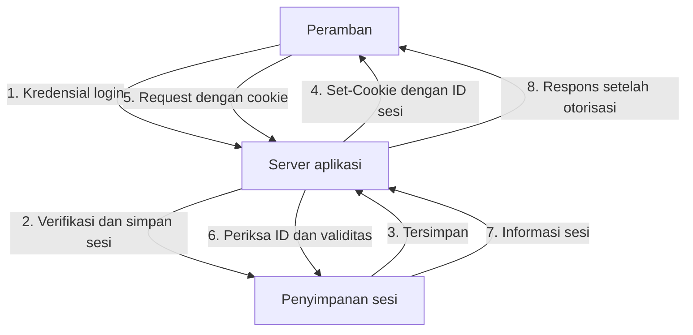
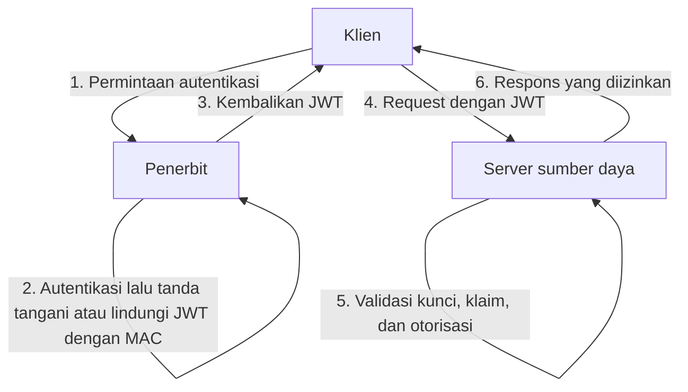
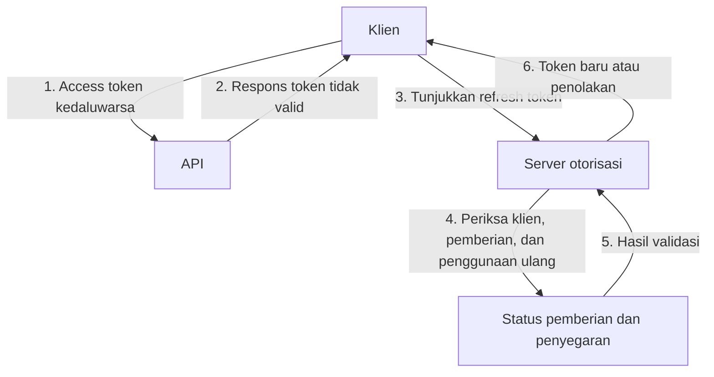

JWT adalah format untuk menyampaikan klaim (*claims*) antarsistem. Menggunakannya tidak otomatis membuat autentikasi, otorisasi, atau manajemen sesi aman. Artikel ini memisahkan rancangan sesi login peramban dari validasi dan pencabutan token API.

Pertama, **JWT adalah format token; cookie adalah mekanisme penyimpanan dan pengiriman peramban**. Cookie dapat membawa JWT maupun ID sesi acak. Membandingkan hanya “cookie versus JWT” mencampuradukkan keputusan yang berbeda.

## Cara kerja sesi di sisi server

Rancangan umum menerbitkan ID sesi yang sulit diprediksi setelah login berhasil, lalu menyimpan hubungannya dengan pengguna, waktu kedaluwarsa, dan informasi lain di server. Peramban menerima ID itu melalui cookie. Diagram ini mengasumsikan HTTPS dan tidak menampilkan atribut cookie maupun alur kegagalan.

Penyimpanan sesi memudahkan pengelolaan pencabutan, logout, dan perubahan izin. Namun, cache atau replika yang belum mengetahui penghapusan dapat menunda efeknya. Rancangan terdistribusi harus menentukan server mana yang melihat versi status tertentu dan kapan.

ID sesi biasanya ringkas dan menghindari pengungkapan informasi pengguna kepada klien. ID yang dicuri tetap dapat disalahgunakan. Sifat sulit diprediksi, pembaruan ID saat login, masa berlaku, HTTPS, atribut cookie, serta pertahanan XSS dan CSRF diperlukan. Akses penyimpanan juga memiliki biaya beban, ketersediaan, dan operasi yang harus dinilai sesuai skala kebutuhan.

## JWT dan validasi lokal

JWT merepresentasikan kumpulan klaim JSON menggunakan tanda tangan atau MAC JWS dan/atau enkripsi JWE. Tanda tangan kunci publik menggunakan kunci privat penerbit dan kunci publik pemeriksa; HMAC menggunakan rahasia bersama. Pembahasan berikut terutama mengenai JWT mandiri yang dilindungi tanda tangan atau MAC.

**Penandatanganan bukan enkripsi.** Klaim JWT yang hanya ditandatangani dapat dibaca, jadi jangan sembarangan memasukkan rahasia. Dekode base64url juga berbeda dari memvalidasi token.

Validasi lokal menggunakan kunci penerbit tepercaya dapat menghindari permintaan ke penyimpanan sesi pusat pada setiap request. Pengambilan dan pembaruan kunci, penonaktifan akun, informasi pencabutan, atau izin terbaru tetap dapat memerlukan komunikasi atau status. JWT tidak menghapus semua akses basis data dan tidak menjamin kinerja lebih baik.

Aplikasi harus menentukan algoritma dan kunci yang diizinkan. Selain verifikasi kriptografis, periksa penerbit `iss`, layanan tujuan `aud`, kedaluwarsa `exp`, awal masa berlaku `nbf` bila diperlukan, tujuan token, dan izin untuk operasi yang diminta. Wajibkan klaim sesuai profil yang digunakan. Spesifikasi JWT umum bahkan tidak mewajibkan `exp` dalam semua kasus. Rancangan login atau pengendalian akses harus menetapkan dan menegakkan kebijakan masa berlaku secara eksplisit.

## 1. Pencabutan dimungkinkan, tetapi perlu dirancang

Server yang hanya memeriksa perlindungan kriptografis dan kondisi waktu secara luring tanpa melihat status tambahan tidak dapat mengetahui pencabutan token individual atau perubahan kata sandi setelah penerbitan. Dalam rancangan itu, token bearer valid yang dicuri dapat tetap digunakan sampai kedaluwarsa. Menghapusnya dari klien tidak menghentikan salinan yang dicuri.

Pilihan mencakup masa berlaku pendek, daftar pencabutan, nomor versi per pengguna atau sesi, dan introspeksi token. Menonaktifkan kunci penandatanganan juga memengaruhi token lain yang diterbitkan dengan kunci tersebut serta memerlukan penyebaran perubahan ke cache kunci dan pemeriksa. Masa berlaku pendek membatasi paparan, tetapi bukan pengganti pencabutan token individual secara langsung.

Menambahkan status atau komunikasi bukan kegagalan dengan sendirinya. Memeriksa status di setiap API, hanya saat penyegaran, atau mendistribusikan peristiwa pencabutan memiliki sifat berbeda. Pilih kecepatan pencabutan dan biaya operasi yang diperlukan. Mencabut refresh token tidak selalu membatalkan access token yang sudah diterbitkan dan masih diterima setiap API melalui validasi lokal.

## 2. Pemilihan algoritma dan kekeliruan tujuan token

`alg: none` menyatakan bentuk tanpa tanda tangan atau MAC. Endpoint autentikasi atau akses yang mewajibkan token bertanda tangan tidak boleh menerimanya. Jangan biarkan `alg` yang diterima mengubah kebijakan verifikasi. RFC 8725 membedakan penerimaan `none` yang tidak semestinya dari kekeliruan algoritma yang memakai kunci publik RSA sebagai rahasia HMAC.

Gunakan pustaka yang dipelihara dan atur algoritma yang diizinkan, hubungan kunci dengan penerbit, penerima tujuan, serta aturan validasi tiap jenis token. Cegah penerimaan token untuk tujuan lain, seperti memakai ID token sebagai access token API. Keamanan atau status patch terkini semua pustaka tidak dapat dijamin secara menyeluruh.

## 3. Penyimpanan peramban, XSS, dan CSRF

JavaScript dari origin yang sama dapat membaca `localStorage` maupun `sessionStorage`. Karena itu, XSS dapat membocorkan token bearer yang disimpan di sana. Masa penyimpanan `sessionStorage` yang lebih singkat tidak mencegah pembacaan tersebut.

Cookie `HttpOnly` mencegah JavaScript membaca nilainya secara langsung, tetapi tidak mencegah XSS secara keseluruhan. Kode berbahaya dari origin yang sama masih dapat menjalankan operasi terautentikasi dengan cookie atau membaca informasi yang diperoleh.

Saat cookie dikirim otomatis sesuai kondisi peramban, tangani CSRF juga. Tetapkan `Secure`, nilai `SameSite` yang sesuai, dan cakupan pengiriman sempit, serta rancang perlindungan seperti token CSRF atau pemeriksaan Origin untuk operasi pengubah status. Jangan menganggap `SameSite` mencakup semua kasus dan jangan mengubah status melalui GET. Pertimbangan ini berlaku baik cookie berisi JWT maupun ID sesi. Lihat [penjelasan XSS dan CSRF](/id/p/cross-site-scripting-xss-csrf-security/).

Pilihan penyimpanan juga bergantung pada arsitektur. Pertimbangkan menyimpan token API di server dan menggunakan cookie sesi dengan peramban tanpa menyerahkan token API kepadanya. Putuskan berdasarkan batas aplikasi dan operasi yang diperlukan.

## 4. Refresh token dan lokasi status

Refresh token merupakan salah satu cara memperoleh access token baru yang berumur pendek. Penerbitannya opsional; penggunaan JWT tidak otomatis mewajibkannya. “15 menit” adalah contoh masa berlaku, bukan nilai universal yang ditentukan standar.

Diagram ini menggambarkan rancangan yang mengelola status penyegaran. Lindungi refresh token sebagai rahasia dan tentukan penanganan pencabutan serta penggunaan ulang. RFC 9700 mewajibkan refresh token yang diterbitkan untuk klien publik terikat secara kriptografis pada pengirim atau menggunakan rotasi. Rotasi membatalkan token sebelumnya sambil menyimpan hubungannya dengan token baru; penanganan penggunaan ulang yang terdeteksi juga bagian dari rancangan.

Ini bukan berarti setiap token harus disimpan sebagai teks terang di basis data. Kelola representasi aman dan status terkait, lalu periksa hubungannya dengan pengguna, klien, dan pemberian otorisasi. Status dapat dikelola saat penyegaran, sedangkan access token divalidasi secara lokal oleh tiap API.

## Kesimpulan: bandingkan menurut tujuan dan kebutuhan

JWT dapat berguna untuk menyampaikan klaim yang dapat diverifikasi antar layanan. Jaringan internal bukan alasan melewatkan validasi penerbit, tujuan, atau izin. Access token OAuth tidak terbatas pada format JWT. Sebaliknya, ID token OIDC adalah JWT yang menyampaikan hasil autentikasi kepada klien. Jangan menggunakannya sebagai pengganti access token API.

JWT juga tidak otomatis membuat URL pengaturan ulang kata sandi atau verifikasi email menjadi sekali pakai. Kedaluwarsa, batasan penerima dan tujuan, serta pelacakan apakah sudah digunakan tetap diperlukan. Jika token acak sederhana memenuhi kebutuhan, JWT tidak diperlukan.

Untuk aplikasi yang berpusat pada peramban dan memerlukan pencabutan cepat, sesi di server dapat menjadi titik awal perbandingan. JWT juga kandidat bila validasi lokal antarlayanan diperlukan. Ini keputusan rancangan berdasarkan kebutuhan, bukan pernyataan bahwa salah satu pilihan selalu lebih aman atau cepat. Bandingkan penundaan pencabutan yang dapat diterima, kemutakhiran informasi, jenis klien, pengelolaan kunci, penyimpanan, lalu lintas, dan beban operasi.

## Referensi

- [RFC 7519: format dan klaim JWT, §3–4](https://www.rfc-editor.org/rfc/rfc7519.html)
- [RFC 8725: validasi algoritma, penerbit, tujuan, dan kegunaan, §2.1 dan §3](https://www.rfc-editor.org/rfc/rfc8725.html)
- [RFC 7009: rancangan pencabutan token OAuth, §3](https://www.rfc-editor.org/rfc/rfc7009.html)
- [RFC 9700: perlindungan refresh token, §2.2.2 dan §4.14](https://www.rfc-editor.org/rfc/rfc9700.html)
- [RFC 6749: access token dan refresh token, §1.4–1.5](https://www.rfc-editor.org/rfc/rfc6749.html)
- [OpenID Connect Core 1.0: ID token, §2](https://openid.net/specs/openid-connect-core-1_0.html)
- [OWASP: sesi dan atribut cookie](https://cheatsheetseries.owasp.org/cheatsheets/Session_Management_Cheat_Sheet.html)
- [OWASP: keamanan Web Storage](https://cheatsheetseries.owasp.org/cheatsheets/HTML5_Security_Cheat_Sheet.html)
- [OWASP: token pengaturan ulang kata sandi](https://cheatsheetseries.owasp.org/cheatsheets/Forgot_Password_Cheat_Sheet.html)
