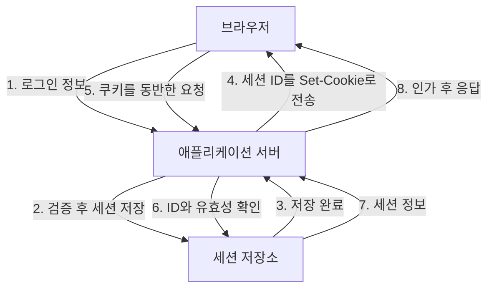
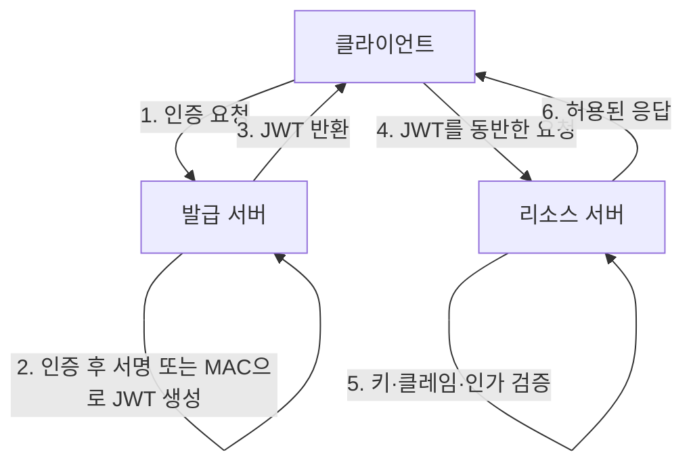
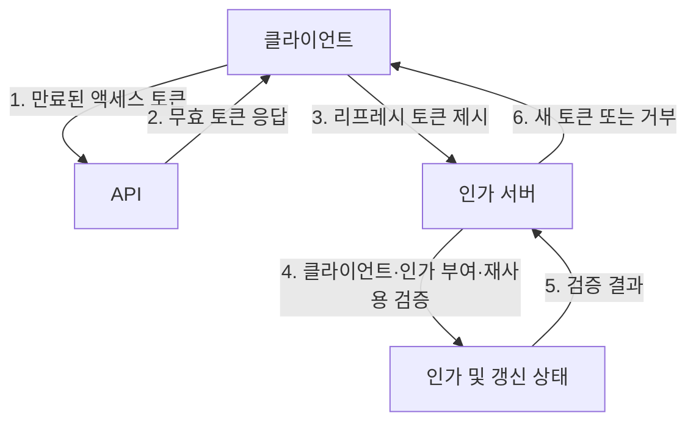

JWT는 시스템 사이에서 클레임(claims)을 전달하는 형식입니다. 이를 채택한다고 인증, 인가 또는 세션 관리가 자동으로 안전해지는 것은 아닙니다. 이 글에서는 브라우저 로그인 세션의 설계와 API 토큰의 검증·폐기를 구분합니다.

먼저 **JWT는 토큰 형식이고, 쿠키는 브라우저의 저장·전송 메커니즘**이라는 점을 구별해야 합니다. 쿠키에는 JWT도 무작위 세션 ID도 담을 수 있습니다. 단순히 '쿠키 대 JWT'로 비교하면 서로 다른 설계 결정을 혼동하게 됩니다.

## 서버 측 세션의 동작 방식

일반적인 설계는 로그인 성공 후 예측하기 어려운 세션 ID를 발급하고, 서버 저장소에 사용자·만료 시간 등과의 대응 관계를 보관합니다. 브라우저에는 ID를 쿠키로 돌려줍니다. 다음 개요는 HTTPS를 전제로 하며 쿠키 속성과 실패 시 처리는 생략합니다.

저장소를 통해 폐기, 로그아웃, 권한 변경을 관리하기 쉽습니다. 다만 삭제를 아직 반영하지 않은 캐시나 복제본이 있으면 효과가 지연될 수 있습니다. 분산 설계에서는 어느 서버가 언제 어떤 버전의 상태를 보는지도 정해야 합니다.

세션 ID는 대개 작고 사용자 정보를 클라이언트에 노출할 필요가 없습니다. 그러나 탈취된 ID는 악용될 수 있습니다. 예측 불가능성, 로그인 시 ID 갱신, 만료 관리, HTTPS, 쿠키 속성, XSS·CSRF 방어가 필요합니다. 저장소 접근에는 부하, 가용성, 운영 비용도 있으므로 필요한 규모에 맞춰 평가해야 합니다.

## JWT와 로컬 검증

JWT는 JSON 클레임 집합을 나타내며 JWS 서명·MAC 또는 JWE 암호화, 혹은 이들의 조합을 사용할 수 있습니다. 공개 키 서명에서는 발급자의 개인 키와 검증자의 공개 키를 쓰고, HMAC에서는 공유 비밀 키를 씁니다. 이하에서는 주로 서명 또는 MAC으로 보호되는 자체 포함형 JWT를 다룹니다.

**서명은 암호화가 아닙니다.** 서명만 된 JWT의 클레임은 읽을 수 있으므로 비밀 정보를 함부로 넣어서는 안 됩니다. base64url 디코딩과 토큰 유효성 검증도 다릅니다.

신뢰하는 발급자의 키로 로컬에서 검증할 수 있으면 요청마다 중앙 세션 저장소에 질의하지 않는 구성이 가능합니다. 그래도 키 획득·갱신, 계정 정지, 폐기 정보, 최신 권한 등을 위해 통신이나 상태가 필요할 수 있습니다. JWT가 모든 데이터베이스 접근을 없애거나 더 나은 성능을 보장하지는 않습니다.

허용할 알고리즘과 키는 애플리케이션이 정해야 합니다. 암호학적 검증 외에도 발급자 `iss`, 대상 서비스 `aud`, 만료 `exp`, 필요한 경우 유효 시작 `nbf`, 토큰 용도와 요청 작업의 권한을 확인합니다. 채택한 프로파일에 따라 필요한 클레임을 필수로 지정합니다. 범용 JWT 명세에서는 `exp`조차 모든 경우에 필수인 것은 아닙니다. 로그인이나 접근 관리 설계에서는 유효 기간 정책을 명시하고 검증해야 합니다.

## 1. 폐기는 가능하지만 설계가 필요합니다

암호학적 보호와 시간 조건만 오프라인으로 확인하고 추가 상태를 전혀 조회하지 않는 서버는 개별 토큰의 폐기나 발급 후 비밀번호 변경을 알 수 없습니다. 이런 설계에서는 탈취된 유효한 Bearer 토큰이 만료까지 사용될 위험이 있습니다. 클라이언트에서 삭제하는 것만으로는 탈취된 복사본을 막지 못합니다.

대안에는 짧은 유효 기간, 폐기 목록, 사용자·세션별 버전 번호, 토큰 인트로스펙션(introspection) 등이 있습니다. 서명 키를 무효화하면 같은 키로 발급한 다른 토큰에도 영향을 주며 키 캐시와 검증자에게 변경을 전파해야 합니다. 짧은 만료 시간은 노출 시간을 줄이지만 개별 토큰의 즉시 폐기를 대신하지는 않습니다.

상태나 통신을 도입하는 것 자체가 실패는 아닙니다. API마다 상태를 확인하는 방식, 갱신할 때만 확인하는 방식, 폐기 이벤트를 배포하는 방식은 특성이 다릅니다. 필요한 폐기 속도와 운영 비용을 선택해야 합니다. 리프레시 토큰을 폐기해도 각 API가 로컬 검증만으로 계속 수락하는 기존 액세스 토큰이 자동으로 무효화되는 것은 아닙니다.

## 2. 알고리즘 선택과 토큰 용도의 혼동

`alg: none`은 서명이나 MAC이 없는 형식입니다. 서명된 토큰을 요구하는 인증·접근 엔드포인트에서는 이를 수락하지 않도록 설정합니다. 수신한 `alg`에 따라 검증 정책을 바꾸어서는 안 됩니다. RFC 8725는 `none`의 부적절한 수락과 RSA 공개 키를 HMAC 비밀 키로 잘못 사용하는 알고리즘 혼동을 별개 문제로 설명합니다.

유지보수되는 라이브러리를 사용하고 허용 알고리즘, 키와 발급자의 관계, 대상 수신자, 토큰 종류별 검증 규칙을 설정합니다. ID 토큰을 API 액세스 토큰으로 수락하는 등 다른 용도의 토큰이 통용되는 구성도 막아야 합니다. 모든 라이브러리의 안전성이나 현재 패치 상태를 일괄 보장할 수는 없습니다.

## 3. 브라우저 저장소, XSS와 CSRF

동일 출처의 JavaScript는 `localStorage`와 `sessionStorage`를 모두 읽을 수 있습니다. 따라서 XSS로 여기에 저장된 Bearer 토큰이 유출될 수 있습니다. `sessionStorage`의 저장 기간이 짧다는 사실은 이 읽기를 막지 못합니다.

`HttpOnly` 쿠키는 JavaScript가 쿠키 값을 직접 읽는 것을 막지만 XSS 전체를 방지하지는 않습니다. 동일 출처의 악성 코드는 여전히 쿠키를 동반한 인증된 작업을 수행하거나 가져온 정보를 읽을 수 있습니다.

쿠키가 브라우저의 조건에 따라 자동 전송되는 경우 CSRF에도 대응해야 합니다. `Secure`, 적절한 `SameSite`, 좁은 전송 범위를 설정하고 상태 변경 작업에 CSRF 토큰이나 Origin 확인 등의 보호를 설계합니다. `SameSite`가 모든 경우를 막는다고 가정하지 말고 GET으로 상태를 변경하지 않아야 합니다. 이는 쿠키에 JWT를 넣든 세션 ID를 넣든 공통입니다. [XSS·CSRF 설명](/ko/p/cross-site-scripting-xss-csrf-security/)도 참조하세요.

저장 위치는 아키텍처의 제약도 받습니다. 브라우저에 API 토큰을 전달하지 않고 서버에 보관하며, 브라우저와는 세션 쿠키로 통신하는 구성도 고려할 수 있습니다. 애플리케이션 경계와 필요한 작업에 따라 결정합니다.

## 4. 리프레시 토큰과 상태를 관리하는 위치

리프레시 토큰은 수명이 짧은 액세스 토큰을 다시 얻는 방법 중 하나입니다. 발급은 선택 사항이며 JWT를 사용한다고 반드시 필요한 것은 아닙니다. '15분'은 유효 기간의 예이지 표준이 일률적으로 정한 값이 아닙니다.

이 그림은 갱신 상태를 관리하는 설계의 개요입니다. 리프레시 토큰을 비밀로 보호하고 폐기와 재사용에 어떻게 대응할지 정합니다. RFC 9700은 공개 클라이언트에 발급하는 리프레시 토큰에 송신자 제약 또는 로테이션을 요구합니다. 로테이션은 이전 토큰을 무효화하면서 새 토큰과의 관계를 보관합니다. 재사용을 탐지했을 때의 처리도 설계에 포함됩니다.

이는 모든 토큰의 평문을 반드시 데이터베이스에 저장하라는 뜻이 아닙니다. 안전한 표현과 관련 상태를 관리하고 사용자·클라이언트·인가 부여와의 관계를 확인합니다. 갱신 시 상태를 관리하면서 각 API에서는 액세스 토큰을 로컬 검증하는 구성도 가능합니다.

## 결론: 용도와 요구 사항으로 비교하기

JWT는 서비스 사이에 검증 가능한 클레임을 전달하는 용도 등에 유용합니다. 내부 네트워크라는 이유만으로 발급자·대상·권한 검증을 생략해서는 안 됩니다. OAuth 액세스 토큰은 JWT 형식으로 제한되지 않습니다. 반면 OIDC ID 토큰은 JWT이며 클라이언트에 인증 결과를 전달합니다. ID 토큰을 API 액세스 토큰 대신 사용해서는 안 됩니다.

JWT라고 해서 비밀번호 재설정이나 이메일 확인 URL이 자동으로 일회용이 되지도 않습니다. 유효 기간, 대상과 용도의 제한, 사용 여부 관리가 여전히 필요합니다. 단순한 무작위 토큰이 요구 사항을 충족한다면 JWT를 채택할 필요는 없습니다.

브라우저 중심이며 신속한 폐기를 중시하는 경우 서버 측 세션은 비교의 출발점입니다. 서비스 간 로컬 검증이 필요하면 JWT도 후보입니다. 이는 요구 사항에 따른 설계 판단이며 어느 한쪽이 항상 더 안전하거나 빠르다는 결론이 아닙니다. 허용할 폐기 지연, 정보의 최신성, 클라이언트 종류, 키 관리, 저장 위치, 통신량과 운영 부담을 비교해 선택하세요.

## 참고 자료

- [RFC 7519: JWT 형식과 클레임, §3–4](https://www.rfc-editor.org/rfc/rfc7519.html)
- [RFC 8725: 알고리즘·발급자·대상·용도 검증, §2.1 및 §3](https://www.rfc-editor.org/rfc/rfc8725.html)
- [RFC 7009: OAuth 토큰 폐기 설계, §3](https://www.rfc-editor.org/rfc/rfc7009.html)
- [RFC 9700: 리프레시 토큰 보호, §2.2.2 및 §4.14](https://www.rfc-editor.org/rfc/rfc9700.html)
- [RFC 6749: 액세스 토큰과 리프레시 토큰, §1.4–1.5](https://www.rfc-editor.org/rfc/rfc6749.html)
- [OpenID Connect Core 1.0: ID 토큰, §2](https://openid.net/specs/openid-connect-core-1_0.html)
- [OWASP: 세션 관리와 쿠키 속성](https://cheatsheetseries.owasp.org/cheatsheets/Session_Management_Cheat_Sheet.html)
- [OWASP: Web Storage 보안](https://cheatsheetseries.owasp.org/cheatsheets/HTML5_Security_Cheat_Sheet.html)
- [OWASP: 비밀번호 재설정 토큰](https://cheatsheetseries.owasp.org/cheatsheets/Forgot_Password_Cheat_Sheet.html)
