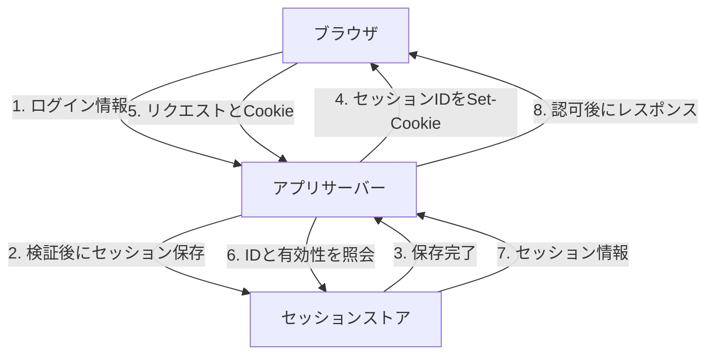
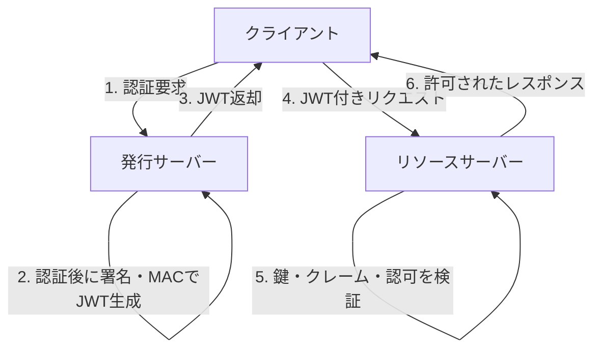
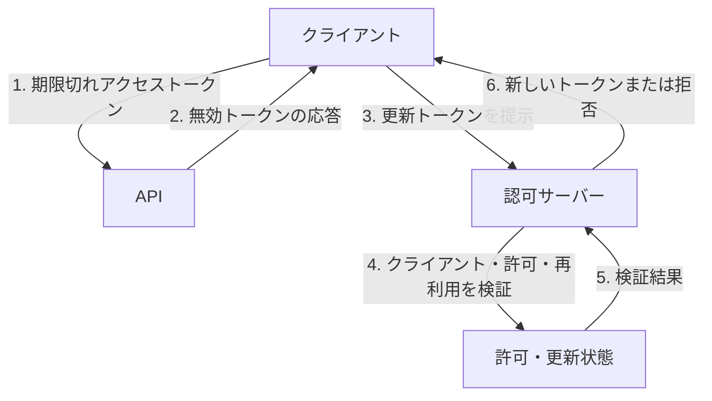

JWTは、システム間でクレームを受け渡すための形式です。採用するだけで認証・認可やセッション管理が安全になるわけではありません。本記事では、ブラウザのログイン状態を保つ設計と、APIに渡すトークンの検証・失効を分けて考えます。

最初に区別したいのは、**JWTはトークンの形式、Cookieはブラウザでの保存・送信の仕組み**という点です。JWTをCookieで送ることも、ランダムなセッションIDをCookieで送ることもできます。「CookieかJWTか」だけでは比較の軸がそろいません。

## サーバー側セッションの仕組み

典型的な方式では、ログイン成功後に予測困難なセッションIDを発行し、サーバー側のストアに利用者や期限などとの対応を保存します。ブラウザにはIDをCookieで返します。以下はHTTPS通信を前提とした概略で、Cookie属性や失敗時の処理は図から省略しています。

失効・ログアウト・権限変更をストア側で管理しやすいのが利点です。ただし、削除を確認しないキャッシュや複製があれば反映に遅延が生じます。分散構成では、どのサーバーがどの時点の状態を参照するかも設計に含めます。

セッションIDは通常コンパクトで、利用者情報をクライアントへ露出させずに済みます。しかし、IDを盗まれれば悪用され得ます。予測困難性、ログイン時のID更新、期限管理、HTTPS、Cookie属性、XSS・CSRF対策が必要です。ストアへのアクセスにも負荷・可用性・運用上のコストがあり、規模や要求に応じて評価します。

## JWTとローカル検証

JWTはJSONのクレーム集合を表し、JWSによる署名・MACやJWEによる暗号化を用いる形式です。公開鍵暗号の署名では発行側の秘密鍵と検証側の公開鍵を使い、HMACでは共有秘密鍵を使います。ここからは主に、署名またはMACで保護された自己完結型JWTを扱います。

**署名は暗号化ではありません。** 署名だけのJWTでは内容を読めるため、秘密情報を安易に入れないでください。base64urlのデコードと、トークンの有効性の検証も別です。

信頼する発行者の鍵を使ってローカル検証できれば、各リクエストで中央セッションストアへ問い合わせずに済む構成を作れます。ただし、鍵の取得・更新、利用者の停止、失効情報、最新の権限などのために通信や状態が必要な場合もあります。「JWTならDBアクセスが一切なくなり、必ず高速になる」とは限りません。

検証では、許可するアルゴリズムと鍵をアプリケーション側で定め、暗号学的な検証に加えて、発行者 `iss`、対象サービス `aud`、期限 `exp`、必要なら有効開始 `nbf`、トークンの用途と要求された操作の権限を確認します。必要なクレームは採用するプロファイルに従って必須化します。JWTの汎用仕様だけでは `exp` もすべての場合に必須ではありません。ログイン・アクセス管理に使う設計では、有効期間の方針と検証を明示する必要があります。

## 1. 失効は可能だが設計が必要

署名と時間条件だけでオフライン検証し、追加の状態を一切見ないサーバーは、個別トークンの失効や発行後のパスワード変更を知ることができません。この構成では盗まれた有効なBearerトークンが期限まで使われるリスクがあります。クライアントから削除するだけでは、盗まれたコピーは止まりません。

対策には、短い有効期間、失効リスト、利用者・セッションごとの版番号、トークンのイントロスペクションなどがあります。署名鍵を無効にする方法は、その鍵で発行した他のトークンにも影響し、鍵キャッシュなどへの反映も必要です。短い期限は露出時間を抑えますが、即時の個別失効の代わりではありません。

状態や通信を導入すること自体が失敗なのではありません。各APIで状態を見るか、更新時だけ見るか、失効情報をどう配布するかで特性が異なります。要求する失効速度と運用コストを選びます。更新トークンを失効させても、既発行のアクセストークンを各APIがローカル検証だけで受け入れるなら、その有効性が自動的に消えるとは限りません。

## 2. アルゴリズム選択と用途の混同

`alg: none` は署名・MACのない形式を表します。署名を必須とする認証・アクセス用の受け口では受け入れない設定にします。受信した `alg` を信頼して検証方針を変えてはいけません。RFC 8725は、`none` の不適切な受理と、RSA公開鍵をHMAC鍵として誤用するアルゴリズム混同を別の問題として説明しています。

更新・保守されたライブラリを使うだけでなく、許可アルゴリズム、鍵と発行者の対応、対象サービス、トークン種別ごとの検証規則を設定します。IDトークンをAPI用アクセストークンとして受け入れるなど、別用途のJWTを流用できる構成も避けます。全ライブラリの安全性や現在の修正状況を一括して保証することはできません。

## 3. ブラウザの保存場所とXSS・CSRF

`localStorage` と `sessionStorage` は同一オリジンのJavaScriptから読めます。XSSがあれば、そこにあるBearerトークンを読み取られる可能性があります。`sessionStorage` の保存期間が短いことは、この読み取りを防ぐ対策ではありません。

`HttpOnly` CookieはJavaScriptからのCookie値の直接読み取りを防ぎますが、XSS全体を防ぐものではありません。同一オリジンの悪意あるコードは、Cookie付きの操作を実行したり、取得した情報を読んだりする可能性があります。

Cookieが条件に応じて自動送信される場合はCSRFにも対処します。`Secure`、適切な `SameSite`、狭い送信範囲を設定し、状態を変更する操作ではCSRFトークンやOrigin検証などを設計します。`SameSite` だけで全ケースが防げると考えず、GETで状態を変更しないことも大切です。これらはCookieの中身がJWTでもセッションIDでも共通です。[XSS・CSRFの解説](/p/cross-site-scripting-xss-csrf-security/)も参照してください。

保存場所には構成上の制約があります。ブラウザへAPIトークンを渡さず、サーバー側で保持してブラウザとはセッションCookieでやり取りする構成も検討できます。採否は、アプリの境界と必要な操作に沿って判断します。

## 4. 更新トークンと状態を持つ場所

短命なアクセストークンを再取得する方法の一つが更新トークンです。更新トークンの発行は任意で、JWTを使うから必ず必要になるわけではありません。「15分」は有効期間の例であり、標準が一律に定める値ではありません。

この図は、更新状態を管理する構成の概略です。更新トークンを秘密として保護し、失効と再利用への対応を決めます。RFC 9700では、公開クライアントに発行する更新トークンについて、送信者への暗号学的な束縛かローテーションを要求しています。ローテーションでは前のトークンを無効にして関係を保持し、再利用を検知した場合の処理も設計します。

サーバーが各トークンの平文を必ずDB保存する、という意味ではありません。安全な表現・関連状態を管理し、利用者・クライアント・許可との対応を確認します。更新時に状態を管理しながら、アクセストークンは各APIでローカル検証する構成も可能です。

## 結論：用途と要件で比較する

JWTは異なるサービス間で検証可能なクレームを渡す用途などで有用です。内部ネットワークにあるという理由だけで発行者・対象・権限の検証を省かないでください。OAuthのアクセストークンはJWTに限定されません。一方、OIDCのIDトークンはJWTであり、クライアントに認証結果を伝える用途を持ちます。両者を同じ目的に使わないことが重要です。

パスワード再設定やメール確認のURLも、JWTにすれば自動的にワンタイムになるわけではありません。有効期間・対象・用途と使用済みの管理が必要です。単純なランダムトークンで要件を満たせるなら、JWTを採用する必要はありません。

ブラウザ中心で即時失効を重視する場合、サーバー側セッションは比較の出発点になります。複数サービスでのローカル検証が必要ならJWTも候補です。これは要件からの設計判断であり、どちらかが常に安全・高速という結論ではありません。失効までの許容時間、情報の鮮度、クライアントの種類、鍵管理、保存場所、通信量と運用負荷を比較して選びましょう。

## 参考資料

- [RFC 7519：JWTの形式とクレーム（§3–4）](https://www.rfc-editor.org/rfc/rfc7519.html)
- [RFC 8725：アルゴリズム・発行者・対象・用途の検証（§2.1、§3）](https://www.rfc-editor.org/rfc/rfc8725.html)
- [RFC 7009：OAuthトークン失効の設計（§3）](https://www.rfc-editor.org/rfc/rfc7009.html)
- [RFC 9700：更新トークンの保護（§2.2.2、§4.14）](https://www.rfc-editor.org/rfc/rfc9700.html)
- [RFC 6749：アクセストークンと更新トークン（§1.4–1.5）](https://www.rfc-editor.org/rfc/rfc6749.html)
- [OpenID Connect Core 1.0：IDトークン（§2）](https://openid.net/specs/openid-connect-core-1_0.html)
- [OWASP：セッション管理とCookie属性](https://cheatsheetseries.owasp.org/cheatsheets/Session_Management_Cheat_Sheet.html)
- [OWASP：Web Storageのセキュリティ](https://cheatsheetseries.owasp.org/cheatsheets/HTML5_Security_Cheat_Sheet.html)
- [OWASP：パスワード再設定トークン](https://cheatsheetseries.owasp.org/cheatsheets/Forgot_Password_Cheat_Sheet.html)
