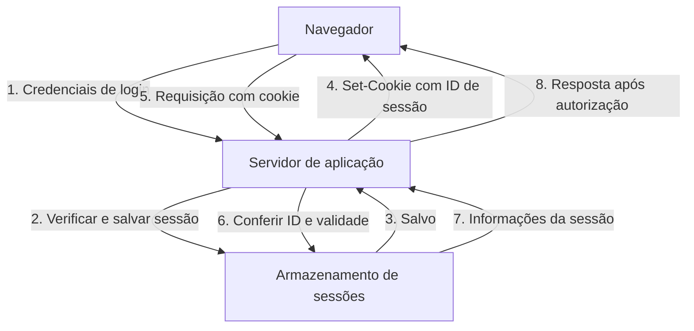
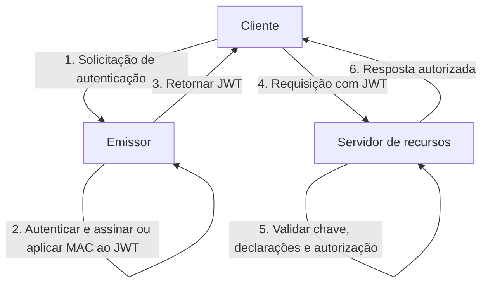
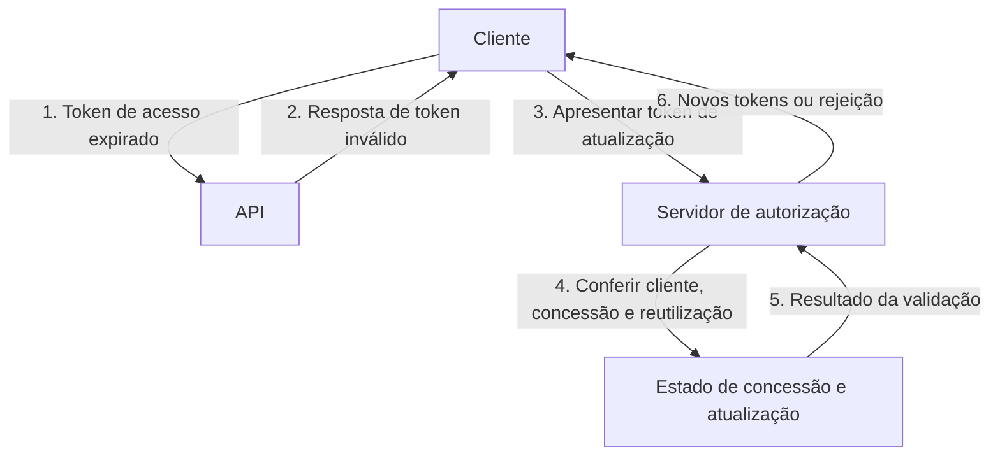

JWT é um formato para transmitir declarações (*claims*) entre sistemas. Adotá-lo não torna autenticação, autorização ou gestão de sessões automaticamente seguras. Este artigo separa o projeto das sessões de login do navegador da validação e revogação de tokens de API.

Primeiro, **JWT é um formato de token; cookies são um mecanismo de armazenamento e envio do navegador**. Um cookie pode conter um JWT ou um identificador de sessão aleatório. Comparar apenas “cookies versus JWT” mistura decisões diferentes.

## Como funcionam as sessões no servidor

Um projeto típico gera um identificador de sessão imprevisível após um login bem-sucedido e armazena no servidor sua associação com o usuário, a expiração e outros dados. O navegador recebe o identificador em um cookie. O esquema pressupõe HTTPS e omite atributos de cookie e caminhos de falha.

O armazenamento facilita a revogação, o logout e as mudanças de permissões. Porém, caches ou réplicas que ainda não observaram uma exclusão podem atrasar seu efeito. Um projeto distribuído deve especificar qual servidor vê cada versão do estado e quando.

Identificadores de sessão costumam ser compactos e evitam expor informações do usuário ao cliente. Um identificador roubado ainda pode ser usado indevidamente. São necessários imprevisibilidade, renovação do identificador no login, expiração, HTTPS, atributos de cookie e defesas contra XSS e CSRF. O acesso ao armazenamento também tem custos de carga, disponibilidade e operação, que devem ser avaliados para a escala exigida.

## JWT e validação local

JWT representa um conjunto de declarações JSON usando assinaturas ou MAC de JWS e/ou criptografia JWE. Assinaturas de chave pública usam a chave privada do emissor e a pública do verificador; HMAC usa um segredo compartilhado. A seguir, tratamos principalmente de JWTs autocontidos protegidos por assinatura ou MAC.

**Assinar não é criptografar.** As declarações de um JWT apenas assinado podem ser lidas; não inclua segredos sem cuidado. Decodificar base64url também é diferente de validar um token.

A validação local com a chave de um emissor confiável pode evitar consultas ao armazenamento central de sessões em cada requisição. Obtenção e atualização de chaves, suspensão de contas, informações de revogação ou permissões atuais ainda podem exigir comunicação ou estado. JWT não elimina todos os acessos ao banco de dados nem garante desempenho melhor.

A aplicação deve definir os algoritmos e as chaves permitidos. Além da verificação criptográfica, confira o emissor `iss`, o serviço destinatário `aud`, a expiração `exp`, o início de validade `nbf` quando aplicável, a finalidade do token e a permissão para a operação solicitada. Exija as declarações segundo o perfil adotado. A especificação genérica de JWT nem sequer exige `exp` em todos os casos. Um projeto de login ou controle de acesso deve definir e aplicar explicitamente sua política de validade.

## 1. A revogação é possível, mas exige um projeto

Um servidor que verifica apenas a proteção criptográfica e as condições de tempo de forma offline, sem consultar estado adicional, não pode saber que um token individual foi revogado ou que a senha mudou após a emissão. Nesse projeto, um token bearer válido roubado pode continuar utilizável até expirar. Apagá-lo do cliente não impede o uso de uma cópia roubada.

As opções incluem validade curta, listas de revogação, números de versão por usuário ou sessão e introspecção de tokens. Invalidar uma chave de assinatura também afeta outros tokens emitidos com ela e exige propagar a mudança aos caches e verificadores. Uma expiração curta limita a exposição, mas não substitui a revogação imediata de um token individual.

Introduzir estado ou comunicação não é, por si só, um fracasso. Consultar estado em cada API, apenas na atualização ou distribuir eventos de revogação tem propriedades diferentes. Escolha a velocidade de revogação e o custo operacional necessários. Revogar um token de atualização não invalida necessariamente os tokens de acesso já emitidos que cada API continua aceitando por validação local.

## 2. Escolha de algoritmos e confusão de finalidades

`alg: none` indica um formato sem assinatura nem MAC. Um endpoint de autenticação ou acesso que exige tokens assinados não deve aceitá-lo. Não deixe que o `alg` recebido mude a política de verificação. A RFC 8725 distingue a aceitação indevida de `none` da confusão de algoritmos que usa uma chave pública RSA como segredo HMAC.

Use uma biblioteca mantida e configure algoritmos permitidos, associações entre chaves e emissores, destinatários e regras de validação para cada tipo de token. Impeça a aceitação de tokens destinados a outra finalidade, como usar um token de ID como token de acesso de API. Não é possível garantir de forma geral a segurança ou a situação atual das correções de todas as bibliotecas.

## 3. Armazenamento no navegador, XSS e CSRF

JavaScript de mesma origem pode ler tanto `localStorage` quanto `sessionStorage`. Um XSS pode, portanto, expor tokens bearer armazenados neles. A menor duração do armazenamento em `sessionStorage` não impede essa leitura.

Um cookie `HttpOnly` impede que JavaScript leia diretamente seu valor, mas não impede XSS como um todo. Código malicioso de mesma origem ainda pode executar operações autenticadas com cookies ou ler informações obtidas.

Quando cookies são enviados automaticamente conforme as condições do navegador, trate também de CSRF. Configure `Secure`, um valor adequado de `SameSite` e um escopo de envio restrito, e projete proteções como tokens CSRF ou verificações de Origin para operações que alteram estado. Não suponha que `SameSite` cubra todos os casos nem altere estado por GET. Isso vale tanto para cookies com JWT quanto com identificadores de sessão. Veja a [explicação de XSS e CSRF](/pt/p/cross-site-scripting-xss-csrf-security/).

O armazenamento também depende da arquitetura. Considere manter tokens de API no servidor e usar um cookie de sessão com o navegador, sem entregar a ele esses tokens. Decida segundo os limites da aplicação e as operações necessárias.

## 4. Tokens de atualização e localização do estado

Tokens de atualização são uma forma de obter novos tokens de acesso de curta duração. Sua emissão é opcional; usar JWT não os torna obrigatórios. “15 minutos” é um exemplo de validade, não um valor universal definido por uma norma.

O diagrama mostra um projeto que gerencia o estado de atualização. Proteja os tokens de atualização como segredos e decida como lidar com revogação e reutilização. A RFC 9700 exige que tokens de atualização emitidos a clientes públicos sejam vinculados criptograficamente ao remetente ou usem rotação. A rotação invalida o token anterior, mantendo sua relação com o novo; o tratamento da reutilização detectada também faz parte do projeto.

Isso não significa armazenar necessariamente cada token em texto claro no banco de dados. Gerencie uma representação segura e o estado associado, verificando sua relação com o usuário, o cliente e a concessão de autorização. É possível gerenciar estado na atualização enquanto cada API valida localmente os tokens de acesso.

## Conclusão: comparar conforme a finalidade e os requisitos

JWT pode ser útil para transmitir declarações verificáveis entre serviços. Uma rede interna não justifica omitir a validação de emissor, destinatário ou permissões. Tokens de acesso OAuth não se limitam ao formato JWT. Já os tokens de ID do OIDC são JWTs que comunicam ao cliente o resultado da autenticação. Não devem ser usados como substitutos dos tokens de acesso a uma API.

JWT também não torna uma URL de redefinição de senha ou confirmação de e-mail automaticamente de uso único. Expiração, restrições de destinatário e finalidade e controle de uso continuam necessários. Se um token aleatório simples satisfaz os requisitos, JWT é desnecessário.

Para aplicações centradas no navegador que precisam de revogação rápida, sessões no servidor são um ponto de partida para comparar. JWT também é candidato quando se exige validação local entre serviços. É uma decisão de projeto baseada em requisitos, não uma afirmação de que uma opção é sempre mais segura ou rápida. Compare o atraso de revogação aceitável, a atualidade das informações, o tipo de cliente, a gestão de chaves, o armazenamento, o tráfego e a carga operacional.

## Referências

- [RFC 7519: formato e declarações JWT, §3–4](https://www.rfc-editor.org/rfc/rfc7519.html)
- [RFC 8725: validação de algoritmos, emissor, destinatário e finalidade, §2.1 e §3](https://www.rfc-editor.org/rfc/rfc8725.html)
- [RFC 7009: projeto de revogação de tokens OAuth, §3](https://www.rfc-editor.org/rfc/rfc7009.html)
- [RFC 9700: proteção de tokens de atualização, §2.2.2 e §4.14](https://www.rfc-editor.org/rfc/rfc9700.html)
- [RFC 6749: tokens de acesso e atualização, §1.4–1.5](https://www.rfc-editor.org/rfc/rfc6749.html)
- [OpenID Connect Core 1.0: token de ID, §2](https://openid.net/specs/openid-connect-core-1_0.html)
- [OWASP: sessões e atributos de cookies](https://cheatsheetseries.owasp.org/cheatsheets/Session_Management_Cheat_Sheet.html)
- [OWASP: segurança de Web Storage](https://cheatsheetseries.owasp.org/cheatsheets/HTML5_Security_Cheat_Sheet.html)
- [OWASP: tokens de redefinição de senha](https://cheatsheetseries.owasp.org/cheatsheets/Forgot_Password_Cheat_Sheet.html)
