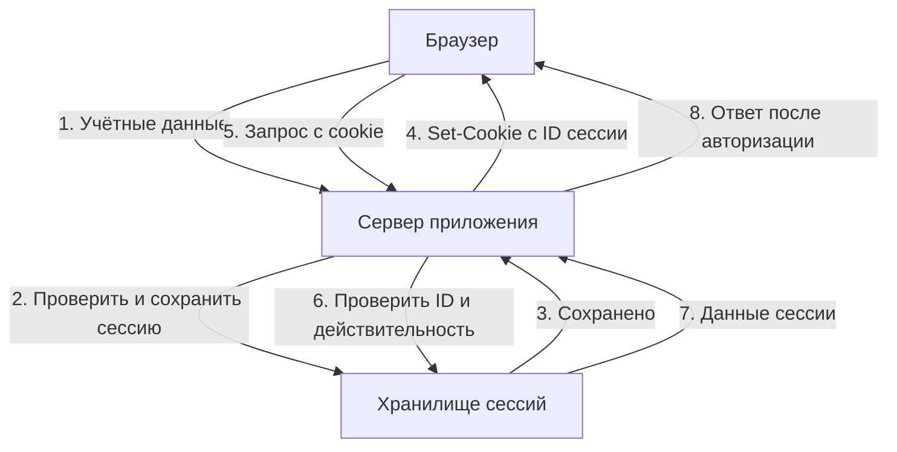
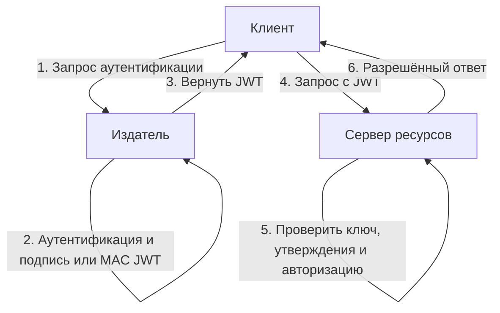
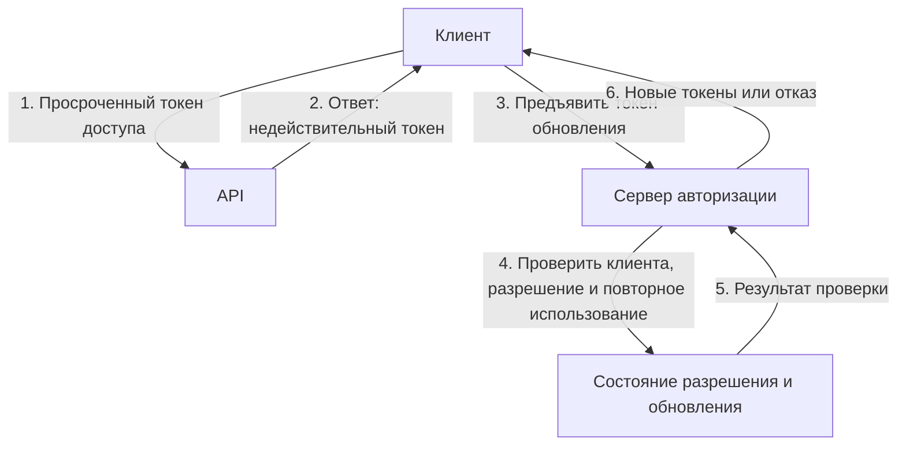

JWT — формат передачи утверждений (*claims*) между системами. Сам по себе его выбор не делает аутентификацию, авторизацию или управление сессиями безопасными. В статье разделены проектирование браузерных сессий входа и проверка и отзыв токенов API.

Прежде всего, **JWT — формат токена, а cookie — механизм хранения и передачи данных браузером**. В cookie можно передавать как JWT, так и случайный идентификатор сессии. Сравнение только «cookie или JWT» смешивает разные проектные решения.

## Как работают серверные сессии

Типичная схема после успешной аутентификации выдаёт непредсказуемый идентификатор сессии и хранит на сервере его связь с пользователем, сроком действия и другими данными. Браузер получает идентификатор в cookie. Схема предполагает HTTPS и не показывает атрибуты cookie и обработку ошибок.

Хранилище упрощает отзыв, выход из системы и изменение прав. Однако кэши или реплики, ещё не получившие информацию об удалении, могут задержать его действие. В распределённой системе нужно определить, какой сервер когда видит какую версию состояния.

Идентификаторы сессий обычно компактны и позволяют не раскрывать клиенту пользовательские данные. Украденный идентификатор всё же можно использовать во вред. Необходимы непредсказуемость, смена идентификатора при входе, срок действия, HTTPS, атрибуты cookie и защита от XSS и CSRF. Доступ к хранилищу также связан с нагрузкой, доступностью и эксплуатационными затратами, которые оценивают для нужного масштаба.

## JWT и локальная проверка

JWT представляет набор JSON-утверждений с использованием подписей или MAC JWS и/или шифрования JWE. Подпись с открытым ключом использует закрытый ключ издателя и открытый ключ проверяющей стороны; HMAC использует общий секрет. Далее речь в основном о самодостаточных JWT, защищённых подписью или MAC.

**Подписание — не шифрование.** Утверждения JWT, который только подписан, доступны для чтения: не помещайте туда секреты бездумно. Декодирование base64url также отличается от проверки действительности токена.

Локальная проверка с ключом доверенного издателя может позволить не обращаться к центральному хранилищу сессий при каждом запросе. Получение и обновление ключей, блокировка учётных записей, сведения об отзыве или актуальных правах всё же могут требовать связи или состояния. JWT не устраняет все обращения к базе данных и не гарантирует лучшую производительность.

Приложение должно определить разрешённые алгоритмы и ключи. Помимо криптографической проверки проверяйте издателя `iss`, целевой сервис `aud`, срок действия `exp`, при необходимости начало действия `nbf`, назначение токена и право выполнить запрошенную операцию. Требуйте утверждения согласно выбранному профилю. Общая спецификация JWT не делает даже `exp` обязательным во всех случаях. Для входа или управления доступом нужно явно определить и обеспечить политику срока действия.

## 1. Отзыв возможен, но требует проектирования

Сервер, проверяющий офлайн только криптографическую защиту и временные условия без обращения к дополнительному состоянию, не может узнать об отзыве отдельного токена или смене пароля после его выдачи. В такой схеме украденный действительный bearer-токен может оставаться пригодным до истечения срока. Удаление на клиенте не останавливает украденную копию.

Варианты включают короткие сроки, списки отзыва, номера версий пользователя или сессии и интроспекцию токенов. Аннулирование ключа подписи затрагивает и другие токены, выданные с этим ключом, и требует распространения изменений в кэши ключей и проверяющим сторонам. Короткий срок ограничивает время риска, но не заменяет немедленный отзыв отдельного токена.

Добавление состояния или связи само по себе не является неудачей. Проверка состояния в каждом API, только при обновлении и распространение событий отзыва имеют разные свойства. Выберите нужную скорость отзыва и эксплуатационные затраты. Отзыв токена обновления не обязательно аннулирует уже выданные токены доступа, которые API продолжают принимать по результатам локальной проверки.

## 2. Выбор алгоритмов и смешение назначений токенов

`alg: none` обозначает форму без подписи и MAC. Точка аутентификации или доступа, требующая подписанных токенов, не должна её принимать. Не позволяйте полученному `alg` менять политику проверки. RFC 8725 различает ненадлежащее принятие `none` и путаницу алгоритмов, при которой открытый ключ RSA используется как секрет HMAC.

Используйте поддерживаемую библиотеку и настройте разрешённые алгоритмы, соответствие ключей издателям, получателей и правила проверки каждого типа токена. Исключите принятие токенов другого назначения, например ID-токена вместо токена доступа к API. Нельзя в целом гарантировать безопасность или текущее состояние исправлений всех библиотек.

## 3. Хранение в браузере, XSS и CSRF

JavaScript того же источника (origin) может читать и `localStorage`, и `sessionStorage`. Поэтому XSS может раскрыть хранящиеся там bearer-токены. Более короткое время хранения в `sessionStorage` не препятствует чтению.

Cookie с `HttpOnly` запрещает JavaScript непосредственно читать его значение, но не предотвращает XSS в целом. Вредоносный код того же источника по-прежнему может выполнять аутентифицированные действия с cookie или читать полученную информацию.

Если cookie отправляются автоматически при соответствующих условиях браузера, учитывайте и CSRF. Установите `Secure`, подходящий `SameSite` и узкую область отправки; для действий, меняющих состояние, предусмотрите CSRF-токены или проверки Origin. Не считайте, что `SameSite` покрывает все случаи, и не меняйте состояние через GET. Это относится как к cookie с JWT, так и с идентификатором сессии. См. [объяснение XSS и CSRF](/ru/p/cross-site-scripting-xss-csrf-security/).

Хранение зависит и от архитектуры. Можно оставить API-токены на сервере, а с браузером работать через cookie сессии, не передавая ему эти токены. Выбор зависит от границ приложения и необходимых операций.

## 4. Токены обновления и расположение состояния

Токен обновления — один из способов получить новые короткоживущие токены доступа. Его выдача необязательна: применение JWT само по себе не требует такого токена. «15 минут» — пример срока, а не универсальное значение, предписанное стандартом.

Схема показывает вариант с управлением состоянием обновления. Защищайте токены обновления как секреты и определите обработку отзыва и повторного использования. RFC 9700 требует для токенов обновления публичных клиентов криптографической привязки к отправителю либо ротации. Ротация аннулирует предыдущий токен, сохраняя его связь с новым; реакция на обнаруженное повторное использование также входит в проектирование.

Это не означает обязательное хранение каждого токена в открытом виде в базе данных. Управляйте безопасным представлением и связанным состоянием, проверяя связь с пользователем, клиентом и предоставленной авторизацией (authorization grant). Можно управлять состоянием при обновлении, а токены доступа проверять локально в каждом API.

## Заключение: сравнивайте по назначению и требованиям

JWT полезен для передачи проверяемых утверждений между сервисами. Внутренняя сеть не оправдывает пропуск проверки издателя, получателя или прав. OAuth-токены доступа не ограничены форматом JWT. ID-токены OIDC, напротив, являются JWT и передают клиенту результат аутентификации. Нельзя подменять ими токены доступа к API.

JWT также не делает URL сброса пароля или подтверждения почты автоматически одноразовым. Нужны срок действия, ограничения получателя и назначения и учёт использования. Если требованиям отвечает простой случайный токен, JWT не нужен.

Для браузерных приложений с потребностью в быстром отзыве серверные сессии — отправная точка для сравнения. JWT тоже подходит в качестве кандидата, когда требуется локальная проверка между сервисами. Это решение по требованиям, а не утверждение, что один вариант всегда безопаснее или быстрее. Сравните допустимую задержку отзыва, актуальность информации, тип клиента, управление ключами, хранение, трафик и эксплуатационную нагрузку.

## Источники

- [RFC 7519: формат JWT и утверждения, §3–4](https://www.rfc-editor.org/rfc/rfc7519.html)
- [RFC 8725: проверка алгоритмов, издателя, получателя и назначения, §2.1 и §3](https://www.rfc-editor.org/rfc/rfc8725.html)
- [RFC 7009: проектирование отзыва OAuth-токенов, §3](https://www.rfc-editor.org/rfc/rfc7009.html)
- [RFC 9700: защита токенов обновления, §2.2.2 и §4.14](https://www.rfc-editor.org/rfc/rfc9700.html)
- [RFC 6749: токены доступа и обновления, §1.4–1.5](https://www.rfc-editor.org/rfc/rfc6749.html)
- [OpenID Connect Core 1.0: ID-токен, §2](https://openid.net/specs/openid-connect-core-1_0.html)
- [OWASP: сессии и атрибуты cookie](https://cheatsheetseries.owasp.org/cheatsheets/Session_Management_Cheat_Sheet.html)
- [OWASP: безопасность Web Storage](https://cheatsheetseries.owasp.org/cheatsheets/HTML5_Security_Cheat_Sheet.html)
- [OWASP: токены сброса пароля](https://cheatsheetseries.owasp.org/cheatsheets/Forgot_Password_Cheat_Sheet.html)
